This manual is the technical companion of the guide. The guide explains what catalyst is; this manual is for the
engineer who installs, operates and releases every part of it from nothing. It describes the fleet as it stands on
2026-10-31: kernel **0.119.2**, software-engineering module **3.4.1**, knowledge-base module **0.6.1**, catalyst-users
**0.10.0**, catalyst-kb-engine **0.16.0**, Catalyst Studio (catalyst-ui) **0.69.0**.

Every chapter cites its sources as `cantica-tech/<repository>:<path>`, so a statement can be checked against the code.
Where a chapter says "not verified", the behaviour was read from the code but not run.

## Contents

1. [The fleet at a glance](#1-the-fleet-at-a-glance)
2. [How the parts depend on each other](#2-how-the-parts-depend-on-each-other)
3. [The deployment runbook, from a bare machine](#3-the-deployment-runbook-from-a-bare-machine)
4. [Releasing: the order of a fleet release](#4-releasing-the-order-of-a-fleet-release)
5. [How-to index](#5-how-to-index)
6. [The chapters](#6-the-chapters)

## 1. The fleet at a glance

| Repository | What it is | Language | Branches and tags | Governed by catalyst |
|---|---|---|---|---|
| `cantica-tech/catalyst` | The kernel: the `catalyst` CLI (`dist/catalyst.pyz`), the framework texts (`framework/kernel/`), the agent adapters (`agents/`), the MCP server (`catalyst mcp`) | Python ≥ 3.11 | `development` → `main` → `release`; tags `X.Y.Z` (older ones `vX.Y.Z`) | yes, module SE |
| `cantica-tech/catalyst-software-engineering` | Process module **SE**: requirements, steps, bugs, features, tests, decisions, roadmap | Markdown + YAML (+ UI `.tsx`) | `development` → `main`; tags on `main` | no |
| `cantica-tech/catalyst-knowledge-base` | Process module **KBM**: knowledge bases, sources, builds, classification | Markdown + YAML | `main` only; tags on `main` | yes, module SE |
| `cantica-tech/catalyst-users` | CLI facade to an identity provider (Keycloak built in), the system account, roles and groups; the local Keycloak (`compose.yaml`) | Python | `development` → `main`; tags | yes, SE + KBM |
| `cantica-tech/catalyst-mcp` | MCP server over the catalyst CLI and catalyst-users; deny-by-default, one group per criterion | Python | `development` → `main` | yes, SE |
| `cantica-tech/catalyst-kb-engine` | The knowledge-base build engine (Pydantic AI): reads sources, builds folders and vector builds (`kbm-build/1`), search, MCP search, site generation | Python | `development` → `main`; tags | yes, SE |
| `cantica-tech/catalyst-docs` | catalyst's documentation as a knowledge base: the guide, this manual, the public site on GitHub Pages and its vector database | Markdown, MkDocs | `development` → `main` | yes, KBM |
| `cantica-tech/catalyst-ui` | **Catalyst Studio**: VS Code extension, desktop app (Electron), the Studio SPA, the core runtime | TypeScript, Node ≥ 20 | `development` → `main` → `release`; tags `X.Y.Z` | yes, SE |
| `cantica-tech/standards` | Shared code standards and the shared lint workflow (pinned ruff, eslint) | — | tags | — |
| `cantica-tech/cantica-tech` | The distribution repository: released kernel zips and `catalyst.pyz` (`catalyst/kernel/v<ver>/`), module zips (`catalyst/modules/`), VS Code `.vsix` (`catalyst/vsix/`) | — | `main` | — |

Each governed project's **criterion** — its rules, artifacts and journal — lives outside the project, at
`$HOME/.catalyst/projects/<name>/criterion`, and is shared through its own private git repository, on the branch
`criterion`. The only file catalyst adds to a project is `catalyst.toml`, which names the criterion and never holds a
path.

The split between a project, its criterion in catalyst's home and the criterion's private repository looks like this:

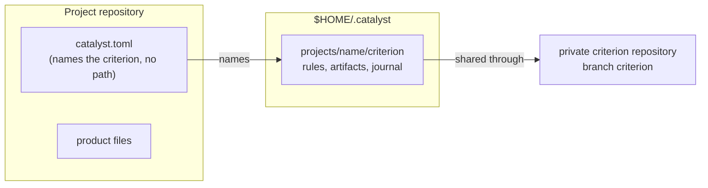

## 2. How the parts depend on each other

The fleet's components and the way they call each other:

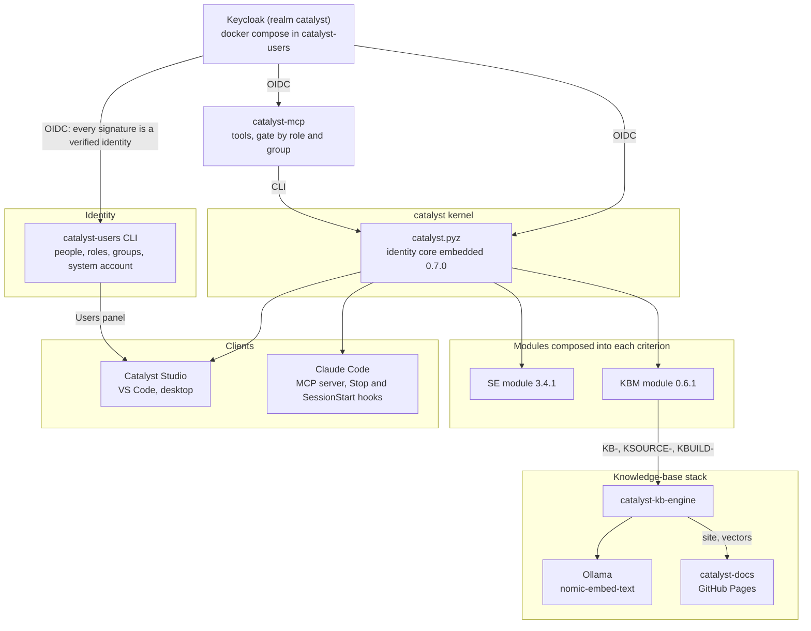

Hard dependencies, in the order they bite:

1. **Every write needs a verified identity.** `catalyst init` and every command that journals refuse to run without
   either a logged-in person or the machine's system account, both verified against the identity provider. So
   Keycloak (or another provider) comes before any deployment. If it is down, writes fail; there is no offline
   signing. See [50 §4](50-identity-users-mcp.md) and [10 §12](10-architecture-kernel.md).
2. **A module is required at install** (or `--no-module`, adding one later). SE needs kernel ≥ 0.83.0, KBM ≥ 0.107.0.
3. **The Studio needs a kernel** ≥ 0.54.0 (≥ 0.64.0 for the Studio views), the criterion readied with `catalyst open`,
   and catalyst-users ≥ 0.9.0 for the Users panel and the password login.
4. **catalyst-kb-engine needs** the catalyst CLI for anything it records, KBM in the knowledge base's criterion, and
   Ollama with `nomic-embed-text` for vector builds.
5. **The desktop app's release build** downloads `catalyst.pyz` from `cantica-tech/cantica-tech:catalyst/kernel/v<ver>/`,
   so that kernel must be published first.

The same five dependencies, with the minimum versions, as a graph (an arrow reads "is needed by"):

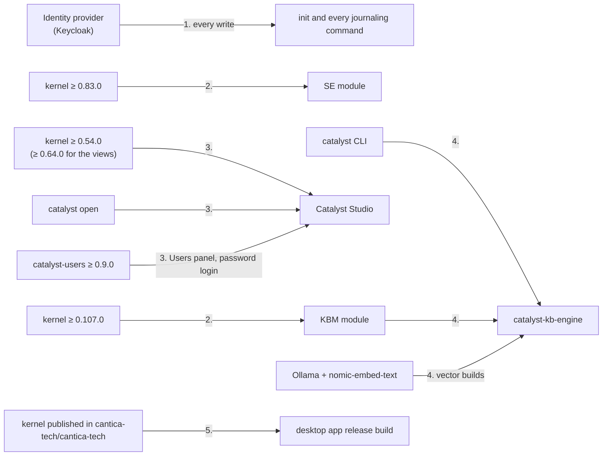

## 3. The deployment runbook, from a bare machine

Each step says what it achieves. The detailed procedure, with what each command writes, how to verify it and how
it fails, is in the chapter named on the step.

The steps depend on each other as follows; an arrow means "must be done before":

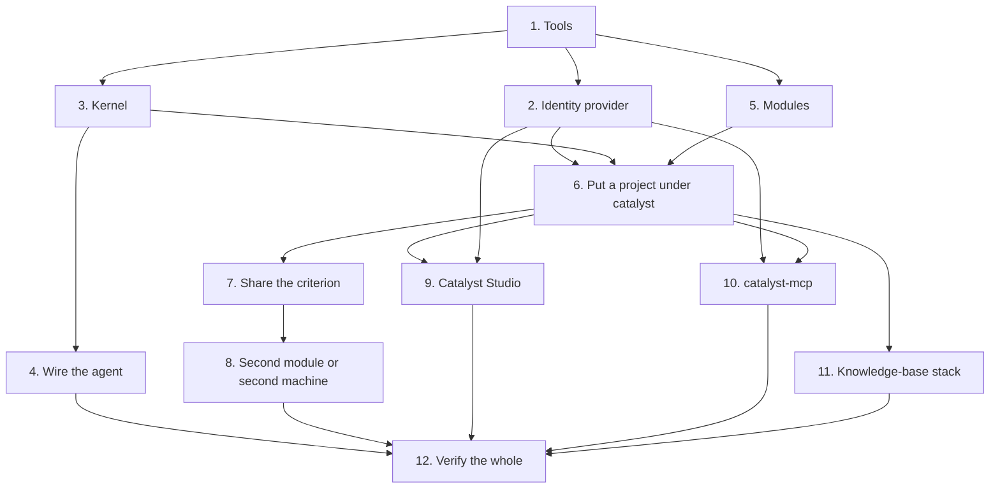

### Step 1 — Tools (all chapters)

| Tool | Version | Why |
|---|---|---|
| git | any recent | criteria are git repositories; the journal pins blobs in git |
| Python | ≥ 3.11 (3.12 or 3.13 fine) | the kernel, catalyst-users, catalyst-mcp, catalyst-kb-engine |
| uv | recent | per-criterion runtimes (`<criterion>/.venv`), the Python projects |
| go-task (`task`) | 3.x | the repositories' `Taskfile.yml` |
| gh | logged in, `cantica-tech` access | private criterion repositories, pull requests, branch protection |
| Docker or Podman | with compose | the local Keycloak |
| Node.js | ≥ 20 (CI uses 24) | catalyst-ui |
| VS Code | ≥ 1.85, `code` on PATH | the extension |
| Ollama | with `nomic-embed-text` | vector builds and search |
| Claude Code | `claude` on PATH | the agent catalyst wires itself into |
| An SSH key | registered on GitHub | cloning and pushing criteria |

Achieves: every later command can run. Verify with `git --version`, `python3 --version`, `uv --version`,
`task --version`, `gh auth status`, `docker compose version`, `node --version`, `ollama list`.

### Step 2 — The identity provider ([50 §7](50-identity-users-mcp.md))

1. Clone `cantica-tech/catalyst-users`; `docker compose up -d` starts Keycloak 26.4.0 on `127.0.0.1:8080` and imports
   the realm `catalyst` (clients, roles, groups) from `keycloak/`. Its data lands in `.keycloack/data` (sic).
2. Create the realm's first administrator (`keycloak/set_admin.py` on macOS, `kcadm.sh` elsewhere).
3. `catalyst-users setup --criterion <project>` writes `$HOME/.catalyst/users/IAM/settings.json`, which defines the
   machine's **system account** — the identity unattended work signs as.
4. `catalyst-users login`, then `catalyst-users roles provision keycloak/catalyst-roles.json --login-client catalyst-cli
   --login-client catalyst-admin-cli` creates the roles that grant catalyst commands.

The four sub-steps, between the operator, catalyst-users and Keycloak:

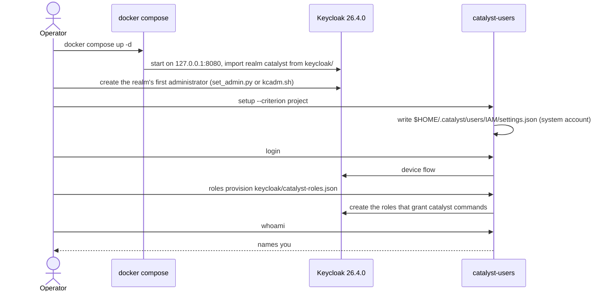

Achieves: catalyst can verify who signs. Verify: `curl -s http://localhost:8080/realms/catalyst/.well-known/openid-configuration`
answers; `catalyst-users whoami` names you.

### Step 3 — The kernel ([20 §3–§5](20-deploy-kernel.md))

Either take a release from `cantica-tech/cantica-tech` (`catalyst/kernel/v0.119.2/`: `kernel-v0.119.2.zip` and
`catalyst.pyz`), or clone `cantica-tech/catalyst` at the tag and `task build:cli` to make `dist/catalyst.pyz`.
The first `init` (or `catalyst runtime install`) creates the launcher `$HOME/.catalyst/bin/catalyst`, which runs each
project's own criterion runtime; put `$HOME/.catalyst/bin` on PATH.

The two ways to obtain the kernel converge on the same launcher:

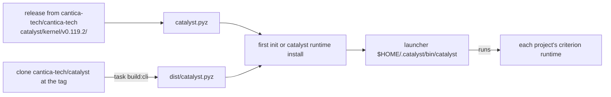

Achieves: one `catalyst` command that always runs the kernel version each project is deployed at.

### Step 4 — Wire the agent, once per machine ([30 §4](30-cli-catalyst.md))

`catalyst agent install claude-code` registers, at user level, the `catalyst mcp` server (the §4 commands as prompts
`/catalyst:<name>`, and the `catalyst` and `command` tools), the Stop hook (`catalyst hook stop`) and the silent
session-start hook (`catalyst hook start --quiet`). Nothing goes into any project. Verify: `claude mcp list` shows
`catalyst`.

What the one command registers, all at user level:

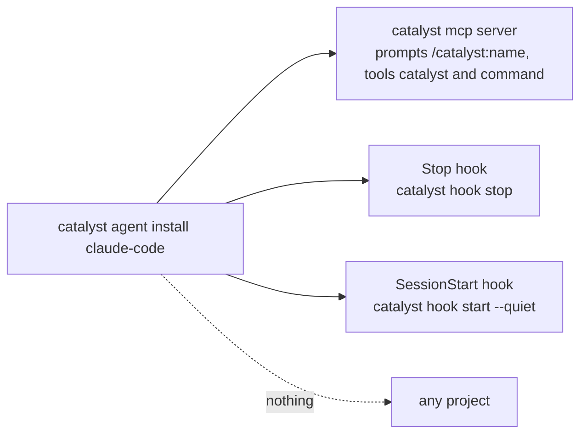

### Step 5 — Modules ([40 §5](40-modules.md))

Get SE and, if wanted, KBM: a sibling checkout named `catalyst-<id>` at its tag, a release zip from
`cantica-tech/cantica-tech:catalyst/modules/`, or a git URL with `@tag`.

### Step 6 — Put a project under catalyst ([20 §7–§9](20-deploy-kernel.md), [30 §3](30-cli-catalyst.md))

From the project's root, logged in (`catalyst identity login`) or with the system account available:

```sh
catalyst init --kernel <kernel zip or framework/kernel> --name <name> --module software-engineering \
  --git-username <u> --rule-doc <file>:<prefix> --agent claude-code
```

Achieves: the criterion at `$HOME/.catalyst/projects/<name>/criterion` with the composed documents
(`CODE-OF-CONDUCT.md`, `rules/Rules-of-Rules.md`, `ACCESS-CONTROL.md`, `Taskfile.common.yml`), the deployment ledger,
the journal, its `.venv`, and `catalyst.toml` in the project. Then the judgment steps of `BOOTSTRAP.md` §2: domains and
rules, roles, the README, first artifacts, `catalyst check`. Commit `catalyst.toml` only on the owner's yes.

The install runs between the operator, the CLI and the identity provider; the project gains one file:

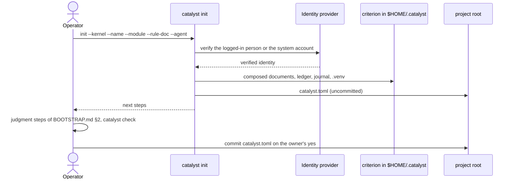

### Step 7 — Share the criterion ([20 §10](20-deploy-kernel.md))

Create an empty **private** repository (by convention `<project>-criterion`), then
`catalyst share create <url> --protect`: it prints its plan and exits **3** (asking); re-run with `--yes` once the owner
agrees. It pushes the branch `criterion`, protects it where the plan allows, and stages `repoed`, the URL and the branch
in `catalyst.toml` — commit that too.

The exit-3 assent gate decides whether anything leaves the machine:

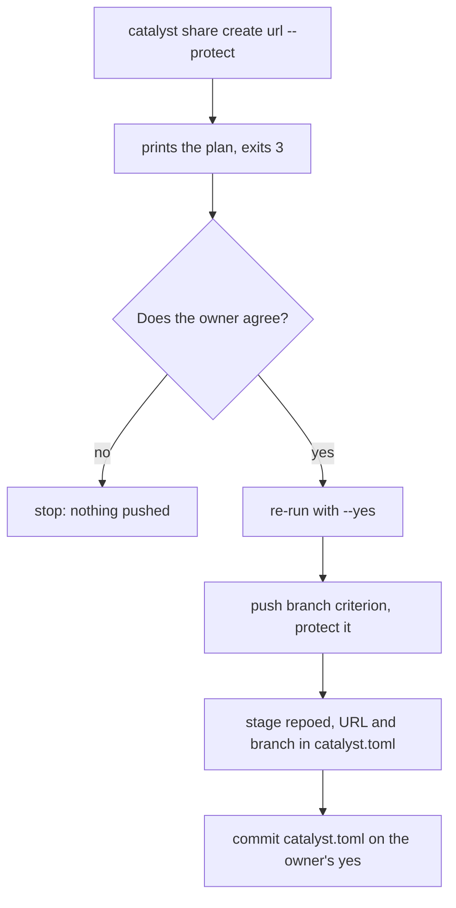

### Step 8 — A second module, or a second machine ([40 §5](40-modules.md), [20 §11](20-deploy-kernel.md))

- A second module: `catalyst module install <src> --kernel <deployed kernel>`, then `module verify`, `catalyst check`.
- A second machine: clone the project, `catalyst open` (clones the criterion into the home, fetches journal pins, fills
  the runtime), `catalyst identity login`.

Joining from a second machine:

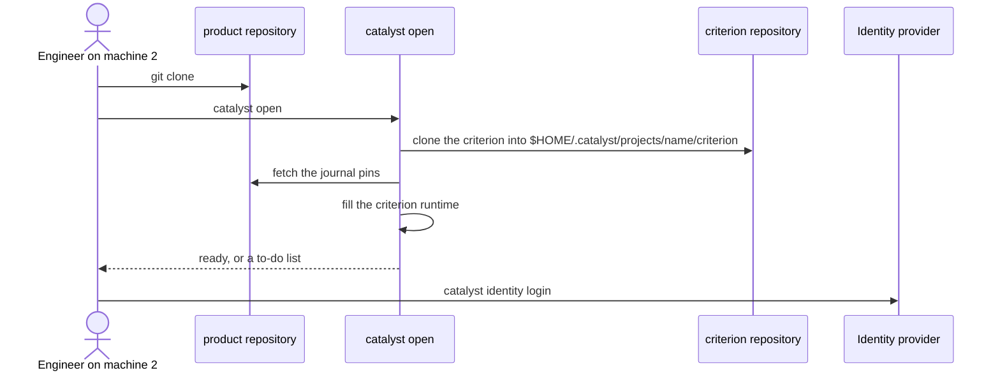

### Step 9 — Catalyst Studio ([70 §6](70-catalyst-ui.md))

Install the `.vsix` from `cantica-tech/cantica-tech:catalyst/vsix/` or the Marketplace, or build it:
`npm ci`, `npm run typecheck`, `npm run build -w catalyst-studio`, `task build:vscode-extension`,
`task install:vscode-extension`. Set `catalyst.iam.command` to the catalyst-users command for the Users panel.

The three ways to get the extension:

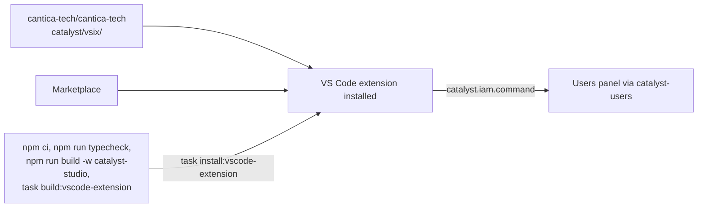

### Step 10 — catalyst-mcp ([50 §8](50-identity-users-mcp.md))

`uv sync` in `cantica-tech/catalyst-mcp`, `catalyst-users login`, then register it in the MCP client
(`claude mcp add-json -s user …` with `CATALYST_MCP_CATALYST_ROOT`). Writes are allowed only over stdio and only to
callers whose roles and criterion groups grant them.

catalyst-mcp's decision on each call:

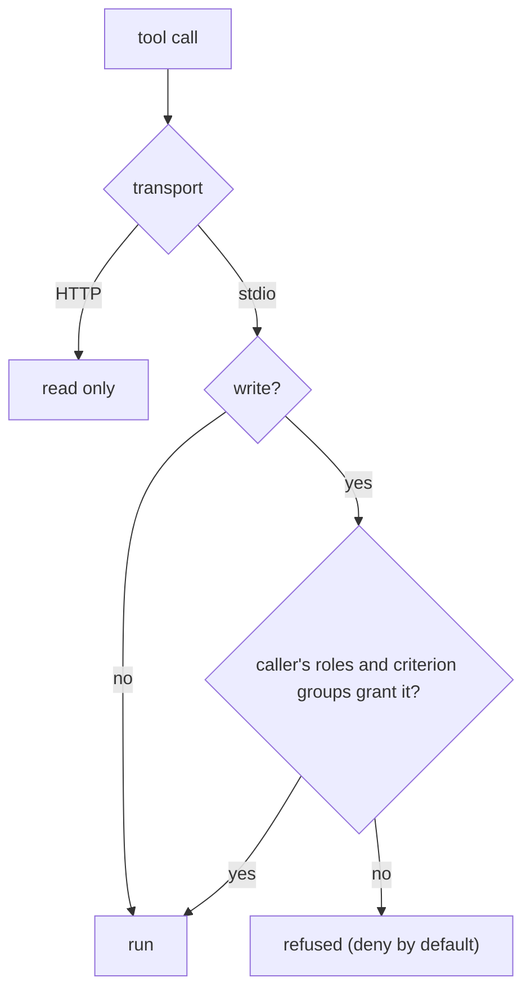

### Step 11 — The knowledge-base stack ([60 §7](60-knowledge-base-stack.md))

`ollama pull nomic-embed-text`; install the engine from its tag
(`uv tool install "catalyst-kb-engine[vectors,openai,search,mcp,serve] @ git+https://github.com/cantica-tech/catalyst-kb-engine@0.16.0"`
— it is not on PyPI); onboard a knowledge base with KBM's `/kb-setup`; `read-sources`, `build-folders`,
`build-vectors`, `search`. For catalyst-docs: Pages deploys from GitHub Actions on each push to `main` and daily; then
`catalyst-kb-engine record-site https://cantica-tech.github.io/catalyst-docs/` records what it serves.

The knowledge-base pipeline, from onboarding to the published site:

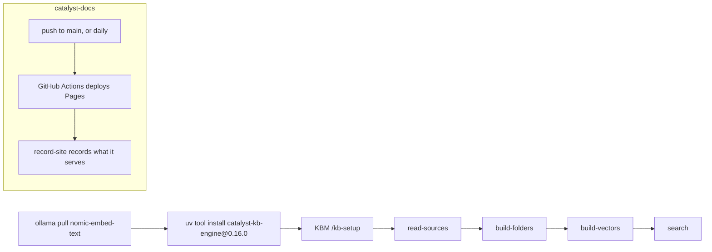

### Step 12 — Verify the whole

In every project: `catalyst where`, `catalyst open`, `catalyst check`, `catalyst journal verify`,
`catalyst unrecorded`, `catalyst module verify`. In the Studio: the Instances view lists each project. For the
knowledge base: `catalyst-kb-engine search --build <dir> "<question>"` answers with cited passages.

## 4. Releasing: the order of a fleet release

The kernel and Catalyst Studio use three branches; work lands on `development`, each version is integrated into
`main` by a pull request, then into `release`, where the tag is made:

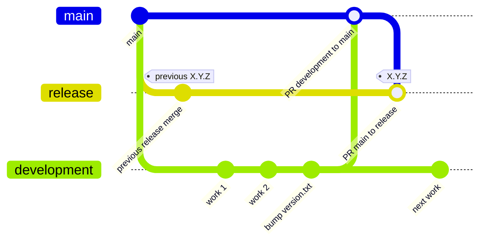

The modules have no `release` branch: they tag on `main` (KBM has `main` only; SE integrates from `development`):

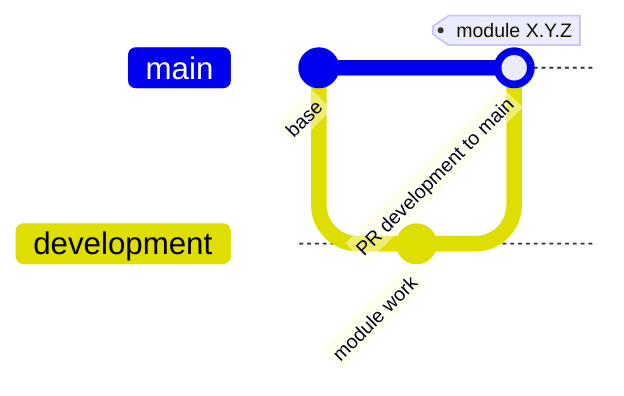

1. **Kernel**: PR `development` → `main`, then `main` → `release`; tag `X.Y.Z` on `release`; publish from a worktree at
   the tag (the publish script refuses any other checkout) to `cantica-tech/cantica-tech:catalyst/kernel/v<ver>/`.
   Before pushing: ruff check and format `--check`, repo-wide, `--no-cache`, at CI's pinned version; the kernel purity
   scan (`scripts/check_kernel_purity.py`), which also reads `CHANGELOG.md` — name no module and no product there.
2. **Modules**: tag on `main`; `scripts/package_release.py --publish-dir <cantica-tech checkout> --push` packages each
   catalogued module's working tree, so check out the tag first.
3. **Deployments**: in each governed project, `catalyst sync plan`, `catalyst sync apply --kernel <new zip>`,
   `catalyst migrate`, then `catalyst check`, `journal verify`; share through a PR on the criterion. On a shared
   criterion the kernel goes in before a module that needs it.
4. **Catalyst Studio**: sync `packages/catalyst-core/spec` to the new kernel (`npm run spec:sync -w catalyst-core --
   <catalyst checkout> <ver>`; a test fails while the two disagree), a **clean** build (remove `dist/` and
   `*.tsbuildinfo` — local checks can pass on stale build info), PRs to `main` and `release`, a GitHub release tagged
   `X.Y.Z` (the Desktop workflow attaches the installers), `task release:vsix:publish PUBLISH_DIR=<cantica-tech
   checkout>`; the Marketplace only when the owner asks.
5. **catalyst-docs**: bump the engine pin in `.github/workflows/pages.yml` when the engine changes; `record-site` after
   each deployment.

The release order as a flow, with the checks that gate each stage:

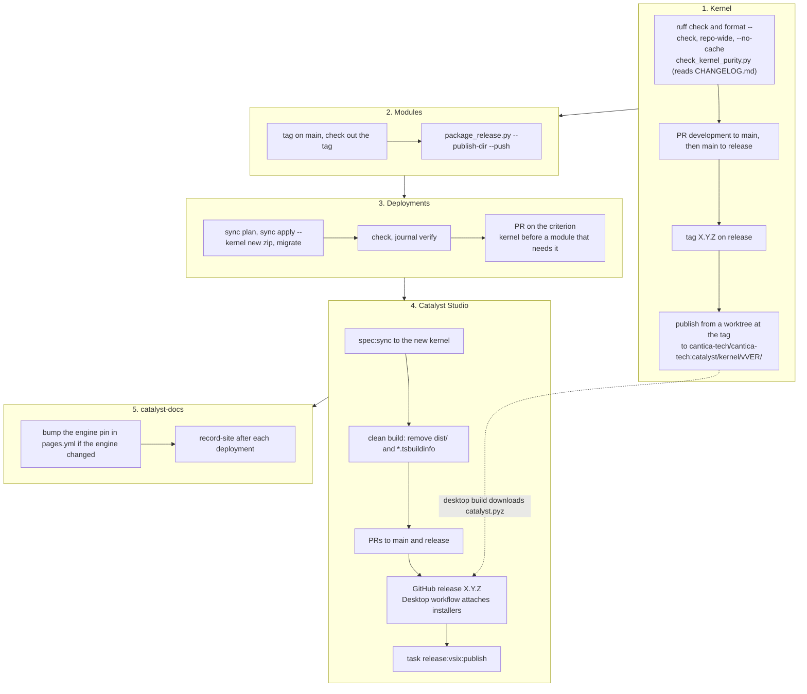

## 5. How-to index

| I want to… | Where |
|---|---|
| Put an existing project under catalyst | [20 §7](20-deploy-kernel.md) |
| Join a criterion on another machine | [20 §11](20-deploy-kernel.md) |
| Upgrade a deployment to a new kernel or module | [20](20-deploy-kernel.md), [40 §6](40-modules.md) |
| Adopt changes made outside catalyst | [30 §7](30-cli-catalyst.md) (`journal adopt`) |
| Understand why a command exited 3 | [30 §2](30-cli-catalyst.md) |
| Run a feature end to end (FEAT → REQ → STEP → close) | [40 §3](40-modules.md) |
| Add a person, grant a role on a criterion | [50 §10](50-identity-users-mcp.md) |
| Recover when Keycloak is down | [50 §11](50-identity-users-mcp.md) |
| Back up and restore Keycloak | [50 §9](50-identity-users-mcp.md) |
| Build a knowledge base from GitHub repositories | [60 §8](60-knowledge-base-stack.md) |
| Query a vector build | [60 §8](60-knowledge-base-stack.md) |
| Build and install the VS Code extension | [70 §6](70-catalyst-ui.md) |
| Release the Studio | [70 §7](70-catalyst-ui.md) |
| Know what will surprise me | [80](80-oddities.md) |

## 6. The chapters

| Chapter | Contents |
|---|---|
| [10 — Kernel architecture](10-architecture-kernel.md) | Concepts, laws and their enforcement, package map, on-disk layouts, journal, ledgers, sharing, runtimes, agents, composition, migrations, release pipeline |
| [20 — Deploying the kernel](20-deploy-kernel.md) | Every step from a bare machine to a shared, verified deployment; second machine; upgrades; rollback |
| [30 — The `catalyst` CLI](30-cli-catalyst.md) | Every command, subcommand and option; exit codes; files touched; the §4 slash commands; the repository's own tooling |
| [40 — Modules](40-modules.md) | The module contract; SE and KBM in full; install, upgrade, release |
| [50 — Identity and catalyst-mcp](50-identity-users-mcp.md) | catalyst-users, Keycloak, signing, catalyst-mcp |
| [60 — The knowledge-base stack](60-knowledge-base-stack.md) | catalyst-kb-engine, catalyst-docs |
| [70 — Catalyst Studio](70-catalyst-ui.md) | catalyst-ui's packages, tasks, build, release |
| [80 — Oddities](80-oddities.md) | Every sharp edge, by component |
| [90 — Next steps](90-next-steps.md) | The forward plan, by component |
