Hand-off reference for the catalyst kernel (GitHub `cantica-tech/catalyst`, kernel **0.119.2**, on-disk format **1.0-rc**), its CLI, its on-disk formats, and how it is built, released and distributed. Its companion, `20-deploy-kernel.md`, gives the install and operate procedure.

Sources are cited as `cantica-tech/<repo>:<path>`. Where this document says "observed", the fact comes from a throwaway install made for this documentation (release kernel 0.119.2 + `software-engineering` 3.4.1, taken from the distribution repository, with a sandboxed `HOME`). Paths in catalyst's home are written as `$HOME/.catalyst/...` (or `$CATALYST_HOME/...`).

---

## Table of contents

1. [What catalyst is, in one page](#1-what-catalyst-is-in-one-page)
2. [Glossary of the core concepts](#2-glossary-of-the-core-concepts)
3. [The ten laws and the invariants: how each is enforced](#3-the-ten-laws-and-the-invariants-how-each-is-enforced)
4. [Repositories of the kernel side of the fleet](#4-repositories-of-the-kernel-side-of-the-fleet)
5. [The source repository layout (`cantica-tech/catalyst`)](#5-the-source-repository-layout-cantica-techcatalyst)
6. [The Python package: module map](#6-the-python-package-module-map)
7. [On-disk layout: project, catalyst home, criterion](#7-on-disk-layout-project-catalyst-home-criterion)
8. [`catalyst.toml`, the project file](#8-catalysttoml-the-project-file)
9. [Kernel, modules and composition](#9-kernel-modules-and-composition)
10. [Rules, rule documents, prefixes, domains](#10-rules-rule-documents-prefixes-domains)
11. [Artifacts, entity types (ETDs) and IDs](#11-artifacts-entity-types-etds-and-ids)
12. [Identity and signing (catalyst-users, Keycloak)](#12-identity-and-signing-catalyst-users-keycloak)
13. [The journal: shards, entries, pins, verify, adopt, redact](#13-the-journal-shards-entries-pins-verify-adopt-redact)
14. [The signers ledger and the deployment ledger](#14-the-signers-ledger-and-the-deployment-ledger)
15. [Sharing: drivers, the criterion repository, branch, CI gate, `repoed`](#15-sharing-drivers-the-criterion-repository-branch-ci-gate-repoed)
16. [Runtimes, the launcher and the per-criterion `.venv`](#16-runtimes-the-launcher-and-the-per-criterion-venv)
17. [Agents: hooks (start/stop, ADR-002), the MCP server, adapters](#17-agents-hooks-startstop-adr-002-the-mcp-server-adapters)
18. [Composed documents: CODE-OF-CONDUCT.md, Rules-of-Rules.md, Taskfile.common.yml](#18-composed-documents)
19. [Projects vs workspaces](#19-projects-vs-workspaces)
20. [Format versions, migrations, sync](#20-format-versions-migrations-sync)
21. [Data flows (diagrams)](#21-data-flows-diagrams)
22. [Build, release and distribution pipeline](#22-build-release-and-distribution-pipeline)
23. [CI workflows](#23-ci-workflows)
24. [Known inconsistencies in the sources](#24-known-inconsistencies-in-the-sources)

---

## 1. What catalyst is, in one page

catalyst is a **persistent, verifiable project memory** for codebases developed with AI coding agents (`cantica-tech/catalyst:README.md`). For each governed project it keeps:

- **documented rules**, grouped in **domains**;
- **artifacts** (the units of work: requirements, bugs, steps…, as defined by a *process module*) that trace down to rules;
- an **append-only journal** that records every change: who made it, why, which rules it serves, and the git blob hash of each file before and after.

The record lives in a **criterion**. A criterion is a git repository kept in catalyst's home (`$HOME/.catalyst/projects/<name>/criterion`), never inside the project. The only thing the project carries is `catalyst.toml`, which names the criterion and pins versions.

A stdlib-only Python CLI (`catalyst`, shipped as a single-file zipapp `catalyst.pyz`) does every mechanical step: allocating IDs, signing, writing the journal, regenerating indexes, checking the chain, sharing, and syncing versions. The agent (Claude Code is the only tested one) keeps the judgment: which rule, what intent, whether two rules conflict.

The **kernel** is process-agnostic. A **process module** (a separate repository, e.g. `cantica-tech/catalyst-software-engineering`) supplies the entity types and commands. People and their rights live in **catalyst-users** (`cantica-tech/catalyst-users`), a facade to an identity provider (Keycloak built in). The criterion stores no user registry.

How the kernel, a process module, catalyst-users and the agent share the work:

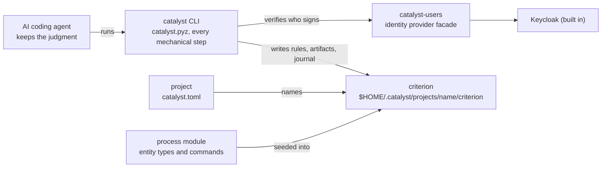

The core chain (`cantica-tech/catalyst:README.md`):

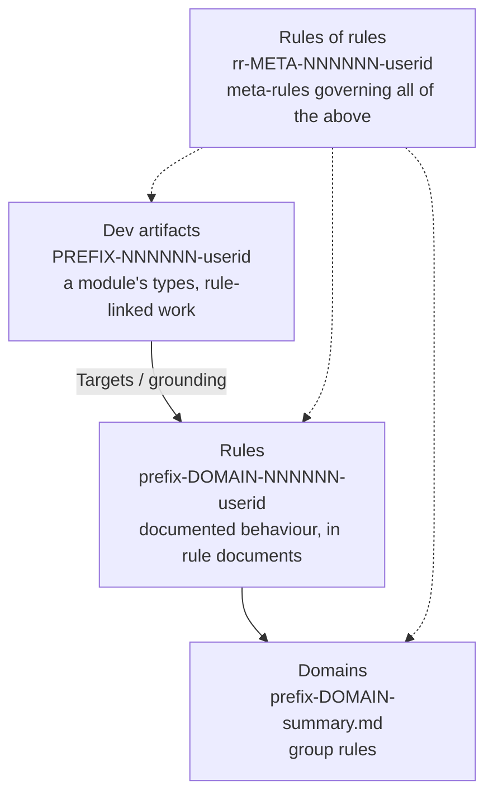

At commit granularity, every product commit cites an artifact or rule ID that resolves in the deployment, or its subject starts with `chore:` (INV-5).

---

## 2. Glossary of the core concepts

| Term | Meaning | Where specified |
|---|---|---|
| **project** | A product repository (or subfolder) governed by catalyst: the directory holding `catalyst.toml` (the *project root*). | `framework/kernel/FORMAT.md` §1 |
| **criterion** (or working copy) | The project's governance record: its own git repository at `$CATALYST_HOME/projects/<project_name>/criterion`. In the journal and in documents, `.criterion/<path>` names a criterion file; this is a namespace, not a directory in the project. | `FORMAT.md` §2, INV-6 |
| **catalyst home** | `$CATALYST_HOME`, default `$HOME/.catalyst`. Holds criteria, runtimes, the launcher, identity tokens, the machine id and catalyst-users' settings. | `scripts/project_file.py` `home()` |
| **kernel** | `framework/kernel/` plus the CLI. Versioned by the root `version.txt` (0.119.2). It never names a module (INV-30). | INV-3, INV-30 |
| **process module** | A repository `catalyst-<id>` that ships entity types (ETDs), templates, definitions, meta-rules, commands, invariants and migrations. It is seeded into `criterion/modules/<id>/`. | `framework/kernel/MODULE-SPECIFICATION.md` |
| **ETD** | Entity Type Definition: a YAML file declaring a type's prefix, folder, fields, grounding and workflow. | `MODULE-SPECIFICATION.md` §4 |
| **rule document / prefix** | A Markdown file under `rules/` holding rules; each has a short lowercase ID prefix (e.g. `br`, `env`, `fw`). | `FORMAT.md` §5 |
| **domain** | A group of rules (`rules/domains/<prefix>-<DOMAIN>-<summary>.md`), registered in `rules/domains/domains.md`. It must exist before its rules. | `FORMAT.md` §5.4 |
| **userid** | 8 characters `[A-Za-z0-9]` with at least one uppercase letter, drawn at an identity's first signature. It ends every ID that identity creates. | INV-26 |
| **journal** | Append-only JSONL, sharded `development/journal/<actor>@<machine>/<YYYY-MM>.jsonl`. | INV-17, `FORMAT.md` §7 |
| **signers ledger** | `IAM/signers.jsonl`, one line per identity that ever signed (issuer+subject → userid). | `FORMAT.md` §6 |
| **deployment ledger** | `.ledger/<task>.todo.md`, the agent's install/analysis checklist (anti-drift). It is not part of the format. | `BOOTSTRAP.md` §3 |
| **repoed** | `catalyst.toml` flag, `true` once the criterion is published to a criterion repository. | INV-18 |
| **shared branch** | The criterion repository's integration branch, `criterion_branch`, default `criterion`. | `CLI.md` `catalyst criterion` |
| **tier** | The ceremony level of a change: `chore` (no artifact, `chore:` commit prefix), `fix`, `feature`. A module may redefine them. | rr-META-006, `scripts/catalyst/tiers.py` |
| **RECON-** | Kernel entity: a reconciliation case for a conflict or proposal, decided by a human. | INV-21 |
| **WORKFLOW-** | Kernel entity: a process definition. It can govern a type's state moves. | INV-24 |
| **ANALYSIS-** | Kernel entity: a four-eyes analysis run of existing code. | `ANALYSIS-PLAYBOOK.md` |
| **landing policy** | `IAM/landing.json`: how accepted changes reach the criterion repository (grouping, review, merge). | design 33, migration 0.116.0 |
| **workspace** | A VS Code `*.code-workspace` whose member projects share a meta criterion in `$CATALYST_HOME/workspaces/<name>/criterion`. | `CLI.md` `catalyst workspace` |
| **legacy deployment** | A pre-0.48 shape: `<name>.catalyst` JSON pointer plus a `.criterion` symlink, directory or submodule in the project. It is read for one minor and moved with `catalyst move --to-home`. | INV-6 |

---

## 3. The ten laws and the invariants: how each is enforced

`framework/kernel/INVARIANTS.md` opens with ten **laws**, which an agent judges for itself. A marker `<!-- catalyst: end of the session brief -->` follows them. After the marker come the numbered **invariants**, each mapped to its law and to its enforcer. A session loads only the laws; `catalyst why <L1…L10|INV-n|rr-META-n|ID>` explains the rest. A module may add up to three laws (e.g. `SE-L1`, in its `INVARIANTS.module.md`).

| Law | Summary | Main enforcer |
|---|---|---|
| L1 | Record every change as it happens | journal, `journal verify`, `unrecorded`, Stop hook |
| L2 | Ground every change (artifact → rule → domain; commits cite an ID or are `chore:`) | `validate`, `trace`, `hook commit-msg` |
| L3 | Assent before push | every publishing command exits **3** without `--yes` |
| L4 | Humans decide, agents do the work (RECON- cases, verified signer) | `catalyst reconcile` role gate, signer verification |
| L5 | The criterion lives outside the project | `where`, `open`, `check` |
| L6 | Never hand-edit generated or frozen files | `check` (index drift, derived fields), `sync` never overwrites definitions |
| L7 | IDs are permanent, signed with the creator's userid; signers ledger never rewritten | `id next`, `check`, `criterion integrity` |
| L8 | Install, sync, share only when asked | explicit verbs only (`init`, `sync apply`, `share`) |
| L9 | Kernel knows no module; modules know no other module or agent | `scripts/check_kernel_purity.py` in CI, `module install` collision checks |
| L10 | Report honestly; say "catalyst"; name repositories, never local paths | — (judgment) |

Invariant → enforcer table (from `INVARIANTS.md`):

| Invariant | Law | Enforced by |
|---|---|---|
| INV-1 repo-scoped references | L10 | — |
| INV-2 install only when asked | L8 | `catalyst init` is an explicit verb |
| INV-3 name it "catalyst" | L10 | — |
| INV-4 assent before push | L3 | exit 3 without `--yes` |
| INV-5 chain | L2 | `validate`, `trace`, `hook commit-msg` |
| INV-6 criterion outside the project | L5 | `where`, `open`, `check` |
| INV-7 descriptive naming (`<id>-<summary>.md`) | L6 | `check` (structure) |
| INV-8 no orphan rules (every rule in `rules/rules.md`) | L2 | `check` |
| INV-9, 14, 15, 27, 28 | — | owned by the active module |
| INV-10–13, 22 | — | retired with the plugin system (ADR-022) |
| INV-16 people from catalyst-users; grants enforced | L7, L4 | `check`, every writing verb |
| INV-17 journal | L1 | journal, `journal verify`, `unrecorded`, Stop hook |
| INV-18 shared deployments | L3, L4 | `share`, criterion CI gate, `criterion integrity` |
| INV-19 project lifecycle | — | retired (0.52.0) |
| INV-20 uniform artifact-type layout | L6 | `check` |
| INV-21 reconciliation | L4 | `catalyst reconcile` (levels full/propose/none) |
| INV-23 frozen definitions | L6 | `sync` never overwrites; `definition migrate` |
| INV-24 workflow entity | — | `check` |
| INV-25 act without asking (routine local writes) | — | — |
| INV-26 signed IDs | L7 | `id next`, `check` |
| INV-29 atomic, real-time updates | L1 | journal, Stop hook |
| INV-30 module-agnostic kernel; modules compose | L9 | `check_kernel_purity.py`, `module install`, CI installs the second module alone and beside another |

Enforcement happens in four places:

1. **The CLI's verbs** refuse (exit 1) or ask (exit 3).
2. **`catalyst check`** reports structure, chain, journal, unrecorded changes, index freshness and (on a merge HEAD) integrity.
3. **The agent hooks** run `hook start` and `hook stop`; the latter blocks the end of a turn on new failures.
4. **git-level gates**: the product's `commit-msg` hook, `catalyst trace` in the product CI, and the criterion repository's `catalyst` workflow behind branch protection.

The four places, by when they act on a change:

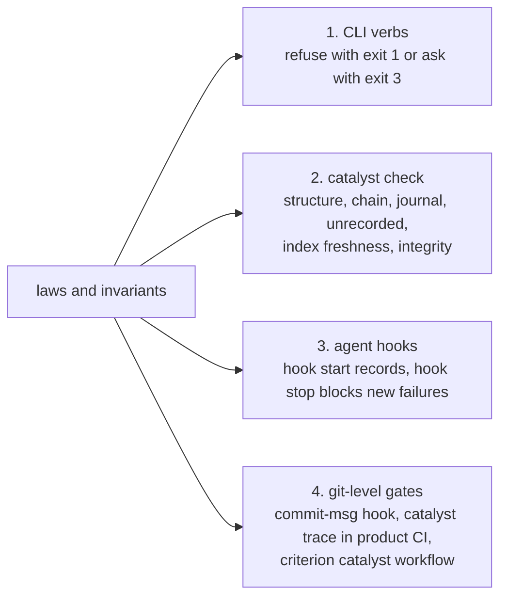

---

## 4. Repositories of the kernel side of the fleet

| Repository | Visibility (observed) | Role |
|---|---|---|
| `cantica-tech/catalyst` | public | Kernel sources, CLI sources, docs, ADRs, release scripts. Branches `development` → `main` → `release`; tags `X.Y.Z` (older tags `vX.Y.Z`). |
| `cantica-tech/cantica-tech` | public | **Distribution repository**: released kernel zips, module zips, VS Code `.vsix`, an example project. Branch `main` only. |
| `cantica-tech/catalyst-software-engineering` | public | Process module `software-engineering` (3.4.1 at time of writing). Tags on `main` (no `release` branch). |
| `cantica-tech/catalyst-knowledge-base` | public | Process module `knowledge-base` (KBM). It is also a CI fixture of the kernel (tag `0.4.1` in `tests.yml`). |
| `cantica-tech/catalyst-users` | public | Identity facade (Keycloak). Its stdlib core is **vendored** into the kernel under `scripts/catalyst/identity/` (release 0.7.0, see `VERSION`). |
| `<project>-criterion` (convention) | **private** | Each project's own criterion repository (shared branch `criterion`). |
| `cantica-tech/standards` | public | Shared lint/format/typecheck workflow (`lint.yml@v0.1.2`) used by the kernel's CI. |
| `cantica-tech/catalyst-docs` | public | The user-facing guide (published at `cantica-tech.github.io/catalyst-docs`). |

Module catalog: `cantica-tech/catalyst:framework/modules/catalog.md` lists `software-engineering` and `knowledge-base` (SSH URLs, default branch `main`). It is read by the purity check, the release packager and CI.

How the kernel-side repositories feed each other:

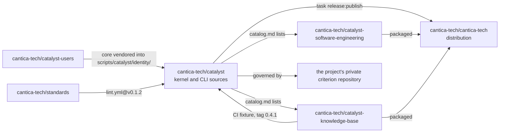

---

## 5. The source repository layout (`cantica-tech/catalyst`)

```text
catalyst/
  BOOTSTRAP.md            single install entry point (laws, capabilities, install, anti-drift, assent)
  CLAUDE.md AGENT.md SYSTEM.md   thin per-agent shims pointing at BOOTSTRAP.md
  README.md CONTRIBUTING.md CHANGELOG.md SECURITY.md LICENSE (Apache-2.0)
  version.txt             kernel version (0.119.2)
  catalyst.toml           catalyst's own deployment (it governs itself, "dogfooding")
  Taskfile.yml            repo tasks: test, check:*, build:cli, catalyst, release, release:publish
  pyproject.toml          name "catalyst", requires-python >=3.11, stdlib only, zipapp not installed
  requirements-dev.txt    pytest etc.
  ruff.toml pyrightconfig.json
  framework/
    README.md
    kernel/               THE KERNEL (shipped in kernel-vX.Y.Z.zip)
      INVARIANTS.md       laws + invariants
      CLI.md              CLI reference (partly generated by scripts/gen_docs.py)
      FORMAT.md           on-disk format 1.0-rc
      ARTIFACT-LAYOUT.md  criterion tree
      MODULE-SPECIFICATION.md  kernel/module contract (v2.0.0)
      INSTANTIATION-GUIDE.md / INSTANTIATION-CHECKLIST.md   install judgment steps
      SYNCHRONIZE.md      /sync-framework procedure + migration list
      ACCESS-CONTROL.md   default roles/grants text (copied verbatim)
      ANALYSIS-PLAYBOOK.md  four-eyes analysis procedure (copied verbatim)
      GLOSSARY.md README.md
      rules-of-development.template.md  -> composed CODE-OF-CONDUCT.md
      rules-of-rules.template.md        -> composed rules/Rules-of-Rules.md
      definitions/<type>/DEFINITION-*-vN.md   versioned prose definitions
      entities/{analysis,reconciliation,workflow}.yaml   kernel ETDs
      migrations/<version>/*.md + migrations.md          one-time migration notes
      schemas/*.schema.json   ETD, module manifest, gates, landing schemas
      templates/          Taskfile.common.template.yml, ledger, rule, domain, workflow, reconciliation,
                          analysis, users/roles/groups display templates, landing policies
    modules/
      catalog.md          production modules
      sample-process/     in-repo sample module (tests)
  scripts/
    catalyst/             THE CLI PACKAGE (see §6)
    project_file.py module_loader.py   imported by the CLI (shipped in the zipapp)
    package_release.py    build_cli(), package_kernel(), package_modules(), publish_releases()
    check_deployment.py check_command_parity.py check_kernel_purity.py
    check_frozen_surface.py check_token_budgets.py measure_tokens.py
    gen_docs.py           regenerates the generated blocks of CLI.md / FORMAT.md / MODULE-SPECIFICATION.md
    vendor_identity.py    re-vendors catalyst-users' core into scripts/catalyst/identity/
    capture_golden_corpus.py
  agents/claude-code/plugin/.claude-plugin/plugin.json   the same wiring as `agent install claude-code`, as a plugin
  spec/*.schema.json      JSON Schemas of every `--json` output
  tests/                  pytest suite
  beta/                   QUICKSTART.md, TRIAL.md, FEEDBACK.md
  docs/                   roadmap.md, decisions.md, adr/ (ADR-001..022), design/ (01a..33), results/, plans/
  .github/workflows/      deployment-rules.yml, tests.yml, standards.yml
  dist/                   (git-ignored) dist/catalyst.pyz from `task build:cli`
  catalyst/               (git-ignored) release output: catalyst/kernel/v<ver>/{kernel-v<ver>.zip,catalyst.pyz,manifest.json}
```

---

## 6. The Python package: module map

Location: `cantica-tech/catalyst:scripts/catalyst/` (~25.5k lines, **standard library only**). In the zipapp it sits beside `project_file.py` and `module_loader.py`, a generated `kernel_entities_embedded.py` (the kernel ETDs as data), and `catalyst/_build.py` (`VERSION`, `BUILD`).

Entry point: `__main__.py` (argparse, ~3.7k lines). Every subcommand finds the deployment by walking up to the nearest `catalyst.toml` (or `--project`), or opens a bare criterion with `--working-copy`. It prints JSON with `--json`, matching `spec/*.schema.json`.

Exit codes: `0` ok · `1` failure · `2` no deployment (or usage error) · `3` needs the user's assent (`--yes`).

The main modules grouped by role, with the calls a writing verb makes (§21.2):

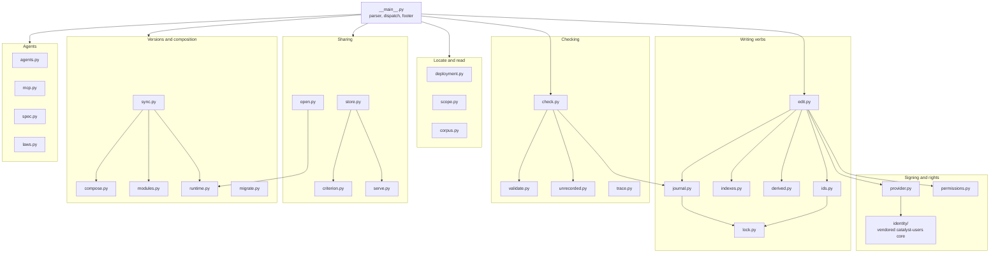

| Module | Responsibility |
|---|---|
| `__main__.py` | Parser, dispatch, the status footer on stderr (`CATALYST_FOOTER=0` disables it). |
| `init.py` | `catalyst init`: an all-or-nothing install with rollback (see deploy doc). |
| `compose.py` | Composes `CODE-OF-CONDUCT.md`, `Rules-of-Rules.md`, `ACCESS-CONTROL.md`, `Taskfile.common.yml` from kernel templates plus module contributions; `recompose` does a three-way merge (`git merge-file`). |
| `deployment.py` | Locates a deployment and loads its entity types (kernel plus modules). |
| `scope.py` | What a deployment governs: its tree minus nested deployments and `.catalystignore` opt-outs. |
| `corpus.py` | Parses the criterion into data: rules, domains, artifacts, index rows. |
| `validate.py` | Chain validation (errors: `duplicate-id`, `dangling-ref`, `ungrounded`, `signer`, `id-shape`, `rule-unindexed`…; warnings: `enum-value`, `index-drift`…). |
| `check.py` | `catalyst check` (format, structure, chain, journal, unrecorded, index freshness, integrity) and `hook stop`. |
| `journal.py` | Journal append/verify/restore/pin/redact; shards; causal ordering; lock. |
| `unrecorded.py` | Detects product commits whose changes the journal does not reach (content-hash based). |
| `trace.py` | Commit-message tracing (INV-5): `trace`, `hook commit-msg`. |
| `ids.py` | ID allocation (`<PREFIX>-NNNNNN-<userid>`, rule IDs) and userid generation. |
| `lock.py` | Cross-process locks (O_CREAT\|O_EXCL files in the criterion's git dir). |
| `edit.py` | Writing verbs: `new`, `status set`, `link`/`unlink`, `rename`, `edit`, `restore`. Each one signs, indexes and journals. |
| `indexes.py` | Regenerates every `<folder>/<folder>.md` index from the files. |
| `derived.py` | Back-reference (derived) fields; `repair derived`. |
| `guards.py`, `conditions.py`, `workflows.py` | State-entry guards, the condition language, governing `WORKFLOW-` transitions and due dates. |
| `gates.py` | Opt-in approval gates (`IAM/gates.json`), `approve`, `approvals`. |
| `proposals.py` | `propose`: a RECON- case with `Trigger: proposal`. |
| `trial.py` | `catalyst try`: a change on a scratch clone, findings added and cleared, nothing kept. |
| `tiers.py` | Ceremony tiers (module `tiers:` or the defaults chore/fix/feature). |
| `permissions.py` | Who may run which command (grants). |
| `provider.py` | **Signing**: reads `IAM/identity.json`, verifies the logged-in identity through catalyst-users (or the machine's system account), keeps the signers ledger and the per-machine snapshot. |
| `identity/` | **Vendored catalyst-users core** (release in `identity/VERSION`): `oidc.py` (discovery, device flow RFC 8628, refresh, revoke, introspection), `session.py`, `credentials.py` (owner-only token files), `keychain.py` (macOS `security` / libsecret), `config.py` (settings precedence), `admin.py` (Keycloak admin REST with the caller's token), `providers/keycloak.py`, `providers/static.py` (tests only). Never edit it here: change catalyst-users, then run `scripts/vendor_identity.py`. |
| `admin.py` | `user`/`role` (these now **refuse**: people live in catalyst-users), `freeze`/`unfreeze`, `definition migrate`. |
| `membership.py` | Membership ledger of a served criterion (`catalyst serve`). |
| `landing.py` | Landing policies (`IAM/landing.json`; <code>landing init&#124;show</code>). |
| `store.py` | Store abstraction: drivers `home` (working form) and `local` / `git` / `serve` (sharing). |
| `criterion.py` | Git sharing: <code>criterion create&#124;join&#124;status&#124;push&#124;sync&#124;integrity&#124;protect</code>, `.gitattributes`, the criterion CI workflow. |
| `serve.py`, `serve_landing.py` | `catalyst serve`: HTTP server (SQLite) through which several people share criteria; landing accepted batches into the git repository. |
| `open.py` | `catalyst open`: join a missing criterion, fill its runtime, install the launcher, report a to-do. |
| `runtime.py` | Runtimes per version in `$CATALYST_HOME/runtimes/<ver>/`, the launcher, the criterion `.venv`. |
| `move.py` | `move --to-home` (legacy → home store), `move --name` (rename a project). |
| `migrate.py` | `catalyst migrate`: layout, template and judgment steps a deployment is behind on. |
| `sync.py` | <code>sync plan&#124;apply</code>: re-vendor the CLI, refresh the module, recompose, retire old agent files, journal one `/sync-framework` entry. |
| `modules.py` | Module release trees, `modules/modules.json`, <code>module install&#124;upgrade&#124;list&#124;verify&#124;available</code>. |
| `versions.py` | Version-range checks (`>=0.83.0`). |
| `agents.py` | <code>agent install&#124;uninstall&#124;status</code> for claude-code, copilot, vscode, cursor, codex, gemini. |
| `mcp.py` | `catalyst mcp`: stdio MCP server (prompts = §4 commands, tools `catalyst` and `command`, instructions = laws). |
| `run.py` | `agent run`: dispatches a command to the project's agent non-interactively (`claude -p`), streaming events and cost. |
| `spec.py` | `catalyst spec <command>`: only the part of CODE-OF-CONDUCT §4 a command needs. |
| `laws.py` | Session brief and `catalyst why`. |
| `views.py`, `history.py`, `impact.py`, `inbox.py` | Read-only views: `list`, `view`, `backlog`, `graph`, `journal show`, history, `impact`, `inbox`. |
| `analysis.py` | Four-eyes analysis lifecycle (<code>analysis start&#124;record&#124;diff&#124;reconcile&#124;decide&#124;close</code>). |
| `report.py`, `audit.py`, `badge.py` | Usage report, audit pack, README badge SVG. |
| `workspace.py` | VS Code workspace meta criterion. |
| `generate.py` | Item templates and definitions generated from a v3 `module.yaml`. |
| `proc.py` | UTF-8-safe subprocess on every OS. |

---

## 7. On-disk layout: project, catalyst home, criterion

### 7.1 Project (product repository)

```text
<project root>/
  catalyst.toml            the ONLY tracked catalyst file (INV-6, L5)
  .catalystignore          optional, any directory: opt files/dirs out of governance
  .git/
    hooks/commit-msg       optional, `catalyst hook install` (never tracked)
    refs/catalyst/journal  pin ref: keeps product blobs the journal names (local until `journal pin --share`)
  ...product files...
```

catalyst creates no Taskfile, no `.claude/` file, no `.gitignore` entry and no agent file in the project. Observed: after `init`, `git status` shows only `?? catalyst.toml`, and `git for-each-ref` shows the new `refs/catalyst/journal`. A directory with its own `catalyst.toml` is a nested, separate deployment.

How the project, catalyst's home and the criterion point at each other:

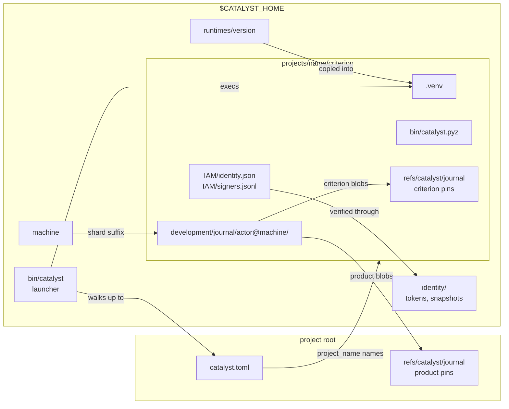

### 7.2 Catalyst home

```text
$HOME/.catalyst/                       ($CATALYST_HOME overrides)
  bin/catalyst, bin/catalyst.cmd       launcher (stdlib Python script; .cmd for Windows)
  machine                              random machine id (journal shard suffix), never the hostname
  runtimes/<version>[+g<sha>[.dirty]]/ one venv per CLI build: site-packages/catalyst.pyz + catalyst.pth
  projects/<name>/
    criterion/                         the criterion (git repo)
    agent                              this user's agent for the project (`open --agent`)
  workspaces/<name>/criterion/         a VS Code workspace's meta criterion
  identity/<sha16>.json                OIDC tokens per (issuer, client), owner-only (0700 dir)
  identity/<sha16>.snapshot.json       read-only snapshot of the verified identity + content hash
  users/                               catalyst-users home (CATALYST_USERS_HOME overrides):
    IAM/settings.json                  provider settings, system-account username, password *command*
    credentials.json                   catalyst-users' own tokens
  credentials                          tokens for `catalyst serve` servers (`share login`)
  serve/serve.db                       `catalyst serve` default database
```

### 7.3 Criterion (observed after `init`, module software-engineering 3.4.1)

```text
$HOME/.catalyst/projects/<name>/criterion/
  .git/                         own history; branch `main` after init (shared: `criterion`)
    catalyst/                   local state, never committed or pushed:
      last-check.json           last `check` result (feeds the footer line)
      sessions/<session>.json   hook-start baselines (ADR-002), pruned after a week
      ids.json                  per-prefix / per-domain high-water marks
      integrity                 cached integrity results per merge HEAD
    refs/catalyst/journal       pins of criterion blobs; refs/catalyst/remote-journal once shared
  .gitignore                    "/.venv"
  .venv/                        runtime copy (git-ignored); `catalyst-version` marker
  version.txt                   kernel version (must equal catalyst.toml kernel_version)
  catalyst.toml? NO             (lives in the project only)
  CODE-OF-CONDUCT.md            composed: rules of development + command catalogue (§4)
  ACCESS-CONTROL.md             verbatim from kernel
  ANALYSIS-PLAYBOOK.md          verbatim from kernel
  INVARIANTS.md                 kernel laws+invariants (session brief source)
  INVARIANTS.module.md          first module's laws+invariants
  DEPLOYMENT.md                 informational deployment note
  README.md                     landing page stub (extend it, INSTANTIATION-GUIDE §1.7)
  Taskfile.common.yml           composed: one task per §4 command
  composition.json              composition parameters (module, meta-rule userid, rule_docs, test_locations, rules_dir)
  bin/catalyst.pyz              vendored CLI (shared: + catalyst.pyz.sha256)
  definitions/<type>.md + README.md   frozen definitions (INV-23)
  modules/modules.json          installed modules: id, version, source, commit, sha256, installed[, history]
  modules/<module-id>/          the module release tree as shipped
  modules/declined.json         (optional) declined optional templates
  IAM/
    identity.json               pointer to catalyst-users ({"provider","issuer"[,"client","catalyst_client"]})
    signers.jsonl               signers ledger
    landing.json                (optional) landing policy
    gates.json                  (optional) approval gates
    users/ roles/ groups/       README + templates/ (display-only JSON templates)
  rules/
    README.md rules.md Rules-of-Rules.md
    <doc>.md ...                rule documents (one per --rule-doc)
    templates/ (TEMPLATE-RULE-vN.md, templates-rule.md, README.md)
    domains/ (README.md, domains.md, templates/, <prefix>-<DOMAIN>-<summary>.md)
  reconciliations/ workflows/ analyses/      kernel entity folders (README, index, templates/)
  <module folders>              SE module: requirements/ steps/ tests/ features/ decisions/
                                development/{bugs,house-keeping,roadmaps}/, development/BACKLOG.md
  development/journal/<actor>@<machine>/<YYYY-MM>.jsonl   journal shards
  .ledger/                      (optional) deployment ledgers
  # once shared:
  .gitattributes                union-merge block for journal shards, signers ledger and indexes
  .github/workflows/catalyst.yml  criterion CI gate
  .frozen                       (optional) items sync leaves alone
```

Every entity folder has this shape (INV-20):

```text
<folder>/README.md
<folder>/<folder>.md                         generated index
<folder>/templates/README.md
<folder>/templates/templates-<type>.md       catalog: | Version | File | Timestamp | Notes |
<folder>/templates/TEMPLATE-<TYPE>-v1.md     never edited once a newer version exists
<folder>/<ID>-<summary>.md ...               instances, any depth
```

---

## 8. `catalyst.toml`, the project file

It uses flat `key = value` lines and never holds a path (`FORMAT.md` §1). Observed after `init`:

```toml
# catalyst project file: names this project's criterion ($HOME/.catalyst/projects/<project_name>/criterion). Never a path.
project_name = "shop"
format = "1.0-rc"
kernel_version = "0.119.2"
module = "software-engineering"
agent = "claude-code"
repoed = false
created_by = "<owner>"
created = "2026-10-31"
updated = "2026-10-31"
journal_since = "<product HEAD sha at install>"
```

A shared deployment's file adds `catalyst_repo`, `catalyst_repo_url` (the project's private criterion repository) and `criterion_branch = "criterion"`.

| Key | Meaning / check |
|---|---|
| `project_name` | Criterion directory name. |
| `format` | `1.0-rc`. `check`: warning if absent, error if unsupported. |
| `kernel_version` | Must equal the criterion's `version.txt` ("version drift"). |
| `module` | First installed module (all of them are in `modules/modules.json`). |
| `agent` | Project default agent. A per-user override is kept in `$CATALYST_HOME/projects/<name>/agent`. |
| `workspace` | Optional VS Code workspace membership. |
| `role_check` | `enforce` (default) or `warn`. |
| `embed_origins` | Origins that may read via `catalyst serve --local`. |
| `analysis_passes` | `2` (default) or `1`. |
| `governance` | `suspended` → `hook stop` never blocks. |
| `share`, `share_url` | Sharing driver `git` / `serve` / `local`, and the server URL. |
| `repoed`, `catalyst_repo`, `catalyst_repo_url`, `criterion_branch` | Shared-criterion record. |
| `created_by`, `created`, `updated` | Informational. |
| `journal_since` | Baseline commit for unrecorded-change detection (`""` = whole history). |
| `strict_journal` | `true` makes unrecorded changes errors before format 1.0. |

Legacy keys are read, never written: `name`, `framework_version`, `agent-source`, `identity`, `identity_issuer`, `identity_client` (the last three were moved to `IAM/identity.json` by migration 0.106.0).

---

## 9. Kernel, modules and composition

- A module repository holds `module.yaml` (manifest: id, version, `kernel_version` range, entity types/ETDs, tiers, aliases, namespace, `required_paths`…), `schemas/*.yaml` (ETDs), `templates/`, `definitions/`, `rules-of-rules.module.md`, `code-of-conduct.module.md`, `INVARIANTS.module.md`, `migrations/`, and optionally `skills/` and `ui/`. `Taskfile.module.yml` has not been read since kernel 0.70.0 (`MODULE-SPECIFICATION.md` §2, §6.5).
- **Release tree.** A module release zip is the shipped files plus a `manifest.json`. `init` and `sync` seed the same tree into `criterion/modules/<id>/` and record its sha256 (LF-normalised) in `modules/modules.json`. `catalyst module verify` and `check` recompute the hash.
- **Kernel range.** `init` refuses a module whose `kernel_version` excludes the kernel (`versions.py`). SE 3.4.1 declares `>=0.83.0`.
- **Several modules.** `catalyst module install <dir|zip|git-url[@ref]>` adds one beside the first. It refuses collisions on: ID, prefix, folder, definition, namespace, meta-rule ID, command, conflicting tier, or a different grounding type. Modules are loaded in `modules.json` order. The second module's invariants stay in its own folder.
- **Kernel purity (INV-30).** `scripts/check_kernel_purity.py` derives a denylist from the catalogued modules and fails if the kernel, `scripts/` or root docs (CHANGELOG included) name a module, prefix, folder or command.

The collision check a second module goes through:

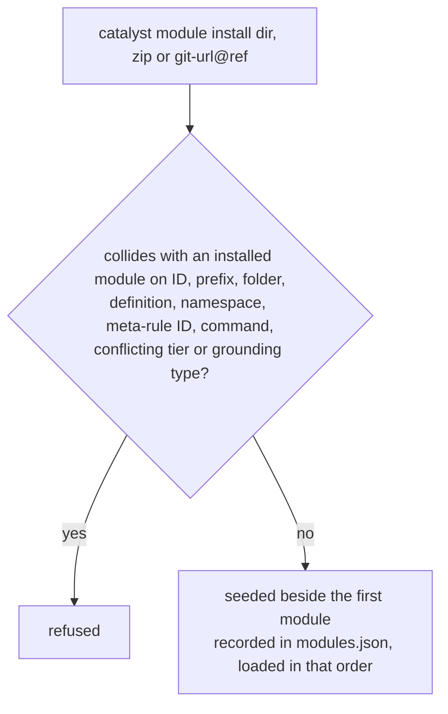

Composition (`compose.py`, `MODULE-SPECIFICATION.md` §6):

| Deployed document | Built from |
|---|---|
| `CODE-OF-CONDUCT.md` | `rules-of-development.template.md`, with the module's `code-of-conduct.module.md` §3/§4 bodies inserted at the end of the kernel's §3/§4 under `### From module <id>` |
| `rules/Rules-of-Rules.md` | `rules-of-rules.template.md` + `rules-of-rules.module.md` appended; meta-rule IDs signed with the installer's userid |
| `ACCESS-CONTROL.md` | verbatim |
| `Taskfile.common.yml` | `templates/Taskfile.common.template.yml` + one task per §4 command |
| `definitions/<type>.md` | latest `DEFINITION-*-vN.md` of each kernel and module type, frozen at deploy |

Placeholders `{{RULES_DIR}}`, `{{RULE_DOCS_LIST}}` and `{{TEST_LOCATIONS}}` are resolved, and the parameters are saved in `composition.json` so that `recompose` can rebuild the same base.

Where each composed document comes from:

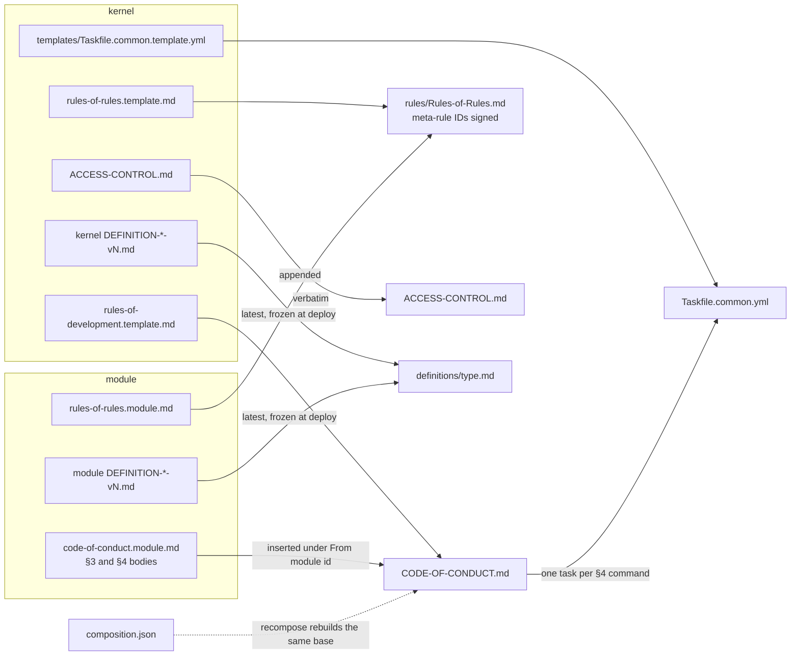

---

## 10. Rules, rule documents, prefixes, domains

- **Rule documents** live under `rules/`: one per natural seam of the project (`--rule-doc <file>:<prefix>`, e.g. `business-rules:br`, `dev-environment-rules:env`). The default is `<name>-rules.md` with prefix `br`. Each is seeded with `## Contents` and `## Linked Artifacts — Quick Index`.
- **A rule** is either a heading `### \`<prefix>-<DOMAIN>-NNNNNN-<userid>\` <title>` in a rule document, or its own `<ID>-<slug>.md` file listed by a document (decision B7). It may carry `**Strength**` `must|should|may` (default `must`; `rule-strength` error otherwise). Every rule must appear in `rules/rules.md` (INV-8; `rule-unindexed` error). `rules/rules.md` is hand-maintained and **not** union-merged, so concurrent edits to it conflict on purpose.
- **Rule IDs** are allocated by `catalyst id next-rule <doc-prefix> <DOMAIN>`. NNNNNN is 6-digit, unique per DOMAIN. The suffix is the signer's userid. The domain must already be registered in `rules/domains/domains.md` (observed: `catalyst: domain 'AUTH' is not registered in rules/domains/domains.md`, exit 1).
- **Domains** are `rules/domains/<prefix>-<DOMAIN>-<summary>.md` (sub-domain `<prefix>-<PARENT>.<SUB>-<summary>.md`), carry no numeric ID, and are created before their rules (rr-META-007).
- **Meta-rules** are `rr-META-NNN` (kernel, signed at install, e.g. `rr-META-000012-<userid>`) and `rr-<NS>-NNN` (module namespace, e.g. `rr-SE-000002-<userid>`).
- **Retirement**: rules are retired in place (marked, dated, reasoned), never deleted, and remain valid targets.

The order a new rule is made in:

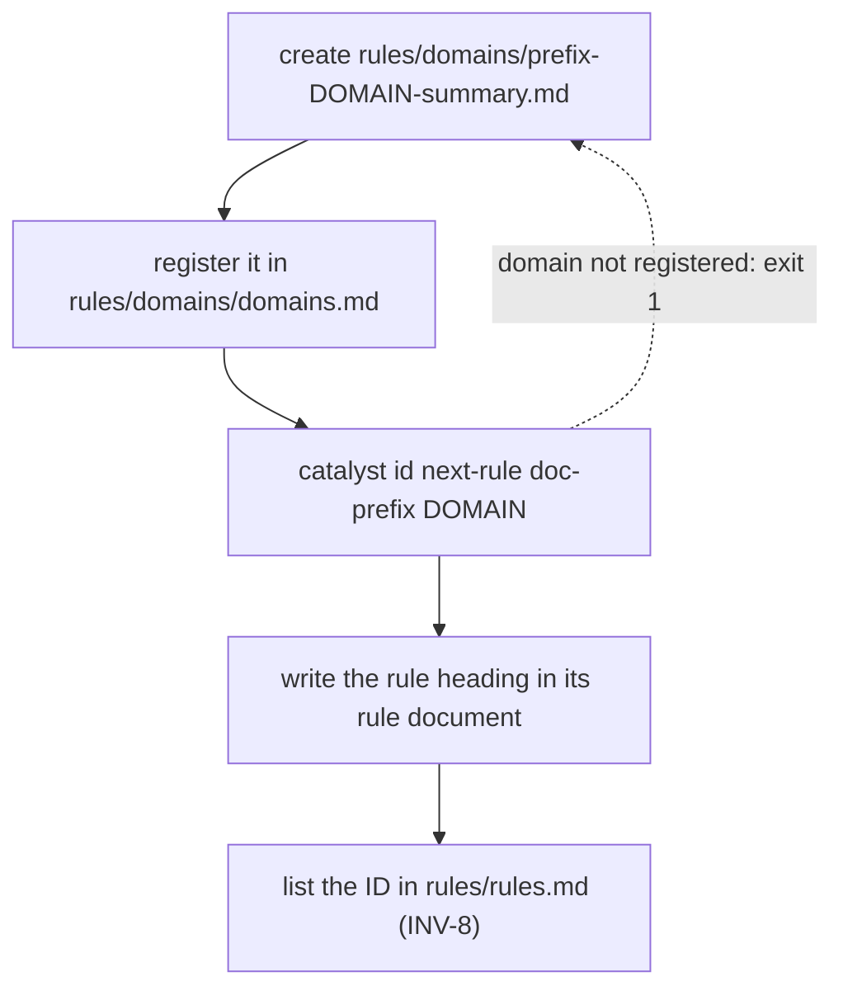

---

## 11. Artifacts, entity types (ETDs) and IDs

- Kernel types (`framework/kernel/entities/`):

  | Prefix | Folder | States (closed) |
  |---|---|---|
  | `ANALYSIS` | `analyses/` | Extracting, Reconciling, Deciding, **Closed**, **Abandoned** |
  | `RECON` | `reconciliations/` | Open, Under Review, **Resolved-Accepted**, **Resolved-Accepted-with-Edits**, **Resolved-Rejected**, **Closed** |
  | `WORKFLOW` | `workflows/` | Draft, Active, **Deprecated** |

The `ANALYSIS-` lifecycle as `scripts/catalyst/analysis.py` moves it (`catalyst analysis <verb>`):

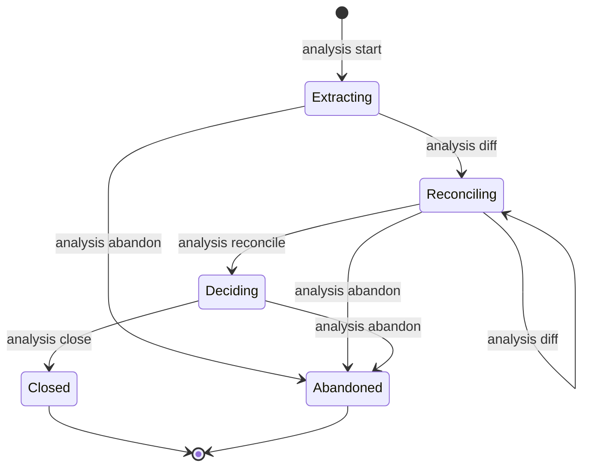

A `RECON-` case moves through `catalyst reconcile <case> <verb>` (`scripts/catalyst/edit.py`); a closed case is final:

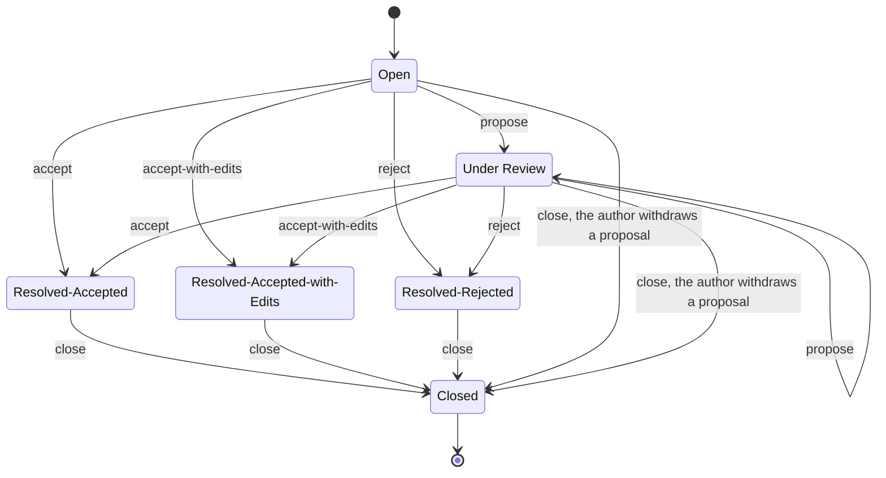

Who may use which reconcile verb depends on the signer's `reconcile:` grant (INV-21):

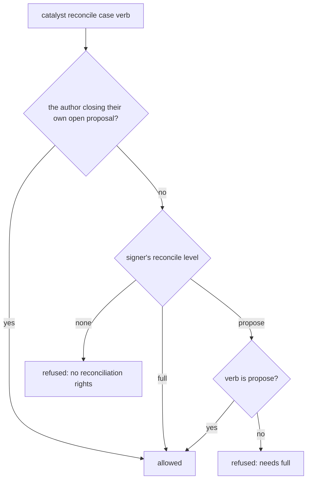

- Module types: the SE module seeds 8 folders (observed): `requirements/`, `steps/`, `tests/`, `features/`, `decisions/`, `development/bugs/`, `development/house-keeping/`, `development/roadmaps/`. Its prefixes include `REQ`, `STEP`, `TEST`, `FEAT`, `ADR`, `BUG`, `HK`, `RM`. Its tiers: a feature is a REQ with STEPs, a fix is a BUG against the rule it restores, and a chore has no artifact (law SE-L1).
- **ETD fields**: `id_prefix`, `name`, `plural_name`, `folder`, `location`, `naming` (`per-file` or `free-form` table rows), `grounding` (`required` / `inherited` / `none`), `grounding_field`, `fields[]` (`kind`, `required`, `allowed_values`, `target_type`, `backref`, `required_when_closed`), and `workflow` (`initial`, `states`, `closed_states`, `transitions`, `guards`). Schema: `framework/kernel/schemas/entity-type-definition.schema.json`.
- **Entity file**: `<PREFIX>-NNNNNN-<summary>.md`, with its fields in a `| **Field** | value |` table, an H1 title, and a `Signed-off-by` field naming a known signer.
- **IDs** (`ids.py`, INV-26, rr-META-020):
  - entity `<PREFIX>-NNNNNN-<userid>`: NNNNNN is global within the type, never reused, and one above the highest ever seen in files, index rows and table rows;
  - rule `<doc-prefix>-<DOMAIN>-NNNNNN-<userid>`;
  - the short form `<PREFIX>-NNNNNN` is accepted in commit messages.

  `catalyst id next <PREFIX>` prints the next ID (e.g. `REQ-000001-<userid>`). High-water marks are cached in `.git/catalyst/ids.json` under the allocation lock.
- **Indexes** `<folder>/<folder>.md` are generated (`catalyst index regen`, `--check`) and must never be hand-edited (L6). Shared criteria union-merge them, then regenerate.
- **Derived fields** (backrefs) are written by `new`/`link`, checked by `check` (`derived` error) and repaired by `catalyst repair derived`.

---

## 12. Identity and signing (catalyst-users, Keycloak)

Design 28/29, `scripts/catalyst/provider.py`, INV-16, `FORMAT.md` §6.

**The model.** A criterion holds **no user or role registry**. `IAM/identity.json` points at a catalyst-users provider:

```json
{"provider": "keycloak", "issuer": "http://localhost:8080/realms/catalyst"}
```

Optional keys are `client`, the public device-grant client (default `catalyst-cli`), and `catalyst_client`, the client whose roles carry the grants (default `catalyst`). A `keycloak` pointer may give `url` + `realm` instead of `issuer`. `static` is a test-only provider: it is refused unless `CATALYST_ALLOW_STATIC_IDENTITY=1`, and `check` warns about it.

**Who signs** (`provider.verify`):

1. The person logged in with `catalyst identity login [--issuer <url>]`. This is an OIDC device flow: the CLI shows a URL and code, and the user approves in a browser. Tokens are stored in `$CATALYST_HOME/identity/<sha256(issuer\nclient)[:16]>.json`, owner-only. Each signature refreshes the token and reads userinfo.
2. Otherwise, the machine's **system account**. catalyst-users `setup` records an admin `username` and a `password_command` (e.g. a keychain read) in `$CATALYST_HOME/users/IAM/settings.json`. When those settings point at the **same issuer**, catalyst signs as that account with a password grant and says so on stderr (`catalyst: no one is logged in: signing as the system account <user>`).
3. Otherwise there is **no verified identity**: nothing is signed, and the writing verb fails and points to `catalyst identity login`. Read verbs still work. git config is never used to guess identity. `--as <name>` can only name the verified identity itself. `journal adopt` keeps the git author only as `commit_author`.

The device flow of `catalyst identity login` (RFC 8628):

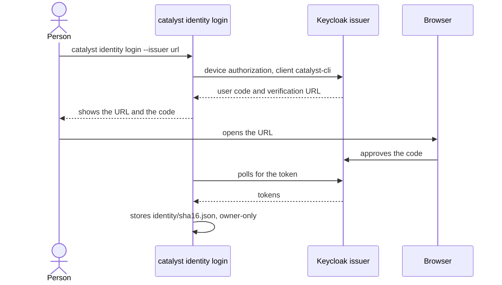

The three cases above as a decision, followed by the grant check every writing verb makes:

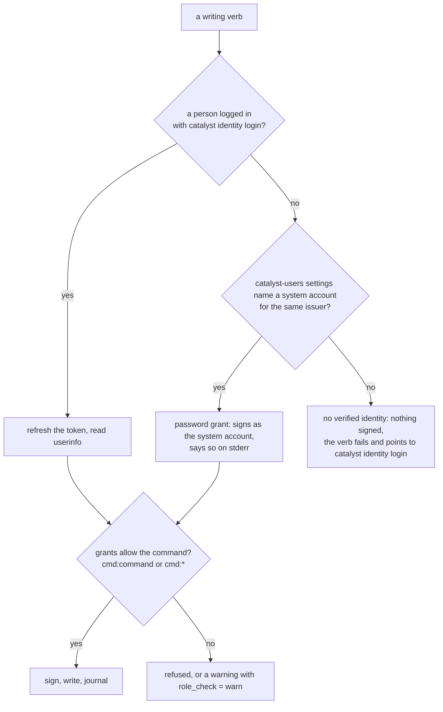

**Grants** come from the provider's token: `cmd:<command>`, `cmd:*`, and `reconcile:full|propose` (none → `none`). A role's name grants nothing. A person whom catalyst-users lists as administering the criterion (`administers` contains `project_name`) gets the Criterion Admin grants and `reconcile:full` in that criterion only. A writing verb refuses a signer whose grants do not allow its command; `role_check = "warn"` turns the refusal into a warning.

**Signers ledger.** An identity's first signature appends `{"userid","iss","sub","username","name","first_signed"}` to `IAM/signers.jsonl`. This is journaled, append-only and union-merged. The person is (`iss`, `sub`). The `username` becomes the journal `actor`.

**Snapshot.** The verified identity (username, name, groups, roles, grants) is written to `$CATALYST_HOME/identity/<key>.snapshot.json` with a content hash. If the snapshot has been edited, it is discarded and the person re-authenticated. Role changes in the provider are seen at the next signature.

An identity's first signature in a criterion, then every later one:

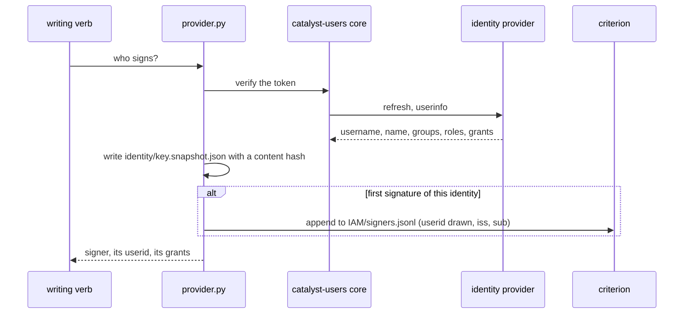

**Provisioning (catalyst-users side, for orientation).**

- `catalyst-users setup` creates the realm `catalyst`, the admin, the criterion group `criteria/<name>/admins`, and the settings.
- `catalyst-users roles provision keycloak/catalyst-roles.json` gives roles their `cmd:` grants.
- `catalyst-users criteria add <name> --admin <user>`.

Keycloak 26.4.0 runs via `docker compose up -d` in `cantica-tech/catalyst-users` on `127.0.0.1:8080`.

**Kernel CLI verbs:** `identity configure|login|logout|whoami|status|link`. `user …` and `role …` exist but always refuse.

---

## 13. The journal: shards, entries, pins, verify, adopt, redact

- **Shards**: `development/journal/<actor>@<machine>/<YYYY-MM>.jsonl`. `<actor>` is the lowercased signer username with any run of characters outside `[a-z0-9._-]` replaced by `-`. `<machine>` is the content of `$CATALYST_HOME/machine`. Two people, or one person on two machines, never write the same file, so a shared criterion merges without conflicts. Pre-0.50 deployments also have `development/journal.jsonl`, which is read and never written.
- **Order**: causal. Each shard keeps its own order; the next entry is the earliest one whose files all start from their state so far; timestamps only break ties. Entries are referred to as `<source>:<line>`.
- **Lock**: `journal append` and `adopt` hold the criterion's journal lock (a file in `.git/`) from reading the last states until the write.
- **Entry** (observed install entry, abridged):

  ```json
  {"timestamp":"2026-10-31T09:55:06Z","actor":"<user>","command":"catalyst init","action":"create",
   "artifact":"deployment of shop","targets":[],
   "intent":["Install catalyst (kernel 0.119.2, module software-engineering 3.4.1) into shop, on the user's explicit request (INV-2)."],
   "files":[{"path":"catalyst.toml","before":null,"after":"4217ec9a…"},
            {"path":".criterion/CODE-OF-CONDUCT.md","before":"126f028b…","after":"126f028b…"}, …],
   "writer":"catalyst/0.119.2","via":"agent"}
  ```

  Required fields: timestamp, actor, command, action (`create|update|close|retire|status-change|sync`), artifact, targets, intent (≥1), files. Optional: `writer`, `tier`, `via` (`agent|person|server`, from 0.116.0), `origin: "manual"` + `commit` (adopted), `files[].superseded`, and `redacted` (redaction tombstone).
- **Paths** are relative to the project root. `.criterion/<p>` is hashed into the criterion repository; anything else is hashed into the product repository (`git hash-object -w`).
- **Pins**: every referenced blob is kept reachable under `refs/catalyst/journal` in the repository it was hashed into, so `git gc` never prunes it. The product repository therefore gains objects and one ref (no commit, no branch). `journal pin --share` merges and pushes the pin ref. `share push` shares the criterion pins itself.
- **verify** (`catalyst journal verify`, part of `check`): checks required fields, timestamp order, the hash chain (`before` = previous `after`), blob presence, pinning, and unjournaled edits. Problems are errors for CLI-written entries and warnings for legacy entries (`--legacy` lists them).
- **Unrecorded changes**: a non-merge product commit after `journal_since` that changes a file to a blob its journal chain does not reach. Detection uses content, never clocks. It is a warning under 1.0-rc and an error at 1.0 or with `strict_journal`. It is resolved by `catalyst journal adopt <rev|A..B> --intent …` (entry with `command: "/adopt"`, `origin: manual`) or by reverting. It is reported by `unrecorded`, `check`, `trace` and the commit-msg hook.
- **restore**: `catalyst journal restore <ISO timestamp> <empty dir>` materialises every journaled file as of that time into a side directory. It never touches the live tree.
- **redact** (decision A5): `catalyst journal redact <blob>… --intent` writes a tombstone entry and takes the blobs out of the pins (rewriting the pin ref without history). The history still holds them until the owner runs `git filter-repo`. Rotate secrets first.

How an unrecorded change is found and resolved:

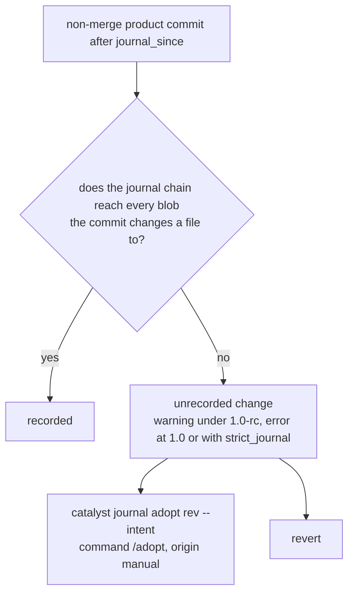

Where a journaled file's blobs go, and how the pins leave the machine:

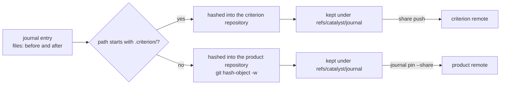

---

## 14. The signers ledger and the deployment ledger

- **Signers ledger** (`IAM/signers.jsonl`): see §12. It is structure-checked: each line is JSON with `userid`, `iss`, `sub` and `username`, a userid names a single identity, and no line the journal recorded may change. Deployments migrated from kernel 0.105 keep `IAM/users/users.retired.json` and `roles.retired.json` for history. `catalyst identity link <user>` lets a person claim their pre-0.106 userid once.
- **Deployment ledger** (`.ledger/<task>.todo.md`, from `framework/kernel/templates/ledger.template.md`): an agent-side checklist for long tasks (install, sync, analysis). Items are `[ ] pending`, `[x]` or `[!] blocked: <reason>`. The agent re-grounds every 5 items and after context compaction (`BOOTSTRAP.md` §3). If a project `.criterion/` holds **only** `.ledger/`, `catalyst init` moves it into the criterion; anything else in `.criterion` makes `init` refuse.

---

## 15. Sharing: drivers, the criterion repository, branch, CI gate, `repoed`

**Drivers** (`store.py`, `catalyst share …`):

| Driver | When | Behaviour |
|---|---|---|
| `local` | default, not shared | `pull`/`push` explain how to share |
| `git` | criterion has a remote or `catalyst_repo_url` is set | criterion repository + pull requests (below) |
| `serve` | `share = "serve"` + `share_url` | a `catalyst serve` HTTP server (SQLite, `127.0.0.1:8765`, TLS left to a reverse proxy) applies pushes all-or-nothing and lands accepted batches into git per the landing policy |

**git model** (INV-18, `criterion.py`):

- `catalyst share create <url> [--branch criterion] [--protect] --yes` publishes the local criterion. It sets `origin`, writes `.gitattributes` (union merge for the journal, signers ledger and generated indexes), `.github/workflows/catalyst.yml` and `bin/catalyst.pyz.sha256`, pushes the shared branch, and records `repoed = true`, `catalyst_repo_url` and `criterion_branch` in `catalyst.toml`. That change is **staged in the product, not committed**, and journaled. The remote repository must already exist (create it on GitHub first). Without `--yes` the command prints the plan and exits 3 (observed: `publish this criterion to <url> (shared branch criterion)`, exit 3).
- `catalyst share push -m <msg> [--yes]` (alias `criterion push`):
  1. commit on a topic branch `<git_username>/<UTC timestamp>`;
  2. fetch the other contributors' pins;
  3. rebase onto the shared branch;
  4. regenerate indexes and journal the merge result;
  5. run `check` and `integrity`;
  6. push with a lease;
  7. share the pins;
  8. open a PR with `gh`.

  A real conflict aborts with nothing pushed; the resolution is a human's (a RECON- case).
- `share pull` / `criterion sync` fast-forward to the shared branch. They refuse while unpublished local work exists.
- `share join` / `catalyst open` clones the criterion named in `catalyst.toml` into the home store on a new machine.
- `criterion protect --yes` sets GitHub branch protection on the shared branch: PRs required, the `catalyst` check required (strict), no force-push, no deletion.
- **Criterion CI gate** (`.github/workflows/catalyst.yml`):
  - it runs on `pull_request_target` and push to `criterion`;
  - it checks out the **base** branch as `gate/` and verifies `gate/bin/catalyst.pyz` against `bin/catalyst.pyz.sha256`;
  - it checks out the PR merge result as `change/` (data only) and fetches `refs/catalyst/journal`;
  - it runs `gate/bin/catalyst.pyz --working-copy . check` and `criterion integrity`.

The steps of `share push`, with its two ways out:

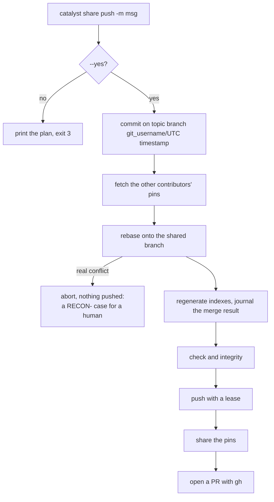

  A PR therefore cannot change its own gate. It needs Python 3.11 on the runner and nothing else.

- **Product CI** may clone the criterion into a temporary `CATALYST_HOME` and run `catalyst.pyz trace <range>` (`CLI.md`). A private criterion needs a deploy key or token.
- **Landing policy** (`IAM/landing.json`, kernel `standard` when absent; `catalyst landing init --policy standard|open|reviewed|host`) decides grouping, review and merge for changes landing through a server.

The criterion CI gate:

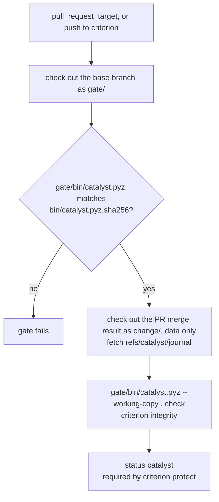

---

## 16. Runtimes, the launcher and the per-criterion `.venv`

(`runtime.py`, ADR-010 §6, decision "uv venv per criterion".)

- **Runtime**: `$CATALYST_HOME/runtimes/<version>/`, one per CLI build. It is created with `uv venv --relocatable --python ">=3.11"` when `uv` is on PATH, else `python -m venv`. Its `site-packages/` holds `catalyst.pyz` and `catalyst.pth`, so `python -m catalyst` runs the zipapp. Nothing is pip-installed or activated.
- **Criterion `.venv`**: a copy of the matching runtime inside the criterion (git-ignored), with a `catalyst-version` marker. Several criteria pinned to different versions run side by side.
- **Launcher** `$CATALYST_HOME/bin/catalyst` (stdlib script, any Python 3):
  - it walks up from `$PWD` to a `catalyst.toml` (or legacy `*.catalyst`) and execs `<criterion>/.venv/bin/python -m catalyst …`;
  - for a legacy deployment it execs `.criterion/bin/catalyst.pyz`;
  - outside any project, and **always for `mcp`**, it runs the newest installed runtime (highest X.Y.Z, then most recent build);
  - if none exists, it fails with `no runtime installed (catalyst runtime install)`.
- **Who fills them**:
  - `init` (unless `--no-runtime`);
  - `catalyst runtime install`;
  - `catalyst open` (refills when the marker differs from the vendored CLI's version; observed: init wrote `0.119.2`, and `open` then refilled it as `0.119.2+gd5e2a1bea451`, creating a second runtime dir);
  - `sync apply` (brings `.venv` to the newly vendored CLI).
- Observed: uv picked a system Python 3.14 in the sandbox.

The launcher's choice, as a decision:

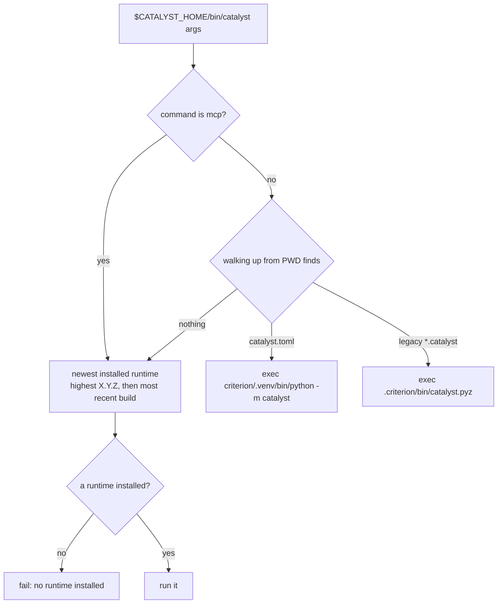

---

## 17. Agents: hooks (start/stop, ADR-002), the MCP server, adapters

**Principle**: agents are wired once per machine **at user level**, never in the project (migration 0.49.0). `catalyst agent install|uninstall|status <agent>` handles this:

| Agent | What `install` writes |
|---|---|
| `claude-code` | `claude mcp add --scope user catalyst -- $CATALYST_HOME/bin/catalyst mcp` (into `~/.claude.json`); `~/.claude/settings.json` `hooks.Stop` = `catalyst hook stop`, `hooks.SessionStart` = `catalyst hook start --quiet` |
| `copilot` | `~/.copilot/mcp-config.json`, `~/.copilot/hooks/catalyst.json` (also read by VS Code's agent) |
| `vscode` | user-profile `mcp.json` |
| `cursor` | `~/.cursor/mcp.json`, `hooks.json` |
| `codex` | `[mcp_servers.catalyst]` in `~/.codex/config.toml`, `~/.codex/hooks.json` |
| `gemini` | `~/.gemini/settings.json` (MCP + `AfterAgent` hook) |

Only catalyst's entries change (they are recognised by the launcher path). Each file is backed up once as `<file>.before-catalyst`. A non-JSON file is left alone and the snippet is printed. If `claude` is not on PATH, the MCP command to run by hand is printed. Observed: `install` then `status` shows `claude-code installed hooks.Stop yes, hooks.SessionStart yes, mcp (user scope) yes`, and `uninstall` cleared both.

`agents/claude-code/plugin` is the same wiring as a Claude Code plugin (`plugin.json` with `mcpServers.catalyst` and the two hooks).

**`catalyst hook start`** (session start):

- It prints the `catalyst open` report (no network, no change) and the laws: kernel and module brief up to the marker.
- When the hook input carries `session_id` (also `sessionId` or `conversation_id`), it records the current `check` failures as the session **baseline** in `<criterion>/.git/catalyst/sessions/<id>.json`. Observed: `s1.json`.
- `--quiet` records only. It is used for Claude Code, whose laws come via the MCP server's instructions.
- It always exits 0.

**`catalyst hook stop`** (end of turn):

- It runs the same pass as `check`.
- **ADR-002**: a failure present in the session's baseline is reported but does not block; only new failures block (exit 2). With no session id or baseline, every failure blocks.
- If the hook has already blocked this stop, it reports without blocking again, so a session cannot loop.
- It fails closed: an internal error gives exit 2. Outside a deployment it exits 0. With `governance = "suspended"` it exits 0.
- `--format exit2|json|gemini|cursor` adapts the output to each agent.

`catalyst hook stop` as a decision (ADR-002):

```mermaid
flowchart TD
  S["catalyst hook stop"] --> D{"inside a deployment?"}
  D -- "no" --> Z["exit 0"]
  D -- "yes" --> Gov{"governance = suspended?"}
  Gov -- "yes" --> Z
  Gov -- "no" --> B{"already blocked this stop?"}
  B -- "yes" --> Rep["report without blocking again"]
  B -- "no" --> C["run the check pass"]
  C -- "internal error" --> X1["exit 2, fails closed"]
  C --> N{"a failure not in the session baseline?<br/>no baseline: every failure counts"}
  N -- "yes" --> X2["exit 2: block"]
  N -- "no" --> Z2["exit 0, baseline failures reported"]
```

**`catalyst mcp`**: stdio JSON-RPC MCP server, observed against the sandbox project:

- `initialize` returns `serverInfo {name: catalyst, version: 0.119.2+g…}` and `instructions` (the laws, ~3.8 KB).
- `tools/list` returns `catalyst` (runs the CLI through the launcher in the project root, args + optional cwd) and `command` (returns a command's procedure).
- `prompts/list` returns the §4 commands: `adopt, check-rules, create, freeze, help, journal, list, migrate-definition, reconcile, roadmap, role, run-analysis, share, show-backlog, status, sync-framework, user`. In Claude Code these appear as `/catalyst:<name>`.

The project is resolved from, in order: the client roots, `CLAUDE_PROJECT_DIR`, the cwd, then the tool's `cwd`.

An MCP exchange with the `catalyst mcp` server:

```mermaid
sequenceDiagram
  participant Client as Claude Code
  participant L as launcher
  participant M as catalyst mcp
  participant P as project runtime
  Client->>L: start catalyst mcp over stdio
  L->>M: newest installed runtime
  Client->>M: initialize
  M-->>Client: serverInfo and instructions, the laws
  Client->>M: prompts/list
  M-->>Client: the §4 commands, shown as /catalyst:name
  Client->>M: tools/call catalyst with args and cwd
  M->>M: resolve the project from client roots, CLAUDE_PROJECT_DIR, cwd, then the tool's cwd
  M->>P: run the CLI through the launcher in the project root
  P-->>M: output
  M-->>Client: result
```

**Git hook** (agent-independent): `catalyst hook install` writes `.git/hooks/commit-msg` (a Python script calling `catalyst hook commit-msg`). It requires each commit to cite a resolving ID or be `chore:`, and routes staged files to their owning deployment. Bypass with `git commit --no-verify`.

**Dispatch**: `catalyst task <name> -- <args>` runs a `Taskfile.common.yml` task with go-task from the project root. The task calls `{{.AGENT_CMD}} "/<name> {{.CLI_ARGS}}"`, where `AGENT_CMD` is derived from `agent` (`claude-code` → `claude -p`) or the `AGENT_CMD` env var. `catalyst agent run <command>` dispatches non-interactively and streams events with token cost (Claude Code adapter only).

---

## 18. Composed documents

| File | Content | Generated by / changed by |
|---|---|---|
| `CODE-OF-CONDUCT.md` | §1 no development without a targeted rule; §2 users, roles, signing; §3 standard document types; **§4 the command catalogue** (kernel + `### From module <id>`, the canonical list of slash commands); §5–9 domain field, IDs, closing, retired rules, journaling | `init`, `recompose`/`sync apply` (three-way merge keeping local edits) |
| `rules/Rules-of-Rules.md` | Kernel meta-rules `rr-META-001…023` (signed) + module meta-rules | same |
| `Taskfile.common.yml` | One task per §4 command plus `catalyst`; `scripts/check_command_parity.py` checks parity with §4 | same |
| `ACCESS-CONTROL.md` | Who may write what, default grants | verbatim copy |
| `INVARIANTS.md`, `INVARIANTS.module.md` | Laws + invariants | copied at init/sync |
| `<folder>/<folder>.md` | Indexes | `index regen` (automatically by verbs) |
| `development/BACKLOG.md` (SE) | Module summary | module command `/show-backlog` |

`catalyst spec <command>` prints only the slice of §4 that a command needs (budgeted).

---

## 19. Projects vs workspaces

- **Project**: a `catalyst.toml` → `$CATALYST_HOME/projects/<name>/criterion` with one or more process modules.
- **Workspace**: `catalyst workspace init <name>.code-workspace` creates `$CATALYST_HOME/workspaces/<name>/criterion`. That meta criterion holds shared rules, domains, the catalyst-users pointer and the signers ledger, its own journal and git repository, and **no process module**. It writes `workspace = "<name>"` into each member's `catalyst.toml` (not committed). Members see the workspace's rules, domains and signers read-only, may target workspace rules, and inherit its identity pointer when they have none. A member's own entries win on a clash.

A workspace's meta criterion beside its members' own criteria:

```mermaid
flowchart TB
  WS["name.code-workspace"] -- "catalyst workspace init" --> Meta["$CATALYST_HOME/workspaces/name/criterion<br/>shared rules, domains, identity pointer, signers ledger<br/>no process module"]
  P1["member project A<br/>catalyst.toml: workspace = name"] -- "reads rules, domains, signers, read-only" --> Meta
  P2["member project B<br/>catalyst.toml: workspace = name"] -- "reads rules, domains, signers, read-only" --> Meta
  P1 --> C1["its own criterion<br/>its own entries win on a clash"]
  P2 --> C2["its own criterion"]
```

---

## 20. Format versions, migrations, sync

- **Format**: `1.0-rc` (`FORMAT.md`). It becomes `1.0` after the multi-user trial. From 1.0 on, unrecorded changes and untraced commits are errors. Breaking changes then mean a major format version with a migration. The CLI's `SUPPORTED_FORMATS` decides what it reads.
- **Kernel versioning**: a change that alters what is deployed needs a `version.txt` bump, a migration under `framework/kernel/migrations/<version>/`, a row in `migrations/migrations.md`, an entry in `SYNCHRONIZE.md`, and a `CHANGELOG.md` entry (`CONTRIBUTING.md`).
- **Migrations**: 42 directories from 0.11.0 to 0.116.0. Recent landmarks:

  | Version | Change |
  |---|---|
  | 0.48.0 | home store, `catalyst.toml` |
  | 0.49.0 | agents at user level |
  | 0.50.0 | journal shards, `share`, exit 3 |
  | 0.52.0 | ten laws |
  | 0.106.0 | users outside catalyst / `IAM/identity.json` |
  | 0.109.0 | Criterion Admin |
  | 0.116.0 | `via` + landing policy |

  A module has its own `migrations/`; kernel and module steps run merged in version order (kernel first on a tie).
- **`catalyst sync plan|apply --kernel <dir|zip> [--module <dir|zip|git-url@ref>]`** (the mechanical half of `/sync-framework`):
  - re-vendors `bin/catalyst.pyz`;
  - copies the invariants and verbatim docs;
  - refreshes the module tree;
  - recomposes the governing docs (three-way merge against the base kernel, found as `…/v<deployed>/kernel-v<deployed>.zip` next to the target zip, or a git tag, or `--base-kernel`);
  - creates definitions of new types only;
  - retires agent files older kernels wrote into the project (`.claude/commands/`, hooks in `.claude/settings.json`), leaving locally edited ones;
  - updates the versions;
  - journals one `/sync-framework` entry;
  - refills `.venv`.

  `.frozen` items are skipped. Refusals:
  - a module needing a kernel newer than the one the shared criterion's CI gate runs (sync the kernel first, merge, pull, then the module);
  - a recompose conflict.
- **`catalyst migrate [--apply] [--kernel …]`** lists the `layout` (legacy → home), `template` (new template versions) and `judgment` steps (never taken automatically). `--apply` takes layout plus kernel templates (and module templates given with `--template`). `--decline` records declined optional templates.

An upgrade through `sync`, with its two refusals:

```mermaid
flowchart TD
  Plan["catalyst sync plan --kernel --module"] --> R1{"module needs a kernel newer than<br/>the shared criterion's CI gate runs?"}
  R1 -- "yes" --> K["sync the kernel first, merge, pull, then the module"]
  R1 -- "no" --> Ap["catalyst sync apply"]
  Ap --> RC{"recompose conflict?"}
  RC -- "yes" --> Stop["stop: resolve it, or freeze the item"]
  RC -- "no" --> Steps["re-vendor the pyz, copy invariants and verbatim docs,<br/>refresh the module tree, recompose with a three-way merge,<br/>definitions of new types only, retire old agent files,<br/>update versions, journal one /sync-framework entry, refill .venv"]
  Steps --> Mig["catalyst migrate: layout, template and judgment steps"]
```

---

## 21. Data flows (diagrams)

### 21.1 Install (`catalyst init`)

```mermaid
flowchart TD
  A["catalyst.pyz init --kernel K --name N --module M --module-dir D"] --> B{"checks: name, no catalyst.toml, no .criterion except ledger-only,<br/>kernel valid, module kernel range, criterion dir empty"}
  B -- "fail" --> X["exit 1 or 2, nothing written"]
  B --> C["identity: --identity-issuer, else catalyst-users settings;<br/>verify the logged-in person or the system account"]
  C -- "no verified identity" --> X
  C --> D["draw userid; compose CODE-OF-CONDUCT, Rules-of-Rules,<br/>ACCESS-CONTROL, Taskfile.common, composition.json"]
  D --> E["kernel entity folders; definitions frozen;<br/>seed module tree and modules.json; module folders"]
  E --> F["IAM/identity.json; IAM/signers.jsonl line; rule documents;<br/>version.txt, DEPLOYMENT.md, README, INVARIANTS, bin/catalyst.pyz"]
  F --> G["catalyst.toml in the project, journal_since = HEAD"]
  G --> H["runtime: runtimes/ver, criterion .venv, launcher"]
  H --> I["git init criterion, first commit; first journal entry; pins in both repos"]
  I --> J["print steps; nothing committed in the project"]
  X -.-> R["on any exception: rollback of every created path, .gitignore restored"]
```

### 21.2 A writing verb (e.g. `catalyst new REQ …`)

```mermaid
flowchart TD
  A["agent or person: catalyst new TYPE --title --field --intent --tier"] --> S["provider.signer(): IAM/identity.json, catalyst-users facade,<br/>verify the token (refresh, userinfo)"]
  S -- "no login" --> SA{"system account for the same issuer?"}
  SA -- "no" --> X["REFUSE: no signature"]
  SA -- "yes" --> P
  S -- "verified" --> P{"grants cmd:create or cmd:* in this criterion?"}
  P -- "no" --> X2["REFUSE, or warn"]
  P -- "yes" --> F{"first signature?"}
  F -- "yes" --> L["append IAM/signers.jsonl, userid drawn"]
  F -- "no" --> I
  L --> I["ids.next(TYPE) under lock: TYPE-NNNNNN-userid"]
  I --> W["write the file from the latest TEMPLATE-TYPE-vN.md; Signed-off-by"]
  W --> B["backrefs (derived fields); guards, gates, workflow checks for status moves"]
  B --> R["index regen folder/folder.md"]
  R --> J["journal append: shard of actor@machine, before and after blob hashes,<br/>pin under refs/catalyst/journal"]
```

### 21.3 Sharing round-trip (git driver)

```mermaid
sequenceDiagram
  participant Dev as Dev machine, criterion in $HOME/.catalyst
  participant GH as Criterion repo on GitHub, branch criterion
  participant CI as catalyst.yml on pull_request_target
  Dev->>Dev: share push -m msg without --yes: prints the plan, exit 3
  Dev->>Dev: share push -m msg --yes: topic branch, rebase, index regen, check, integrity
  Dev->>GH: push topic branch (lease) + refs/catalyst/journal pins
  Dev->>GH: gh pr create (base criterion)
  GH->>CI: run base's verified catalyst.pyz on merge result: check + integrity
  CI-->>GH: status "catalyst" (required by protect)
  GH->>GH: human merges PR
  Dev->>Dev: share pull (fast-forward)
  Note over Dev: second machine: git clone product, then catalyst open clones the criterion and fills .venv
```

### 21.4 Session lifecycle under Claude Code

```mermaid
sequenceDiagram
  participant CC as Claude Code
  participant Hk as catalyst hook
  participant M as catalyst mcp
  participant V as project .venv catalyst
  participant G as git
  CC->>Hk: SessionStart: hook start --quiet
  Hk->>Hk: baseline in .git/catalyst/sessions/id.json
  CC->>M: connect, newest runtime
  M-->>CC: instructions = laws, prompts = §4, tools catalyst and command
  CC->>M: tool catalyst with args
  M->>V: run catalyst args at the project-pinned version
  CC->>Hk: Stop: hook stop
  Hk-->>CC: check: new failures vs baseline exit 2 (block), else 0
  G->>Hk: git commit runs .git/hooks/commit-msg, catalyst hook commit-msg
  Hk-->>G: ID or chore: required, unrecorded warning
```

---

## 22. Build, release and distribution pipeline

### 22.1 Building the CLI

`task build:cli` (equivalently `PYTHONPATH=scripts python3 -c 'from pathlib import Path; import package_release as p; print(p.build_cli(Path("."), Path("dist/catalyst.pyz")))'`) builds `dist/catalyst.pyz`. It stages `scripts/catalyst/` and the helper modules, embeds the kernel ETDs, and writes `_build.py` with `VERSION` and `BUILD = g<12-char HEAD sha>[.dirty]`. `.dirty` is added when `scripts/`, `framework/kernel/entities` or `version.txt` differ from HEAD. The build writes a deterministic zip (no timestamps) behind a `#!/usr/bin/env python3` shebang, using its own `__main__` that propagates the exit code (so hooks can block). `catalyst --version` prints `catalyst 0.119.2+gd5e2a1bea451`.

### 22.2 Branches and tagging (3-branch model)

- `development`: where work lands; PRs target it. CI runs on PRs and on pushes to `development`.
- `main`: integrated from `development` by a merge-commit PR for each version.
- `release`: integrated from `main` by a merge-commit PR. This is what has been tagged and packaged.
- **Tag**: `X.Y.Z` (title `vX.Y.Z`) created with `gh release create <ver> --target release`. Module repositories have no `release` branch and tag on `main`.

The three branches over one release cycle:

```mermaid
gitGraph
  commit id: "main"
  branch release
  commit id: "previous release merge" tag: "previous X.Y.Z"
  checkout main
  branch development
  commit id: "work 1"
  commit id: "work 2"
  commit id: "bump version.txt"
  checkout main
  merge development id: "PR development to main"
  checkout release
  merge main id: "PR main to release" tag: "X.Y.Z"
  checkout development
  commit id: "next work"
```

The release order:

1. bump `version.txt` and turn the `CHANGELOG.md` heading `## <ver> — unreleased` into a date;
2. push `development`;
3. PR `development`→`main`, wait for checks, merge;
4. PR `main`→`release`, wait, merge;
5. tag;
6. publish to the distribution repository.

The same order as a flow:

```mermaid
flowchart LR
  B["bump version.txt,<br/>date the CHANGELOG heading"] --> C["push development"]
  C --> D["PR development to main,<br/>checks, merge"]
  D --> E["PR main to release,<br/>checks, merge"]
  E --> F["tag X.Y.Z on release"]
  F --> G["publish to the<br/>distribution repository"]
```

Before pushing a kernel release, run `python3 scripts/check_kernel_purity.py`, because it scans `CHANGELOG.md`, and run ruff check/format repo-wide.

### 22.3 Packaging and publishing

```mermaid
flowchart LR
  T["tag X.Y.Z on release"] --> W["git worktree at the tag"]
  W --> P["task release:publish PUBLISH_DIR=checkout of cantica-tech/cantica-tech"]
  P --> M["package_modules: each catalogued module checked out as ../catalyst-id:<br/>zip + manifest.json into the module repo's catalyst/modules/id/vVER/;<br/>with --push, commit to the module's main via a temporary worktree"]
  P --> K["package_kernel: framework/kernel + agents/ + bin/catalyst.pyz + LICENSE + manifest.json<br/>into catalyst/kernel/vVER/: kernel-vVER.zip, catalyst.pyz, manifest.json"]
  K --> D["publish_releases: copy into PUBLISH_DIR/catalyst/kernel/vVER/<br/>and catalyst/modules/id/vVER/, refresh READMEs"]
  M --> D
  D --> G["git commit Deploy release: kernel vVER, ...<br/>git push origin main (cantica-tech/cantica-tech)"]
```

- `scripts/package_release.py --publish-dir DIR` **refuses** (exit 2) unless the checkout is exactly at the tag `<ver>` or `v<ver>`. `--unreleased` overrides this.
- `task release` packages and runs the checks without publishing. `task release:publish` adds `--push`, which pushes the module repositories' `main` **and** the distribution repository.
- Distribution layout (`cantica-tech/cantica-tech`):
  - `catalyst/kernel/v<ver>/{kernel-v<ver>.zip, catalyst.pyz, manifest.json}` (v0.32.0 … v0.119.2);
  - `catalyst/modules/software-engineering/v<ver>/software-engineering-v<ver>.zip` (+manifest);
  - `catalyst/modules/knowledge-base/v<ver>/…`;
  - `catalyst/vsix/` (VS Code extension, published from catalyst-ui);
  - `catalyst/example/` (a small governed project).

  Commit subjects are `Deploy release: …`.
- **Kernel zip contents** (observed): every file of `framework/kernel/` (no dotfiles), `agents/…`, `bin/catalyst.pyz`, `LICENSE`, `manifest.json` (`{"id":"catalyst-kernel","name":"Catalyst Kernel","version":…}`). Unzipped, it is a valid `--kernel` directory: `init` reads the version from `manifest.json`.

---

## 23. CI workflows

`cantica-tech/catalyst:.github/workflows/`, all triggered on `pull_request` and on push to `development`, with `contents: read` permissions:

| Workflow | Jobs |
|---|---|
| `deployment-rules.yml` | Python 3.11. Clones every catalogued module. For each one, installs a **scratch deployment** (`python3 -m catalyst init … --at <dir>` with `CATALYST_ALLOW_STATIC_IDENTITY=1`), then runs `check_deployment.py --require`, `check_command_parity.py --require` and `catalyst check`. Then runs `check_kernel_purity.py` (modules dir from `CATALYST_MODULES_DIR`) and `catalyst trace --pattern-only <range>` (every commit cites an ID or is `chore:`). |
| `tests.yml` | pytest on ubuntu/macos/windows × Python 3.11/3.13, with `cantica-tech/catalyst-knowledge-base@0.4.1` checked out as the second-module fixture (`CATALYST_KB_MODULE`, `CATALYST_REQUIRE_FIXTURES=1`). |
| `standards.yml` | `cantica-tech/standards/.github/workflows/lint.yml@v0.1.2` (ruff lint/format, typecheck). |

The three workflows and what each runs:

```mermaid
flowchart LR
  Ev["pull_request, or push to development"] --> DR["deployment-rules.yml"]
  Ev --> T["tests.yml"]
  Ev --> St["standards.yml"]
  DR --> DR1["a scratch deployment per catalogued module"]
  DR1 --> DR2["check_deployment.py, check_command_parity.py, catalyst check"]
  DR --> DR3["check_kernel_purity.py"]
  DR --> DR4["catalyst trace --pattern-only range"]
  T --> T1["pytest on ubuntu, macos, windows<br/>Python 3.11 and 3.13<br/>KBM 0.4.1 as the second-module fixture"]
  St --> S1["standards lint.yml@v0.1.2<br/>ruff lint and format, typecheck"]
```

`task check:all` runs the same checks locally (deployment, command parity, kernel purity, pytest). The standards tasks come from a sibling `../standards` checkout (`STANDARDS_DIR`, optional include).

---

## 24. Known inconsistencies in the sources

(Observed while writing. Do not "fix" them in a deployment; report them upstream.)

- `framework/kernel/CLI.md` `catalyst init` still says "`--name` names the project; the pointer is `<name>.catalyst`". The current behaviour writes `catalyst.toml`. Several later `criterion create|join` paragraphs also describe the legacy submodule and symlink model, followed by a home-store paragraph.
- `framework/kernel/ARTIFACT-LAYOUT.md` shows `modules/<id>/schemas/commands/skills`. A module release built with format 3 ships `module.yaml` alone (no `schemas/`), as observed for SE 3.4.1.
- The init journal entry lists the criterion's own files with `before == after` (not `null`). Only `catalyst.toml` has `before: null`.
- After `init`, the criterion's first git commit does **not** contain `development/journal/` (observed `?? development/journal/`). The shard is first committed by the next `share push` / `create` or by a manual commit.
- The CI scratch deployments still use the legacy `--at` flag.
