This is the step-by-step procedure for an engineer on a fresh machine. It covers four jobs:

1. Install the catalyst CLI and agent wiring.
2. Put a project under catalyst.
3. Share its criterion, and adopt it on a second machine.
4. Upgrade, verify, and roll back.

Read `10-architecture-kernel.md` first for the concepts. Sources are cited as `cantica-tech/<repo>:<path>`. **Observed** means the step was run during this documentation in a throwaway sandbox (kernel 0.119.2 and module `software-engineering` 3.4.1 from the distribution repository, `HOME` pointed at a sandbox, test identity). Every observed output below comes from that run.

Conventions:

- `$CATALYST_HOME` defaults to `$HOME/.catalyst`.
- `<catalyst>` is a checkout of `cantica-tech/catalyst`.
- `<dist>` is a checkout of `cantica-tech/cantica-tech`, the distribution repository.

Before you start, internalise two rules that apply to every step:

- **Law L3.** Nothing is pushed, shared or committed without the owner's explicit yes. Every publishing command exits `3` until it is re-run with `--yes`.
- **Law L8.** catalyst is installed, synced or shared only on explicit request.

---

## Table of contents

0. [Overview and dependency order](#0-overview-and-dependency-order)
1. [Prerequisites](#1-prerequisites)
2. [Identity: catalyst-users and Keycloak (needed before any install)](#2-identity-catalyst-users-and-keycloak)
3. [Obtain the kernel and a module](#3-obtain-the-kernel-and-a-module)
4. [Build `dist/catalyst.pyz` (from source)](#4-build-distcatalystpyz-from-source)
5. [Put `catalyst` on PATH (runtime and launcher)](#5-put-catalyst-on-path)
6. [Wire the agent: `catalyst agent install`](#6-wire-the-agent)
7. [`catalyst init`: every flag, what it creates](#7-catalyst-init)
8. [The judgment steps after init (BOOTSTRAP.md §2)](#8-the-judgment-steps-after-init)
9. [Commit `catalyst.toml`, install the commit hook](#9-commit-catalysttoml-install-the-commit-hook)
10. [Create the criterion remote repository and share it](#10-create-the-criterion-remote-and-share-it)
11. [A second machine: clone, `catalyst open`, `where`](#11-a-second-machine)
12. [Day-to-day sharing: push, pull, conflicts](#12-day-to-day-sharing)
13. [Upgrading: sync-framework, migrations, module upgrade](#13-upgrading)
14. [Verification checklist](#14-verification-checklist)
15. [Product CI](#15-product-ci)
16. [Legacy deployments](#16-legacy-deployments)
17. [Uninstall and rollback](#17-uninstall-and-rollback)
18. [Troubleshooting table](#18-troubleshooting-table)
19. [Environment variables](#19-environment-variables)

---

## 0. Overview and dependency order

| # | Step | Depends on (other fleet components) |
|---|---|---|
| 1 | Install tooling (git, Python ≥ 3.11, uv, go-task, gh, Docker, SSH key) | GitHub account in the `cantica-tech` org (private criterion repositories) |
| 2 | Identity: run Keycloak and set up catalyst-users | `cantica-tech/catalyst-users` (Keycloak 26.4.0 via its `compose.yaml`, realm `catalyst`) |
| 3 | Obtain the kernel (`kernel-vX.Y.Z.zip`) and the module zip | `cantica-tech/cantica-tech` (distribution), or `cantica-tech/catalyst` and `cantica-tech/catalyst-<module>` checkouts |
| 4 | Build `catalyst.pyz` (source path only) | `cantica-tech/catalyst` |
| 5 | Runtime and launcher | uv (optional but recommended) |
| 6 | `catalyst agent install claude-code` | Claude Code CLI (`claude`) on PATH |
| 7 | `catalyst identity login` (or the system account), then `catalyst init` | step 2 (a **verified identity is mandatory**), steps 3 and 5 |
| 8 | Judgment steps: rule docs, domains, roles, landing policy | catalyst-users (`roles provision`, `criteria add`) |
| 9 | Commit `catalyst.toml`; optional `hook install` | — |
| 10 | Create the criterion repository, then `share create --protect` | GitHub (`gh` authenticated with admin on the repo), SSH access |
| 11 | Second machine: `git clone`, `catalyst open`, `identity login` | SSH read access to the private criterion repository, the same identity provider |
| 13 | Upgrades with `sync plan/apply` | New release zips in `cantica-tech/cantica-tech`, and the previous version's zip as merge base |

The same order as a dependency graph; an arrow means "must be done before", dotted arrows come from other fleet components:

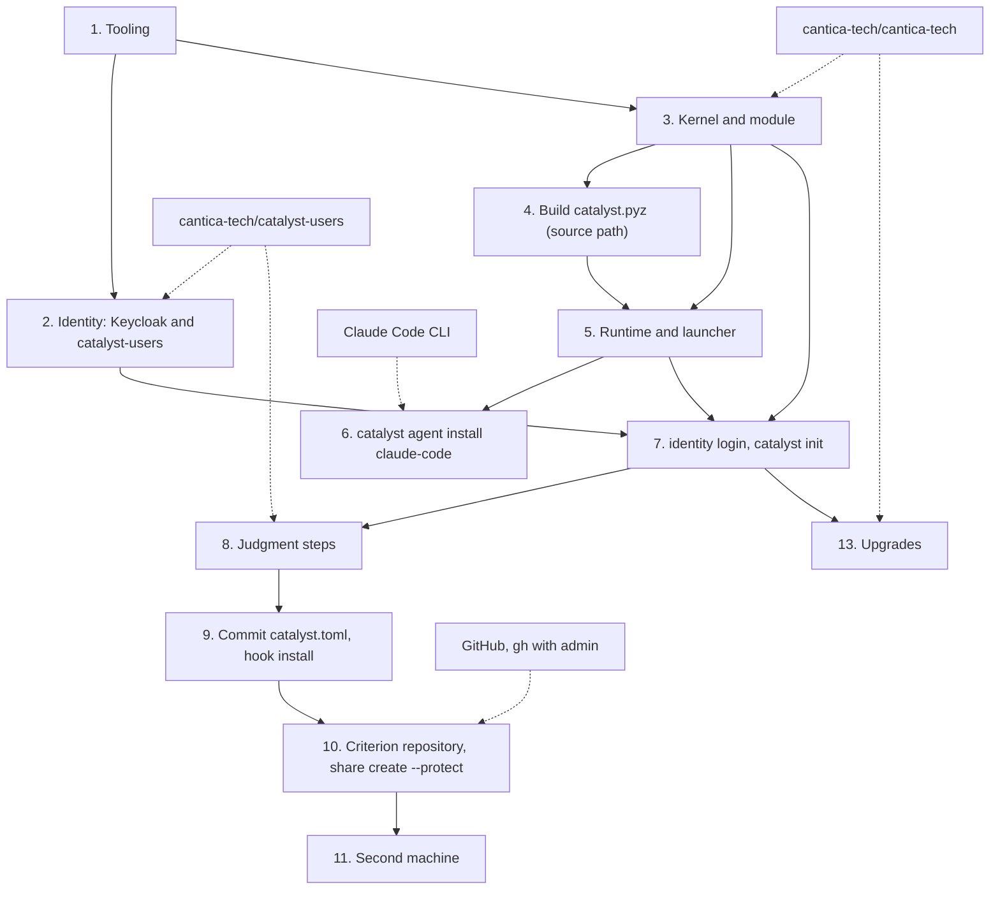

---

## 1. Prerequisites

| Tool | Version | Why | Verify |
|---|---|---|---|
| OS | macOS or Linux are tested by the owner; Windows is a 1.0 target and the CLI runs in Windows CI (`tests.yml`) | — | — |
| `python3` | **≥ 3.11** (CI tests 3.11 and 3.13; observed working with 3.13 and 3.14) | The CLI is a stdlib zipapp. `pyproject.toml` says `requires-python >=3.11`. | `python3 --version` |
| `git` | any recent | The criterion is a git repository; the journal hashes blobs with `git hash-object -w` | `git --version`; also `git config --global user.name` / `user.email` must be set |
| `uv` | observed 0.11.26 | Runtimes are built with `uv venv --relocatable --python ">=3.11"`; without uv, `python -m venv` is used | `uv --version` |
| `go-task` (`task`) | 3.x (observed 3.50.0) | `catalyst task <name>` runs the criterion's `Taskfile.common.yml`; the catalyst repo's own `Taskfile.yml` | `task --version` |
| `gh` | authenticated | `share push` opens pull requests; `share create --protect` / `criterion protect` sets branch protection | `gh auth status` |
| SSH key | registered on GitHub | criterion repositories are reached over `git@github.com:…`; a private criterion needs read (and for contributors, write) access | `ssh -T git@github.com` |
| Docker | — | runs the local Keycloak used by catalyst-users | `docker info` |
| Claude Code (`claude`) | — | the only tested agent | `claude --version` |

You also need **GitHub access to the `cantica-tech` organisation**. The kernel, modules and distribution repositories are public. Criterion repositories (by convention `<project>-criterion`) are **private**.

---

## 2. Identity: catalyst-users and Keycloak

Since kernel 0.106.0, **nothing is installed or signed without a verified identity**. `catalyst init` resolves the pointer from `--identity-issuer` or, failing that, from this machine's catalyst-users settings. With neither, it refuses. Observed:

How `init` finds the identity provider and who installs:

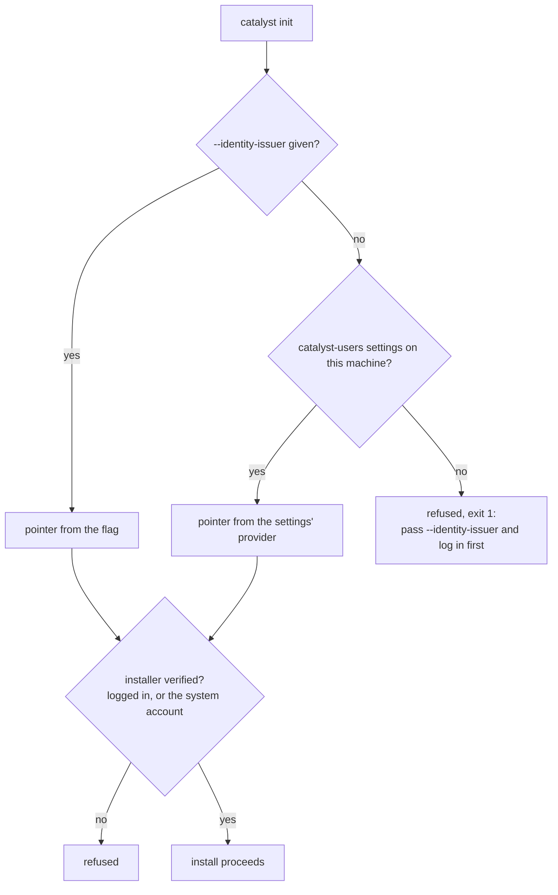

```text
$ python3 kernel/bin/catalyst.pyz init --kernel kernel --name shop --module software-engineering --module-dir se ...
catalyst: people are catalyst-users' (design 29): pass --identity-issuer <url> and log in first (`catalyst identity login --issuer <url>`)
exit=1
```

### 2.1 Run Keycloak and set up catalyst-users

This follows `cantica-tech/catalyst-users:README.md` and `cantica-tech/catalyst:beta/QUICKSTART.md`.

```sh
git clone git@github.com:cantica-tech/catalyst-users.git
cd catalyst-users
uv sync --all-extras                      # Python 3.11+, CLI + dev tools
docker compose up -d                      # Keycloak 26.4.0 on 127.0.0.1:8080, realm "catalyst" imported from keycloak/realm-catalyst.json
uv run catalyst-users setup               # interactive: provider, settings, admin username, a password *command*
```

What `setup` achieves:

- It creates or uses the realm `catalyst` and makes you its admin (group `catalyst-admins`).
- With `--criterion <name>` it creates the criterion group `criteria/<name>/admins` and appoints you.
- It writes `$CATALYST_HOME/users/IAM/settings.json`. That file holds the provider type and connection, the admin `username` and a `password_command`, which is the command that prints the password, e.g. a keychain read. It never holds the password itself. This admin becomes the machine's **system account**: when no one is logged in, catalyst signs as it, provided the issuer matches.

Setting up the provider, from the clone to the provisioned roles:

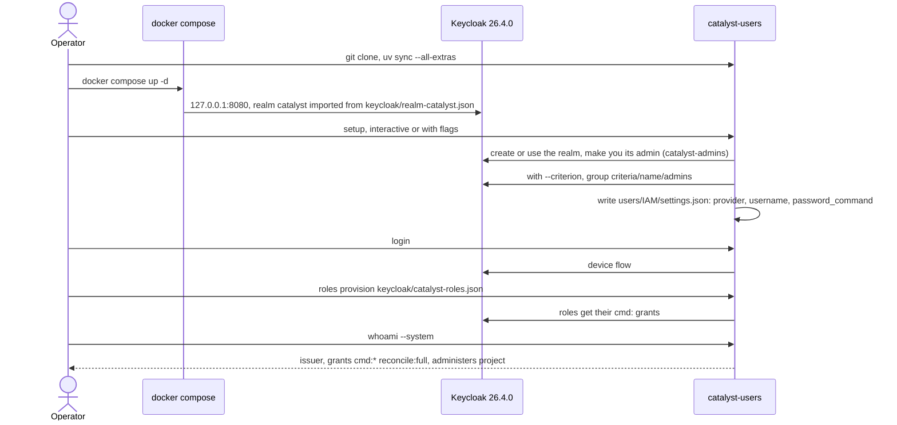

The non-interactive form from the quickstart (substitute your own values; never write a real password into a doc):

```sh
catalyst-users setup --type keycloak \
  --provider '{"url": "http://127.0.0.1:8080", "realm": "catalyst", "definition": "<catalyst-users>/keycloak/realm-catalyst.json"}' \
  --username <you> --password-command "<command that prints your password>" \
  --server-admin admin --server-admin-password-command "<command printing the Keycloak bootstrap admin password>" \
  --email <you@example.com> --first-name <First> --last-name <Last> --criterion <project-name>
```

Give catalyst's roles their grants. This runs with your own login through the device flow:

```sh
uv run catalyst-users login
uv run catalyst-users roles provision keycloak/catalyst-roles.json --login-client catalyst-cli --login-client catalyst-admin-cli
uv run catalyst-users whoami --system      # expect: issuer http://127.0.0.1:8080/realms/catalyst, grants cmd:* reconcile:full, administers <project>
```

For each additional project:

```sh
uv run catalyst-users criteria add <project-name> --admin <you>
```

**Verify:**

- `curl -sf http://127.0.0.1:8080/realms/catalyst/.well-known/openid-configuration` returns JSON.
- `whoami --system` lists the grants.

**Common failures:**

| Symptom | Fix |
|---|---|
| Keycloak not up yet | Wait until `curl` succeeds. |
| `NoSettingsError` | Run `setup`. |
| `--system` fails | The `password_command` must print the password as its first line. |
| Port 8080 already taken | Free the port, or point `--provider url` and later `--identity-issuer` at the port you chose. |

Keycloak keeps its data in `.keycloack/` on the host; delete it to start from the realm file again.

> **Note.** A deployment whose `IAM/identity.json` points at `http://localhost:8080/realms/catalyst` needs a Keycloak reachable at that issuer **on the signing machine**. If Keycloak is down, every writing verb fails. Read verbs keep working.

### 2.2 Log in for catalyst

```sh
python3 <path to catalyst.pyz> identity login --issuer http://localhost:8080/realms/catalyst   # before PATH is set up
# or, once the launcher exists:
catalyst identity login --issuer http://localhost:8080/realms/catalyst
catalyst identity whoami --issuer http://localhost:8080/realms/catalyst
```

This is the OIDC device flow against the public client `catalyst-cli`: open the link and confirm the code. Tokens are stored owner-only in `$CATALYST_HOME/identity/<hash>.json`, never in a project or criterion. If you skip the login, the system account from 2.1 signs, provided its issuer equals the pointer's.

The login, step by step:

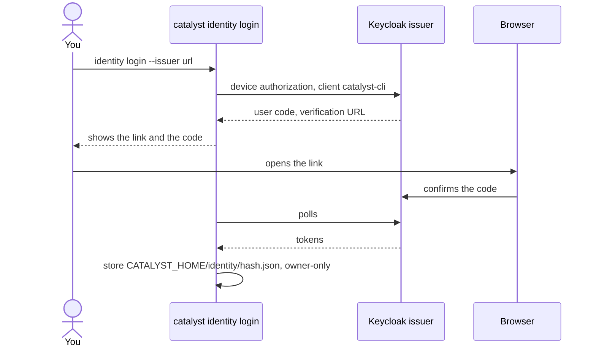

---

## 3. Obtain the kernel and a module

You have two options.

### 3.A From the distribution repository (released artifacts, recommended for operators)

```sh
git clone git@github.com:cantica-tech/cantica-tech.git            # public; branch main
ls cantica-tech/catalyst/kernel/            # v0.32.0 … v0.119.2
ls cantica-tech/catalyst/modules/software-engineering/   # … v3.4.1
mkdir -p ~/catalyst-dl/kernel ~/catalyst-dl/se
(cd ~/catalyst-dl/kernel && unzip -q <dist>/catalyst/kernel/v0.119.2/kernel-v0.119.2.zip)
(cd ~/catalyst-dl/se     && unzip -q <dist>/catalyst/modules/software-engineering/v3.4.1/software-engineering-v3.4.1.zip)
python3 ~/catalyst-dl/kernel/bin/catalyst.pyz --version     # observed: catalyst 0.119.2+gd5e2a1bea451
```

Contents:

- Unzipped kernel (observed): `ACCESS-CONTROL.md ANALYSIS-PLAYBOOK.md ARTIFACT-LAYOUT.md CLI.md FORMAT.md GLOSSARY.md INSTANTIATION-*.md INVARIANTS.md LICENSE MODULE-SPECIFICATION.md README.md SYNCHRONIZE.md agents/ bin/catalyst.pyz definitions/ entities/ manifest.json migrations/ rules-of-*.template.md schemas/ templates/`. This directory is what you pass as `--kernel`.
- Unzipped module (observed): `INVARIANTS.module.md LICENSE README.md ROADMAP.md Taskfile.module.yml code-of-conduct.module.md definitions/ manifest.json migrations/ module.yaml rules-of-rules.module.md templates/ ui/ version.txt`. This directory is what you pass as `--module-dir`.
- Each kernel version directory also holds a loose `catalyst.pyz` and `manifest.json`.
- Keep the **previous** version's zip available in the same `…/v<ver>/kernel-v<ver>.zip` layout. `sync` uses it as the three-way merge base (§13).

Compatibility: SE 3.4.1 requires kernel `>=0.83.0` (`module.yaml` `kernel_version`). `init` refuses a pair that is out of range.

The two ways to get a kernel and a module, and the flags they feed:

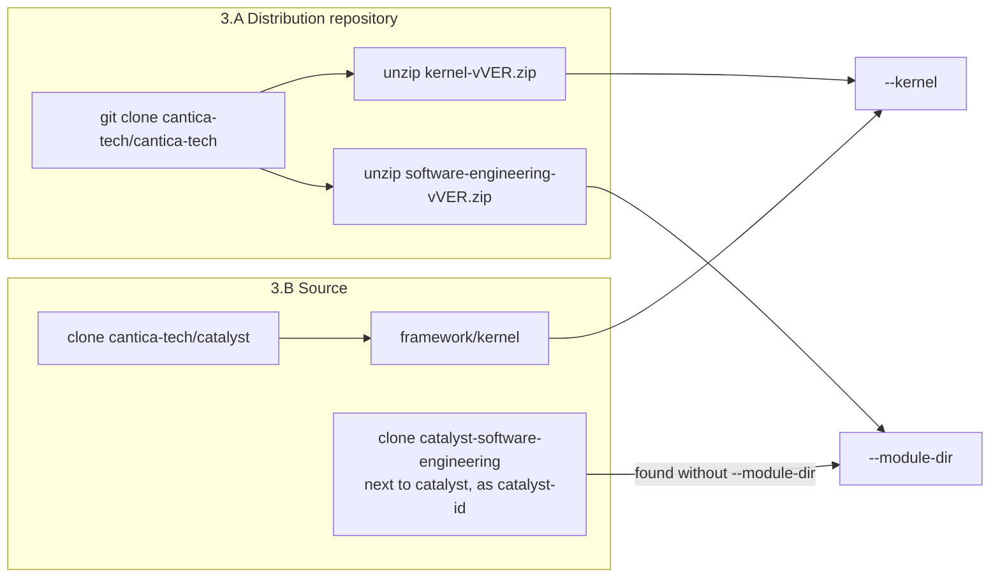

### 3.B From source (developers of catalyst)

```sh
git clone -b development git@github.com:cantica-tech/catalyst.git          # or main/release for released states
git clone -b main git@github.com:cantica-tech/catalyst-software-engineering.git   # next to catalyst, named catalyst-<id>
# optional second module:
git clone -b main git@github.com:cantica-tech/catalyst-knowledge-base.git
cd catalyst && pip install -r requirements-dev.txt   # only for running tests
```

A module checked out next to the project, or next to catalyst, as `catalyst-<id>` is found without `--module-dir`. To match a kernel release, check the module out at the release tag that names that kernel; see the tag notes.

---

## 4. Build `dist/catalyst.pyz` (from source)

```sh
cd <catalyst>
task build:cli
# without Task:
PYTHONPATH=scripts python3 -c 'from pathlib import Path; import package_release as p; print(p.build_cli(Path("."), Path("dist/catalyst.pyz")))'
python3 dist/catalyst.pyz --version     # catalyst <version.txt>+g<12-char HEAD>[.dirty]
```

- **What it achieves:** produces the single-file CLI with the kernel ETDs embedded and build identity stamped. `.dirty` means `scripts/`, `framework/kernel/entities` or `version.txt` differ from HEAD.
- **Files created:** `dist/catalyst.pyz` (git-ignored).
- **Run from source without building:** `task catalyst -- <args>`, or `PYTHONPATH=scripts python3 -m catalyst <args>`. `--kernel` then defaults to the checkout's `framework/kernel`.
- **Common failure:** with a vendored pyz, omitting `--kernel` gives `catalyst: pass --kernel <framework/kernel of a catalyst checkout or release>` (exit 2). A zipapp knows no kernel directory of its own.

What `task build:cli` puts into the zipapp:

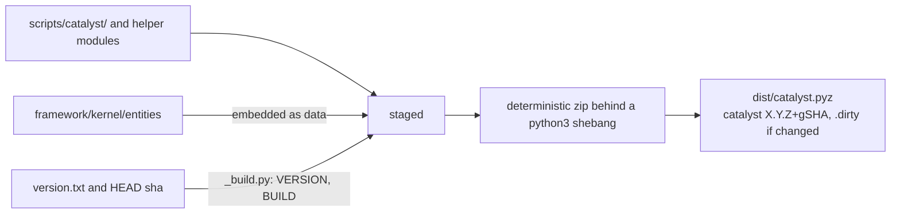

---

## 5. Put `catalyst` on PATH

There is no package install. `catalyst init` (or `catalyst runtime install`) builds:

- `$CATALYST_HOME/runtimes/<version>/`: a venv whose `site-packages/` holds `catalyst.pyz` and `catalyst.pth`;
- the launcher `$CATALYST_HOME/bin/catalyst` (plus `catalyst.cmd`).

Add the launcher's directory to PATH once, for example in `~/.zshrc` or `~/.bashrc`:

```sh
export PATH="$HOME/.catalyst/bin:$PATH"
```

To build a runtime before any project exists:

```sh
python3 <catalyst.pyz> runtime install
catalyst runtime status
```

Observed `runtime status`: `version`, `home`, `runtimes ['0.119.2', '0.119.2+gd5e2a1bea451']`, `launcher_installed True`, `criterion`, `criterion_runtime`.

How the launcher picks what to run:

- Inside a project, it runs that criterion's `.venv`. Each project therefore runs its own pinned version.
- Outside a project, and always for `catalyst mcp`, it runs the newest installed runtime.

Who builds what, and what the launcher runs:

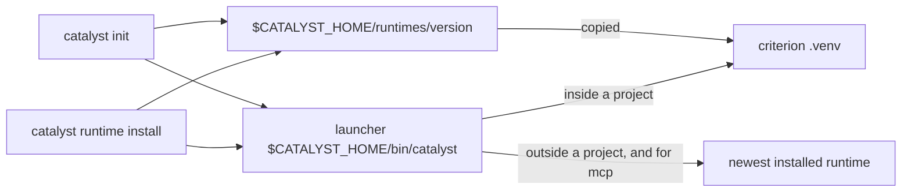

**Verify:** `which catalyst` → `$HOME/.catalyst/bin/catalyst`; `catalyst --version`.

**Failures:**

| Message | Fix |
|---|---|
| `catalyst: no project here and no runtime installed` | Run `python3 <pyz> runtime install`. |
| `<dir> has no reachable criterion (expected …)` | The project's criterion is not on this machine: run `catalyst open` (§11). |

---

## 6. Wire the agent

Run this once per machine, **at user level**. Nothing is written into any project.

```sh
catalyst agent install claude-code
catalyst agent status
```

Observed output:

```text
<HOME>/.claude/settings.json: set hooks.Stop, hooks.SessionStart
claude mcp: catalyst added (user scope, ~/.claude.json)
claude-code  installed  hooks.Stop yes, hooks.SessionStart yes, mcp (user scope) yes
```

What it writes:

- **`~/.claude.json`**: user-scope MCP server `catalyst` → `$HOME/.catalyst/bin/catalyst mcp` (stdio), via `claude mcp add --scope user`.
- **`~/.claude/settings.json`**:
  - `hooks.Stop` → `<launcher> hook stop`, the end-of-turn check, which blocks on failures the session introduced (ADR-002);
  - `hooks.SessionStart` → `<launcher> hook start --quiet`, which records the session's baseline of existing failures.
- **Backups:** each edited JSON file is backed up once as `<file>.before-catalyst`.

What `catalyst agent install claude-code` touches, all at user level:

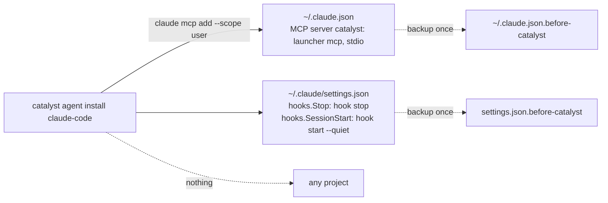

Alternative: install the plugin at `agents/claude-code/plugin` (shipped inside the kernel zip under `agents/`). It is the same wiring.

Other agents: `catalyst agent install copilot|vscode|cursor|codex|gemini`. These are untested by the owner; the files each one writes are listed in `10-architecture` §17.

**Verify in Claude Code:**

- `claude mcp list` shows `catalyst`.
- In a governed project, the `/catalyst:<command>` prompts appear (`/catalyst:check-rules`, …).

**Failures:**

| Symptom | Fix |
|---|---|
| `claude` is not on PATH | The command prints `claude mcp add --scope user catalyst -- <launcher> mcp`: run it yourself. |
| A settings file is not plain JSON | It is left untouched and the snippet is printed: merge it by hand. |

---

## 7. `catalyst init`

Run it from the **project root**: a git repository, ideally with at least one commit. `journal_since` becomes HEAD, or `""` with no commit, which makes the whole history subject to the unrecorded-change check. Run it only when the owner asked for the install (L8).

### 7.1 Command

```sh
cd <project>
python3 <kernel>/bin/catalyst.pyz init \
  --kernel <kernel dir (unzipped release) or <catalyst>/framework/kernel> \
  --name <project-name> \
  --module software-engineering --module-dir <unzipped module or catalyst-software-engineering checkout> \
  --identity-issuer http://localhost:8080/realms/catalyst \
  --user "<Full Name>" --git-username <git-username> \
  --rule-doc business-rules:br --rule-doc dev-environment-rules:env \
  --test-locations "tests/" \
  --agent claude-code
```

The form in `cantica-tech/catalyst:CLAUDE.md` is:

```sh
python3 <catalyst>/dist/catalyst.pyz init --kernel <catalyst>/framework/kernel --name <name> --module <id> --git-username <u> --rule-doc <file>:<prefix> --agent claude-code
```

From a catalyst checkout the equivalent is `task catalyst -- --project <target root> init …`.

The install as a sequence between the operator, the CLI, the provider and the two places it writes:

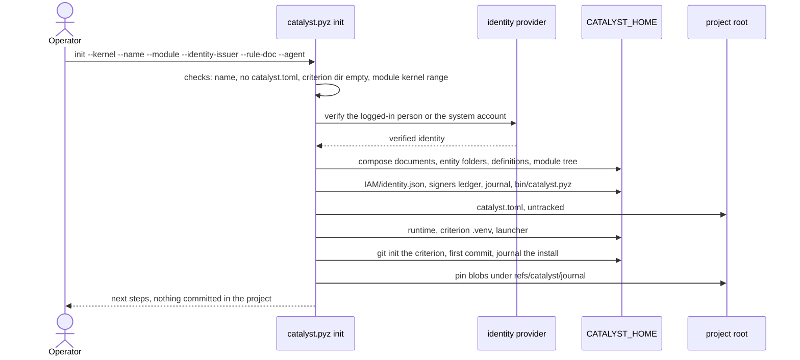

### 7.2 Every flag

| Flag | Meaning | Default and notes |
|---|---|---|
| `--name` | Project name; the criterion directory is `$CATALYST_HOME/projects/<name>/criterion` | Required. Letters, digits, `.`, `_`, `-`. Refused if already used on this machine. Source of the name: `dev-instructions.yaml` `name:` if present (delete it after install), else ask the user, defaulting to the repository name. |
| `--module <id>` | Active (first) module | **No default.** Without it, init lists `catalyst-<id>` checkouts it finds and exits 2. Observed: `catalyst: pass --module <id> (and --module-dir if it is elsewhere), or --no-module …`. |
| `--module-dir <dir>` | Module directory (checkout or unzipped release) | Needed unless a `catalyst-<id>` sibling of the project or of catalyst exists. |
| `--no-module` | Kernel types only; add a module later with `catalyst module install` | — |
| `--kernel <dir>` | `framework/kernel` of a checkout, or an unzipped kernel release | Defaults to the running checkout. **Required with a pyz.** The version comes from `manifest.json` (release) or `../../version.txt` (checkout). |
| `--identity-issuer <url>` | Writes `IAM/identity.json` `{"provider":"keycloak","issuer":<url>}` | Without it, the provider of this machine's catalyst-users settings is used. Without either, refused. The installer must be verified: logged in, or the system account. |
| `--identity-client <id>` | Device-grant client | `catalyst-cli` |
| `--catalyst-client <id>` | Client whose roles carry grants | `catalyst` |
| `--user <name>` | Installer's display name (`DEPLOYMENT.md`, `created_by`, the criterion's git config) | `git config user.name` of the project |
| `--git-username <u>` | Installer username for git/topic branches | `--user` |
| `--rule-doc <file>:<prefix>` | Repeatable. Seeds `rules/<file>.md` with the ID prefix | One document, `<name>-rules.md`, prefix `br`. Choose one per natural seam. On the greenfield path, add `dev-environment-rules:env`. |
| `--test-locations <text>` | Fills `{{TEST_LOCATIONS}}` in `Rules-of-Rules.md` §2 | Placeholder text `*(to be named: …)*` |
| `--agent <id>` | Recorded as `agent` in `catalyst.toml` | `unknown`. Writes no agent file. |
| `--no-runtime` | Skip building the runtime and `.venv` | Do it later with `catalyst runtime install` |
| `--at <dir>` | **Legacy, deprecated**: builds the criterion behind a `.criterion` symlink plus a `<name>.catalyst` pointer | Do not use for new deployments (CI still does) |
| `--user`/`--project` (global) | `--project <dir>` before `init` installs into another directory | — |

### 7.3 What it creates (observed, in order)

Observed output (paths shortened):

```text
catalyst: created refs/catalyst/journal in <project> (pins the blobs the journal records so `git gc` keeps them; local only unless `journal pin --share`)
catalyst: created refs/catalyst/journal in <HOME>/.catalyst/projects/shop/criterion (…)
- composed CODE-OF-CONDUCT.md, rules/Rules-of-Rules.md, ACCESS-CONTROL.md, Taskfile.common.yml
- created the kernel's entity folders, each with index, templates catalog and README
- froze the latest definition of every kernel type (INV-23)
- seeded module software-engineering 3.4.1 (recorded in modules/modules.json): 8 entity folder(s), definitions, invariants
- pointed the deployment at catalyst-users (static); <user> (userid <userid>) signs first, in the signers ledger
- wrote the journal, version.txt, DEPLOYMENT.md, README.md, ANALYSIS-PLAYBOOK.md, INVARIANTS.md; vendored bin/catalyst.pyz
- wrote catalyst.toml (the only file catalyst adds to the project); the criterion is <HOME>/.catalyst/projects/shop/criterion
- wrote no agent files into the project: `catalyst agent install <agent>` wires an agent once per machine, at user level
- filled the criterion's runtime <criterion>/.venv (catalyst 0.119.2, git-ignored)
- installed the catalyst command <HOME>/.catalyst/bin/catalyst (put <HOME>/.catalyst/bin on PATH)
- initialised the working copy's git history and journaled the install
- note: wrote the journaled product files' blobs into the product repository's .git, kept by the ref refs/catalyst/journal (no commit, no branch, nothing pushed)
Next: `catalyst agent install <agent>` once per machine, then the first rules (catalyst id next-rule) and `catalyst check`. Nothing was committed in the project repository.
```

It took about 2 s.

**In the project:**

| Item | Purpose |
|---|---|
| `catalyst.toml` (untracked) | `project_name`, `format = "1.0-rc"`, `kernel_version`, `module`, `agent`, `repoed = false`, `created_by`, `created`, `updated`, `journal_since = <HEAD>` |
| `.git/refs/catalyst/journal` + blobs | Pins the product blobs the journal names, so `git gc` keeps them |

No `.gitignore`, Taskfile or `.claude/` change.

Everything `init` creates, by place:

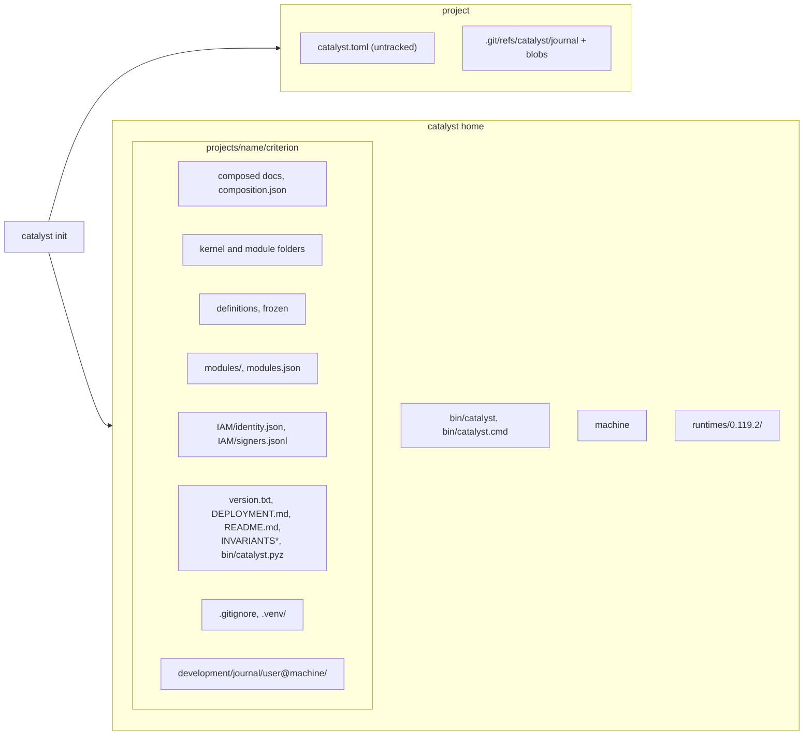

**In catalyst home:**

| Item | Purpose |
|---|---|
| `bin/catalyst`, `bin/catalyst.cmd` | Launcher |
| `machine` | Random machine id used in journal shard names |
| `runtimes/0.119.2/` | Runtime venv |
| `projects/<name>/criterion/` | The criterion (full tree in `10-architecture` §7.3) |

**In the criterion:**

| Item | Purpose |
|---|---|
| Composed docs | `CODE-OF-CONDUCT.md`, `rules/Rules-of-Rules.md`, `ACCESS-CONTROL.md`, `Taskfile.common.yml`, `composition.json` |
| Kernel folders | `rules/` (+ `domains/`, `templates/`, one file per `--rule-doc`, `rules.md`), `reconciliations/`, `workflows/`, `analyses/`, `IAM/{users,roles,groups}/` display templates |
| Module folders (SE) | `requirements/ steps/ tests/ features/ decisions/ development/{bugs,house-keeping,roadmaps}/ development/BACKLOG.md` |
| Definitions | `definitions/*.md`, frozen (21 for kernel + SE) |
| Module record | `modules/software-engineering/` (release tree), `modules/modules.json` (`source` is the directory or zip name, e.g. `"se"`, or the repository URL for a git source) |
| Identity | `IAM/identity.json`, `IAM/signers.jsonl` (first line: installer's userid, iss, sub, username, name, first_signed) |
| Root files | `version.txt`, `DEPLOYMENT.md`, `README.md`, `INVARIANTS.md`, `INVARIANTS.module.md`, `ANALYSIS-PLAYBOOK.md`, `bin/catalyst.pyz` |
| Runtime | `.gitignore` (`/.venv`), `.venv/` |
| Journal | `development/journal/<user>@<machine>/<YYYY-MM>.jsonl` with the install entry |
| git | Repository on branch `main` with one commit, `catalyst init: <name> (kernel X, module id ver)` |

Note that `development/journal/` is left **uncommitted** in the criterion (observed `?? development/journal/`). It is committed by the first `share create` or `share push`; with a local-only criterion, commit it yourself (`git -C <criterion> add -A && git -C <criterion> commit`).

**Atomicity:** any failure rolls back every path init created (an existing empty directory is emptied, not deleted), restores `.gitignore`, and puts a moved `.ledger/` back. So init can simply be re-run.

**Refusals (exit 1, nothing written):**

- `catalyst.toml` or a legacy pointer already exists;
- `.criterion` exists, unless it holds only `.ledger/`;
- the criterion directory is not empty;
- a `.catalystignore` opts the directory out;
- a bad `--name`;
- the module's kernel range excludes the kernel;
- no verified identity.

The all-or-nothing behaviour:

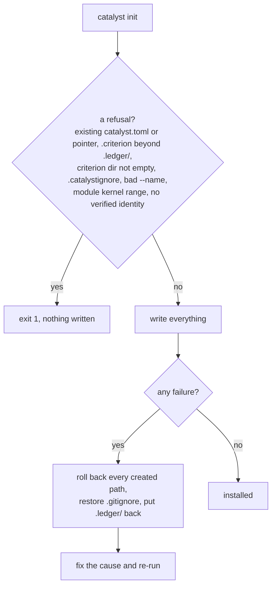

### 7.4 Verify the install

Observed in the sandbox:

```text
$ catalyst where
project    <project> (catalyst.toml, name shop)
criterion  <HOME>/.catalyst/projects/shop/criterion (home)
$ catalyst check
catalyst check passed (module software-engineering): 0 error(s), 0 warning(s)   # (sandbox: 1 warning, the test-only static provider)
$ catalyst journal verify
catalyst journal verify passed: 0 error(s), 0 warning(s)
$ catalyst open
catalyst: shop — criterion … (home)
  kernel 0.119.2 (catalyst.toml pins 0.119.2), runtime 0.119.2+gd5e2a1bea451, agent claude-code
  shared: local (not shared)
  ready
$ catalyst module list
software-engineering 3.4.1  se
    sha256 39d751bb…
$ catalyst unrecorded
0 commit(s) with changes not in the journal (checked as warnings)
$ catalyst spec          # the §4 commands: /adopt /check-rules /create /freeze /help /journal /list /migrate-definition /reconcile /roadmap /role /run-analysis /share /show-backlog /status /sync-framework /user
$ catalyst task          # lists the Taskfile.common.yml tasks (needs go-task)
```

---

## 8. The judgment steps after init

These steps implement `cantica-tech/catalyst:BOOTSTRAP.md` §2 and `framework/kernel/INSTANTIATION-GUIDE.md`. Work them from a deployment ledger: copy `framework/kernel/templates/ledger.template.md` to `<criterion>/.ledger/install.todo.md` and add the items of `INSTANTIATION-CHECKLIST.md`. Each item is `[ ]`, `[x]` or `[!] blocked: <reason>`. Re-read the laws every 5 items.

1. **Preconditions.** Confirm the user asked for the install. Resolve the agent's capabilities: sub-agents, memory, slash commands. Choose the path: **greenfield**, **retrofit**, or skeleton only.
2. **Read the module's invariants**: `<criterion>/INVARIANTS.module.md`.
3. **Fill the module's placeholders.** Any document the module requires that still holds `{{PLACEHOLDER}}` is filled by the command the module names.
4. **People, roles and landing**, in catalyst-users:
   - `catalyst-users roles provision …`;
   - `catalyst-users criteria add <name> --admin <user>`;
   - add contributors to the criterion's group;
   - then the landing policy: `catalyst landing init --policy standard` (recommended; the other choices are `open`, `reviewed` and `host`). It is signed and journaled and counts as the Admin's assent.
   - Verify with `catalyst landing show`.
5. **Landing page.** Extend the criterion's `README.md` stub with the project's rule and workflow structure.
6. **First content.** For each domain, first create `rules/domains/<prefix>-<DOMAIN>-<summary>.md` and register it in `rules/domains/domains.md`. Then:

   ```sh
   RULE=$(catalyst id next-rule br AUTH)        # refused until AUTH is registered
   # write the rule heading in rules/business-rules.md and list the ID in rules/rules.md, then:
   catalyst journal append --command "catalyst journal append" --action create --artifact "$RULE" --target "$RULE" \
     --intent "<goal of the change>" --file "<criterion>/rules/business-rules.md" --file "<criterion>/rules/rules.md" \
     --file "<criterion>/rules/domains/domains.md" --file "<criterion>/rules/domains/<domain file>"
   ```

   Create module artifacts with `catalyst new <TYPE> --title … --field Targets=<rule> --tier fix|feature --intent …` (or `/create <type>` in the agent). `catalyst status set`, `link` and `edit` work the same way: each signs, indexes and journals.
   - **Greenfield:** one domain per decision area (runtime, dependencies, style, testing, CI, dev env, repository layout), each rule implemented as real config in the same pass.
   - **Retrofit:** gather rules per area as you touch it, or bootstrap with `/run-analysis --bootstrap` (four-eyes: two blind passes, then a human decides). Ask the user on conflicts.
7. **Finish.**
   - `catalyst check`: no errors, and report the warnings.
   - Delete `dev-instructions.yaml` if it exists.
   - Write a memory note (project, `catalyst where`, date).
   - Present the deployed tree.
   - **Commit or push nothing without the user's yes** (`BOOTSTRAP.md` §4).

The judgment steps as a flow, from the ledger to the user's yes:

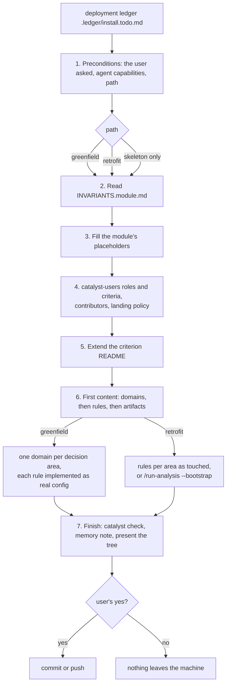

---

## 9. Commit `catalyst.toml`, install the commit hook

These steps run only on the owner's yes.

```sh
catalyst hook install           # writes .git/hooks/commit-msg (never tracked); an existing commit-msg hook is left for you to merge
git add catalyst.toml
git commit -m "chore: install catalyst"
catalyst trace HEAD             # every commit in range cites an ID or is chore:
```

- **What the hook does:** every commit message must cite a resolving `<PREFIX>-NNNNNN[-userid]` or rule ID, or start with `chore:` / `chore(scope):`. It also warns on unrecorded changes. To bypass it once, use `git commit --no-verify`, and only with the owner's say-so.
- **Observed:** `installed <project>/.git/hooks/commit-msg`, a Python script headed `# Installed by \`catalyst hook install\`…`.

The commit-msg hook's decision:

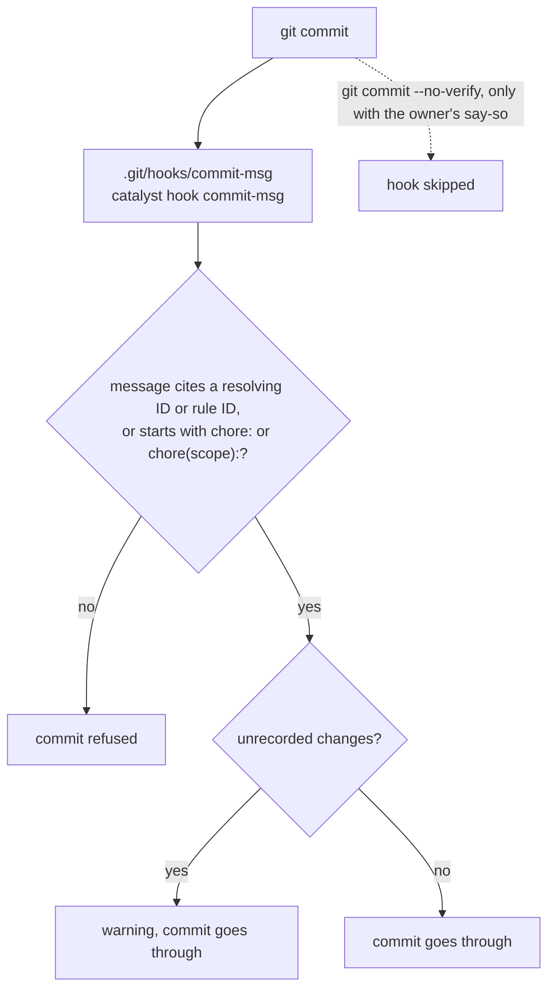

---

## 10. Create the criterion remote and share it

### 10.1 Create the repository on GitHub

Create an **empty private** repository, for example `cantica-tech/<project>-criterion`. catalyst does not create it.

```sh
gh repo create cantica-tech/<project>-criterion --private
```

### 10.2 First publication

```sh
catalyst share create git@github.com:cantica-tech/<project>-criterion.git --protect
# prints the plan and exits 3 (assent gate). Observed:
#   publish this criterion to git@github.com:example-org/shop-criterion.git (shared branch criterion)
#   catalyst: publishing needs the user's assent (INV-4): show them the above, then re-run with --yes
catalyst share create git@github.com:cantica-tech/<project>-criterion.git --protect --yes
```

What it does:

- sets `origin` on the criterion and uses the shared branch `criterion` (`--branch` overrides it);
- writes and commits `.gitattributes` (union merge for journal shards, `IAM/signers.jsonl` and generated indexes), `.github/workflows/catalyst.yml` (the PR gate) and `bin/catalyst.pyz.sha256`;
- pushes the branch and the pins;
- with `--protect`, applies GitHub branch protection: PRs required, `catalyst` check required (strict), no force-push or deletion. This needs `gh` with admin rights;
- writes `repoed = true`, `catalyst_repo = "<name>"`, `catalyst_repo_url` and `criterion_branch = "criterion"` into the project's `catalyst.toml`. This is **staged, not committed**; commit it with the owner's yes (`git commit -m "chore: share the criterion"`).

The first publication, with the assent gate:

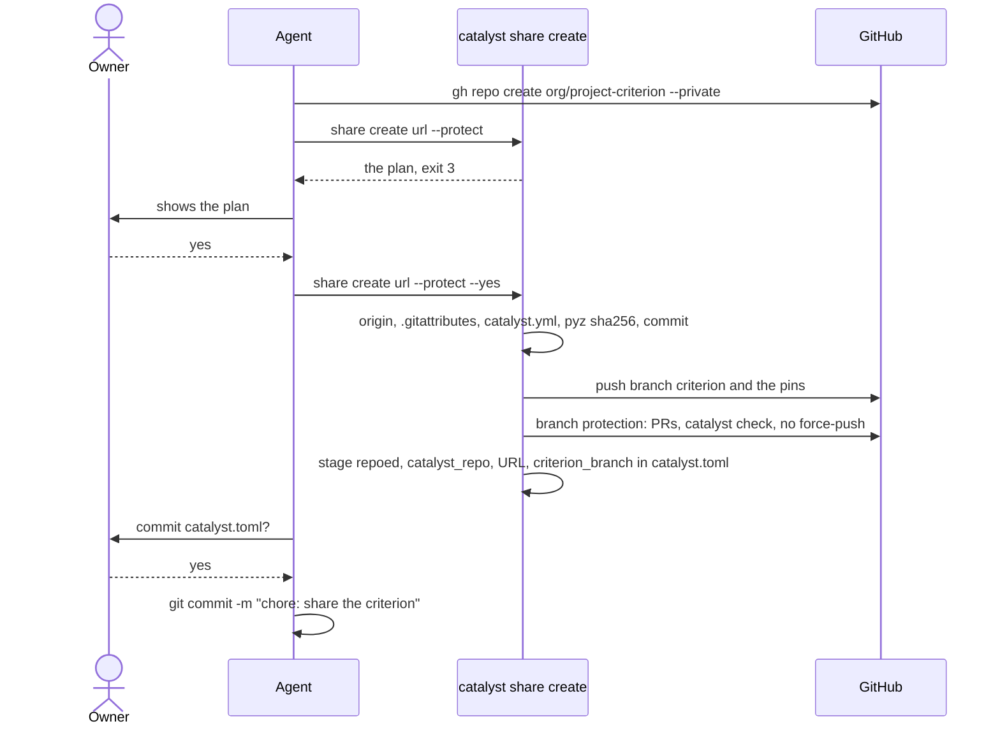

**Verify:**

- `catalyst share info` shows driver `git` and the URL;
- `catalyst share status --fetch` reports 0 ahead/behind;
- on GitHub, the `catalyst` workflow exists on branch `criterion`.

The 10.2 commands were run only as a dry run in the sandbox (exit 3); no real push was made.

**Failures:**

| Symptom | Cause and fix |
|---|---|
| Push denied | SSH key or permissions. |
| Remote already has a branch not contained in local history | Refused: fetch and merge first. |
| `--protect` fails | The remote is not on GitHub, or you are not an admin: set the protection by hand. |
| Private repository in CI | Needs a deploy key or token (§15). |

### 10.3 Alternative: share through a server

```sh
catalyst share create <server-url> --driver serve --as <you> --yes
```

This writes `share = "serve"` and `share_url`. Each user then runs `catalyst share login <url>` with a token issued by `catalyst serve token`. The server is `catalyst serve [--db] [--host] [--port]`, on `127.0.0.1:8765`, with TLS handled by a reverse proxy. This path is not covered further here.

---

## 11. A second machine

Prerequisites: §1 tools, the SSH key with access to the **private** criterion repository, and the identity provider (§2) reachable at the **same issuer URL** as the pointer.

```sh
git clone git@github.com:cantica-tech/<product>.git && cd <product>
python3 <any catalyst.pyz ≥ the pinned kernel, or the launcher if already installed> open
#   clones catalyst_repo_url (branch criterion_branch) into $HOME/.catalyst/projects/<project_name>/criterion,
#   fetches the product's journal pins, fills <criterion>/.venv from the criterion's own bin/catalyst.pyz,
#   installs the launcher if missing, and prints a to-do list (exit 0 = ready, 1 = something left, 2 = not a project)
export PATH="$HOME/.catalyst/bin:$PATH"
catalyst open --agent claude-code        # records this user's agent in $HOME/.catalyst/projects/<name>/agent (never in catalyst.toml)
catalyst where
catalyst identity login                  # issuer from IAM/identity.json; or rely on the system account (setup on this machine)
catalyst identity whoami
catalyst agent install claude-code       # if not done on this machine
catalyst hook install                    # optional, per clone
catalyst check
```

Equivalent explicit commands: `catalyst share join [<url>]` (or `catalyst criterion join`).

The second machine's sequence:

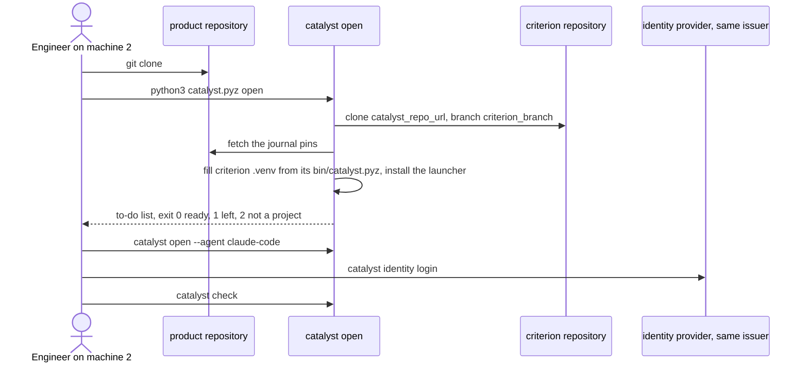

- **Refusals:**
  - a same-named criterion with a different remote;
  - `share pull` / `join` while local work is unpublished.
- **Verify:** `catalyst open` ends with `ready`; `catalyst where` shows `(home)`; `catalyst check` passes.
- **Not verified here:** the clone path. No real remote was used, per the read-only constraint.

---

## 12. Day-to-day sharing

```sh
catalyst share status --fetch                 # unpublished changes, ahead/behind
catalyst share push -m "<message>"            # preview, exit 3
catalyst share push -m "<message>" --yes      # topic branch <git_username>/<UTC ts>, rebase, index regen, check, integrity, push, pins, gh PR
# reviewer merges the PR on GitHub (the catalyst check must be green)
catalyst share pull                           # fast-forward; refuses with unpublished work
```

Conflicts:

- A real conflict aborts the push with nothing pushed. Resolve it by hand, or withdraw your side: `git -C <criterion> checkout origin/criterion -- <file>`, journal and commit that, then open a `RECON-` case with your proposal and push again.
- An agent never applies a merge (L4).
- GitHub's merge button ignores `merge=union`, so a PR that has fallen behind may show conflicts there. Run `share push` again; it rebases, and the union merge applies.

A round of sharing between two contributors:

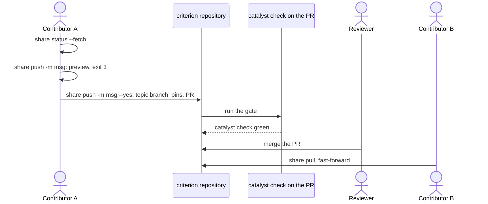

What to do when a push meets a conflict:

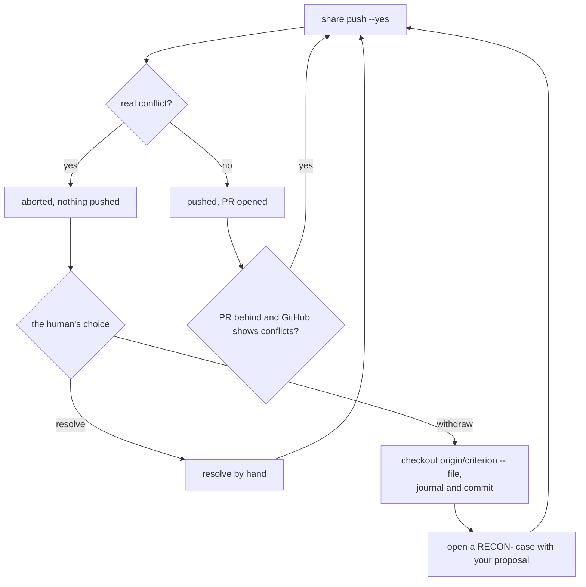

Commits made in the **product** outside catalyst:

1. `catalyst unrecorded` (or `inbox`) lists them.
2. Record them with `catalyst journal adopt <rev|A..B> --intent "<why>"`, or revert them.
3. To share the product's pins, run `catalyst journal pin --share`; it pushes only the `refs/catalyst/journal` ref.

Product commits made outside catalyst:

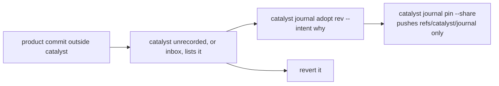

---

## 13. Upgrading

### 13.1 Get the new release

`git -C <dist> pull`, and keep both the old and new `kernel-v<ver>.zip` files in their `catalyst/kernel/v<ver>/` directories.

### 13.2 Plan, then apply (the mechanical half of `/sync-framework`)

```sh
catalyst sync plan  --kernel <dist>/catalyst/kernel/v<new>/kernel-v<new>.zip \
                    --module <dist>/catalyst/modules/software-engineering/v<new>/software-engineering-v<new>.zip
catalyst sync apply --kernel … --module …
catalyst migrate --kernel <same zip>          # judgment steps + template versions to add
catalyst migrate --apply --kernel <same zip>  # takes layout + kernel template steps (module templates only with --template)
catalyst check
```

- **Base kernel.** The base is found next to the target zip as `…/v<deployed>/kernel-v<deployed>.zip`, or from the checkout's git tag of the deployed version. Otherwise pass `--base-kernel`.
- **`apply` does:**
  - re-vendors `bin/catalyst.pyz`;
  - copies `INVARIANTS*`, `ANALYSIS-PLAYBOOK.md` and `definitions/README.md`;
  - refreshes `modules/<id>/` and `modules.json` (with `history`);
  - recomposes the governing documents, keeping local edits;
  - creates definitions for new types only (existing ones are frozen, INV-23);
  - retires catalyst's old project files (`.claude/commands/*` that were never edited, and hooks in `.claude/settings.json`);
  - bumps `version.txt` and `kernel_version`;
  - journals one `/sync-framework` entry;
  - refills `.venv`.
- **Observed:** with an identical version, `Plan: kernel 0.119.2 -> 0.119.2; module 3.4.1 -> 3.4.1 / nothing to change`, and `migrate` prints `nothing to migrate: … up to date with kernel 0.119.2`.
- **Judgment and finishing steps (SYNCHRONIZE.md):**
  - one user confirmation before starting;
  - each migration's judgment steps (`catalyst migrate` lists them; for example 0.116.0 "choose the landing policy", 0.106.0 "point at catalyst-users, provision roles");
  - update `DEPLOYMENT.md`;
  - a four-eyes verification against `INSTANTIATION-GUIDE.md` (two independent sub-agents).
- **Shared criterion order:** sync, `share push --yes`, merge the PR. Teammates then `share pull`, and `catalyst open` refills their `.venv`.
- **Refusals:**
  - A module needing a kernel newer than the one the shared criterion's CI gate runs: sync the **kernel alone**, publish and merge, pull, then sync the module.
  - A recompose conflict stops the sync before anything is written: resolve it, or `catalyst freeze` the item (`.frozen`).
- **Module only:** `catalyst module upgrade <id> [<source>@<tag>] [--plan]`; `catalyst module available <id>` lists tags (needs the network).
- **Add a second module:** `catalyst module install <dir|zip|git-url@ref> --kernel <deployed kernel>`.
- **One definition:** `catalyst definition migrate <type> <version>`.

Upgrading a shared criterion, kernel before module when the CI gate needs it:

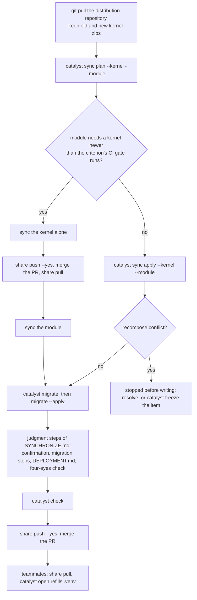

---

## 14. Verification checklist

| Check | Command | Expected |
|---|---|---|
| Locator | `catalyst where` | project, and `criterion … (home)` |
| Readiness | `catalyst open` | `ready`, exit 0 |
| Everything | `catalyst check` (`--strict` turns warnings into errors) | `0 error(s)`. Warnings are listed; the static provider warning appears only in tests. |
| Journal | `catalyst journal verify` | `0 error(s)` |
| Manual changes | `catalyst unrecorded` | `0 commit(s)` |
| Commits traced | `catalyst trace <base>..HEAD` | pass |
| Indexes | `catalyst index regen --check` | no drift |
| Module integrity | `catalyst module verify` | exit 0 |
| Runtime | `catalyst runtime status` | `criterion_runtime` = vendored CLI version |
| Identity | `catalyst identity status` / `whoami` | logged in, grants listed |
| Agent | `catalyst agent status` | `claude-code installed …` |
| Sharing | `catalyst share status --fetch` | 0 unpublished, 0 behind |
| Hooks | <code>echo '{"session_id":"x","cwd":"'$PWD'"}' \&#124; catalyst hook start --quiet; … \&#124; catalyst hook stop</code> | exit 0. Observed: a baseline `sessions/x.json` is created. |
| Bare criterion (CI) | `python3 bin/catalyst.pyz --working-copy . check` in the criterion | pass |
| Explain | `catalyst why L5`, `catalyst why INV-17` | text |

---

## 15. Product CI

Optional. It adds trace checking to the product repository.

```yaml
- env:
    CATALYST_HOME: ${{ runner.temp }}/catalyst
  run: |
    read -r name url branch < <(python3 -c 'import tomllib; d = tomllib.load(open("catalyst.toml", "rb")); print(d["project_name"], d["catalyst_repo_url"], d.get("criterion_branch") or "criterion")')
    git clone -q -b "$branch" "$url" "$CATALYST_HOME/projects/$name/criterion"
    python3 "$CATALYST_HOME/projects/$name/criterion/bin/catalyst.pyz" trace "$range"
```

This comes from `framework/kernel/CLI.md`. A private criterion needs a read-only deploy key or token for the clone. The criterion repository's own PR gate is written by `share create` (§10).

---

## 16. Legacy deployments

Legacy shapes are a `<name>.catalyst` JSON pointer, or a `.criterion` symlink, directory or submodule:

- `catalyst migrate` lists the `layout` step;
- `catalyst move --to-home` moves the criterion to `$CATALYST_HOME/projects/<name>/criterion`, converts the pointer to `catalyst.toml`, drops `/.criterion` from `.gitignore`, turns a submodule into a standalone repository, and fills the runtime. Product changes are staged, not committed.

Moving a legacy deployment into catalyst's home:

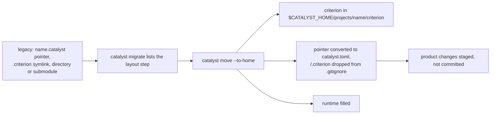

To rename a project, run `catalyst move --name <new>`. For a new agent on the same machine, run `catalyst open --agent <id>`.

---

## 17. Uninstall and rollback

The kernel has **no `catalyst uninstall` verb for a project**. Law L7 says IDs and records are retired, never deleted. The steps below are the manual reverse of what init and the wiring create. Run them only on the owner's explicit decision.

| What | How to undo | Notes |
|---|---|---|
| Failed `init` | Nothing to do: init rolls back on failure; fix the cause and re-run | — |
| Agent wiring | `catalyst agent uninstall claude-code` (removes `hooks.Stop`, `hooks.SessionStart`, and the user-scope MCP server) | Observed: `cleared hooks.Stop, hooks.SessionStart` / `claude mcp: catalyst removed (user scope)`. `<file>.before-catalyst` backups remain. |
| Commit hook | `rm .git/hooks/commit-msg` (check it is catalyst's: the header line) | — |
| Product pins | `git update-ref -d refs/catalyst/journal` (and `git push origin :refs/catalyst/journal` if shared) | After this, `journal restore` loses blobs `git gc` prunes |
| Project file | `git rm catalyst.toml` and commit | After this the project is ungoverned: `check` and hooks exit 0 outside a deployment |
| Local criterion | `rm -rf $HOME/.catalyst/projects/<name>` | Push first if it is shared, or the unpublished work is lost. The remote criterion repository is a separate artifact; archive it on GitHub rather than deleting it. |
| Runtimes and launcher | `rm -rf $HOME/.catalyst/runtimes/<ver>` (old builds accumulate); `rm -rf $HOME/.catalyst/bin` | The launcher is shared by every project on the machine |
| Identity | `catalyst identity logout` (revokes the session and deletes the tokens) | — |
| catalyst-users / Keycloak | `docker compose down` in catalyst-users; delete `.keycloack/` to wipe | This affects every deployment that signs through it |
| A bad change in the criterion | Not a git revert of the journal. Make a new journaled change: `catalyst restore <id> --to <timestamp>`, or `catalyst journal restore <ts> <empty dir>` to inspect the old state. To withdraw an unmerged PR, close it and reset the topic branch. | The journal is append-only |
| A kernel upgrade | Before merge, close the PR and `git -C <criterion> reset --hard origin/criterion` (local, not yet shared). After merge, sync to the older kernel release with `sync apply --kernel <old zip>` | Untested; migrations are not written to be reversible |
| A secret journaled | `catalyst journal redact <blob> --intent "<why>"`, then rotate the secret | History rewriting (`git filter-repo`) is the owner's call |

What sits where, and the command that undoes it:

```mermaid
flowchart TB
  subgraph Machine["user level, per machine"]
    Ag["agent wiring"] --> AgU["catalyst agent uninstall claude-code"]
    Rt["runtimes and launcher"] --> RtU["rm -rf runtimes/ver, bin/"]
    Id["identity tokens"] --> IdU["catalyst identity logout"]
    KC["catalyst-users, Keycloak"] --> KCU["docker compose down"]
  end
  subgraph Project["project"]
    Hk["commit hook"] --> HkU["rm .git/hooks/commit-msg"]
    Pins["product pins"] --> PinsU["git update-ref -d refs/catalyst/journal"]
    Toml["catalyst.toml"] --> TomlU["git rm catalyst.toml, commit"]
  end
  subgraph Crit["criterion"]
    Lc["local criterion"] --> LcU["push first, then rm -rf projects/name"]
    Bad["a bad change"] --> BadU["a new journaled change: catalyst restore"]
    Sec["a journaled secret"] --> SecU["catalyst journal redact, rotate the secret"]
  end
```

---

## 18. Troubleshooting table

| Symptom (message) | Cause | Fix |
|---|---|---|
| `catalyst: pass --kernel <framework/kernel …>` (exit 2) | Running a pyz without `--kernel` | Add `--kernel <unzipped release>` |
| `catalyst: pass --module <id> … Found: none` (exit 2) | No module given or found | `--module <id> --module-dir <dir>` |
| `people are catalyst-users' (design 29): pass --identity-issuer …` | No catalyst-users settings and no issuer | §2, then `--identity-issuer` and `identity login` |
| `no verified identity: not logged in to <issuer>` | Token missing or expired, and no system account | `catalyst identity login` |
| `no one is logged in, and the system account cannot sign in` | Keycloak down, or `password_command` failing | Start Keycloak; test `catalyst-users whoami --system` |
| `--as X: you are logged in as Y` | `--as` names someone else | Sign only as yourself |
| `a criterion named '<n>' already exists` | Name used on this machine | Choose another `--name`, or `catalyst open` an existing one |
| `<works with kernel …, not …>` | Module/kernel version mismatch | Use a matching release pair |
| `domain 'X' is not registered in rules/domains/domains.md` | `id next-rule` before the domain exists | Create and register the domain file first |
| `WARNING version drift` / `kernel_version` ≠ `version.txt` | Half-applied sync, or a teammate synced | `catalyst open` / `share pull`; re-run `sync apply` |
| `format … not supported` (error) | CLI older than the deployment's format | Update the vendored CLI (sync) or use the newer launcher runtime |
| `no runtime installed` | Launcher with no runtime | `python3 <pyz> runtime install` |
| `<dir> has no reachable criterion` | Fresh clone | `catalyst open` |
| Stop hook keeps blocking | New failures this session | Fix them, or `catalyst check` to see them. `governance = "suspended"` is the owner's emergency switch. |
| Exit `3` | Assent gate | Show the output to the user; re-run with `--yes` only after their yes |
| `refs/catalyst/journal` appears in the product repo | Normal: pins | Keep it; share with `journal pin --share` |
| `share push`: `nothing to push` with uncommitted changes | A bug fixed in 0.119.2 | Upgrade |
| The criterion's `development/journal/` is untracked after init | First commit made before the install entry | Commit it, or `share create` will |

Triage for a writing verb that fails on identity:

```mermaid
flowchart TD
  F["a writing verb fails"] --> Q1{"message names catalyst-users<br/>or --identity-issuer?"}
  Q1 -- "yes" --> A1["§2: set up catalyst-users,<br/>then --identity-issuer and identity login"]
  Q1 -- "no" --> Q2{"no verified identity:<br/>not logged in?"}
  Q2 -- "yes" --> A2["catalyst identity login"]
  Q2 -- "no" --> Q3{"system account cannot sign in?"}
  Q3 -- "yes" --> Q4{"Keycloak answers?"}
  Q4 -- "no" --> A4["start Keycloak"]
  Q4 -- "yes" --> A5["test catalyst-users whoami --system:<br/>password_command must print the password first"]
  Q3 -- "no" --> Q5{"--as names someone else?"}
  Q5 -- "yes" --> A6["sign only as yourself"]
```

---

## 19. Environment variables

| Variable | Effect |
|---|---|
| `CATALYST_HOME` | Catalyst's home (default `$HOME/.catalyst`): criteria, runtimes, launcher, identity, users. Use it for sandboxes and CI. |
| `CATALYST_USERS_HOME` | catalyst-users' home (default `$CATALYST_HOME/users`) |
| `CATALYST_USERS_POINTER` | Pointer document selecting the catalyst-users provider |
| `CATALYST_USERS_*` | Keycloak settings overrides |
| `CATALYST_ALLOW_STATIC_IDENTITY=1` | Allows the test-only static provider. **Tests and CI only; never in production.** |
| `CATALYST_FOOTER=0` | Disables the stderr status line |
| `AGENT_CMD` | Overrides the agent command used by `catalyst task` (default from `agent`: `claude -p`) |
| `CLAUDE_PROJECT_DIR` | Project the MCP server serves when the client sends no roots |
| `CATALYST_MODULES_DIR` | (catalyst repo) where `check_kernel_purity.py` finds module checkouts |
| `STANDARDS_DIR` | (catalyst repo) location of the `cantica-tech/standards` checkout for `task lint` |
| `PUBLISH_DIR` | (catalyst repo) distribution repository checkout for `task release:publish` |
