# 30 — The `catalyst` CLI: complete command-line reference (kernel 0.119.2)

This chapter documents every command, subcommand, option, exit code, environment
variable, file and side effect of the `catalyst` command line — the executable half
of the catalyst kernel, owned by **cantica-tech/catalyst**. It also documents the
`catalyst mcp` server, the agent hooks, the slash commands of a deployment's
`CODE-OF-CONDUCT.md` §4 and how they map to `catalyst spec` and to the criterion's
`Taskfile.common.yml`, and the repository's own `Taskfile.yml` tasks and `scripts/`.

Process modules (for example cantica-tech/catalyst-software-engineering and
cantica-tech/catalyst-knowledge-base) add entity types, slash commands and
Taskfile tasks of their own. They are **not** CLI subcommands: they reach the CLI
only through the generic verbs (`new`, `status set`, `list`, ...). Module commands
are covered in another chapter; this one names them only where the kernel's
mechanics touch them.

**Version documented.** Kernel `0.119.2` (`cantica-tech/catalyst:version.txt`), CLI
build `0.119.2+gabe28c81cda7`. The parser lives in
`cantica-tech/catalyst:scripts/catalyst/__main__.py` (`build_parser()`); each
command's implementation is in the module named in its section. The hand-written
reference shipped with every deployment is
`cantica-tech/catalyst:framework/kernel/CLI.md`; its command index, options table
and JSON-schema table are **generated from the parser** by
`scripts/gen_docs.py` (checked in CI), so `catalyst <command> --help` and those
tables never disagree. Where this chapter and `CLI.md` differ, this chapter was
checked against the code (and the differences are listed in
[§11 Known inconsistencies](#11-known-inconsistencies-and-surprising-behaviours)).

**Conventions used here.**

- `$CATALYST_HOME` is catalyst's home on a machine; it defaults to `$HOME/.catalyst`.
- "The criterion" is the deployment's governance store,
  `$CATALYST_HOME/projects/<name>/criterion` (its own git repository). "The
  project" is the product repository holding `catalyst.toml`.
- `catalyst <args>` means the launcher `$CATALYST_HOME/bin/catalyst <args>`
  unless said otherwise (see [§1](#1-getting-and-invoking-the-cli)).
- Source citations are `cantica-tech/catalyst:<path>`; module paths under
  `scripts/catalyst/` are abbreviated to the file name when unambiguous.
- "Journaled" means the command appends one signed entry to the criterion's
  journal (`development/journal/<actor>@<machine>/<YYYY-MM>.jsonl`).

---

## Table of contents

1. [Getting and invoking the CLI](#1-getting-and-invoking-the-cli)
   - 1.1 [The four ways to run it](#11-the-four-ways-to-run-it)
   - 1.2 [Requirements](#12-requirements)
   - 1.3 [The launcher's resolution algorithm](#13-the-launchers-resolution-algorithm)
   - 1.4 [Version strings](#14-version-strings)
2. [Global behaviour](#2-global-behaviour)
   - 2.1 [Global options](#21-global-options)
   - 2.2 [How the deployment is found](#22-how-the-deployment-is-found)
   - 2.3 [Exit codes](#23-exit-codes)
   - 2.4 [Output conventions, `--json`, the status line](#24-output-conventions---json-the-status-line)
   - 2.5 [Who signs: identity, `--as`, grants](#25-who-signs-identity---as-grants)
   - 2.6 [Options common to writing verbs (`--intent`, `--tier`, `--command`, `--preview`, `--forewarned`)](#26-options-common-to-writing-verbs)
   - 2.7 [The assent protocol (exit 3, `--yes`)](#27-the-assent-protocol-exit-3---yes)
   - 2.8 [Local state, locks and caches](#28-local-state-locks-and-caches)
   - 2.9 [Environment variables](#29-environment-variables)
   - 2.10 [File map: home, criterion, project](#210-file-map-home-criterion-project)
   - 2.11 [Network and git side effects at a glance](#211-network-and-git-side-effects-at-a-glance)
3. [Commands: install, machine and project setup](#3-commands-install-machine-and-project-setup)
   - `init`, `open`, `where`, `runtime install|status`, `move`, `migrate`, `workspace init|status`
4. [Commands: agents, hooks, MCP, tasks](#4-commands-agents-hooks-mcp-tasks)
   - `agent install|uninstall|status|run|runs`, `hook start|stop|commit-msg|install`, `mcp`, `task`
5. [Commands: checks, verification and reports](#5-commands-checks-verification-and-reports)
   - `check`, `validate`, `index regen`, `trace`, `unrecorded`, `report`, `audit`, `badge`
6. [Commands: IDs, identity and people](#6-commands-ids-identity-and-people)
   - `id next|next-rule`, `userid gen`, `identity configure|login|logout|whoami|status|link`, `user ...`, `role ...`
7. [Commands: the journal](#7-commands-the-journal)
   - `journal append|adopt|verify|restore|show|redact|pin`
8. [Commands: read-only views](#8-commands-read-only-views)
   - `list`, `view`, `backlog`, `graph`, `impact`, `inbox`, `approvals`, `landing show`, `definition list`, `why`, `spec`
9. [Commands: writing verbs and governance](#9-commands-writing-verbs-and-governance)
   - `new`, `rename`, `edit`, `status set`, `link`, `unlink`, `restore`, `repair derived`, `approve`, `landing init`, `propose`, `reconcile`, `try`, `freeze|unfreeze`, `definition migrate`, `analysis ...`
10. [Commands: framework sync, modules, sharing and the server](#10-commands-framework-sync-modules-sharing-and-the-server)
    - `sync plan|apply`, `recompose`, `module list|install|available|upgrade|verify`, `share ...`, `criterion ...`, `serve ...`, `members`
11. [Known inconsistencies and surprising behaviours](#11-known-inconsistencies-and-surprising-behaviours)
12. [Slash commands (`CODE-OF-CONDUCT.md` §4), `catalyst spec` and `Taskfile.common.yml`](#12-slash-commands-code-of-conductmd-4-catalyst-spec-and-taskfilecommonyml)
13. [The repository's own tooling: `Taskfile.yml`, `scripts/`, CI](#13-the-repositorys-own-tooling-taskfileyml-scripts-ci)
14. [Appendix A: every command and its options (one table)](#14-appendix-a-every-command-and-its-options)
15. [Appendix B: `--json` output schemas](#15-appendix-b---json-output-schemas)

---

## 1. Getting and invoking the CLI

### 1.1 The four ways to run it

| Form | Command | When |
|---|---|---|
| **Launcher** (normal) | `$CATALYST_HOME/bin/catalyst <args>` (put `$CATALYST_HOME/bin` on `PATH`; on Windows also `catalyst.cmd`) | Every day, in or outside a project. Installed by `catalyst runtime install` or `catalyst open`. |
| **Zipapp** | `python3 <path>/catalyst.pyz <args>` | Bootstrapping a machine (no launcher yet), CI, or a release's `bin/catalyst.pyz`. Each criterion vendors one at `<criterion>/bin/catalyst.pyz`. |
| **From a catalyst checkout** | `task catalyst -- <args>` or `PYTHONPATH=scripts python3 -m catalyst <args>` | Developing catalyst itself (cantica-tech/catalyst). |
| **Built zipapp from a checkout** | `task build:cli` then `python3 dist/catalyst.pyz <args>` | Installing projects from an unreleased checkout (what `CLAUDE.md` of cantica-tech/catalyst prescribes). |

The zipapp is built by `scripts/package_release.py:build_cli()`: it packs the
`scripts/catalyst/` package, `module_loader.py`, `check_deployment.py`,
`project_file.py`, the kernel's entity types embedded as
`kernel_entities_embedded.py`, and `catalyst/_build.py` holding `VERSION` and
`BUILD` (the commit). It writes its own `__main__.py` that calls
`sys.exit(main())` so the exit code survives (the stdlib zipapp entry point
discards it, which would make every hook exit `0`). The archive is deterministic
(no timestamps).

**Important.** A zipapp has no `framework/kernel` beside it, so every command
that defaults `--kernel` to "this checkout's" (`init`, `module install|upgrade`,
`definition migrate`, `workspace init`, `migrate`) needs `--kernel <dir|zip>`
explicitly when run from a zipapp or the launcher. From a checkout the default
resolves to `<checkout>/framework/kernel`.

### 1.2 Requirements

| Tool | Needed for | Notes |
|---|---|---|
| Python ≥ 3.11 | everything | `pyproject.toml` `requires-python = ">=3.11"`; uses `tomllib`. Stdlib only. |
| `git` | everything that reads the journal, hashes blobs, IDs, history | `OSError` from a missing git → exit `1`. |
| `uv` (optional) | `runtime install` builds a relocatable venv with `uv venv --relocatable --python ">=3.11"` | Without uv, Python's `venv` module is used. |
| `gh` (optional) | `share push` / `criterion push` opening a pull request; `criterion protect --yes`; `share create --protect` | Without it, the branch is pushed and the PR URL to open is printed. |
| `task` (Task, taskfile.dev) | `catalyst task` | `catalyst task` exits `1` if `task` is not on `PATH`. |
| Agent CLIs (`claude`, `copilot`, `gemini`) | `agent run`, `agent install claude-code` (uses `claude mcp add`) | `agent run` exits `2` if the agent's CLI is not on `PATH`. |
| `pycryptodome==3.23.0` | `catalyst serve` membership ledger only | Server host only (`requirements-dev.txt`). |
| A catalyst-users identity provider (Keycloak) | every writing verb (signatures), `init` | See [§2.5](#25-who-signs-identity---as-grants). |

### 1.3 The launcher's resolution algorithm

`$CATALYST_HOME/bin/catalyst` is a stdlib Python script written by
`scripts/catalyst/runtime.py:install_launcher()`. On each call it:

1. Takes the start directory: `$PWD` if it resolves to the real cwd (so a path
   through a symlink is kept), else `os.getcwd()`.
2. Unless the first argument is `mcp`, walks up from the start directory to the
   first directory holding `catalyst.toml` (regex-read for `project_name` or `name`)
   or a legacy `*.catalyst` JSON pointer.
3. If found: execs `<CATALYST_HOME>/projects/<name>/criterion/.venv/bin/python -m catalyst <args>`
   (`Scripts\python.exe` on Windows). Else, if `<dir>/.criterion/bin/catalyst.pyz`
   exists (legacy layout), execs it with the launcher's own interpreter. Else exits
   with `catalyst: <dir> has no reachable criterion (expected ...)` (exit code 1).
4. If no project is found (or the verb is `mcp`): runs the **newest** runtime in
   `$CATALYST_HOME/runtimes/` (ordered by the numeric `X.Y.Z` then by mtime, so a
   `+g<sha>` build does not order), or exits with `catalyst: no project here and no
   runtime installed (`catalyst runtime install`)`.

The launcher's choice, as a decision procedure:

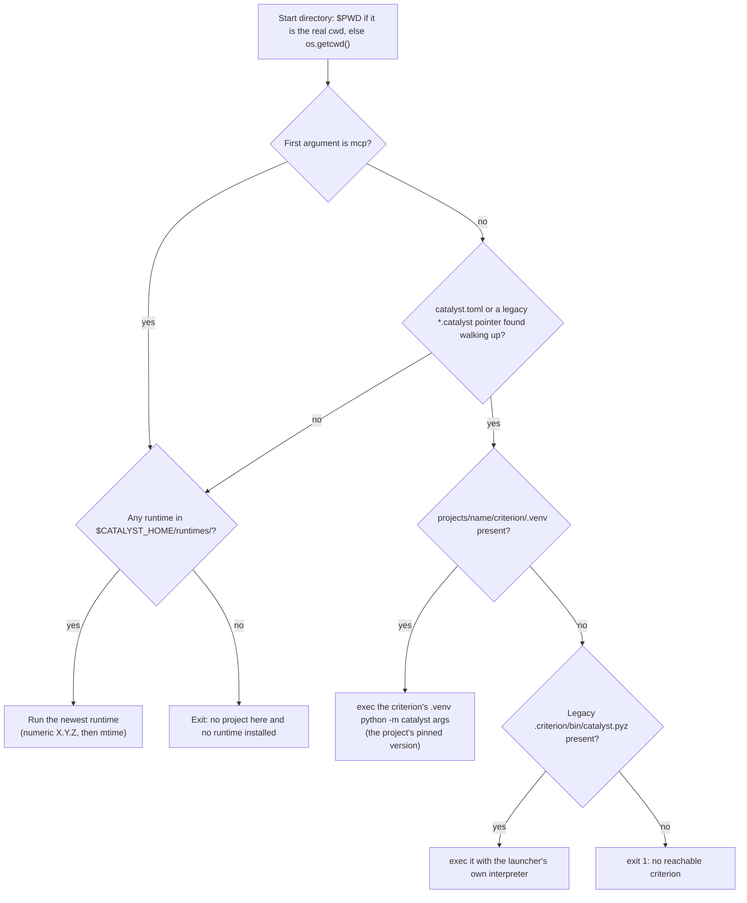

Consequences: inside a project, the project's **pinned** catalyst runs (whatever
version its criterion's `.venv` holds). `catalyst mcp` always runs the newest
runtime, but its `catalyst` tool runs each project's own version through the
launcher. Runtimes are never garbage-collected: `$CATALYST_HOME/runtimes/`
accumulates one directory per version/build ever installed.

### 1.4 Version strings

`catalyst --version` prints `catalyst <version>`, where `<version>` is the kernel
version the CLI shipped with (`scripts/catalyst/__init__.py:version_string()`):

- from a checkout (`python -m catalyst`): the content of `version.txt`, e.g. `0.119.2`;
- from a built zipapp: `<version>+g<12-char sha>`, plus `.dirty` when the packed
  sources differed from that commit, e.g. `0.119.2+gabe28c81cda7`.

The runtime directory names in `$CATALYST_HOME/runtimes/` use the same string.

---

## 2. Global behaviour

### 2.1 Global options

Global options go **before** the subcommand (`catalyst --project ../app check`,
not `catalyst check --project ../app`).

| Option | Default | Meaning |
|---|---|---|
| `-h`, `--help` | — | Help; every subcommand has its own `--help`. Exit `0`. |
| `--version` | — | `catalyst <version>`; exit `0`. |
| `--project PROJECT` | current directory | A directory **inside** the project; the deployment is searched from there upward. |
| `--working-copy WORKING_COPY` | none | Open a **bare criterion** instead of a project (a directory with `version.txt` and `rules/`; e.g. the criterion repository checked out alone in its CI). The module is the single one under `<dir>/modules/` (several or none: kernel-only); project files are out of scope; journal paths outside the working copy are not checked. Honoured by `check`, `validate`, `index regen`, `journal verify`, `criterion integrity` (and generally every command that calls `open_deployment`); ignored by `where`, `open`, `task`, `runtime`, `move`, `migrate`, `init`, `trace --pattern-only`, `share join`, `criterion join`. |

**Pitfall — `serve --project`.** `catalyst serve` declares its own `--project`
(for `--local`). Because argparse sub-parser defaults overwrite the namespace,
`catalyst --project /x serve --local` silently **ignores** `/x` (verified:
`args.project` becomes `None`). Use `catalyst serve --local --project /x`.

**Pitfall — `--preview` / `--forewarned`.** These two flags are offered on every
writing verb's parser (for `--help`), but `main()` strips them from `argv` before
parsing (see [§2.6](#26-options-common-to-writing-verbs)); they must therefore
appear after the verb and only global options with a value (`--project X`,
`--working-copy X`) may precede the verb.

### 2.2 How the deployment is found

`scripts/catalyst/deployment.py:load()`:

1. Start: `--project` (made absolute, symlinks **not** resolved) else the logical
   cwd (`$PWD` when it is the real cwd).
2. Walk up to the nearest directory holding `catalyst.toml`, else a legacy
   `<name>.catalyst` JSON pointer (`scripts/project_file.py:find_up`).
3. Resolve the criterion (`project_file.resolve`): `$CATALYST_HOME/projects/<project_name>/criterion`
   if that directory exists; else a legacy `<project>/.criterion` (symlink,
   directory or submodule); else a pre-0.37 pointer's `agent-source` path.
4. Load the module named by `catalyst.toml`'s `module`, then every other module
   recorded under `<criterion>/modules/` in install order (`modules/modules.json`);
   entity types are the kernel's (`framework/kernel/entities/`: `WORKFLOW`,
   `ANALYSIS`, `RECON`) plus every module's ETDs.

Failures:

- No project file anywhere above → `DeploymentNotFound` → `catalyst: no catalyst
  deployment found at or above <dir> (expected a catalyst.toml, or a legacy
  *.catalyst pointer)`, **exit 2**.
- A project file whose criterion is not on this machine → `WorkingCopyMissing`
  (a subclass) → `... has catalyst.toml but its criterion is not reachable
  (expected $CATALYST_HOME/projects/<name>/criterion, or a legacy .criterion)`,
  **exit 2** (except: `check` exits `1`, `hook stop` blocks with exit `2`).
  Fix: `catalyst open` (clones it if `catalyst.toml` names a repository).
- Run from inside a criterion (outside any project), the CLI never guesses: use
  `--project` or `--working-copy`.

Discovery and its two failure modes, end to end:

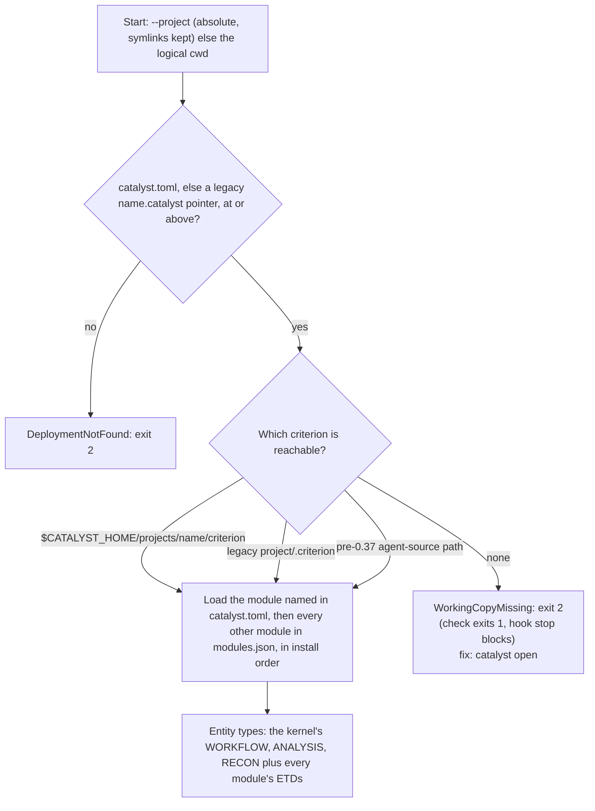

A deployment governs the files under its project root except those under a
nested directory with its own project file (the inner deployment wins) and those
opted out by a `.catalystignore` (empty file: the whole directory; otherwise one
`/`-separated path per line, no wildcards, `#` comments). `unrecorded`,
`journal adopt`, the commit-msg hook's staged files, `trace` and `analysis start`
read only governed files; `init` refuses an opted-out directory; `check` reports a
project file inside an opted-out directory as an error.

### 2.3 Exit codes

The documented convention (`CLI.md`, "Exit codes") and what the code actually does:

| Code | Convention | Where it actually comes from |
|---|---|---|
| `0` | Success. | Also: `check`, `hook stop`, `hook commit-msg` outside any project (so a fresh clone or CI runner is not failed); `hook stop` when it does not block; `hook start` always; `inbox` whether or not anything waits; `criterion status` always; `report` always. |
| `1` | Failure: a check found errors (or warnings under `--strict`), an argument was refused, a git operation failed. The reason is on stderr. | Every caught `IdError`, `JournalError`, `CriterionError`, `AnalysisError`, `ShareError`, `OSError` in `main()`; every `SystemExit("catalyst: ...")` (string exits print to stderr and exit 1). |
| `2` | No deployment at or above the directory (or `--working-copy` names none). | `DeploymentNotFound` / `WorkingCopyMissing` in `main()`; `open` outside a project. **But also** (not in the convention): any argparse usage error (unknown option, missing argument, bad choice); `init` with no `--module`/`--no-module`, both, no `--kernel` reachable, or no user name; `id next --count 0`; `module install|upgrade` without a reachable `--kernel`; `workspace init` without a user name; `agent run` that cannot start (unknown command, no adapter, agent CLI not on `PATH`); `hook stop` when it blocks (Claude Code's protocol: exit 2 + stderr). |
| `3` | Not done for lack of the user's assent (law L3, INV-4): the command printed what it would publish; re-run with `--yes` once the user agrees. | `share push`, `share create`, `criterion push`, `criterion create <url>`, the first `--url` of `criterion push|sync`, `serve landing connect`, `serve members open`. On an interactive terminal these ask `Publish? [y/N]` instead (a "no" also exits `3`). |

Other non-zero codes: `catalyst task` returns Task's own exit code; `agent run`
returns `1` when the agent reports failure (or was denied a tool).

**Rule for agents and scripts:** treat `2` as "no deployment *or* bad usage" and
read stderr; treat `3` as "show the printed preview to a human, then re-run with
`--yes`".

The same rule as a triage procedure:

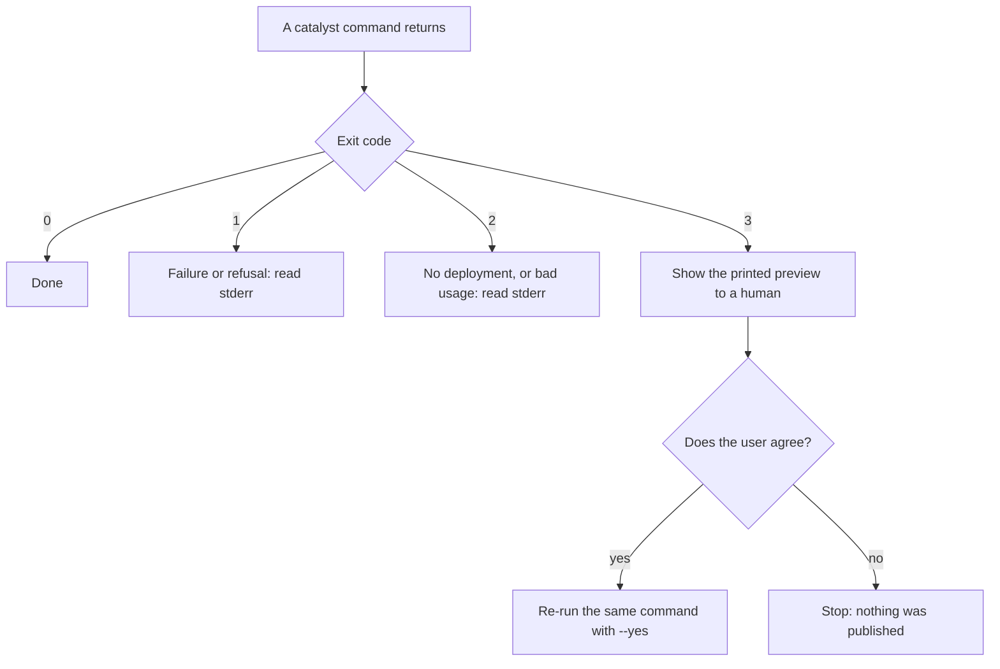

### 2.4 Output conventions, `--json`, the status line

- Human output goes to stdout; errors and warnings go to stderr prefixed
  `catalyst: `. stdout and stderr are reconfigured to UTF-8 with
  `backslashreplace` (Windows code pages never crash a hook).
- `--json` (on most read commands and writing verbs) prints one JSON document (or,
  for `agent run --json`, JSON lines) whose shape is a JSON Schema in
  `cantica-tech/catalyst:spec/` ([Appendix B](#15-appendix-b---json-output-schemas)).
- **Status line.** After a command, on an interactive terminal only (stdout *and*
  stderr are TTYs), catalyst prints to stderr
  `catalyst · <project> · checked HH:MM · N error(s), M warning(s)` — the **last
  recorded** `catalyst check` (from `<criterion>/.git/catalyst/last-check.json`),
  never a new check; `not checked yet (catalyst check)` if none. Never printed with
  `--json`, to a pipe, or after `check`, `hook`, `mcp`, `serve`, `init`, `agent`,
  `spec`. `CATALYST_FOOTER=0` turns it off. It never fails a command.
- A revision or range argument that starts with `-` (`trace`, `unrecorded`,
  `journal adopt`; module refs in `module install`) is refused so it can never
  reach `git` as an option.

### 2.5 Who signs: identity, `--as`, grants

Every command that writes a signed value — IDs (`id next`), journal entries,
writing verbs, administration verbs, `sync apply`, `module install`, analyses —
resolves a **signer** through `scripts/catalyst/ids.py:resolve_signer()` →
`provider.signer()`:

1. Read the deployment's pointer to catalyst-users, `<criterion>/IAM/identity.json`
   (`{"provider": "keycloak", "issuer": "https://.../realms/<realm>", "client": "catalyst-cli", "catalyst_client": "catalyst"}`).
   A workspace member without one inherits its workspace's.
2. Verify **now** who is logged in: the person logged in with
   `catalyst identity login` (tokens in `$CATALYST_HOME/identity/<hash>.json`,
   refreshed with the provider over HTTPS), else this machine's catalyst-users
   **system account** when its settings (`$CATALYST_HOME/users/settings.json`)
   point at the same provider (said on stderr). No verified identity → the command
   fails, signs nothing (exit `1`) and points to `catalyst identity login`.
   Read-only verbs keep working.
3. `--as <name>` only **names** that verified identity (username, name, subject or
   ledger userid, case-insensitive). It can never sign for someone else: a mismatch
   is refused (`you sign only as yourself`, fw-IDENTITY-000002). With the tests'
   `static` provider it selects among the declared people.
4. The identity's first signature appends its line to `<criterion>/IAM/signers.jsonl`
   with a freshly drawn 8-character userid (INV-26); that userid ends every ID it
   creates; the journal's `actor` is the ledger's username.
5. With a command name, the signer's **grants** from the provider must allow it:
   `cmd:<command>` or `cmd:*` (and `reconcile:<full|propose>` for reconciliation).
   `catalyst.toml`'s `role_check = "warn"` turns a refusal into a stderr warning.
   A role's name grants nothing; only its grants count.
6. A per-machine read-only **snapshot** of the identity (username, name, groups,
   roles, grants) is written to `$CATALYST_HOME/identity/<hash>.snapshot.json` at
   each signature, with a content hash; an edited snapshot is discarded.
7. A **legacy** deployment (pointer `<name>.catalyst`, or criterion inside the
   project) becomes read-only for writing verbs once the kernel release that
   retired the layout is out (`catalyst migrate --apply` first).

The parties involved in one signature:

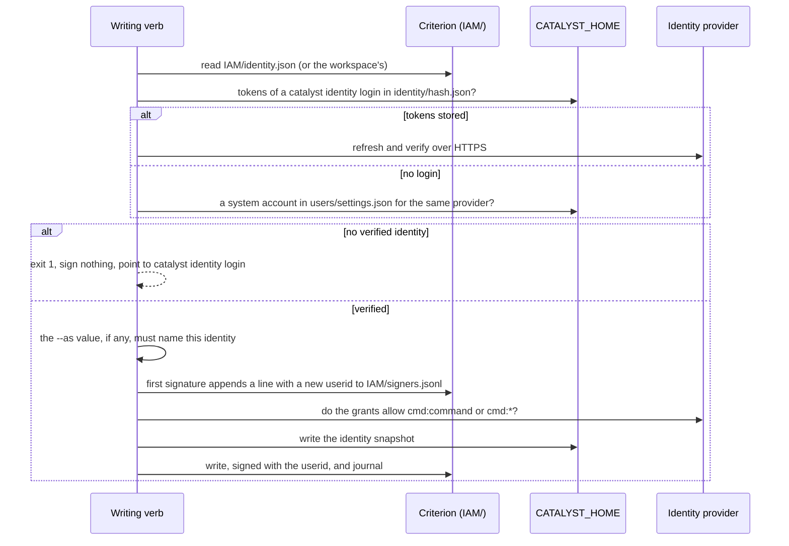

Which verbs check which grant (the `command` passed to `resolve_signer`):

| Verb | Grant checked |
|---|---|
| `new` | `create` (or `create-<type>` aliases) |
| `status set` | `status` |
| `restore` | `journal-restore` |
| `rename`, `edit`, `link`, `unlink` | `create` |
| `journal append` | the `--command` given |
| `journal redact` | `journal` |
| `freeze`, `unfreeze` | `freeze` |
| `definition migrate` | `migrate-definition` |
| `sync apply`, `module install|upgrade`, `migrate --apply` | `sync-framework` |
| `share push|create --driver serve`, `criterion push` | `share` |
| `analysis *` (writing) | `run-analysis` |
| `identity configure` | `identity` |
| `id next`, `id next-rule`, `approve`, `propose`, `reconcile`, `repair derived`, `landing init` | none at the signer level (`approve` checks the gate's role; `reconcile`/`propose` the reconciliation level; `landing init` requires an admin) |

**Network:** because the identity is verified at each signature, **every writing
verb contacts the identity provider** (token refresh/introspection). With the
provider down, writes fail; reads work.

### 2.6 Options common to writing verbs

| Option | Meaning |
|---|---|
| `--as AS_USER` | Names the verified identity (see §2.5). The help text "signer (name or git_username)" is historical: it cannot choose another person. |
| `--intent INTENT` (repeatable) | The goal of the change, journaled. An intent of fewer than three words once IDs are removed ("work starts", "R4.8") is warned about on stderr; the change is still made. |
| `--command CMD` | The slash command the change is for (e.g. `/create-bug`), journaled. Defaults: `catalyst new`, `catalyst rename`, `catalyst edit`, `catalyst restore`, `/status` (for `status set`), `catalyst link`/`catalyst unlink`. |
| `--tier TIER` | The ceremony tier, one of the module's `tiers:` (default set when a module declares none: `chore`, `fix`, `feature`). Checked before anything is written. Without it, the tier the artifact's type opens is used when exactly one tier names that type. |
| `--json` | Prints `{"id", "file", "touched"}` (`spec/change.schema.json`) instead of the human line. |
| `--preview` | Rewritten by `main()` into `catalyst try <verb ...>`: the change is made on a scratch clone and reported; nothing is kept. With `--json`, the try report. |
| `--forewarned` | Runs `try` first; then makes the change for real anyway. If the trial adds `check` findings, the journal entry's intent gains `forewarned: N finding(s) added: ...` and they are printed on stderr. If the trial itself cannot run, exit `1` and nothing is done. |

`--preview`/`--forewarned` exist on: `new`, `rename`, `edit`, `status set`,
`link`, `unlink`, `restore`, `approve`, `reconcile`, `propose`
(`scripts/catalyst/trial.py:VERBS`). Every writing verb exits `1` and changes
nothing on a refusal.

### 2.7 The assent protocol (exit 3, `--yes`)

Implemented by `__main__.py:_assented()` (constant `NEEDS_ASSENT = 3`):

- With `--yes`: proceed.
- Without `--yes` on an interactive terminal (stdin is a TTY): print the preview,
  ask `Publish? [y/N]`; "y"/"yes" proceeds, anything else exits `3`.
- Without `--yes` elsewhere (an agent, CI, the MCP tool — which runs the CLI with
  stdin at `/dev/null`): print the preview on stdout, print
  `catalyst: publishing needs the user's assent (INV-4): show them the above, then
  re-run with --yes` on stderr, exit `3`.

The assent gate as a flow:

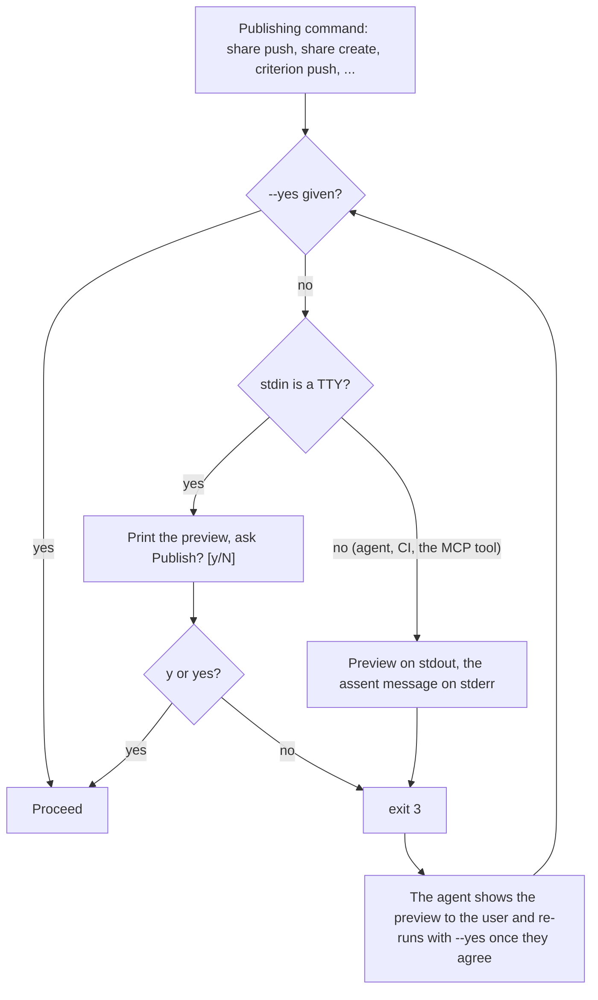

A `--url` *typed at the interactive prompt* of `criterion push|sync` counts as
assent for publishing the local-only criterion there.

Commands that write into `.git/` or the product index without a `--yes` gate
(rely on the agent asking first): `hook install`, `criterion create` without URL,
`share create` (staging `catalyst.toml`), `journal pin` (writes a ref).

### 2.8 Local state, locks and caches

catalyst keeps machine-local state **outside the tracked tree**, in the
criterion's git directory: `git -C <criterion> rev-parse --git-path catalyst`, i.e.
`<criterion>/.git/catalyst/` (falls back to `$TMPDIR/catalyst-<sha256(root)[:16]>/`
if the criterion is not a git repository). `scripts/catalyst/lock.py`.

| File | Written by | Purpose |
|---|---|---|
| `ids.lock`, `ids.json` | `id next`, `id next-rule`, `new` | ID reservation under a cross-process lock: each call hands out one number above the highest seen **or already reserved**, so parallel sub-agents never collide. |
| `journal.lock` | every journal append | Serialises appends. |
| `last-check.json` | `check` (and `hook stop`) | The status line's data. |
| `sessions/<session>.json` | `hook start` (with a session id) | ADR-002 baseline: what `check` already failed on at session start; files older than 7 days are deleted. |
| `integrity/` | `check` when the criterion's HEAD is a merge | Integrity result cached per HEAD. |

Locks are `O_CREAT|O_EXCL` files; wait up to 60 s; a lock older than 30 s is
considered stale (crashed holder) and broken. Error: `the <name> lock <path> is held
by another process — retry, or remove it if no catalyst command is running`.

### 2.9 Environment variables

| Variable | Read by | Effect |
|---|---|---|
| `CATALYST_HOME` | everything (`project_file.home()`, launcher, runtime, hook script) | catalyst's home; default `$HOME/.catalyst`. Set it in CI (`${{ runner.temp }}/catalyst`) to clone a criterion into a scratch home. |
| `CATALYST_FOOTER` | `main()` | `0` disables the interactive status line. |
| `CATALYST_VIA` | journal (`journal.via()`) | `agent` or `person`: recorded as each entry's `via`. `catalyst mcp` and `agent run` set `CATALYST_VIA=agent` for the commands they run. |
| `AI_AGENT`, `CLAUDECODE`, `GEMINI_CLI` | journal | If any is set (and `CATALYST_VIA` is not), entries record `via: agent`; otherwise `person`. |
| `CLAUDE_PROJECT_DIR` | `catalyst mcp` | A project directory hint when the client gives no roots. |
| `AGENT_CMD` | `catalyst task` | Overrides the agent's non-interactive command (default `<agent binary> -p`; `claude-code` → `claude -p`). |
| `CATALYST_TOKEN` | share/serve client (`serve.py`) | A `catalyst serve` token that overrides the one saved by `share login`. |
| `CATALYST_IDENTITY_API_SECRET` | `catalyst serve --identity-issuer` | The confidential API client's secret for token introspection; required with `--identity-issuer`. |
| `CATALYST_SERVE_KEY_COMMAND` | `serve key init` | A command that prints the master key (base64), when `--key-command` is not given. |
| `CATALYST_GITHUB_API` | `serve landing` | GitHub API base URL (default `https://api.github.com`). |
| `CATALYST_USERS_HOME` | vendored catalyst-users core | Where catalyst-users' `settings.json`, `config.toml` and credentials live (default `$CATALYST_HOME/users`; a legacy `~/.catalyst-users` is moved there once and symlinked). |
| `CATALYST_USERS_SERVER`, `_REALM`, `_CLIENT_ID`, `_API_CLIENT_ID`, `_API_CLIENT_SECRET`, `_TIMEOUT`, `_CATALYST_CLIENT`, `_POINTER` | vendored catalyst-users core (`identity/config.py`) | Override the provider connection settings (defaults: `http://localhost:8080`, realm `catalyst`, client `catalyst-cli`, API client `catalyst-api`, timeout 10 s, catalyst client `catalyst`). |
| `CATALYST_ALLOW_STATIC_IDENTITY` | provider, `init` | `1` allows the `static` identity provider, which **verifies nobody** — tests and scratch CI deployments only. Without a provider, `init` then installs with a static Admin made from `--user`. `check` warns about a static pointer. |
| `CODEX_HOME` | `agent install codex` | Where Codex's `config.toml` is (default `~/.codex`). |
| `XDG_CONFIG_HOME`, `APPDATA` | `agent install vscode` | VS Code user directory on Linux/Windows (macOS: `~/Library/Application Support/Code/User`). |
| `PWD` | deployment discovery, launcher | Keeps a symlinked path as the shell sees it. |
| `GIT_TERMINAL_PROMPT` | set to `0` by `serve landing` git calls | No interactive git credential prompt on the server. |
| `PYTHONPATH` | removed from the environment when the runtime's Python is invoked | Avoids a checkout's sources shadowing the runtime. |
| Test/tooling only: `CATALYST_MODULES_DIR` (`check_kernel_purity.py`), `CATALYST_KB_MODULE`, `CATALYST_REQUIRE_FIXTURES` (tests) | | |

### 2.10 File map: home, criterion, project

**`$CATALYST_HOME` (default `$HOME/.catalyst`)**

| Path | Content | Written by |
|---|---|---|
| `bin/catalyst` (+ `catalyst.cmd` on Windows) | The launcher | `runtime install`, `open` |
| `runtimes/<version>/` | One venv per catalyst version/build, with `catalyst.pyz` + `catalyst.pth` in site-packages and a `catalyst-version` marker | `runtime install`, `open`, `init`, `sync apply` |
| `projects/<name>/criterion/` | The criterion (git repository) | `init`, `open`, `share join`, `criterion join`, `move --to-home` |
| `projects/<name>/criterion/.venv/` | Copy of the runtime the project runs (git-ignored) | `init` (unless `--no-runtime`), `open`, `runtime install`, `sync apply` |
| `projects/<name>/agent` | This user's agent for the project | `open --agent <id>` |
| `projects/<name>/runs.jsonl` | This user's `agent run` log | `agent run` |
| `workspaces/<name>/criterion/` | A VS Code workspace's meta criterion | `workspace init` |
| `machine` | Random machine id used in journal shard names (never the hostname) | first journal append |
| `identity/<hash>.json`, `<hash>.snapshot.json` | OIDC tokens (owner-only) and the identity snapshot | `identity login`, every signature |
| `users/` | catalyst-users settings, `config.toml`, system-account credentials | catalyst-users (`catalyst-users setup`) |
| `credentials` | Tokens for `catalyst serve` servers, by URL | `share login` |
| `scratch/<name>-<stamp>-<pid>/` | `try` scratch clones (removed unless `--keep`) | `try`, `--preview`, `--forewarned` |
| `serve/serve.db` | A `catalyst serve` server's SQLite database | `serve` |

**The criterion (`$CATALYST_HOME/projects/<name>/criterion/`)** — files the
kernel owns (module folders such as `requirements/`, `steps/`, `development/bugs/`
are the module's):

| Path | What |
|---|---|
| `version.txt` | Deployed kernel version (`check` compares with `catalyst.toml` `kernel_version`: "version drift"). |
| `CODE-OF-CONDUCT.md` | Composed: kernel `rules-of-development.template.md` + each module's `code-of-conduct.module.md` (§3, §4 under `### From module <id>`). §4 is the command registry. |
| `rules/Rules-of-Rules.md`, `rules/rules.md`, `rules/<doc>.md`, `rules/domains/domains.md` | Meta-rules, rule index, rule documents, domain registry. |
| `ACCESS-CONTROL.md`, `ANALYSIS-PLAYBOOK.md`, `INVARIANTS.md`, `INVARIANTS.module.md`, `DEPLOYMENT.md`, `README.md` | Kernel documents (copied/composed). |
| `Taskfile.common.yml` | One task per §4 command (see §12). |
| `IAM/identity.json` | Pointer to catalyst-users. |
| `IAM/signers.jsonl` | Signers ledger (append-only; never rewritten). |
| `IAM/users/`, `IAM/roles/`, `IAM/groups/` | Display templates only (people are catalyst-users'). |
| `IAM/gates.json` (optional) | Approval gates. |
| `IAM/landing.json` (optional) | Landing policy. |
| `IAM/membership.fingerprints.jsonl` | Written by a `catalyst serve` server once a day. |
| `definitions/<type>.md`, `definitions/README.md` | Frozen entity definitions (INV-23). |
| `workflows/`, `analyses/` (+ `analyses/reports/<ID>/`), `reconciliations/` (+ `<RECON-id>.proposed`) | Kernel entity folders, each with its index `<folder>.md`, `README.md`, `templates/`. |
| `modules/<id>/`, `modules/modules.json` | Installed modules and their record (id, version, source, commit, sha256). |
| `development/journal/<actor>@<machine>/<YYYY-MM>.jsonl` | The journal (sharded). A legacy `development/journal.jsonl` may also exist. |
| `.frozen` | Items protected from `/sync-framework`. |
| `bin/catalyst.pyz`, `bin/catalyst.pyz.sha256` | Vendored CLI and its hash (the CI gate verifies it). |
| `.gitattributes` | `# catalyst:` block: `merge=union` for journal shards and generated indexes. |
| `.github/workflows/catalyst.yml` | The criterion's CI gate (`pull_request_target`). |
| `.ledger/` | Deployment ledger (moved in from a project's `.criterion` at install). |
| `.git/catalyst/` | Local state ([§2.8](#28-local-state-locks-and-caches)). |
| `refs/catalyst/journal` (git ref) | Pins every journaled blob so `git gc` keeps it. |

**The project.** Only `catalyst.toml` (flat TOML, no tables, never a path). Keys
(`scripts/project_file.py:KEYS`): `project_name`, `format` (`1.0-rc`),
`kernel_version`, `module` (the first installed module), `agent`, `workspace`,
`role_check` (`enforce`|`warn`), `embed_origins`, `analysis_passes` (`1`|`2`),
`governance` (`suspended` stops `hook stop` from blocking), `share`
(`git`|`serve`|`local`), `share_url`, `repoed`, `catalyst_repo`,
`catalyst_repo_url`, `criterion_branch`, `created_by`, `created`, `updated`,
`journal_since` (baseline commit for unrecorded-change detection), `strict_journal`.
Legacy keys read but never written: `name`, `framework_version`, `agent-source`,
`identity`, `identity_issuer`, `identity_client`.

catalyst also writes into the **project's `.git/`** (never a commit or branch):
journaled blobs and the ref `refs/catalyst/journal` (first time: announced on
stderr), and `.git/hooks/commit-msg` on `hook install`. `share create`,
`criterion create|join`, `move --to-home` and `workspace init` **stage** (never
commit) changes to `catalyst.toml`/`.gitignore`/`.gitmodules`.

How the three places relate, and what reaches outside the machine:

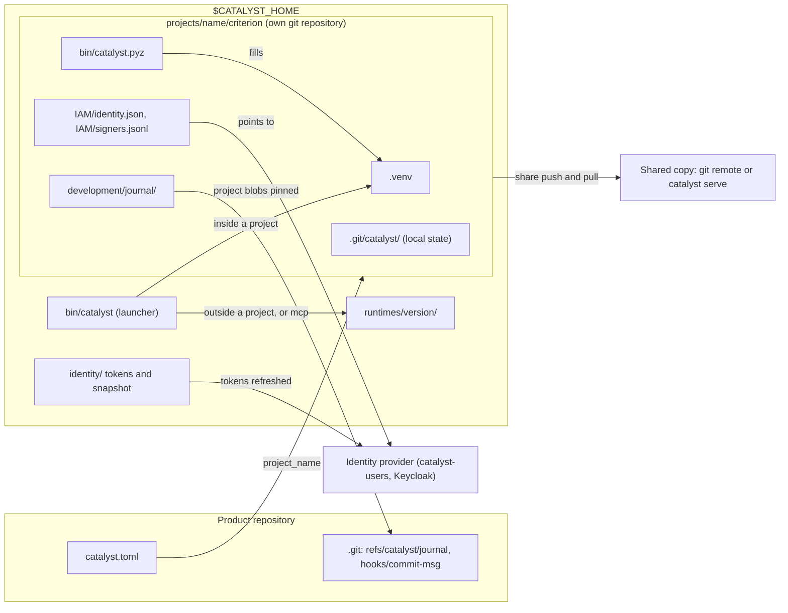

### 2.11 Network and git side effects at a glance

| Command | Network | Pushes | Writes into the project repo |
|---|---|---|---|
| any writing verb, `id next`, `init`, `identity *` (not `status`) | identity provider (HTTPS) | — | blobs + `refs/catalyst/journal` when a project file is journaled |
| `open` (no `--fetch`) | clone if the criterion is missing | — | — |
| `open --fetch`, `share status --fetch`, `criterion status --fetch` | git fetch | — | fetch pins |
| `share pull`, `criterion sync` | git fetch / server GET | — | — |
| `share push`, `criterion push` | git fetch+push, `gh pr create` | topic branch `<user>/<UTC stamp>` + journal pins | — |
| `share create`, `criterion create <url>` | git push | shared branch | stages `catalyst.toml` |
| `criterion protect --yes` | `gh api` | branch protection | — |
| `journal pin --share` | fetch + push `refs/catalyst/journal` (criterion and product) | the pin ref only | the pin ref |
| `journal redact` | — | — | rewrites the pin ref (one commit, no history) |
| `module available` | `git ls-remote` | — | — |
| `module install <url>`, `module upgrade`, `sync --module <url>` | shallow `git clone` to a temp dir | — | — |
| `agent run` | whatever the agent does | — | — |
| `serve` | listens (default 127.0.0.1:8765) | `serve landing` pushes topic branches `landing/<signer>/...` and opens PRs | — |
| `share login`, `share join`/`open` with `share = "serve"` | HTTP(S) to the server | — | — |

---

## 3. Commands: install, machine and project setup

### 3.1 `catalyst init`

```
catalyst [--project <dir>] init --name <name> (--module <id> | --no-module)
         [--module-dir <dir>] [--kernel <framework/kernel>]
         [--identity-issuer <url> [--identity-client <id>] [--catalyst-client <id>]]
         [--user <name>] [--git-username <u>] [--rule-doc <file>:<prefix> ...]
         [--test-locations <text>] [--agent <id>] [--no-runtime] [--at <dir>]
```

**Purpose.** Install catalyst into a project — only ever on the user's explicit
request (INV-2, law L8). The mechanical half of `BOOTSTRAP.md` §2; the judgment
steps (first rules, domains, roles, landing policy) follow it.
Implementation: `__main__.py:cmd_init` → `scripts/catalyst/init.py:init`.

| Option | Default | Meaning |
|---|---|---|
| `--name NAME` | required | `project_name` in `catalyst.toml`; the criterion goes to `$CATALYST_HOME/projects/<name>/criterion`. A name already used on the machine is refused. |
| `--module MODULE` | none (no default by design) | The first process module's id. |
| `--no-module` | off | Kernel types only; `catalyst module install` later. Mutually exclusive with `--module` (exit `2`). |
| `--module-dir DIR` | searched | The module's directory. Default search: sibling checkouts named `catalyst-<id>` next to the project or next to catalyst. |
| `--kernel DIR` | the checkout the CLI runs from | `framework/kernel` of a catalyst checkout or release. **Required from a zipapp/launcher.** No `rules-of-rules.template.md` there → exit `2`. |
| `--identity-issuer URL` | the provider this machine's catalyst-users is set up for (`$CATALYST_HOME/users/settings.json`) | Writes `IAM/identity.json` (`provider: keycloak`). Log in first: `catalyst identity login --issuer <url>`. |
| `--identity-client ID` | `catalyst-cli` | Public client with the device grant. |
| `--catalyst-client ID` | `catalyst` | Client whose roles carry catalyst grants. |
| `--user NAME` | `git config user.name` of the project | Installer's display name (DEPLOYMENT.md, criterion git config). None available → exit `2`. |
| `--git-username U` | `--user` | Installer's username. When `--user`/`--git-username` is given, init signs only as that identity; otherwise as whoever is verified. |
| `--rule-doc FILE:PREFIX` (repeatable) | one document `<name>-rules.md`, prefix `br` | Seeds rule documents (`.md` appended if missing). |
| `--test-locations TEXT` | — | Fills `{{TEST_LOCATIONS}}` in `Rules-of-Rules.md` §2. |
| `--agent ID` | `unknown` (treated as `claude-code` by dispatch) | Recorded as `agent` in `catalyst.toml`. Writes no agent file. |
| `--no-runtime` | off | Do not fill the criterion's `.venv` now (`catalyst runtime install`/`open` later). |
| `--at DIR` | — | **Legacy**: build the criterion in agent-owned space behind a git-ignored `.criterion` symlink and a `<name>.catalyst` pointer. Still used by cantica-tech/catalyst's own CI. |
| `--userid` | hidden (`argparse.SUPPRESS`) | Fixes the first userid, for reproducible examples/tests. |

**Steps (in order).** Validate the arguments (above); without `--module`/`--no-module`
it installs nothing and lists the modules found (exit `2`). Then:
compose `CODE-OF-CONDUCT.md`, `rules/Rules-of-Rules.md`, `ACCESS-CONTROL.md`,
`Taskfile.common.yml` (placeholders `{{RULES_DIR}}`, `{{RULE_DOCS_LIST}}`,
`{{TEST_LOCATIONS}}` resolved, meta-rule IDs signed by the installer); create every
kernel and module entity folder (index, `templates/` with `TEMPLATE-<TYPE>-v1.md`
and a catalog row, `README.md`); seed `rules/` (`rules.md`, each rule document
with `## Contents` and `## Linked Artifacts — Quick Index`); freeze the latest
definition of every type in `definitions/`; copy the module to `modules/<id>/`
and record it in `modules/modules.json`; write `IAM/identity.json`, the signers
ledger with the installer's line (new userid), and `IAM/{users,roles,groups}/`
templates; write `version.txt`, `DEPLOYMENT.md`, `README.md`,
`ANALYSIS-PLAYBOOK.md`, `INVARIANTS.md` (+ module's), vendor `bin/catalyst.pyz`;
`git init` the criterion, write `catalyst.toml` in the project (with
`journal_since` = the project's `HEAD`, `""` if no commit), fill the runtime, and
journal the install as the first entry. A project `.criterion` holding only
`.ledger/` is moved into the criterion.

The same steps as a flow:

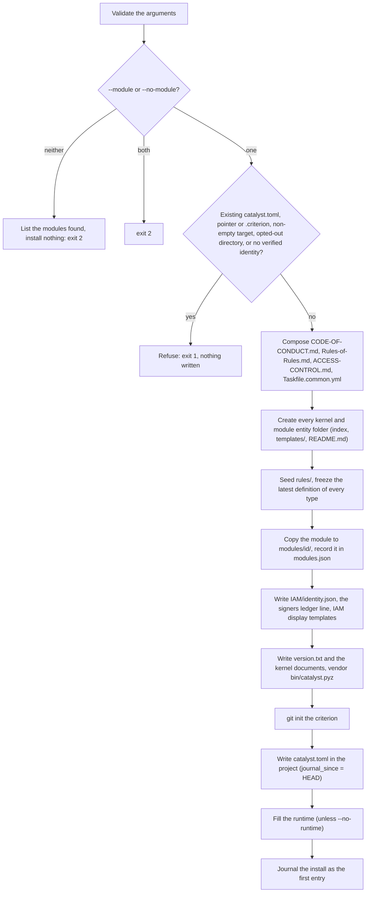

**Files.** Creates the criterion; writes `catalyst.toml` (not staged, not
committed); writes blobs + `refs/catalyst/journal` into the project's `.git`
(announced on stderr); fills `$CATALYST_HOME/runtimes/<v>/`, `bin/catalyst`, and
`<criterion>/.venv` unless `--no-runtime`.

**Refuses (exit 1, nothing written)** when the project already has a
`catalyst.toml` or legacy pointer or a `.criterion` (other than ledger-only), the
target criterion directory is non-empty, the directory is opted out by
`.catalystignore`, or no identity can be verified (`people are catalyst-users'
(design 29): pass --identity-issuer <url> and log in first`).

**Example (verified in a sandbox):**

```sh
catalyst identity login --issuer https://id.example.com/realms/catalyst
cd ~/src/acme && python3 ~/src/catalyst/dist/catalyst.pyz init \
  --kernel ~/src/catalyst/framework/kernel --name acme \
  --module software-engineering --module-dir ~/src/catalyst-software-engineering \
  --rule-doc business-rules:br --agent claude-code \
  --identity-issuer https://id.example.com/realms/catalyst
# - composed CODE-OF-CONDUCT.md, rules/Rules-of-Rules.md, ACCESS-CONTROL.md, Taskfile.common.yml
# - ... - wrote catalyst.toml (the only file catalyst adds to the project) ...
# Next: `catalyst agent install <agent>` once per machine, then the first rules ...
```

**Pitfalls.** From a zipapp, `--kernel` is checked *before* the module listing,
so a bare `init --name x` says `pass --kernel`. Commit `catalyst.toml` yourself.
Nothing is shared: `share create` publishes later.

### 3.2 `catalyst open`

```
catalyst [--project <dir>] open [--fetch] [--agent <id>] [--json]
```

**Purpose.** The one step after `git clone` and at the start of work: make the
project ready on this machine and report where it stands
(`scripts/catalyst/open.py`). Writes only in `$CATALYST_HOME`, never in the project.

| Option | Meaning |
|---|---|
| `--fetch` | Fetch the shared copy (and the product's journal pins) first. |
| `--agent ID` | Record this user's agent in `$CATALYST_HOME/projects/<name>/agent` (what `catalyst task` and `agent run` dispatch to). |
| `--json` | `spec/open.schema.json`: `project`, `name`, `criterion`, `kind` (`home`/`legacy`/`missing`), `pinned`, `criterion_version`, `runtime`, `agent`, `share`, `done`, `notes`, `todo`, `ready`. |

**Steps.** Clone a missing criterion from `catalyst_repo_url`/`criterion_branch`
(git) or pull it from a `share = "serve"` server; fetch the product's pins; install
the launcher if missing; (re)fill `<criterion>/.venv` from the criterion's
`bin/catalyst.pyz` when missing or different; read the shared copy's state; build
a to-do list of exact commands (legacy layout to move, version drift, pull to make,
unpublished changes).

Opening a shared project on a second machine:

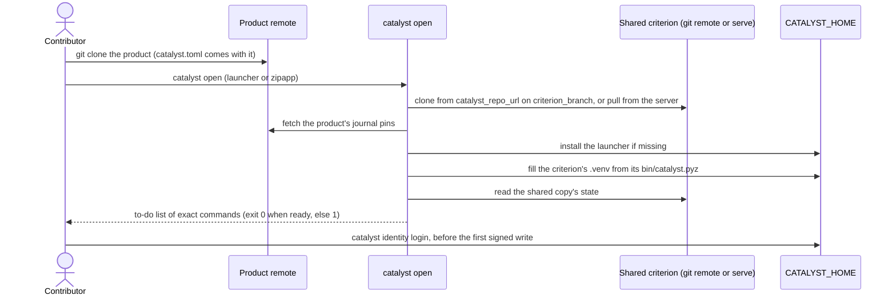

**Exit.** `0` when nothing is left to do (`ready`), `1` otherwise, `2` with no
project file above.

### 3.3 `catalyst where`

```
catalyst [--project <dir>] where [--json]
```

Prints the project file and the criterion it resolves to; no writes, no network.
JSON (`spec/where.schema.json`): `project`, `file`, `name`, `criterion`, `kind`
(`home`/`legacy`/`missing`), `expected`, `workspace` (+ `workspace_criterion`).
Exit `1` when no project file is found **or** the criterion is missing (note: not
`2`). Example output:

```
project    /home/ada/src/acme (catalyst.toml, name acme)
criterion  /home/ada/.catalyst/projects/acme/criterion (home)
```

### 3.4 `catalyst runtime install` / `catalyst runtime status`

```
catalyst runtime install
catalyst runtime status [--json]
```

- `install`: extracts the running CLI as a pyz, builds
  `$CATALYST_HOME/runtimes/<version>/` once (uv `--relocatable` venv, else `venv`;
  `catalyst.pyz` + `catalyst.pth` in site-packages; marker `catalyst-version`),
  (re)writes the launcher `$CATALYST_HOME/bin/catalyst`, and, in a home-store
  project, copies the runtime into `<criterion>/.venv`. In a legacy deployment it
  says to run `catalyst migrate --apply` first. Prints `put <bin> on PATH`. Exit `1`
  on a build failure (no uv and Python < 3.11, etc.).
- `status`: `version`, `home`, `runtimes` (all installed), `launcher`,
  `launcher_installed`, `criterion`, `criterion_runtime`
  (`spec/runtime-status.schema.json`). Always exit `0`.

Pitfall: runtimes accumulate (no cleanup command); delete old
`$CATALYST_HOME/runtimes/*` by hand if disk matters (keep the ones criteria use).

### 3.5 `catalyst move`

```
catalyst [--project <dir>] move (--to-home | --name <new>) [--no-runtime] [--as <user>]
```

- `--to-home`: moves a legacy deployment (a `.criterion` symlink — its target
  moves —, an in-project `.criterion` directory, or a `.criterion` git submodule,
  which becomes a standalone repository keeping branches, remote and unpushed work)
  into `$CATALYST_HOME/projects/<name>/criterion`; `<name>.catalyst` becomes
  `catalyst.toml`; `/.criterion` leaves `.gitignore`; product changes are
  **staged, never committed**; runtime filled unless `--no-runtime`; journaled.
- `--name NEW`: renames a home-store project (criterion directory and
  `project_name`).
- `--as`: actor recorded in the journal.

Exactly one of `--to-home`/`--name` (argparse group, required). Exit `1` on a
refusal (name in use, nothing to move), printing one `- step` line per action.

### 3.6 `catalyst migrate`

```
catalyst [--project <dir>] migrate [--kernel <dir|zip>] [--since <version>]
         [--apply [--template <TYPE|all> ...] [--no-runtime]]
         [--decline <TYPE|all> ...] [--as <user>] [--intent <why>] [--json]
```

**Purpose.** What the deployment is behind on, and the mechanical part of catching
up (`scripts/catalyst/migrate.py`). Without `--apply` it writes nothing and lists:

- `layout` (auto): a legacy layout, moved as `move --to-home` does;
- `template` (auto for the kernel's; optional for a module's): templates folders
  lacking the template the kernel/module ships today, to add as
  `TEMPLATE-<T>-v<N+1>` with a catalog row (a copy already held under any version
  counts as held);
- `judgment` (you): steps the migrations since the last sync (or `--since`)
  leave to a person, with their qualifier. Never taken.

| Option | Meaning |
|---|---|
| `--kernel` | A checkout's `framework/kernel` or a kernel release (dir or zip). From a checkout it defaults to the checkout's own; otherwise without it, templates and migrations are not compared (a note says so). |
| `--apply` | Takes the layout + kernel template steps (+ module templates named by `--template`), journaled as one `catalyst migrate` entry. Idempotent. |
| `--template TYPE` | With `--apply`: also add this module type's new template (prefix, template name, or `all`). Repeatable. |
| `--decline TYPE` | Record (journaled) that you do not want this module template; it is no longer offered until the module ships a different one. Cannot be combined with `--apply` (exit `1`). |
| `--since VERSION` | List the judgment steps of every migration after this kernel. |
| `--no-runtime` | When moving: do not fill `.venv`. |
| `--as`, `--intent`, `--json` | As usual (`spec/migrate.schema.json`). |

Output lines: `auto  <kind> <detail>`, `you   <kind> ...`, `done  ...`. Exit `0`
(also when there are judgment steps left), `1` on a refusal.

### 3.7 `catalyst workspace init` / `catalyst workspace status`

```
catalyst workspace init <name>.code-workspace [--user <name>] [--git-username <u>]
         [--identity-issuer <url> [--identity-client <id>] [--catalyst-client <id>]] [--kernel <dir>]
catalyst workspace status <name>.code-workspace [--json]
```

A VS Code workspace (`.code-workspace`, comments and trailing commas allowed) whose
member folders hold a `catalyst.toml`. `init` creates the meta criterion
`$CATALYST_HOME/workspaces/<name>/criterion` (rules, domains, identity pointer,
signers ledger, its own journal and git history, no module) and writes
`workspace = "<name>"` into each member's `catalyst.toml` (not committed); a member
of another workspace is left alone; a workspace name already used is refused.
Members then also see the workspace's rules, domains and signers read-only, and
inherit its identity pointer when they have none. `status` lists folders and which
are members (`spec/workspace-status.schema.json`). `init` with no user name → exit `2`.

---

## 4. Commands: agents, hooks, MCP, tasks

### 4.1 `catalyst agent install|uninstall <agent>`, `catalyst agent status`

```
catalyst agent install   (claude-code|copilot|vscode|cursor|codex|gemini)
catalyst agent uninstall (claude-code|copilot|vscode|cursor|codex|gemini)
catalyst agent status [--json]
```

Wires catalyst into an agent **at user level, never in a project**
(`scripts/catalyst/agents.py`). Once per machine, after the launcher exists
(`install` refuses with `no launcher at ... — run catalyst runtime install first`).

| Agent | What `install` writes |
|---|---|
| `claude-code` | `claude mcp remove --scope user catalyst` then `claude mcp add --scope user catalyst -- $CATALYST_HOME/bin/catalyst mcp` (stored in `~/.claude.json`); in `~/.claude/settings.json`: `hooks.Stop` → `catalyst hook stop`, `hooks.SessionStart` → `catalyst hook start --quiet`. If `claude` is not on `PATH`, the MCP command to run by hand is printed. |
| `copilot` | `~/.copilot/mcp-config.json` `mcpServers.catalyst` (`type: local`, `tools: ["*"]`); `~/.copilot/hooks/catalyst.json` (catalyst's own file: `sessionStart` → `hook start --format json` (30 s), `agentStop` → `hook stop --format json` (120 s), bash and powershell). VS Code's agent reads these hooks too. |
| `vscode` | The VS Code user profile's `mcp.json` `servers.catalyst` (`type: stdio`). No hooks (use `copilot` for those). |
| `cursor` | `~/.cursor/mcp.json` `mcpServers.catalyst`; `~/.cursor/hooks.json` `hooks.sessionStart` → `hook start --format cursor`, `hooks.stop` → `hook stop --format cursor`. |
| `codex` | `[mcp_servers.catalyst]` table in `$CODEX_HOME/config.toml` (default `~/.codex`); `~/.codex/hooks.json` `hooks.Stop` → `hook stop --format json`. No session-start hook. |
| `gemini` | `~/.gemini/settings.json` `mcpServers.catalyst` and `hooks.AfterAgent` → `hook stop --format gemini`. Gemini connects to no MCP server in an untrusted folder. |

Rules: only catalyst's entries change (recognised by the launcher path in them);
each file is backed up once as `<file>.before-catalyst`; a file that is not plain
JSON is never rewritten — the snippet to add is printed and the command fails
(exit `1`). `uninstall` removes catalyst's entries (and catalyst's own files).
`status` prints one row per agent with each part `yes`/`no`/`unknown`
(`spec/agent-status.schema.json`). The Claude Code plugin
`agents/claude-code/plugin` is the same wiring, but hardcodes `$HOME/.catalyst`.

### 4.2 `catalyst agent run`

```
catalyst [--project <dir>] agent run <command> [<arguments>...] [--agent <id>] [--json]
```

Dispatches one §4 command to the project's agent, non-interactively, from the
project's root (`scripts/catalyst/run.py`). The agent is given the command's
procedure (the same text as the MCP prompt) and runs under the user's own agent
settings; catalyst never widens permissions, so a refused tool is reported as
`denied`. `CATALYST_VIA=agent` is set for the agent. A `--json` given after the
arguments is still taken as catalyst's.

| Adapter | Command line | Measured |
|---|---|---|
| `claude-code` | `claude -p <prompt> --output-format stream-json --verbose` | events, tool calls, token usage, `cost_usd` |
| `copilot` | `copilot -p <prompt>` | text only; `end.measured: false` |
| `gemini` | `gemini -p <prompt>` | text only; `end.measured: false` |

Events (`spec/run-event.schema.json`): `start`, `session`, `text`, `tool`,
`tool_result`, `end` (`ok`, `turns`, `usage{input,output,cache_read,cache_write}`,
`cost_usd`, `duration_ms`, `denied`, `result`). Each run is appended to
`$CATALYST_HOME/projects/<name>/runs.jsonl` (with the project's `git config
user.name`); a log write failure never fails the run. Exit `0` ok, `1` not ok or
denied, `2` cannot start.

### 4.3 `catalyst agent runs`

```
catalyst [--project <dir>] agent runs [--limit N] [--json]
```

This user's run log for the project, oldest first, with a total cost line
(`spec/runs.schema.json`). Never shared, never in the criterion.

### 4.4 `catalyst hook start`

```
catalyst [--project <dir>] hook start [--format text|json|cursor] [--quiet]
```

The agent's session-start hook (`cmd_hook_start`). Prints the `catalyst open`
report computed **without acting** (no writes, no network), then the laws: the top
of the criterion's `INVARIANTS.md` and each module's `INVARIANTS.module.md` up to
their `end of the session brief` marker. Reads the hook's JSON on stdin (only when
`--format` is not `text` or `--quiet`): the project is `--project`, else the
input's `cwd` (or Cursor's `workspace_roots[0]`), else the cwd. With a session id
(`session_id`, `sessionId`, `conversation_id`, `conversationId`; `[A-Za-z0-9._-]{1,128}`)
it runs a full `check` and records the baseline in
`<criterion>/.git/catalyst/sessions/<id>.json` (ADR-002).

- `text`: plain text (Claude Code legacy form).
- `json`: `{"hookSpecificOutput": {"hookEventName": "SessionStart", "additionalContext": <text>}}` (Codex, Copilot, Gemini, Claude Code).
- `cursor`: `{"additional_context": <text>}`.
- `--quiet`: record the baseline, print nothing (Claude Code: the MCP server's
  instructions already carry the laws).

Always exits `0`; prints nothing outside a project.

The two hooks over one agent session (ADR-002):

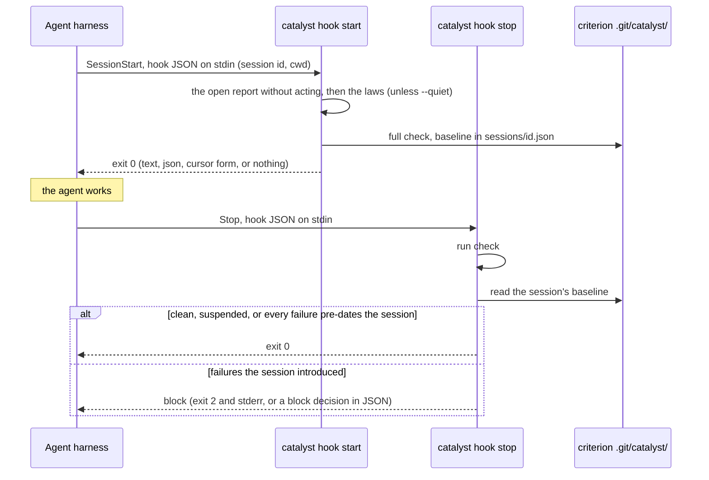

### 4.5 `catalyst hook stop`

```
catalyst [--project <dir>] hook stop [--strict] [--format exit2|json|gemini|cursor]
```

The end-of-turn hook: the same pass as `check`, shaped to keep the agent working
until it is clean (`check.py:hook_stop`).

Decision sequence:

1. No project → exit `0`. Criterion unreachable → block with the reason.
2. `governance = "suspended"` in `catalyst.toml` → print that on stderr, exit `0`.
3. Run `check` (a crash counts as an error: fails closed). Clean (errors only;
   warnings too with `--strict`) → exit `0`.
4. Input has `stop_hook_active: true` (a stop hook already blocked this stop) →
   report on stderr, do **not** block again (no infinite loop), exit `0`.
5. No session id or no baseline → block with every failure, saying why.
6. Otherwise block only on failures **not** in the session's baseline; if all
   failures pre-date the session, report them and exit `0`.

The decision sequence as a flow:

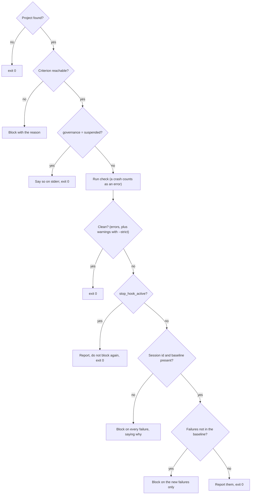

Block formats: `exit2` → message on stderr, exit `2` (Claude Code);
`json` → `{"decision": "block", "reason": ...}` on stdout, exit `0` (Codex,
Copilot CLI/VS Code, Claude Code); `gemini` → `{"decision": "deny", ...}`;
`cursor` → `{"followup_message": ...}`. Any unexpected exception inside the hook
blocks (`catalyst hook stop crashed — ...`), never exits `1` (agents treat `1` as
non-blocking).

### 4.6 `catalyst hook commit-msg`

```
catalyst [--project <dir>] hook commit-msg <message_file> [--route]
```

A git `commit-msg` hook (`trace.py:check_message`). Passes (exit `0`) when the
message cites an artifact or rule ID that resolves in the deployment — full
(`REQ-000012-Ab3xR9pQ`, `br-AUTH-000003-Ab3xR9pQ`) or short (`REQ-000012`,
`br-AUTH-000003`) — or the subject starts `chore:`/`chore(<scope>):` (any case;
a module may declare other commit prefixes per tier). Lines starting `#` are
ignored; a merge in progress (`MERGE_HEAD`) passes; outside a deployment or with
the criterion unreachable it passes. Otherwise exit `1` with `commit refused —
cites no artifact or rule ID (or mark it chore:)` or `... IDs that resolve to
nothing`.

A traced message is then checked for **staged files no journal entry records**: a
warning during the beta (`format = "1.0-rc"`), a refusal from format `1.0` or with
`strict_journal = true`. Advice printed: `catalyst journal append --file <path>`
first, or `catalyst journal adopt HEAD` after. Bypass once: `git commit --no-verify`.

What the installed hook decides for one commit:

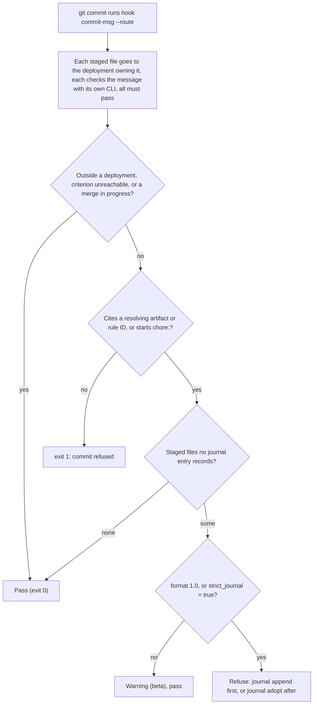

`--route` (what the installed hook calls, from the repository top): each staged
file goes to the deployment owning it (nearest project file, unless opted out);
each owning deployment checks the message with its own CLI; all must pass. No
owned file staged → the top's deployment checks the message, if any.

### 4.7 `catalyst hook install`

```
catalyst [--project <dir>] hook install
```

Writes an executable Python `commit-msg` hook into the project repository's
`.git/hooks/commit-msg` that runs `hook commit-msg --route` through the launcher
(`$CATALYST_HOME/bin/catalyst`), falling back to the nearest legacy
`.criterion/bin/catalyst.pyz`. Rewrites its own hook; refuses (exit `1`) when a
foreign `commit-msg` hook exists (merge by hand). Writes into `.git/` — run it only
with the user's assent (there is no `--yes`). A repository with `core.hooksPath`
must call the hook from there.

### 4.8 `catalyst mcp`

```
$CATALYST_HOME/bin/catalyst mcp
```

A stdio MCP server (newline-delimited JSON-RPC 2.0, stdlib only;
`scripts/catalyst/mcp.py`), registered once per machine by `agent install`. It
redirects fd 1 to stderr so stray output cannot corrupt the protocol. Protocol
versions offered: `2025-11-25`, `2025-06-18`, `2025-03-26`, `2024-11-05` (it
echoes the client's if supported). Through the launcher, `mcp` always runs the
newest installed runtime.

**Project discovery** (per request): a tool call's `cwd`; else the client's roots
(`roots/list`, asked once, reset on `notifications/roots/list_changed`); else
`$CLAUDE_PROJECT_DIR`; else the server's working directory — then the nearest
`catalyst.toml` above.

**Instructions** (on `initialize`): a generic paragraph ("catalyst governs
projects that have a catalyst.toml ...") plus the deployment's laws (as
`hook start` prints them) when the server's start directory is in a project.

**Prompts.** One per command of the composed `CODE-OF-CONDUCT.md` §4 (kernel and
modules), read at request time; description = the command's one-line summary;
`prompts/get` returns `catalyst /<name>` with one user message holding the
command's procedure (`catalyst spec` text plus the arguments). Arguments: one
`arguments` string — except for clients named `claude-code`, which split typed
words over declared arguments, so they get 16 optional slots `word1..word16`,
joined back with spaces. In Claude Code they appear as `/catalyst:<name>`
(e.g. `/catalyst:check-rules`). No project → empty prompt list.

**Tools.**

| Tool | Input | Behaviour |
|---|---|---|
| `catalyst` | `args: string[]` (required), `cwd?: string` | Runs `$CATALYST_HOME/bin/catalyst <args>` (else the same pyz / `python -m catalyst`) in the project root, stdin `/dev/null`, `CATALYST_VIA=agent`, timeout 600 s. Returns `exit <code>\n<stdout>[\n[stderr]\n<stderr>]`, `isError` when the code ≠ 0. `mcp` itself is refused. Publishing verbs therefore exit `3` unless `--yes` is passed. |
| `command` | `name?`, `arguments?`, `cwd?` | Returns the command's procedure (for clients without prompts: Copilot CLI, Codex); without `name`, lists `/<name> — <summary>`. |

Methods: `initialize`, `prompts/list`, `prompts/get`, `tools/list`, `tools/call`,
`ping`; others → `-32601`; errors → `-32602`/`-32603` without ending the session.

A typical exchange between an agent and the server:

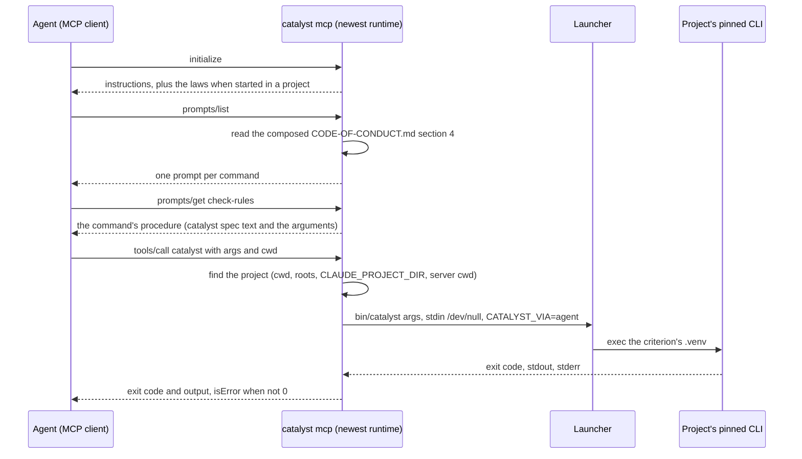

### 4.9 `catalyst task`

```
catalyst [--project <dir>] task [<name> [-- <arguments>...]]
```

Runs one task of the criterion's `Taskfile.common.yml` with Task from the
project's root: `task -t <criterion>/Taskfile.common.yml <name> AGENT_CMD=<cmd> -- <args>`;
without a name, `task -t ... --list`. `AGENT_CMD` = `$AGENT_CMD` if set, else
`<binary of this user's agent> -p` (agent: `$CATALYST_HOME/projects/<name>/agent`,
else `catalyst.toml` `agent`, else `claude-code` → `claude -p`). Exit: Task's own;
`1` without a criterion Taskfile or without `task` on `PATH`. catalyst never
creates, includes or edits the project's own `Taskfile.yml`.

Example: `catalyst task create -- bug "The export drops the last row"` runs
`claude -p "/create bug The export drops the last row"` in the project root.

---

## 5. Commands: checks, verification and reports

### 5.1 `catalyst check`

```
catalyst [--project <dir> | --working-copy <dir>] check [--strict] [--json]
```

Every check a deployment can run on itself, in one pass (`scripts/catalyst/check.py:run`):

1. **Format**: `catalyst.toml` `format` absent → warning (pre-`1.0-rc`); not one
   this CLI reads → error (sync the CLI or the deployment).
2. **Scope**: a project file inside a `.catalystignore`-opted-out directory → error.
3. **Module kernel range**: a module whose `kernel_version` range excludes the
   deployed `version.txt` → error.
4. **Structure** (`scripts/check_deployment.py`): folders, indexes, templates,
   definitions, required paths, signers, version drift, module record hashes
   (`module verify`), etc. (`structure: ...`).
5. **Chain** (`validate`, below): `chain <code>: <where>: <message>`.
6. **Gates** (`IAM/gates.json` malformed / unknown names; `gates unapproved` per
   gated rule lacking approvals), **landing** policy errors, **identity** pointer
   problems (a `static` provider warns), workflows, proposals, analyses records,
   **overdue** entities (warnings).
7. **Journal** (`journal verify`): errors; legacy-entry warnings summarised in one line.
8. **Unrecorded changes** after `journal_since` (warning in beta, error at
   format `1.0` or with `strict_journal = true`); uncommitted changes in governed
   files; OS clutter (`.DS_Store`, `Thumbs.db`, `desktop.ini`) ignored.
9. **Indexes** stale (`index regen --check`).
10. **Integrity** when the criterion's HEAD is a merge (`criterion integrity`,
    cached per HEAD in `.git/catalyst/integrity/`).

It records its result in `.git/catalyst/last-check.json` (the status line).
Output: the findings then `catalyst check passed|FAILED (<scope>): N error(s), M
warning(s)` where scope is e.g. `module software-engineering` or `modules a, b` or
`kernel only`. `--json` (`spec/check.schema.json`): `ok`, `errors`, `warnings`,
`findings[{level,text,entity}]`. Exit `1` on any error (any warning with
`--strict`); `0` and `catalyst check skipped: ...` outside any project;
`catalyst check FAILED: ...` exit `1` when the criterion is unreachable.

The check pipeline in order:

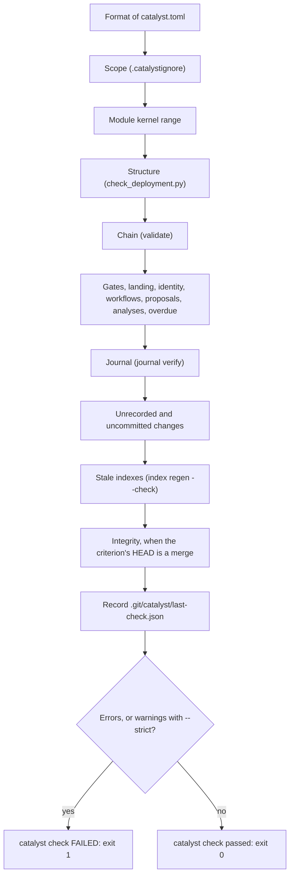

### 5.2 `catalyst validate`

```
catalyst [--project|--working-copy ...] validate [--strict] [--json]
```

The traceability chain only (`scripts/catalyst/validate.py`). Errors:
`duplicate-id`, `dangling-ref`, `required-field`, `closed-incomplete`, `derived`
(back-reference disagrees; `repair derived` fixes), `ungrounded` (INV-5),
`signer` (Signed-off-by unknown), `id-shape`, `rule-unindexed` (INV-8),
`rule-strength` (not must/should/may), `rule-file-heading`, `index-orphan`.
Warnings (`--strict` promotes): `enum-value`, `unknown-user`, `guard`, `ref-type`,
`cardinality`, `retired-target`, `index-drift`. Exit `1` when failing. JSON:
`spec/validate.schema.json`.

### 5.3 `catalyst index regen`

```
catalyst [...] index regen [--check [--diff]]
```

Rewrites every per-file entity type's `<folder>/<folder>.md` index from the
artifact files: the first table with an `ID` column gets one row per artifact in ID
order (`ID` links the file, `Title` from the H1, other columns from same-named
fields); prose, other tables and headers kept; a column with no matching field
keeps its old cell; a row whose file is gone is kept (its ID is never freed; it
shows as `index-orphan`). `--check`: write nothing, print `out of date: ...`, exit
`1` if any; `--diff` adds a unified diff. Free-form types (rows of a hand-edited
table) have no generated index. Never edit an index by hand (law L6).

### 5.4 `catalyst trace`

```
catalyst [--project <dir>] trace [<range>] [--pattern-only]
```

Checks that every commit in a git range traces, by the commit-msg rule. `<range>`:
anything `git log` takes (default `HEAD~1..HEAD`; `HEAD` = whole history). Merges
skipped; with a deployment, a commit changing files but none it governs is skipped;
a commit changing no file is checked. Prints `ERROR <sha> '<subject>': <reason>`
per untraced commit, then a summary. With a deployment and `journal_since`, also
`WARNING|ERROR unrecorded-change: ...` per commit after the baseline (fails only at
error level). `--pattern-only`: no deployment needed, accepts any well-formed full
or six-digit short ID without resolving; the repository is the cwd (or
`--project`). Exit `1` on any failure or a bad range.

CI recipe (GitHub Actions, `fetch-depth: 0`): range = `base..head` for a PR,
`before..sha` for a push, `sha~1..sha` for a new branch; run the criterion's CLI
(`$CATALYST_HOME/projects/<name>/criterion/bin/catalyst.pyz trace "$range"`) or a
release zipapp with `--pattern-only`.

### 5.5 `catalyst unrecorded`

```
catalyst [--project <dir>] unrecorded [<range>] [--json]
```

Lists non-merge product commits after `journal_since` that change a governed file
to a blob that was not its latest journaled `after` at that commit (a hand revert
counts), unless adopted. `<range>` narrows further. One line per commit (sha,
author, subject, files) then a count; `--json`: `[{commit, author, subject,
files:[{path,before,after}]}]`. Exit `1` only when something is found at error
level, on a bad range, for a `--working-copy`, without `journal_since` and without
a range, or when the baseline commit is missing from this clone (shallow
checkout). Resolve with `/adopt` (`journal adopt` or revert).

### 5.6 `catalyst report`

```
catalyst [...] report [--since <ISO date>] [--json]
```

Usage measurement: journal entries and active days; entries per actor, tier
(`untiered`) and command (top 10); of the product's non-merge commits (last 200
from `HEAD`, or all since `--since`), how many trace; artifacts per type and
Status; reconciliation cases; unrecorded and adopted commits; `validate` counts.
JSON keys: `entries, actors, tiers, commands, active_days, artifacts,
reconciliations, errors, warnings, commits, commits_traced, unrecorded_commits,
adopted_commits`. Always exit `0`.

### 5.7 `catalyst audit`

```
catalyst [...] audit [--json] [--html <file>]
```

The audit pack: what the deployment runs (project, kernel, modules, the catalyst
building the pack, the criterion commit), integrity (`journal verify`, `check`
first errors, gated rules lacking approvals), signatures per signer, and each rule
(status, strength, domain) with everything resting on it transitively. `--html`
writes one self-contained page (no script, no remote file), printable to PDF; the
only file written. JSON: `spec/audit.schema.json`. `serve --local` answers
`GET /v1/audit`.

### 5.8 `catalyst badge`

```
catalyst [...] badge [--metric check|chain] [--out <file>]
```

An SVG `label | value` badge: `check` (default): `passing` (green), amber with
warnings, red with the error count; `chain`: share of live rules something rests
on (green ≥80%, amber ≥50%). To stdout or `--out`. It reads `check` state; intended
for a CI job to publish.

---

## 6. Commands: IDs, identity and people

### 6.1 `catalyst id next`

```
catalyst [...] id next <PREFIX> [--count N] [--as <user>]
```

Prints `<PREFIX>-NNNNNN-<userid>`: `NNNNNN` one above the highest number ever seen
for the prefix (files, index rows, table rows, journal) **and** above any number
already reserved on this machine; `<userid>` the verified signer's. `--count N`
prints N consecutive reserved IDs (`N < 1` → exit `2`). Unknown prefix → exit `1`
listing the known ones (e.g. `ADR, ANALYSIS, BUG, FEAT, HK, RECON, REQ, RM, STEP,
TEST, WORKFLOW` with the software-engineering module).

**Behaviour to know:** each call **reserves** the number under the ID lock in
`<criterion>/.git/catalyst/ids.json` (verified: two successive calls printed
`BUG-000001-...` then `BUG-000002-...`). An ID printed and never used is burned
locally (a gap). `CLI.md` still says "two calls before the file is written print
the same ID" — that is no longer true. Prefer `catalyst new`, which allocates and
writes in one step. Numbers are unique per type and signer, not across machines:
two contributors can draw the same number under different userids (both valid).

### 6.2 `catalyst id next-rule`

```
catalyst [...] id next-rule <doc-prefix> <DOMAIN> [--as <user>]
```

`<doc-prefix>-<DOMAIN>-NNNNNN-<userid>`, numbered within the domain across all
document prefixes (defined, indexed, cited in rule documents or the journal), and
reserved as above. The domain must be in `rules/domains/domains.md`; `META` and
each module's namespace are always accepted. Example: `id next-rule br AUTH` →
`br-AUTH-000004-Ab3xR9pQ`.

### 6.3 `catalyst userid gen`

```
catalyst [...] userid gen
```

Prints a new userid: 8 characters from `[A-Za-z0-9]` (CSPRNG), redrawn without an
uppercase letter or on collision with a known one (INV-26). Needs a deployment (to
know existing userids). Writes nothing.

### 6.4 `catalyst identity ...`

```
catalyst [...] identity configure [--provider keycloak|static] --issuer <url> [--client <id>]
                                  [--catalyst-client <id>] [--link <retired user>] [--as <user>] [--intent <why>]
catalyst [...] identity login   [--issuer <url> [--client <id>]] [--json]
catalyst [...] identity logout  [--issuer <url> [--client <id>]]
catalyst [...] identity whoami  [--issuer <url> [--client <id>]] [--json] [--as <user>]
catalyst [...] identity status  [--issuer <url> [--client <id>]] [--json]
catalyst [...] identity link <user> [--as <user>]
```

The deployment's pointer to catalyst-users and this person's login
(`__main__.py:cmd_identity`, `scripts/catalyst/provider.py`, the vendored
catalyst-users core in `scripts/catalyst/identity/` — changed in
cantica-tech/catalyst-users first, then re-vendored with `scripts/vendor_identity.py`).

| Subcommand | What it does | Network | Writes |
|---|---|---|---|
| `configure` | Writes `IAM/identity.json` (`provider`, `issuer` without trailing `/`, `client`, `catalyst_client`), then resolves a signer under it (`--link` first adopts a retired user's userid); on failure restores the old file. Journaled (`catalyst identity`, tier `chore`). Pointer problems → `SystemExit` exit `1`. | provider | criterion |
| `login` | Device flow: prints `Open <verification URI>` and `confirm the code <code>`, waits, stores tokens owner-only in `$CATALYST_HOME/identity/<hash>.json`, discards the old snapshot, then prints `whoami`. | provider | home |
| `logout` | Revokes the session, deletes tokens and snapshot; warns if revocation failed. | provider | home |
| `whoami` | Verified now: username, name, issuer, subject, userid (`(none yet: given at your first signature)`), groups, roles, grants, reconciliation level, criteria administered (`spec/identity-whoami.schema.json`). Inside a deployment it is the deployment's signer (rewrites the snapshot). | provider | snapshot |
| `status` | Provider, issuer, whether tokens are stored. No network. Always exit `0`. | — | — |
| `link` | Keep a retired user's userid (name, username or userid) as yours, once (migration 0.106.0); appends a ledger line. | provider | criterion |

With `--issuer`, `login`/`logout`/`whoami`/`status` work outside any deployment
(e.g. before `init`). Without `--issuer` inside a deployment with no pointer:
`IAM/identity.json is missing: catalyst identity configure --issuer <url>` (exit 1).
`--as` on `whoami`/`link` only selects among the static test backend's people.

### 6.5 `catalyst user ...`, `catalyst role ...` (always refuse)

```
catalyst user add <name> <role> [--git-username <u>] [--as] [--intent] [--json]
catalyst user remove <name> | user modify <name> <field> <value> | user assign-role <name> <role>
catalyst role add <name> [--action <a> ...] [--reconciliation full|propose|none] [--provider-role <r>]
catalyst role modify <name> [--action <a> ...] [--provider-role <r>]
```

Kept for the `/user` and `/role` slash commands; since design 29 they **always**
exit `1` with: `people and roles are catalyst-users' (design 29): add, disable or
change people, and what each role grants, there (catalyst-users users …,
catalyst-users roles provision); fw-IDENTITY-000002`. The refusal happens before
any signer resolution; the options are parsed but unused (`--provider-role` is
documented as "no longer used"). Listing people: `catalyst list user`.

---

## 7. Commands: the journal

The journal is append-only (INV-17), sharded per actor and machine:
`<criterion>/development/journal/<actor-slug>@<machine-id>/<YYYY-MM>.jsonl`. Each
CLI entry carries `timestamp` (UTC), `actor`, `command`, `action`, `artifact`,
`targets`, `intent`, `files[{path, before, after}]` (git blob SHAs; `.criterion/<path>`
for criterion files, project-relative otherwise), optional `tier`, `via`
(`agent`/`person`/`server`), `writer: "catalyst/<version>"`, and for adoptions
`origin: "manual"`, `commit`, `commit_author`. Every journaled blob is pinned under
`refs/catalyst/journal` in its repository. Entries are written by the CLI only.

### 7.1 `catalyst journal append`

```
catalyst [...] journal append --command <cmd> --action <action> --artifact <id|text>
         --intent <text> [...] --file <path> [...] [--target <id> ...] [--tier <tier>]
         [--as <user>] [--allow-unchanged] [--json]
```

Appends one entry under the journal lock with real hashes and time. Write the files
first, then append.

| Option | Meaning |
|---|---|
| `--command` (required) | A §4 command or alias (`/status`), `catalyst <verb>`, or a tier name; anything else is written with a stderr warning. Also the grant checked. |
| `--action` (required) | `create`, `update`, `close`, `retire`, `status-change`, `sync` (code also accepts `redact`). Anything else → exit `1`. |
| `--artifact` (required) | Artifact ID or short description. |
| `--intent` (repeatable) | The goal; thin intents warned. |
| `--file` (repeatable) | Touched path (absolute or cwd-relative). Deleted file → `after: null`. |
| `--target` (repeatable) | Rule/artifact IDs served (`targets: []` if none). |
| `--tier` | One of the module's tiers (default set `chore`/`fix`/`feature`); unknown → exit `1` naming them. |
| `--allow-unchanged` | Accept a file whose content equals its last journaled state (otherwise rejected). |
| `--json` | Print the written entry (`spec/journal-entry.schema.json`). |

Output: `journaled N file(s) at <timestamp>`. The first pin in a repository prints
a note about `refs/catalyst/journal`.

### 7.2 `catalyst journal adopt`

```
catalyst [...] journal adopt <commit> [<commit> ...] | <A>..<B>
         --intent <text> [...] [--target <id> ...] [--artifact <id|text>] [--tier <tier>] [--as <user>] [--json]
```

Records commits made outside catalyst (`/adopt`). For each commit, oldest first:
one entry with `command: "/adopt"`, `action: "update"`, `origin: "manual"`,
`commit`, `commit_author` (git's author, never the actor), each unrecorded file's
`after` = the commit's blob, `before` = its last journaled state (else the parent's
blob). A file journaled again since the commit is recorded `superseded: true` (history
only). Signed by the verified identity only. `--intent` required; `--artifact`
defaults to `commit <sha>`. Files already recorded are skipped; nothing unrecorded
→ `nothing to adopt`. Output `adopted <sha10> (<actor>): N file(s)`.

### 7.3 `catalyst journal verify`

```
catalyst [--working-copy ...] journal verify [--strict] [--legacy] [--json]
```

Checks every line is a JSON object with required fields; timestamps ordered; each
file's `before` = previous `after` (hash chain); every blob exists; CLI blobs
pinned; no journaled file changed since its last entry; absolute/machine-specific
paths. Problems on CLI-written entries are errors; on pre-CLI (`writer`-less)
entries warnings, hidden behind a count unless `--legacy`. Union merges leave
`concurrent-edit` **notes** (never fail). Exit `1` when failing.
JSON: `{"ok", "issues"}`.

### 7.4 `catalyst journal restore`

```
catalyst [...] journal restore <timestamp> [<out>]
```

Materialises every journaled file as it stood at `<timestamp>` (ISO 8601, any
offset converted to UTC) into `<out>` (absent or empty; default
`$TMPDIR/journal-restore-<digits>`): latest `after` at or before the time, or the
first entry's `before` for files first journaled later. Never touches the live
tree. Redacted blobs are skipped. Exit `1` listing paths whose blob is missing.

### 7.5 `catalyst journal show`

```
catalyst [...] journal show [--since <ISO>] [--artifact <id>] [--actor <name>] [--rule <id>] [--json]
catalyst [...] journal show --artifact <id> --content [--json]
```

Read-only, entries in time order, filtered (`--actor` matches a name or part).
With `--content` (needs `--artifact`, else exit `1`): the entity's history — every
entry that changed its file, causal order, with who/when/command/intent and the
content before/after as a unified diff (JSON: `spec/history.schema.json`; a
missing blob is `null`, a redacted one `null` + `redacted: true`). Short IDs resolve.

### 7.6 `catalyst journal redact`

```
catalyst [...] journal redact <blob40hex> [...] --intent <why> [--as] [--tier] [--json]
```

For content journaled by mistake (a secret): appends a tombstone entry (`action:
redact`, the blobs under `redacted`) and removes the blobs from the pins of the
criterion **and** the product repository (rewriting `refs/catalyst/journal` as one
history-less commit). No entry is rewritten; the chain still verifies. Afterwards
readers treat the blobs as redacted. It does **not** purge commits that hold the
file (`git filter-repo` is the owner's call) — rotate the secret first. A blob the
journal does not name is refused. Default tier: the module's no-artifact tier.

### 7.7 `catalyst journal pin`

```
catalyst [...] journal pin [--share]
```

Pins every referenced blob under `refs/catalyst/journal` (backfill for pre-CLI
entries, after cloning or importing). `--share` also merges each repository's pins
with its `origin`'s and pushes **only the pin ref** (criterion and product).
`criterion push`/`share push` share the criterion's pins themselves; run `pin
--share` when you push the product. `git update-ref -d refs/catalyst/journal`
removes the ref (restore then loses pruned blobs).

---

## 8. Commands: read-only views

None of these writes (apart from the identity snapshot where a signer is
involved). Each takes `--json` (schemas in Appendix B). IDs may be full, short
(`REQ-000030` when unique; ambiguous short forms are refused naming both), or a
meta-rule as written in the handbook (`rr-META-015`).

| Command | Synopsis | Output |
|---|---|---|
| `list` | `list <type> [--filter KEY=VALUE ...] [--type <family>] [--json]` | `<type>`: an entity type (prefix, name or folder), `rule`, `user` (signers ledger + retired registry), `role` (roles template), `template` (`--type` narrows), or `all` (rules then every type). Filters use `*`/`?` wildcards. Unknown type → exit `1` naming the known ones. |
| `view` | `view <id> [--json]` | Fields, outgoing links, incoming links, journal entries; a rule adds `title`, `status`, `domain`, `text`; a proposal case adds `proposal`. Unknown → exit `1`. |
| `backlog` | `backlog [--json]` | Open items per type/status (open = not a closed state), open items missing a required link, rules no open item targets, `coverage` of active rules. |
| `graph` | `graph [--json]` | `rules`, `domains`, `artifacts` (with `links`, `mentions`, row items), `types` (fields, states, grounding). |
| `impact` | `impact <id> [--up|--down] [--depth N] [--json]` | `upstream` / `downstream` transitively, each with `depth` and `via{id,field,on}`; prose mentions listed apart. Unknown → `1`. |
| `inbox` | `inbox [--json]` | What waits for a person, kinds `unrecorded-commit`, `unrecorded-change`, `reconciliation`, `analysis`, `approval`, `proposal`, `overdue`, each with `evidence` and `settle` commands. Always `0`. `--working-copy`: last four kinds. |
| `approvals` | `approvals <id> [--json]` | Each gate covering the entity: counted approvals for its current version, missing count. |
| `landing show` | `landing show [--json]` | The landing policy in force (`IAM/landing.json`, else the kernel's `standard`) and its source; rules as `match -> one pull request per <group>, <review>, merge <auto|admin>`. |
| `definition list` | `definition list [--json]` | Each deployed `definitions/<type>.md`: slug, version, description. |
| `why` | `why <item>` | A law (`L3`, `SE-L1`) with the invariants it absorbs; an invariant (`INV-17`, `INV-SE-2`) with its law, enforcement and text; a meta-rule section (`rr-META-012`, `rr-SE-001`); an alias as its new ID; else `view` of an ID. Nothing matches → exit `1`. No `--json`. |
| `spec` | see [§12.2](#122-catalyst-spec) | |

---

## 9. Commands: writing verbs and governance

All verbs in this section sign (see §2.5), regenerate indexes, write exactly one
journal entry, take the common options of §2.6, and exit `1` changing nothing on a
refusal. Implementation: `scripts/catalyst/edit.py` unless noted.

### 9.1 `catalyst new`

```
catalyst [...] new <type> --title <t> [--field NAME=VALUE ...] [--as] [--intent ...] [--command <cmd>] [--tier] [--json] [--preview|--forewarned]
```

Allocates the next ID (reserved), copies the type's **latest** template, fills
ID, Name, Filename (from the title), initial status, dates, `Signed-off-by` and the
given fields (references as comma-separated IDs, each checked to exist), registers
it in the index, journals. Refuses a missing required field (`HK needs --field
Targets=…, --field Domain=…`), a reference that does not resolve, an initial status
a gate covers, or a grant that does not allow `create`/`create-<type>`. The
sections below the field table are left for the agent to write (then `journal
append` the edit, or use `edit --section`). Output: `<ID>  <file>`.

Example: `catalyst new BUG --title "Export drops the last row" --field
Targets=br-EXPORT-000002-Ab3xR9pQ --field Domain=EXPORT --field Severity=High
--command /create-bug --tier fix --intent "The CSV export loses the final row"`.

### 9.2 `catalyst rename`

`rename <id> --title <t>`: the heading, `Name`, `Filename` and the file name follow
the new title; the ID never changes (L7). Back-references follow.

### 9.3 `catalyst edit`

```
catalyst [...] edit <id> [--field NAME=VALUE ...] [--section HEADING=TEXT ...] [--section-file HEADING=FILE ...] ...
```

Changes plain fields and section bodies. Never `ID`, `Name`/`Filename` (use
`rename`), `Signed-off-by`, `Status` (`status set`), derived fields, or references
(`link`/`unlink`). Enum fields take allowed values only; an edit that changes
nothing is refused. An admin's edit is made; anyone else may edit only their own
entity (creator, or named in a person field): directly when it links to nothing,
otherwise the edit becomes a **proposal** (a `RECON-` case, needs a reconciliation
level) and the file is untouched — output `<id> is linked: the edit is a proposal,
<RECON-id>, waiting for its decision`.

### 9.4 `catalyst status set`

```
catalyst [...] status set <id> <status> [--force] [--through] [--as] [--intent] [--command] [--tier] [--json]
```

Sets `Status`, checked against the type's statuses, declared transitions, the
module's guards (`holds: <condition>`), an active governing `WORKFLOW-` (its
`## Transitions` rows: From/To/Role/When), and approval gates.

- `--force`: writes a value outside the statuses or past a failing **guard**
  (recorded in the journal). Never passes a gate or a governing workflow.
- `--through`: reaches a later status along the shortest declared path, each step's
  gates and guards checked, one entry naming the path (not with `--force`).
- A `RECON-` case is refused (only `reconcile` changes one).

There is no bare `catalyst status`: `status` requires the `set` subcommand.

### 9.5 `catalyst link` / `catalyst unlink`

```
catalyst [...] link   <id> <field> <id> [<id> ...] [...]
catalyst [...] unlink <id> <field> <id> [<id> ...] [...]
```

Add / remove IDs in a reference field, maintaining the target's declared
back-reference. A required field must keep one ID (link the replacement first). A
derived field is changed from where it is cited.

### 9.6 `catalyst restore`

```
catalyst [...] restore <id> --to <ISO timestamp | #N> [...]
```

Writes the entity's file back as it stood after the last journal entry at or before
the time, or after its N-th change (`#1` = first; as `journal show --artifact`
lists them); derived fields recomputed; a new journaled change. Refused for a rule
sharing its document with other rules, no version then, a redacted/missing blob, an
unchanged file, or a version entering a gated state without approvals.

### 9.7 `catalyst repair derived`

```
catalyst [...] repair derived [--as] [--tier] [--json]
```

Rewrites every derived field (another type's back-reference) that disagrees with
its sources, one entry (default: the module's no-artifact tier, `chore`).
Idempotent: `every derived field agrees with its sources`.

### 9.8 `catalyst approve` / approval gates

```
catalyst [...] approve <id> --gate <gate> [--as] [--intent] [--tier] [--json]
```

Gates are opt-in in `IAM/gates.json` (`framework/kernel/schemas/gates.schema.json`):
a gate covers the rules of a domain, or a type entering a state (optionally `when`
a condition holds), and needs N approvals from one role. `approve` writes one
journal entry (action `approve`, no file changed) naming the gate and the entity's
current blob. Refused: gate does not cover it; signer inactive or lacking the role;
signer is the **author** of that version; second approval by the same person.
Changing the text voids earlier approvals. Output says how many are still missing.
On a proposal case, it approves the proposed version.

### 9.9 `catalyst landing init`

```
catalyst [...] landing init [--policy standard|open|reviewed|host] [--force] [--as <admin>] [--intent] [--json]
```

Writes the kernel's policy template (`framework/kernel/templates/landing.<policy>.template.json`)
to `IAM/landing.json`, journaled as the Admin's assent to every landing it allows.
Admins only; an existing file needs `--force`. Phase 1: declared and checked; it
drives `catalyst serve landing`.

### 9.10 `catalyst propose`

```
catalyst [...] propose <id> --from <file|-> [--title <t>] [--as] [--intent] [--tier] [--json]
```

Opens a `RECON-` case with `Trigger: proposal`: base = the entity file's current
blob, proposed content kept at `reconciliations/<RECON-id>.proposed`; the entity is
untouched. A rule is proposed as its whole rule document. Needs a `propose` or
`full` reconciliation level. Re-running `propose` on the case (via `reconcile
<case> propose --from`) revises it against a new base.

### 9.11 `catalyst reconcile`

```
catalyst [...] reconcile <RECON-id> (accept|accept-with-edits|reject|propose|close)
         [--text <resolution>] [--from <file|->] [--as] [--intent] [--preview|--forewarned]
```

The role-gated decision on a reconciliation case (INV-21): level `full` may use
every verb, `propose` only `propose`, `none` nothing. For a proposal case: `accept`
writes the proposed content (refused when the entity moved past the base, when the
acceptor is the proposal's author — law L4 —, or a gated move lacks approvals of the
proposed version); `accept-with-edits --from` writes the acceptor's content;
`propose --text` adds a Revisions row (or `--from` a revised proposal); `close`
withdraws (author, while open); `reject` writes nothing to the entity. Output:
`<id>: <verb> -> <new Status>`. No `--json`, no `--tier`.

### 9.12 `catalyst try`

```
catalyst [...] try [--json] [--keep] <verb> <its arguments...>
catalyst [...] try --proposal <RECON-id> [--as <user>] [--json] [--keep]
```

Runs one writing verb (`status`, `new`, `edit`, `link`, `unlink`, `rename`,
`restore`, `approve`, `reconcile`, `propose`) on a scratch copy —
`git clone --shared` of the criterion into `$CATALYST_HOME/scratch/`, with the
current files (uncommitted included) copied over — and reports the files it would
write (blobs before/after), `check` findings added and cleared, the touched
entity's impact, and approvals it would leave waiting (`spec/try.schema.json`).
Nothing is kept (`--keep` keeps the scratch clone); the project side of `check` is
not tried; nothing is shared. Exit `0` when the change would succeed, `1` when it
is refused (the refusal is the answer). `--proposal` = `reconcile <case> accept`.

### 9.13 `catalyst freeze` / `catalyst unfreeze`

```
catalyst [...] freeze|unfreeze <item> [--as] [--intent] [--json]
```

Adds/removes an artifact ID, entity type, template name or working-copy path to the
criterion's `.frozen`, protecting it from `/sync-framework` (`recompose` skips frozen
documents unless `--force`). Journaled (grant `freeze`).

### 9.14 `catalyst definition migrate`

```
catalyst [...] definition migrate <entity-folder-name> <version> [--kernel <dir>] [--as] [--intent] [--json]
```

The only way to move a deployed `definitions/<type>.md` forward (INV-23):
overwrites it with `DEFINITION-...-v<version>.md` from the kernel's or the deployed
module's `definitions/<type>/`; refuses a version that does not exist. `--kernel`
defaults to the checkout's (required from a zipapp).

### 9.15 `catalyst analysis ...`

The four-eyes analysis of existing code (`ANALYSIS-PLAYBOOK.md`, `/run-analysis`;
`scripts/catalyst/analysis.py`): an `ANALYSIS-` record in `analyses/`, reports in
`analyses/reports/<ID>/`. Each phase journals the record and its reports
(grant `run-analysis`); a skipped phase is refused (exit `1`).

| Subcommand | Synopsis | Effect |
|---|---|---|
| `start` | `analysis start [<path>...] [--mode bootstrap|incremental] [--passes 1|2] [--name <n>] [--as]` | Allocates the record (`Extracting`), writes `inventory.json`: every tracked governed file under the paths (default `.`) with blob hash, product `HEAD`, passes (default 2, or `analysis_passes` from `catalyst.toml`). `incremental` (default) lists existing rules/domains/grounded artifacts; `bootstrap` refuses when rules exist. |
| `record` | `analysis record <ID> --pass A|B <file> [--replace] [--as]` | Validates one pass's findings JSON (kind, title, statement, confidence, in-scope evidence, …) and stores `A.json`/`B.json`; warns when passes are identical; single-pass refuses `B`. |
| `diff` | `analysis diff <ID> [--as]` | Pairs findings → `diff.json` (`agreed`, `conflicting`, `a_only`, `b_only`); Status `Reconciling`. |
| `reconcile` | `analysis reconcile <ID> <file> [--as]` | Accepts `{"findings","dropped"}` only if every pass finding is in exactly one final `sources` or dropped with a reason, and non-agreements carry a `verification` other than `both passes`; writes `reconciled.json`; Status `Deciding`. |
| `decide` | `analysis decide <ID> <F#> accept|reject [--artifact <DOMAIN|rule|artifact ID>] [--reason <t>] [--as]` | Records the user's decision in `decisions.json`; `accept` needs an existing artifact; later decisions replace earlier ones. |
| `close` | `analysis close <ID> [--as]` | Refuses while undecided or an accepted artifact is missing; Status `Closed`, summary. |
| `abandon` | `analysis abandon <ID> --reason <t> [--as]` | Status `Abandoned`. |
| `status` | `analysis status <ID> [--json]` | Phase, passes, diff counts, decisions, `PROBLEM` lines; `--json` full report. |
| `list` | `analysis list [--json]` | Every analysis, newest first. |

The record's phases (its Status) and the subcommands that move it:

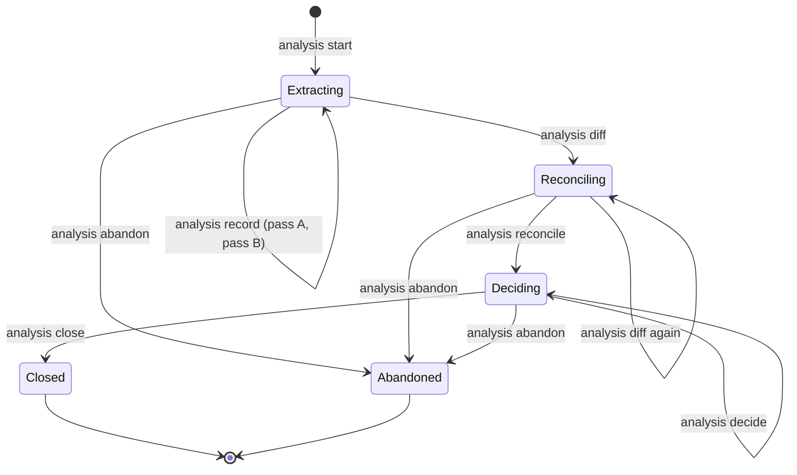

---

## 10. Commands: framework sync, modules, sharing and the server

### 10.1 `catalyst sync plan` / `catalyst sync apply`

```
catalyst [...] sync plan|apply --kernel <framework/kernel | kernel-vX.Y.Z.zip>
         [--module <dir | zip | git URL[@ref]>] [--base-kernel <dir|zip>] [--cli <catalyst.pyz>]
         [--commands-dir <dir>] [--as] [--intent] [--json]
```

The mechanical half of `/sync-framework` (`scripts/catalyst/sync.py`).

| Option | Meaning |
|---|---|
| `--kernel` (required) | Target kernel. |
| `--module` | Target module (a checkout reduced to what its release ships, a zip, or a git URL with `@<branch|tag|commit>`, cloned shallow to a temp dir). With several modules installed it moves only the one it names; a module not installed is refused. Without it the governing documents are recomposed with every installed module as deployed. |
| `--base-kernel` | The kernel the deployment was composed from (default: `…/v<deployed>/kernel-v<deployed>.zip` next to a release zip, or the checkout's git tag of the deployed version). |
| `--cli` | The `catalyst.pyz` to vendor (default: the release's, or built from the checkout). |
| `--commands-dir` | Where an older catalyst wrote project command files, to retire (default `.claude/commands`). |

`plan` lists, writing nothing: CLI, invariants, kernel documents copied as-is
(`ANALYSIS-PLAYBOOK.md`, `definitions/README.md`), module tree, governing documents
(recompose), agent files an older catalyst wrote into the project to retire
(`.claude/commands/*`, hooks in `.claude/settings.json`), new type definitions,
versions, and the kernel and module **migrations** between the versions.
`apply` does it and journals one `/sync-framework` entry (with `modules/modules.json`),
then refreshes the criterion's `.venv` to the vendored CLI (a failure is a warning:
run `catalyst open`). Output ends with `Next: the migrations' judgment steps above,
a DEPLOYMENT.md history line, then catalyst check.`

Safety: locally edited command files or kernel documents are reported, never
overwritten; a recompose conflict stops the sync before anything is written; files no
release ships are never touched; both refuse a module needing a kernel newer than
the one the shared criterion's CI gate runs (sync and publish the kernel first).

The plan, the assent and the apply:

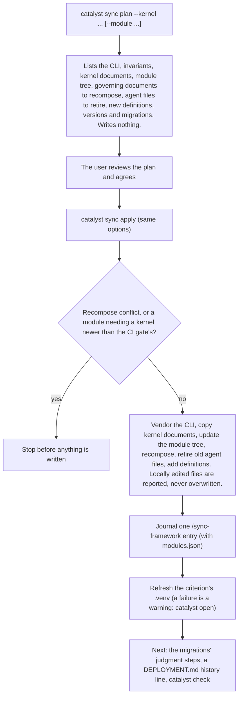

### 10.2 `catalyst recompose`

```
catalyst [...] recompose --base-kernel <old kernel> --base-module <old module dir> --kernel <new kernel>
                         [--module-dir <new module dir>] [--check] [--force]
```

Three-way merges template changes into the deployed `CODE-OF-CONDUCT.md`,
`rules/Rules-of-Rules.md`, `ACCESS-CONTROL.md` and `Taskfile.common.yml`
(`git merge-file`), keeping local edits; composition parameters are read back from
the deployment. Prints per file `merged|unchanged|N conflict(s)|frozen, skipped`
(`would update` with `--check`). Conflicts are left marked `<<<<<<<`. Exit `1` with
conflicts, or with `--check` if anything would change; `1` if the deployment has no
module (`the deployment has no active module`). `--force` also merges `.frozen`
documents. Used inside `sync apply`; rarely run by hand.

### 10.3 `catalyst module ...`

```
catalyst [...] module list [--json]
catalyst [...] module verify [<id>] [--json]
catalyst [...] module available <id> [--json]
catalyst [...] module install <dir|zip|git URL[@ref]> [--kernel <dir>] [--as] [--intent] [--json]
catalyst [...] module upgrade <id> [<dir|zip|git URL[@ref]>] [--kernel <dir>] [--base-kernel <dir>] [--plan] [--as] [--intent] [--json]
```

`scripts/catalyst/modules.py`. The record `modules/modules.json` holds per module:
id, version, source (URL, release file name or directory name — never a path),
commit (git source), sha256 of the deployed tree (text normalised to LF).

- `list`: the record (no network). Unrecorded modules (installed before records
  existed) show `not recorded: the next catalyst sync apply records it`.
- `verify`: recomputes hashes; exit `1` on `changed` or `missing` (also `check` errors).
- `available`: version tags (`1.2.3`/`v1.2.3`) at the recorded repository via
  `git ls-remote`, newest first, marked `installed`/`newer`; a dir/zip source or an
  unreachable repository → exit `1`.
- `install`: adds a module (first or beside others; INV-2, explicit only): seeds as
  `init --module` does, merges its part into the governing documents, names it in
  `catalyst.toml` if first, journals (grant `sync-framework`). Refused before writing
  when: the module's kernel range excludes the deployed (or gate's) kernel;
  `--kernel` is not the deployed version; a merge would conflict; a URL/ref looks
  like an option; or it collides with the kernel or an installed module (id, entity
  prefix/folder/definition, namespace, meta-rule ID, slash command, tier id, a
  different grounding type). `--kernel` unreachable → exit `2`.
- `upgrade`: moves one module through `sync plan|apply` (`--plan` = plan only;
  `--base-kernel` defaults to `--kernel`; the kernel stays). Without a source, the
  recorded repository is fetched. Hidden pass-through options `--cli`,
  `--commands-dir`.

`install` and `upgrade` side by side:

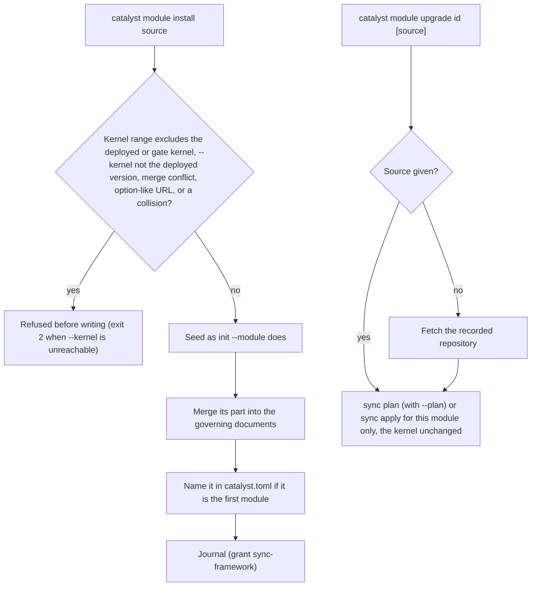

Several modules: loaded in install order; types, tiers, aliases and namespaces are
the union; the first module's invariants sit at the criterion root
(`INVARIANTS.module.md`), the others' in their folders.

### 10.4 `catalyst share ...` (the sharing driver)

```
catalyst [...] share info [--json]
catalyst [...] share status [--fetch] [--json]
catalyst [...] share pull
catalyst [...] share push -m <message> [--as] [--no-pr] [--yes] [--json]
catalyst [...] share create <url> [--driver git|serve] [--branch criterion] [--protect] [--as] [--yes]
catalyst [--project <dir>] share join [<url>]
catalyst share login <server-url> [--token <t>]
```

Driver (`scripts/catalyst/store.py`): `catalyst.toml` `share` (`git`, `serve` with
`share_url`, `local`); absent → `git` when the criterion has a remote or
`catalyst_repo_url` is set, else `local`.

| Subcommand | git driver | serve driver | Exit / notes |
|---|---|---|---|
| `info` | driver, remote, branch, capabilities (`pull, push, pull-request, integrity, protect`) | server URL | `local`: `(nothing: local only)` |
| `status` | unpublished changes, ahead/behind (`--fetch` first) | vs. last-seen server batch | `0` |
| `pull` | `criterion sync` (fast-forward; refuses with local work) | writes changed files, appends others' shards; stops when a file changed on both sides (a `RECON-` for a human) | `1` on refusal; `local` says how to share |
| `push` | `criterion push`: preview → assent → topic branch `<user>/<UTC stamp>`, commit, rebase onto the shared branch (after fetching others' pins), regenerate indexes (+ journal entry if a union merge changed one), `check` + `integrity`, push with lease, share pins, `gh pr create` (unless `--no-pr`) | sends changed files + new blobs as one all-or-nothing batch | `3` without `--yes` (non-TTY); nothing to publish → `0`; `local` → `1` with `share create` advice |
| `create` | `criterion create <url>`: `.gitattributes`, CI workflow, `bin/catalyst.pyz.sha256`, push, record `repoed`, `catalyst_repo_url`, `criterion_branch` in `catalyst.toml` (**staged**); `--protect` = `criterion protect --yes` | `--driver serve --as <user>`: writes `share = "serve"`, `share_url` (journaled, staged), pushes every file | `3` without `--yes` |
| `join` | clone `catalyst_repo_url` (or `<url>`) into the home store on the shared branch (or update); refuses a same-named criterion with another remote; fills runtime | empty criterion filled by a pull | `catalyst open` does the same |
| `login` | — | stores the token (from `--token` or one stdin line) in `$CATALYST_HOME/credentials` | no token → exit `1` |

A `share push` with the git driver, from the agent's first call to the pull request:

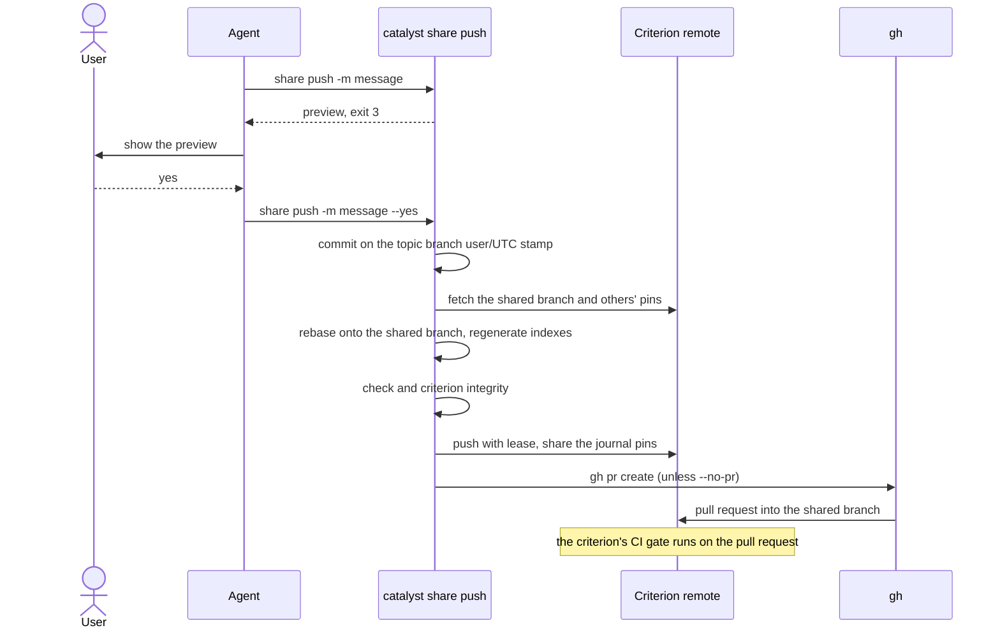

A serve push is refused (nothing applied) when a file moved on the server since,
a change is not journaled, a new entry is signed by someone else than the token's
user, an artifact ID collides, or a `RECON-` change exceeds the signer's level.

Verified in a sandbox: `share create <bare repo>` without `--yes` printed the preview
and exited `3`; with `--yes` it pushed, wrote the three files, set `repoed = true`
and staged `catalyst.toml`; its journal entries are signed with actor `catalyst`
(no verified signer is resolved by the git driver's create).

`share create` with the git driver:

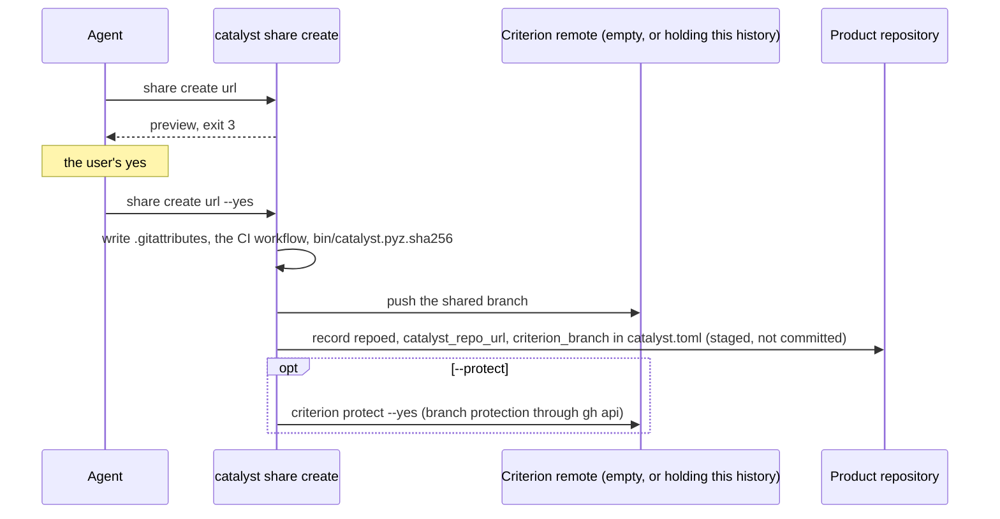

### 10.5 `catalyst criterion ...` (git specifics, partly legacy)

```
catalyst [...] criterion status [--fetch]
catalyst [...] criterion create [<url>] [--branch criterion] [--yes]
catalyst [--project <dir>] criterion join [--url <url>]
catalyst [...] criterion push -m <message> [--as] [--no-pr] [--url <url>] [--yes]
catalyst [...] criterion sync [--url <url>] [--yes]
catalyst [--working-copy ...] criterion integrity [--head HEAD] [--parent <rev> ...]
catalyst [...] criterion protect [--yes]
```

`scripts/catalyst/criterion.py`. In the home store (default since ADR-010) these
work on `$CATALYST_HOME/projects/<name>/criterion` as its own repository and
`share` calls them; the `.criterion` **submodule** behaviour (create replacing a
symlink by a submodule, join initialising the submodule, staging `.gitmodules`) is
legacy, kept "for one minor"; `move --to-home` converts.

- `status`: mode (`home`, `submodule`, `local`), remote, shared branch, current
  branch, uncommitted count, ahead/behind. Always `0`.
- `create [<url>]`: without URL, version the criterion locally (git repo on the
  shared branch, `.gitattributes`, CI workflow), record `criterion_branch`
  (journaled), nothing leaves the machine. With URL: assent (exit `3`), set
  `origin`, require the remote branch (if any) to be contained in local history,
  push, record the remote in `catalyst.toml` (staged).
- `join [--url]`: bring a shared criterion to this machine (home store clone, or
  legacy submodule init on the shared branch). No assent gate (local only).
- `push`: as `share push` (git). A local-only deployment is first published to
  `--url` (asked on a TTY; else exit `1` naming `--url`; assent needed). Rebase
  conflicts abort: nothing pushed; resolve by hand or withdraw your side and open a
  `RECON-` case — never auto-resolve. A remote topic branch holding commits you lack
  (a reviewer's suggestion) is refused: pull first.
- `sync`: fast-forward to `origin/<shared>`; refuses with uncommitted changes or
  commits no remote branch contains.
- `integrity`: exit `1` if a merge lost any journal line, entity/rule ID or index
  row recorded by a parent (default parents of `--head`; aliases count as kept).
  Reads git objects directly; used by the criterion's CI on pull requests.
- `protect`: GitHub branch protection on the shared branch — PRs required (0
  approvals), status check `catalyst` required (strict), no force-push, no
  deletion, admins not enforced. Without `--yes` prints the `gh api` call and
  exits `0`; with `--yes` applies it. Non-GitHub remotes → exit `1`.

The criterion's CI (`.github/workflows/catalyst.yml`, written by `create`,
refreshed by `push`) runs on `pull_request_target` with read-only permissions:
checks the base out as `gate/`, verifies `gate/bin/catalyst.pyz` against
`bin/catalyst.pyz.sha256`, checks the PR merge result out as `change/` (data only)
and runs `python3 gate/bin/catalyst.pyz --working-copy . check` and
`... criterion integrity`. Job name `catalyst`. Merge-safe storage:
`.gitattributes` marks journal shards and generated indexes `merge=union`
(`rules/rules.md` is hand-maintained and conflicts normally); a host's merge button
ignores `union`, so re-run `push` to rebase.

The criterion's CI gate on a pull request:

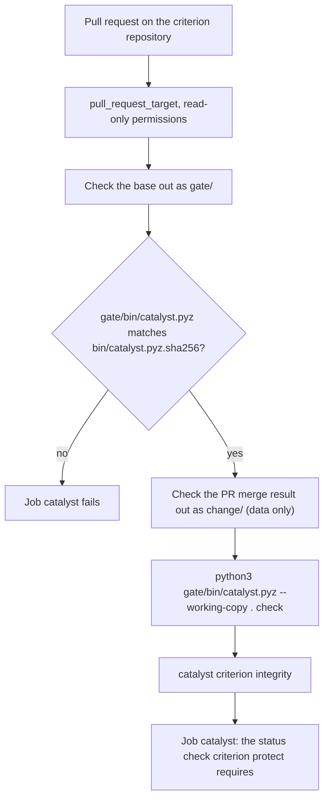

Product CI with a home-store criterion:

```yaml
- env:
    CATALYST_HOME: ${{ runner.temp }}/catalyst
  run: |
    read -r name url branch < <(python3 -c 'import tomllib; d = tomllib.load(open("catalyst.toml", "rb")); print(d["project_name"], d["catalyst_repo_url"], d.get("criterion_branch") or "criterion")')
    git clone -q -b "$branch" "$url" "$CATALYST_HOME/projects/$name/criterion"
    python3 "$CATALYST_HOME/projects/$name/criterion/bin/catalyst.pyz" trace "$range"
```

(a private criterion repository needs a read-only deploy key or token).

### 10.6 `catalyst serve` and `catalyst members`

```
catalyst serve [--db <file>] [--host 127.0.0.1] [--port 8765] [--allow-origin <origin> ...]
               [--identity-issuer <url> [--identity-api-client catalyst-api]] [--criterion <name>]
catalyst serve --local [--project <dir>] [--port <n>] [--static <dir>] [--allow-origin <origin> ...]
catalyst serve [--db <file>] token issue <userid> | token list | token revoke <n>
catalyst serve [--db <file>] key init [--key-command <cmd>] | key escrow --holder <admin> ... --threshold <k> --out <dir> | key recover --share <file> ... [--reason <t>]
catalyst serve [--db <file>] landing connect <repo-url> [--forge git|github] [--token-command <cmd>] [--name serve-landing] [--branch criterion] [--yes] [--json]
catalyst serve [--db <file>] landing tick|list [--json] | landing retry <n>
catalyst serve [--db <file>] members open [--yes] [--reason <t>] | members check [--json] | members fingerprint
catalyst [--project <dir>] members list|add|remove|adopt [<username>] [--reason <t>] [--json]
```

`scripts/catalyst/serve.py`, `serve_landing.py`, `membership.py`.

**Shared server.** SQLite database (`--db`, default `$CATALYST_HOME/serve/serve.db`)
holding every version of the criterion's files; HTTP JSON under `/v1`, bearer token
on every request; TLS left to a reverse proxy. Write side: `GET head`,
`GET changes?since=<batch>`, `GET blobs/<sha>`, `POST have`, `POST push`. Read side
(computed with the CLI's own code): `GET list?type=&filter=`, `view/<id>`,
`backlog`, `journal?since=&artifact=&actor=&rule=`, `graph`,
`impact/<id>?direction=&depth=`, `commands`, `spec/<command>[/<part>]`,
`history/<id>`, `approvals/<id>`, `analyses`, `analyses/<id>`, `definitions`,
`inbox`, `members` (GET/POST); `GET events` (SSE of batch numbers); `GET check` →
501. Each answer carries `X-Catalyst-Batch`. The first push to an empty server is an
import. The server also starts a daily membership fingerprint and, once connected,
a landing tick every minute.

The server's parts and what it talks to:

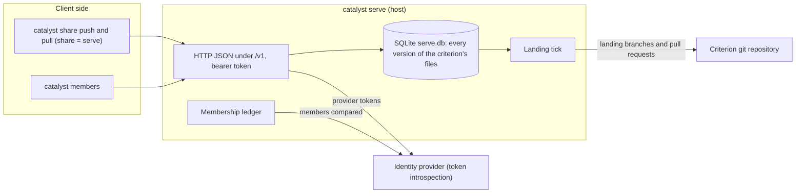

| Option | Default | Meaning |
|---|---|---|
| `--db` | `$CATALYST_HOME/serve/serve.db` | Database. |
| `--host` | `127.0.0.1` | Listen address (`--local` refuses another). |
| `--port` | `8765` (`--local`: OS-chosen) | Port. |
| `--allow-origin` (repeatable) | none | CORS for GET from `https://host[:port]` pages (each read still needs a token; other methods 403). `--local` adds `catalyst.toml` `embed_origins`. |
| `--identity-issuer` | — | Also accept the provider's access tokens via introspection (needs `CATALYST_IDENTITY_API_SECRET`, else exit `1`); cached ≤ 30 s; push signer = ledger line for the token's issuer+subject. |
| `--identity-api-client` | `catalyst-api` | Introspecting client and required audience. |
| `--criterion NAME` | recorded name | The criterion this database serves (recorded once; another later is refused). Its catalyst-users admins hold every grant and level `full` there. |
| `--local` | off | Serve this project's criterion **read-only** on 127.0.0.1 with a per-run token; prints one JSON line `{"url","token","pid"[, "page"]}`; `GET check` works, `GET runs`, `GET audit`, `GET modules`, `GET modules/<id>/available`, `GET modules/<id>/plan?to=<tag>`; write routes → 405; batch = change counter polled every second. |
| `--project` | cwd | `--local`'s project (**shadows the global `--project`**). |
| `--static DIR` | — | With `--local` only: serve a client page's files outside `/v1` (`/` = `index.html`, no token, nosniff); start line adds `page` with `#token=...`; API requests with a foreign `Origin` → 403. |

Host-side subcommands (run where the server's database is):

- `token issue <userid>` prints a token once (only its hash is kept); `token list`;
  `token revoke <n>` (unknown → exit `1`). Users store theirs with `share login`.
- `key init` (master key in the host keychain, or printed by `--key-command` /
  `CATALYST_SERVE_KEY_COMMAND`); `key escrow` writes one `<holder>.share` per holder
  (mode 0600), any `--threshold` recover; `key recover` rebuilds and **replaces**
  the key (all shares void), recorded in the ledger and the journal.
- `members open` (Admin only, `cmd:*`; server started once with `--criterion`):
  lists the provider's current members, exit `3` without `--yes`; then opens the
  encrypted, hash-chained, server-signed membership ledger — from then on the server
  **fails closed** (provider tokens only; members = Admin, criterion admins, and
  people both the provider and the ledger name). `members check` verifies chain,
  signatures, fingerprints and provider/ledger agreement (exit `1` on findings);
  `members fingerprint` writes `IAM/membership.fingerprints.jsonl` now.
- `landing connect <repo>`: where accepted batches land and the command printing
  the push/API token (read per tick, never stored); exit `3` without `--yes`.
  `landing tick` (also automatic each minute): takes in the shared branch, groups
  held batches per the landing policy (`change`, `session` after `idle_minutes`,
  `window`), lands each group as one commit on `landing/<signer>/...` with
  `Signed-off-by` lines, pushes, opens a PR, merges only under `review: none` +
  `merge: auto` once checks pass; otherwise waits (`waiting-review`,
  `waiting-admin`, `check-failed`); a file changed on the shared branch since →
  `conflict`, batches held for a human. `landing list`; `landing retry <n>`.

One landing tick:

```mermaid
flowchart TD
    T["landing tick (each minute once connected)"] --> A["Take in the shared branch"]
    A --> G["Group held batches per the landing policy: change, session after idle_minutes, window"]
    G --> Q{"A file changed on the shared branch since?"}
    Q -- yes --> C["conflict: batches held for a human"]
    Q -- no --> L["One commit per group on landing/signer/... with Signed-off-by lines"]
    L --> P["Push, open a pull request"]
    P --> R{"review none, merge auto, and checks passed?"}
    R -- yes --> M["Merge"]
    R -- no --> W["Wait: waiting-review, waiting-admin or check-failed"]
```

`catalyst members` (client side, design 32): through the project's server
(`share = "serve"` required, else exit `1`): `list`, or `add|remove|adopt
<username> --reason`. Admins only.

---

## 11. Known inconsistencies and surprising behaviours

Checked against the code at 0.119.2; useful when something "doesn't do what the
doc says".

1. **`id next` reserves numbers.** `CLI.md` says `id next` "allocates nothing: two
   calls before the file is written print the same ID". The code
   (`cmd_id` → `next_entity_id(..., reserve=True)`) reserves each number in
   `<criterion>/.git/catalyst/ids.json`; successive calls return successive IDs and
   unused ones become gaps. The first call by a new identity also appends to the
   signers ledger.
2. **Exit code 2 is overloaded.** Documented as "no deployment", it is also argparse
   usage errors, `init`/`module install|upgrade`/`workspace init` argument problems,
   `id next --count 0`, `agent run` that cannot start, and a blocking `hook stop`.
   `where` exits `1` (not `2`) without a project; `open` exits `2`.
3. **`catalyst --project X serve --local` ignores `X`.** `serve` declares its own
   `--project` (a string), whose default overwrites the global one.
4. **`--as` cannot choose a signer.** Its help says "signer (name or git_username)",
   but outside the tests' static backend it only names the logged-in identity; any
   other value is refused.
5. **`share create` (git driver) journals as actor `catalyst`**, not as a verified
   signer (observed in a sandbox: two entries `actor: "catalyst"`, command
   `catalyst criterion create`). Only `--driver serve` resolves `--as`. This sits
   oddly with law L4 ("who signs is verified").
6. **`criterion protect` without `--yes` exits `0`**, not `3`, unlike the other
   publishing commands; `hook install` writes into `.git/` with no assent flag at all.
7. **`user ...` / `role ...` always refuse** (exit `1`), yet keep full option sets
   (`--git-username`, `--action`, `--reconciliation`, `--provider-role` "no longer
   used"); the implementation behind them in `cmd_admin` is unreachable.
8. **`journal append --action` help lists six actions**; the code also accepts
   `redact` (`journal.ACTIONS`).
9. **Stale wording in `CLI.md`**: `init` "the pointer is `<name>.catalyst`" (it is
   `catalyst.toml`), "Outside any catalyst project (no `*.catalyst` pointer)",
   "What a deployment governs — the directory holding its `*.catalyst` pointer";
   `criterion status` "prints the mode (`submodule` or `local`)" (also `home`); most
   of the `criterion create/join` prose describes the legacy submodule model.
10. **Hidden options**: `init --userid` (fixed first userid), `module upgrade --cli`
    and `--commands-dir` (`argparse.SUPPRESS`).
11. **Legacy `--at` still in CI.** `init --at` is "legacy, for one minor", but
    cantica-tech/catalyst's own `deployment-rules.yml` installs scratch deployments with it.
12. **Top-level help is truncated**: `catalyst --help` shows the description
    "`catalyst` command line. Every subcommand works on the deployment found at"
    (first line of the module docstring, cut mid-sentence).
13. **`_NO_STATUS_LINE` lists `help`**, which is not a command (harmless).
14. **`check` writes state**: every `check`/`hook stop`/`hook start` run writes
    `.git/catalyst/last-check.json` (and sessions) — "read-only" in spirit only.
15. **Runtimes are never cleaned**: `$CATALYST_HOME/runtimes/` grows by one
    directory per version and per build (`+g<sha>`, `.dirty`).
16. **Agent wiring asymmetries**: Codex gets a Stop hook but no session-start hook
    (so no ADR-002 baseline: every failure blocks); `codex` honours `CODEX_HOME` for
    `config.toml` but always writes `~/.codex/hooks.json`; `vscode` gets no hooks;
    the Claude Code plugin hardcodes `$HOME/.catalyst` (ignores `CATALYST_HOME`).
17. **Grant checks are uneven**: `id next|next-rule`, `approve`, `propose`,
    `reconcile`, `repair derived`, `landing init` resolve the signer without a
    command grant; `rename`, `edit`, `link`, `unlink` are checked as `create`.
18. **`--working-copy` is silently ignored** by commands that locate the project
    themselves (`where`, `open`, `task`, `runtime`, `move`, `migrate`, `init`).
19. **`hook install`** writes `ROUTER = ".criterion/bin/catalyst.pyz"` into the hook
    even for home-store deployments (it then falls back to the launcher).
20. **`catalyst task` dispatches `"/<command> ..."` as a prompt to `claude -p`.**
    With commands now served as MCP prompts (`/catalyst:<name>` in Claude Code) and
    no command files in projects, whether `claude -p "/check-rules"` resolves the
    command could not be verified here; `catalyst agent run <command>` sends the
    procedure text itself and is the dependable route.

---

## 12. Slash commands (`CODE-OF-CONDUCT.md` §4), `catalyst spec` and `Taskfile.common.yml`

### 12.1 The command registry

A deployment's commands are exactly the bullets of its composed
`CODE-OF-CONDUCT.md` §4: the kernel's
(`cantica-tech/catalyst:framework/kernel/rules-of-development.template.md` §4)
followed by each module's (`code-of-conduct.module.md` §4, under
`### From module <id>`). Nothing else lists commands: the MCP prompts, `catalyst
spec`, `catalyst agent run`, `Taskfile.common.yml` and `/help` all read §4 at run
time (`scripts/check_command_parity.py` checks the Taskfile against it). Agents
reach them as MCP prompts (`/catalyst:<name>` in Claude Code) or the MCP `command`
tool; humans through `catalyst task <name> -- <args>` or `catalyst agent run`.

Every route to a command reads the same registry:

```mermaid
flowchart LR
    K["Kernel rules-of-development.template.md section 4"] --> COC["Composed CODE-OF-CONDUCT.md section 4"]
    MOD["Each module's code-of-conduct.module.md section 4"] --> COC
    COC --> PR["MCP prompts (/catalyst:name)"]
    COC --> CT["MCP command tool"]
    COC --> SP["catalyst spec"]
    COC --> AR["catalyst agent run"]
    COC --> TF["Taskfile.common.yml tasks"]
    COC --> HL["/help"]
    COC --> GS["serve GET commands and spec"]
    PAR["check_command_parity.py"] -. checks .-> TF
```

Kernel commands (0.119.2):

| Command (aliases) | Purpose | CLI it drives |
|---|---|---|
| `/user` (`/user-add`, `/user-remove`, `/user-modify`, `/user-assign-role`, `/user-list`) | People who sign. `list` lists the signers ledger; the others refuse (people are catalyst-users'). | `catalyst list user`; `catalyst user ...` (refuses) |
| `/role` (`/role-add`, `/role-modify`) | Roles; both refuse (catalyst-users' `roles provision`). | `catalyst role ...` (refuses) |
| `/create <type> <title>` (`/create-<type>`) | Create an artifact of a module-declared type; each type is a *part* with its own procedure. | `catalyst new <PREFIX> --title ... --field ...` |
| `/list <type> [--filter ...]` | List artifacts, rules, users, roles, templates (`--type <family>`), or `all`. | `catalyst list` |
| `/freeze <item>` | Protect from `/sync-framework`. | `catalyst freeze` / `unfreeze` |
| `/migrate-definition <type> <version>` | Move a frozen definition forward (INV-23). | `catalyst definition migrate --kernel <release>` |
| `/share info|status|pull|push <msg>|create <url> [--protect]|join [<url>]` | Share the criterion; `push`/`create` only on the user's yes. | `catalyst share ...` (exit 3 → ask → `--yes`) |
| `/reconcile <RECON-id> accept|accept-with-edits|reject|propose <text>|close` | Decide a reconciliation case (level-gated). | `catalyst reconcile` |
| `/status <id> <status> [force]` | Change Status; refuses `RECON-`. | `catalyst status set [--force] --intent ...` |
| `/run-analysis [<path>...] [--bootstrap|--incremental] [--passes 1|2]` | Four-eyes analysis of existing code. | `catalyst analysis start|record|diff|reconcile|decide|close` |
| `/sync-framework [latest|<version>] [--force <scope>]` | Synchronise with a kernel (and module) release. | `catalyst sync plan`, `sync apply`, `migrate`, `check` |
| `/check-rules [<file>]` (`/audit`) | Mechanical `catalyst check` then judgment checks; with a file, its change-impact. | `catalyst check`, `impact`, `view` |
| `/journal [--since] [--artifact] [--actor] [--rule] | restore <timestamp>` (`/journal-restore`) | Read-only journal report or point-in-time restore. | `catalyst journal show`, `journal restore` |
| `/adopt [<commit>|<range>]` | Resolve changes committed outside catalyst: adopt or revert, with the user. | `catalyst unrecorded`, `journal adopt`, `git revert` (with assent) |
| `/help [<command>]` (`/commands`) | Every command with its purpose, and the artifact types. | `catalyst spec` |

Every artifact-changing command ends the same way (§4 preamble): `catalyst index
regen` → `catalyst journal append --command /<name> ...` (one entry, all files) →
`catalyst check` (unless the agent's Stop hook runs `hook stop`). Product commits
cite the artifact or rule ID, or start `chore:`.

Module commands are appended after these. For example the software-engineering
module (3.4.1) adds `/roadmap add|update|merge|remove` (`/roadmap-add`, ...),
`/show-backlog`, and the `/create` parts `bug`, `req`, `test`, `feature`, `step`,
`adr`, `house-keeping`, `decision` (aliases `/create-bug`, `/create-req`,
`/create-requirement`, ...). Those are documented in the modules chapter.

cantica-tech/catalyst additionally keeps `.claude/commands/dogfood.md` (`/dogfood
[recreate]`): catalyst-development-only, never part of a deployment's §4.

### 12.2 `catalyst spec`

```
catalyst [...] spec [<command> [<part>]] [--general] [--budget WORDS] [--json]
```

Prints only what one command needs from the deployed §4: its bullet(s) and its
"When the user enters `/<command>`" procedure(s), headed `# /<name> — from
CODE-OF-CONDUCT.md §4` (an alias is shown as `# /create-bug (alias of /create)`),
followed by a one-paragraph reminder of the common ending (tier first, signer and
IDs via the CLI, `index regen` → `journal append` → `check`, law L3). `<command>`
may be given with or without `/`, or as an alias; `<part>` selects one part of a
command with parts (`spec create bug`).

| Form | Output | Exit |
|---|---|---|
| `spec` | `/name` per line (every command, kernel + modules) | 0 |
| `spec <cmd> [<part>]` | the command's spec text | 1 if unknown |
| `spec --general` | the §4 rules that apply to every command | 0 |
| `spec --json` | `{"commands": [{name, usage, summary, aliases, parts[{name, usage, summary, aliases}]}]}` (`spec/commands.schema.json`) | 0 |
| `spec <cmd> --json` | `{command, part, text}` (`spec/command-spec.schema.json`) | 0/1 |
| `spec --budget N` | `ERROR /<cmd>: W words (budget N)` per command or part over budget, then a summary | 1 if any over |

`catalyst mcp`'s prompts and `command` tool, `catalyst agent run`, and a server's
`GET commands`/`GET spec/<command>[/<part>]` return the same text. catalyst holds
itself to 1,000 words per command (`tests/test_token_budgets.py`).

### 12.3 `Taskfile.common.yml`

Composed **into the criterion** (never the project) from
`cantica-tech/catalyst:framework/kernel/templates/Taskfile.common.template.yml`
plus one generated task per §4 command (ADR-021), and refreshed by
`/sync-framework`. Structure:

```yaml
version: "3"
vars:
  AGENT_CMD: '{{.AGENT_CMD | default "claude -p"}}'
tasks:
  catalyst:                       # not a slash command: pass-through to the CLI via the launcher
    desc: "Run the catalyst CLI: task catalyst -- <args>"
    cmds:
      - python3 "{{env "CATALYST_HOME" | default (printf "%s/.catalyst" (env "HOME"))}}/bin/catalyst" {{.CLI_ARGS}}
  check-rules:                    # one per §4 command, kernel and modules
    dir: '{{.USER_WORKING_DIR}}'
    desc: "verify that rules, domains, and artifact links remain consistent and do not conflict"
    cmds:
      - '{{.AGENT_CMD}} "/check-rules {{.CLI_ARGS}}"'
  # ... adopt, create, freeze, help, journal, list, migrate-definition, reconcile,
  #     role, run-analysis, share, status, sync-framework, user, + module commands
```

Run with `catalyst task <command> -- <arguments>` (sets `AGENT_CMD` from the
user's agent) or `task -t <criterion>/Taskfile.common.yml <command> AGENT_CMD="<bin> -p" -- <args>`.
Each task is a thin non-interactive dispatch of the slash command to the agent.
The deployed task list for a software-engineering deployment: `adopt`,
`catalyst`, `check-rules`, `create`, `freeze`, `help`, `journal`, `list`,
`migrate-definition`, `reconcile`, `roadmap`, `role`, `run-analysis`, `share`,
`show-backlog`, `status`, `sync-framework`, `user`.

---

## 13. The repository's own tooling: `Taskfile.yml`, `scripts/`, CI

### 13.1 `Taskfile.yml` (cantica-tech/catalyst root)

It mirrors `.github/workflows/*.yml`, so `task check:all` is what CI runs. It never
touches a deployed project's Taskfile.

| Task | Runs | Notes |
|---|---|---|
| `install` | `pip install -r requirements-dev.txt` | `pytest>=8`, `pycryptodome==3.23.0`. |
| `test` | `pytest` | `testpaths = ["tests"]`. Tests isolate `CATALYST_HOME`/`CATALYST_USERS_HOME` and enable the static identity. |
| `check:deployment` | `python3 scripts/check_deployment.py` | Structural invariants of the deployment found from the cwd (catalyst's own, via `catalyst.toml`). |
| `check:command-parity` | `python3 scripts/check_command_parity.py` | Taskfile.common.yml and module commands vs §4. |
| `check:kernel-purity` | `python3 scripts/check_kernel_purity.py` | INV-30: kernel names no module. |
| `check:all` | the three checks + `test` | What CI runs. |
| `build:cli` | `package_release.build_cli(Path("."), Path("dist/catalyst.pyz"))` | Builds `dist/catalyst.pyz`; prints its path. |
| `catalyst` | `PYTHONPATH=scripts python3 -m catalyst {{.CLI_ARGS}}` | `task catalyst -- <args>`: the CLI from source. |
| `release` | `package_release.py`, then `check:command-parity`, `check:kernel-purity`, `test` | Packages, no commit, no push. |
| `release:publish` | `package_release.py --publish-dir "$PUBLISH_DIR" --push` | Requires `PUBLISH_DIR` (a distribution repository checkout). Refuses (exit 2) unless HEAD is the version's release tag (`--unreleased` overrides, not exposed by the task). **Commits and pushes** module repositories and `PUBLISH_DIR` — only with the owner's assent. |
| `lint`, `format`, `typecheck`, `standards:lint`, `standards:format`, `standards:typecheck`, `standards:sync`, `standards:check` | from `{{.STANDARDS_DIR | default "../standards"}}/Taskfile.standards.yml` (optional include, flattened) | cantica-tech/standards: Ruff, Prettier, Pyright; `standards:check` fails if the vendored copy drifted. Missing checkout → tasks absent. |

### 13.2 `scripts/`

| Script | Usage | What it does |
|---|---|---|
| `catalyst/` | package | The CLI (this chapter). `identity/` is vendored catalyst-users core (`VERSION` file with per-file sha256). |
| `project_file.py` | library | `catalyst.toml` / legacy pointer reading and writing, home and criterion resolution, `KEYS` (generates `FORMAT.md` §1). Packed in the zipapp. |
| `module_loader.py` | library | Kernel entity types and module manifests/ETDs; `REPO_ROOT`. Packed in the zipapp. |
| `check_deployment.py` | `python3 scripts/check_deployment.py [--require]` | Structural invariants (INV-5..8, 16, 17, 23, 24, 26) of the deployment found from the cwd; module-agnostic. Exit 0 clean, 1 violations; no deployment → 0 unless `--require`. Packed in the zipapp (used by `check`). |
| `check_command_parity.py` | `python3 scripts/check_command_parity.py [--require]` | Criterion `Taskfile.common.yml` (one task per §4 command) and module manifest commands vs the composed §4. Exit 1 on drift (or nothing to check under `--require`). |
| `check_kernel_purity.py` | `python3 scripts/check_kernel_purity.py [-v|--warnings]` | INV-30: denylist derived from modules in `framework/modules/catalog.md`, found as `../catalyst-<id>/`, `framework/modules/<id>/` or `$CATALYST_MODULES_DIR/<id>`; errors (exit 1) for module ids, prefixes, folders, commands, template/definition names in the kernel, tooling and root docs (CHANGELOG included); warnings for entity names as words (`-v` lists them). |
| `check_frozen_surface.py` | `python3 scripts/check_frozen_surface.py [--write]` | Prose feature freeze (R1.6, ADR-017): invariants, meta-rules, §4 commands, entity types, top-level kernel docs vs `docs/FROZEN-SURFACE.json`; `--write` re-snapshots (a reviewed, ADR-backed change). |
| `measure_tokens.py` | `python3 scripts/measure_tokens.py [--write-baseline]` | Approximate token cost (bytes/4) of BOOTSTRAP + INVARIANTS brief, every `spec <cmd>`, install path; `--write-baseline` writes `docs/BUDGETS-BASELINE.json`. |
| `check_token_budgets.py` | `python3 scripts/check_token_budgets.py` | Fails an item that grew >5% over the baseline or has no baseline. |
| `gen_docs.py` | `python3 scripts/gen_docs.py [--check]` | Regenerates marked sections: `CLI.md` (`cli-index`, `cli-options`, `cli-json`), `FORMAT.md` (`kernel-types`, `project-keys`), `SYNCHRONIZE.md` (`migrations`), `MODULE-SPECIFICATION.md` (`manifest-fields`, `etd-fields`, `etd-field-definitions`, `etd-workflow`). Also fails on: `--flag`s in `CLI.md` prose no command has, project-file keys read but unregistered, invariants without enforcement notes, `--json` commands without a schema. `--check` writes nothing (exit 1 if stale). Run after any parser change. |
| `package_release.py` | `python3 scripts/package_release.py [--publish-dir DIR] [--push] [--unreleased]` | Zips each catalogued module (sibling `../catalyst-<id>/`) with `manifest.json` into `<module repo>/catalyst/modules/<id>/v<ver>/` (with `--push`: commits onto the module's `origin main` via a temp worktree, pushes); zips `framework/kernel/` + `bin/catalyst.pyz` into `catalyst/kernel/v<ver>/`; `--publish-dir` copies releases into a distribution checkout's `catalyst/` and refreshes READMEs (`--push` commits and pushes it). Nothing is pushed without `--push`. `build_cli()` builds the zipapp. |
| `vendor_identity.py` | `python3 scripts/vendor_identity.py <catalyst-users checkout> <tag>` | Re-vendors catalyst-users' stdlib core into `scripts/catalyst/identity/` from the tag (imports rewritten), writes `VERSION`; `tests/test_catalyst_identity_vendored.py` checks it. |
| `capture_golden_corpus.py` | `python3 scripts/capture_golden_corpus.py --project <root> --name <name> [--out tests/fixtures]` | Deterministic `<name>-golden-corpus.tar.gz` + `.json` snapshot of a deployment (criterion + pointer, no git history, ledger or restore points) for migration/UI parity tests. Private data: gitignored, never committed. |

How `package_release.py` lays the release out (`task release`, `task release:publish`):

```mermaid
flowchart LR
    SRC["cantica-tech/catalyst checkout"] --> PKG["package_release.py"]
    MODS["Sibling module checkouts ../catalyst-id/"] --> PKG
    PKG --> MZ["Module zip with manifest.json in the module repo's catalyst/modules/id/vX/"]
    PKG --> KZ["framework/kernel plus bin/catalyst.pyz zipped in catalyst/kernel/vX/"]
    PKG -- "with a publish dir" --> DIST["Distribution checkout catalyst/, READMEs refreshed"]
    MZ -. "with push: commit onto origin main, push" .-> MR["Module repositories"]
    DIST -. "with push: commit and push" .-> DR["Distribution repository"]
```

### 13.3 CI workflows (`.github/workflows/`)

- `tests.yml` — pytest on Ubuntu, macOS, Windows × Python 3.11 and 3.13, with
  cantica-tech/catalyst-knowledge-base at a pinned tag as a fixture
  (`CATALYST_KB_MODULE`, `CATALYST_REQUIRE_FIXTURES=1`).
- `deployment-rules.yml` — clones every module in `framework/modules/catalog.md`,
  installs a scratch deployment per module (`python3 -m catalyst init ... --at ...`
  with `CATALYST_ALLOW_STATIC_IDENTITY=1`), runs `check_deployment.py --require`,
  `check_command_parity.py --require`, `catalyst check`; runs
  `check_kernel_purity.py` with `CATALYST_MODULES_DIR`; runs `catalyst trace` on the
  pushed/PR range (force pushes: `origin/main..sha`).
- `standards.yml` — cantica-tech/standards' shared lint workflow.

---

## 14. Appendix A: every command and its options

Generated from the CLI's own parser (copied from `cantica-tech/catalyst:framework/kernel/CLI.md`, whose tables `scripts/gen_docs.py --check` verified as current for 0.119.2). `catalyst <command> --help` says the same.

### 14.1 Command index


Every command and its options, from the CLI itself; sections 3–10 describe each.

| Command | What it does | Options |
|---|---|---|
| `catalyst validate` | validate the traceability chain against the ETDs | `--json`, `--strict` |
| `catalyst init` | install catalyst into this project (explicit only, INV-2) | `--agent`, `--at`, `--catalyst-client`, `--git-username`, `--identity-client`, `--identity-issuer`, `--kernel`, `--module`, `--module-dir`, `--name`, `--no-module`, `--no-runtime`, `--rule-doc`, `--test-locations`, `--user` |
| `catalyst check` | run every check: structure, chain, journal, indexes | `--json`, `--strict` |
| `catalyst hook stop` | end-of-turn hook: block the stop with the failures | `--format`, `--strict` |
| `catalyst hook commit-msg <message_file>` | git commit-msg hook: the message must trace to the chain | `--route` |
| `catalyst hook install` | install the commit-msg hook in the project's git repository | — |
| `catalyst hook start` | session-start hook: print the invariants, record the session's baseline | `--format`, `--quiet` |
| `catalyst report` | usage report: actors, tiers, traced commits, open artifacts | `--json`, `--since` |
| `catalyst audit` | the audit pack: each rule's chain and the record's integrity | `--html`, `--json` |
| `catalyst badge` | a README badge: an SVG of check's result or of the rules in use | `--metric`, `--out` |
| `catalyst unrecorded <range>` | commits whose product changes the journal does not record | `--json` |
| `catalyst trace <range>` | check that every commit in a range cites an artifact or rule ID | `--pattern-only` |
| `catalyst recompose` | merge kernel/module template changes into the deployed documents, keeping local edits (three-way) | `--base-kernel`, `--base-module`, `--check`, `--force`, `--kernel`, `--module-dir` |
| `catalyst spec <command> <part>` | print only what one command needs from CODE-OF-CONDUCT §4 | `--budget`, `--general`, `--json` |
| `catalyst id next <prefix>` | next <PREFIX>-NNNNNN-<userid> for an entity type | `--as`, `--count` |
| `catalyst id next-rule <doc_prefix> <domain>` | next <doc-prefix>-<DOMAIN>-NNNNNN-<userid> rule ID | `--as` |
| `catalyst journal append` | append one entry with real hashes and time | `--action`, `--allow-unchanged`, `--artifact`, `--as`, `--command`, `--file`, `--intent`, `--json`, `--target`, `--tier` |
| `catalyst journal adopt <revs>` | record commits made outside catalyst in the journal (origin manual) | `--artifact`, `--as`, `--intent`, `--json`, `--target`, `--tier` |
| `catalyst journal verify` | check hash chains, blobs, pins and unjournaled edits | `--json`, `--legacy`, `--strict` |
| `catalyst journal restore <timestamp> <out>` | materialise journaled files as of a timestamp | — |
| `catalyst journal show` | read-only: journal entries, filtered, in time order | `--actor`, `--artifact`, `--content`, `--json`, `--rule`, `--since` |
| `catalyst journal redact <blob>` | redact journaled content: a tombstone entry, the blobs out of the pins | `--as`, `--intent`, `--json`, `--tier` |
| `catalyst journal pin` | pin every referenced blob so git gc keeps it | `--share` |
| `catalyst list <type>` | read-only: artifacts of a type, rules, users, roles or templates | `--filter`, `--json`, `--type` |
| `catalyst view <id>` | read-only: one artifact or rule, its links both ways and its history | `--json` |
| `catalyst backlog` | read-only: open work by type and status, missing links, idle rules | `--json` |
| `catalyst repair derived` | every derived field (another type's back-reference) from its sources, journaled | `--as`, `--json`, `--tier` |
| `catalyst graph` | read-only: every rule, domain and artifact with its links, and the entity types | `--json` |
| `catalyst new <type>` | create an artifact from its type's latest template, signed, indexed, journaled | `--as`, `--command`, `--field`, `--forewarned`, `--intent`, `--json`, `--preview`, `--tier`, `--title` |
| `catalyst rename <id>` | a new title: heading, Name, Filename and file follow; the ID stays | `--as`, `--command`, `--forewarned`, `--intent`, `--json`, `--preview`, `--tier`, `--title` |
| `catalyst edit <id>` | change an entity's fields and sections; never its ID, Name, Filename, Signed-off-by or Status (design 31) | `--as`, `--command`, `--field`, `--forewarned`, `--intent`, `--json`, `--preview`, `--section`, `--section-file`, `--tier` |
| `catalyst approve <id>` | approve an entity's current version under a gate (IAM/gates.json), journaled | `--as`, `--forewarned`, `--gate`, `--intent`, `--json`, `--preview`, `--tier` |
| `catalyst approvals <id>` | the gates covering an entity: approvals counted and missing | `--json` |
| `catalyst landing init` | choose the landing policy: the Admin's assent to the landings it allows | `--as`, `--force`, `--intent`, `--json`, `--policy` |
| `catalyst landing show` | read-only: the landing policy in force and where it comes from | `--json` |
| `catalyst restore <id>` | write an entity back as it stood at a time: a new journaled change | `--as`, `--command`, `--forewarned`, `--intent`, `--json`, `--preview`, `--tier`, `--to` |
| `catalyst status set <id> <status>` | set Status, checked against the type's statuses and transitions | `--as`, `--command`, `--force`, `--forewarned`, `--intent`, `--json`, `--preview`, `--through`, `--tier` |
| `catalyst link <id> <field> <ids>` | cite IDs in a reference field, keeping the back-reference | `--as`, `--command`, `--forewarned`, `--intent`, `--json`, `--preview`, `--tier` |
| `catalyst unlink <id> <field> <ids>` | stop citing IDs in a reference field, dropping the back-reference | `--as`, `--command`, `--forewarned`, `--intent`, `--json`, `--preview`, `--tier` |
| `catalyst user add <name> <role>` | refuses: add people in catalyst-users | `--as`, `--git-username`, `--intent`, `--json` |
| `catalyst user remove <name>` | refuses: disable people in catalyst-users | `--as`, `--intent`, `--json` |
| `catalyst user modify <name> <field> <value>` | refuses: change people in catalyst-users | `--as`, `--intent`, `--json` |
| `catalyst user assign-role <name> <role>` | refuses: grant roles in catalyst-users | `--as`, `--intent`, `--json` |
| `catalyst role add <name>` | refuses: provision roles in catalyst-users | `--action`, `--as`, `--intent`, `--json`, `--provider-role`, `--reconciliation` |
| `catalyst role modify <name>` | refuses: change what a role grants in catalyst-users | `--action`, `--as`, `--intent`, `--json`, `--provider-role` |
| `catalyst freeze <item>` | protect an item from /sync-framework (.frozen) | `--as`, `--intent`, `--json` |
| `catalyst unfreeze <item>` | remove an item from .frozen | `--as`, `--intent`, `--json` |
| `catalyst definition list` | each deployed definition: its slug, version and description | `--json` |
| `catalyst definition migrate <entity> <version>` | move definitions/<type>.md to a version that exists (INV-23) | `--as`, `--intent`, `--json`, `--kernel` |
| `catalyst sync plan` | list what a sync would change, and the migrations to run | `--as`, `--base-kernel`, `--cli`, `--commands-dir`, `--intent`, `--json`, `--kernel`, `--module` |
| `catalyst sync apply` | do the mechanical half of /sync-framework, then journal it | `--as`, `--base-kernel`, `--cli`, `--commands-dir`, `--intent`, `--json`, `--kernel`, `--module` |
| `catalyst inbox` | what waits for a person, with its evidence and what settles it (read-only) | `--json` |
| `catalyst impact <id>` | what an entity rests on and what rests on it, transitively (read-only) | `--depth`, `--down`, `--json`, `--up` |
| `catalyst module list` | each installed module: id, version, source, commit, hash (no network) | `--json` |
| `catalyst module install <source>` | install a module into a deployment that has none (seeded as init does) | `--as`, `--intent`, `--json`, `--kernel` |
| `catalyst module available <id>` | the releases at the module's recorded repository (the network) | `--json` |
| `catalyst module upgrade <id> <source>` | move the installed module to another release, through `sync plan\|apply` | `--as`, `--base-kernel`, `--intent`, `--json`, `--kernel`, `--plan` |
| `catalyst module verify <id>` | recompute each module's hash and compare it with the record (exit 1 on a difference) | `--json` |
| `catalyst where` | the project's criterion: the home store, or a legacy working copy | `--json` |
| `catalyst agent install <agent>` | add catalyst to the agent's user-level configuration | — |
| `catalyst agent uninstall <agent>` | remove catalyst's entries from it | — |
| `catalyst agent status` | which agents have catalyst | `--json` |
| `catalyst agent run <command> <arguments>` | dispatch a command to the project's agent; stream what it does and what it cost | `--agent`, `--json` |
| `catalyst agent runs` | this user's logged runs for the project, with what each cost | `--json`, `--limit` |
| `catalyst mcp` | serve catalyst to an agent over MCP (stdio): its commands, CLI, invariants | — |
| `catalyst task <name> <task_args>` | run a criterion task (Taskfile.common.yml) from the project's root | — |
| `catalyst runtime install` | build this version's runtime, install the launcher, fill the criterion's .venv | — |
| `catalyst runtime status` | runtimes, launcher and the criterion's runtime version | `--json` |
| `catalyst move` | move a legacy deployment into $HOME/.catalyst, or rename a project | `--as`, `--name`, `--no-runtime`, `--to-home` |
| `catalyst migrate` | what this deployment is behind on (legacy layout, templates, judgment steps); --apply takes the mechanical part | `--apply`, `--as`, `--decline`, `--intent`, `--json`, `--kernel`, `--no-runtime`, `--since`, `--template` |
| `catalyst workspace init <file>` | create the meta criterion and make the folders with a catalyst.toml members | `--catalyst-client`, `--git-username`, `--identity-client`, `--identity-issuer`, `--kernel`, `--user` |
| `catalyst workspace status <file>` | the workspace's criterion and which folders are members | `--json` |
| `catalyst index regen` | rewrite every <folder>/<folder>.md index | `--check`, `--diff` |
| `catalyst analysis start <scope>` | open an analysis: scope, mode, code state, inventory | `--as`, `--mode`, `--name`, `--passes` |
| `catalyst analysis record <id> <file>` | store one independent pass's findings (JSON) | `--as`, `--pass`, `--replace` |
| `catalyst analysis diff <id>` | match the two passes: agreed, conflicting, A-only, B-only | `--as` |
| `catalyst analysis reconcile <id> <file>` | store the reconciler's list (every finding accounted for) | `--as` |
| `catalyst analysis decide <id> <finding> <verdict>` | record the user's decision on one reconciled finding | `--artifact`, `--as`, `--reason` |
| `catalyst analysis close <id>` | close once every finding is decided and accepted ones exist | `--as` |
| `catalyst analysis abandon <id>` | stop an analysis, with the reason | `--as`, `--reason` |
| `catalyst analysis status <id>` | an analysis's phase and what it still needs | `--json` |
| `catalyst analysis list` | every analysis in brief, newest first | `--json` |
| `catalyst reconcile <case> <verb>` | decide a reconciliation case (role-gated: full, propose, none) | `--as`, `--forewarned`, `--from`, `--intent`, `--preview`, `--text` |
| `catalyst try <change>` | make one change on a scratch copy of the criterion and say what it would do (nothing is kept) | `--as`, `--json`, `--keep`, `--proposal` |
| `catalyst propose <id>` | propose a change to an entity or rule document, decided by someone else | `--as`, `--forewarned`, `--from`, `--intent`, `--json`, `--preview`, `--tier`, `--title` |
| `catalyst why <item>` | explain a law (L1…), an invariant (INV-n), a meta-rule or an ID | — |
| `catalyst open` | make the project ready on this machine (join, runtime) and say where it stands | `--agent`, `--fetch`, `--json` |
| `catalyst share info` | the driver, where the shared copy is, what it can do | `--json` |
| `catalyst share status` | this criterion against its shared copy | `--fetch`, `--json` |
| `catalyst share pull` | bring in what the shared copy has (refuses with unpublished work) | — |
| `catalyst share push` | publish this criterion's changes (git: a topic branch and a pull request) | `--as`, `--json`, `--message`, `--no-pr`, `--yes` |
| `catalyst share create <url>` | publish a local-only criterion for the first time (git, or a server) | `--as`, `--branch`, `--driver`, `--protect`, `--yes` |
| `catalyst share join <url>` | bring a shared criterion to this machine (a project with catalyst.toml) | — |
| `catalyst share login <url>` | keep this user's token for a catalyst serve server (in catalyst's home) | `--token` |
| `catalyst serve token <action> <who>` | issue, list or revoke the tokens users sign with | — |
| `catalyst serve key <action>` | the master key of the membership ledger: init, escrow, recover (fw-IDENTITY-000013) | `--holder`, `--key-command`, `--out`, `--reason`, `--share`, `--threshold` |
| `catalyst serve landing <action> <target>` | where the server lands what it accepted: connect, tick, list, retry (fw-STRUCTURE-000024) | `--branch`, `--forge`, `--json`, `--name`, `--token-command`, `--yes` |
| `catalyst serve members <action>` | the membership ledger: open, check, fingerprint (fw-IDENTITY-000012) | `--json`, `--reason`, `--yes` |
| `catalyst members <action> <member>` | a served criterion's members, through its server: list, add, remove, adopt (design 32) | `--json`, `--reason` |
| `catalyst criterion status` | the working copy against the shared branch | `--fetch` |
| `catalyst criterion create <url>` | version the working copy for sharing; with a URL, publish it as the .criterion submodule | `--branch`, `--yes` |
| `catalyst criterion join` | check out a shared deployment in a clone of the product | `--url` |
| `catalyst criterion push` | commit, rebase, check, push a topic branch, open a pull request | `--as`, `--message`, `--no-pr`, `--url`, `--yes` |
| `catalyst criterion sync` | fast-forward to the shared branch (refuses with local work) | `--url`, `--yes` |
| `catalyst criterion integrity` | fail if a merge lost any ID, index row or journal line | `--head`, `--parent` |
| `catalyst criterion protect` | branch protection for the shared branch (GitHub) | `--yes` |
| `catalyst identity configure` | point the deployment at catalyst-users (writes IAM/identity.json) | `--as`, `--catalyst-client`, `--client`, `--intent`, `--issuer`, `--link`, `--provider` |
| `catalyst identity login` | log in with a code shown in your browser (the device flow) | `--client`, `--issuer`, `--json` |
| `catalyst identity logout` | revoke your session and delete your tokens | `--client`, `--issuer` |
| `catalyst identity whoami` | who catalyst-users says you are: userid, groups, roles, grants (verified now) | `--as`, `--client`, `--issuer`, `--json` |
| `catalyst identity status` | the provider, and whether you are logged in (no network) | `--client`, `--issuer`, `--json` |
| `catalyst identity link <user>` | keep a retired user's userid as yours, once (migration 0.106.0) | `--as` |
| `catalyst userid gen` | draw a new unique userid (INV-26) | — |


### 14.2 Options


Every argument and option, with its default and choices.

| Command | Argument | What it does |
|---|---|---|
| `catalyst validate` | `--strict` | treat warnings as errors |
|  | `--json` | machine-readable output |
| `catalyst init` | `--name` `NAME` | the project's name: catalyst.toml's project_name, its criterion $HOME/.catalyst/projects/<name>/criterion |
|  | `--module` `MODULE` | the active process module id (no default: without it, init lists the modules it finds) |
|  | `--user` `USER` | the installer's name, as catalyst-users knows them (default: git config user.name) |
|  | `--git-username` `GIT_USERNAME` | the installer's username (default: --user) |
|  | `--rule-doc` `FILE:PREFIX` | a rule document and its ID prefix, e.g. business-rules:br (repeatable) |
|  | `--test-locations` `TEST_LOCATIONS` | where the project's tests live (Rules-of-Rules §2) |
|  | `--at` `AT` | legacy: an agent-owned location reached through a .criterion symlink (default, ADR-010: $HOME/.catalyst/projects/<name>/criterion, nothing in the project) |
|  | `--no-runtime` | do not fill the criterion's .venv now (`catalyst runtime install` later) |
|  | `--agent` `AGENT` | the running agent's id, e.g. claude-code (recorded in catalyst.toml; `catalyst agent install <agent>` wires the agent, at user level) (default `unknown`) |
|  | `--kernel` `KERNEL` | framework/kernel of a catalyst checkout or release (default: this checkout's) |
|  | `--module-dir` `MODULE_DIR` | the module's directory (default: searched) |
|  | `--no-module` | install the kernel only; `catalyst module install` adds a module later |
|  | `--identity-issuer` `IDENTITY_ISSUER` | catalyst-users: the provider's issuer URL people sign through (design 29); log in first with `catalyst identity login --issuer <url>` |
|  | `--identity-client` `IDENTITY_CLIENT` | its public client with the device grant (default: catalyst-cli) |
|  | `--catalyst-client` `CATALYST_CLIENT` | the client whose roles are catalyst grants (default: catalyst) |
| `catalyst check` | `--strict` | treat warnings as errors |
|  | `--json` | machine-readable output (JSON on stdout) |
| `catalyst hook stop` | `--strict` | block on warnings too, not only on errors |
|  | `--format` `FORMAT` | how to block: exit 2 + stderr (Claude Code), decision JSON (Codex, Copilot), Gemini CLI's, Cursor's follow-up message (one of `exit2`, `json`, `gemini`, `cursor`; default `exit2`) |
| `catalyst hook commit-msg` | `<message_file>` | the file git passes the hook, holding the commit message |
|  | `--route` | from the repository top: hand the message to each deployment owning a staged file |
| `catalyst hook install` | — | — |
| `catalyst hook start` | `--format` `FORMAT` | plain text (Claude Code), additionalContext JSON (Codex, Copilot, Gemini), Cursor's (one of `text`, `json`, `cursor`; default `text`) |
|  | `--quiet` | record the session's baseline (from the hook input) and print nothing: for an agent whose session already carries the laws |
| `catalyst report` | `--since` `SINCE` | only history from this date/time on (ISO 8601) |
|  | `--json` | machine-readable output (JSON on stdout) |
| `catalyst audit` | `--json` | machine-readable output (JSON on stdout) |
|  | `--html` `FILE` | write a self-contained page, printable to PDF |
| `catalyst badge` | `--metric` `METRIC` | what the badge shows: the deployment's check result, or how many live rules have work resting on them (one of `check`, `chain`; default `check`) |
|  | `--out` `FILE` | write the SVG there (default: stdout) |
| `catalyst unrecorded` | `<range>` | git revision range (default: every commit after the baseline) |
|  | `--json` | machine-readable output (JSON on stdout) |
| `catalyst trace` | `<range>` | git revision range (default: HEAD~1..HEAD) |
|  | `--pattern-only` | no working copy (e.g. CI of a local-only deployment): accept any well-formed ID |
| `catalyst recompose` | `--base-kernel` `BASE_KERNEL` | framework/kernel the deployment was composed from (the old version) |
|  | `--base-module` `BASE_MODULE` | the module directory it was composed from |
|  | `--kernel` `KERNEL` | the new framework/kernel |
|  | `--module-dir` `MODULE_DIR` | the new module directory (default: the deployed one) |
|  | `--check` | change nothing; exit 1 if anything would change |
|  | `--force` | also merge documents listed in .frozen |
| `catalyst spec` | `<command>` | e.g. status or /check-rules (none: list commands) |
|  | `<part>` | one part of a command with parts, e.g. `create bug` |
|  | `--general` | the §4 rules that apply to every command |
|  | `--budget` `WORDS` | check every command's spec against a word budget (exit 1 if over) |
|  | `--json` | the commands, or one command's spec, as JSON |
| `catalyst id next` | `<prefix>` | entity type prefix, e.g. RECON or a module's type |
|  | `--count` `COUNT` | that many consecutive IDs, one per line (default `1`) |
|  | `--as` `AS_USER` | signer (name or git_username) |
| `catalyst id next-rule` | `<doc_prefix>` | the rule document's prefix, e.g. br |
|  | `<domain>` | a registered DOMAIN code |
|  | `--as` `AS_USER` | signer (name or git_username) |
| `catalyst journal append` | `--command` `CMD` | the catalyst command, e.g. /status |
|  | `--action` `ACTION` | create\|update\|close\|retire\|status-change\|sync |
|  | `--artifact` `ARTIFACT` | the artifact ID or a short description |
|  | `--target` `TARGET` | a rule/artifact ID this serves (repeatable) |
|  | `--intent` `INTENT` | the goal of the change (repeatable) |
|  | `--file` `FILE` | a touched file (repeatable) |
|  | `--as` `AS_USER` | signer (name or git_username) |
|  | `--allow-unchanged` | journal a file that has not changed since its last entry |
|  | `--tier` `TIER` | the change's ceremony tier, one the active module declares (default: chore, fix, feature; a chore needs no artifact) |
|  | `--json` | machine-readable output (JSON on stdout) |
| `catalyst journal adopt` | `<revs>` … | a commit, several, or a range (A..B) |
|  | `--intent` `INTENT` | why the change was made (repeatable, required) |
|  | `--target` `TARGET` | a rule/artifact ID this serves (repeatable) |
|  | `--artifact` `ARTIFACT` | the artifact ID or a short description (default: commit <sha>) |
|  | `--tier` `TIER` | the change's ceremony tier, one the active module declares |
|  | `--as` `AS_USER` | signer: only the logged-in identity (fw-IDENTITY-000002) |
|  | `--json` | machine-readable output (JSON on stdout) |
| `catalyst journal verify` | `--strict` | treat warnings as errors |
|  | `--legacy` | also list warnings on pre-CLI entries |
|  | `--json` | machine-readable output (JSON on stdout) |
| `catalyst journal restore` | `<timestamp>` | ISO 8601 UTC, e.g. 2026-09-27T18:00:00Z |
|  | `<out>` | side directory, empty or absent (default: journal-restore-<timestamp> in TMPDIR) |
| `catalyst journal show` | `--since` `SINCE` | only entries from this date/time on (ISO 8601) |
|  | `--artifact` `ARTIFACT` | only entries for this artifact |
|  | `--actor` `ACTOR` | only entries by this actor (name or part of it) |
|  | `--rule` `RULE` | only entries targeting this rule or artifact ID |
|  | `--content` | with --artifact: the history of that entity, each change with its content before and after |
|  | `--json` | machine-readable output (JSON on stdout) |
| `catalyst journal redact` | `<blob>` … | a git blob the journal names (40 hex characters) |
|  | `--intent` `INTENT` | why (repeatable; required) |
|  | `--as` `AS_USER` | signer (name or git_username) |
|  | `--tier` `TIER` | the change's ceremony tier (default: the module's tier with no artifact) |
|  | `--json` | machine-readable output (JSON on stdout) |
| `catalyst journal pin` | `--share` | also merge with and push the remote's pins (working copy and product repository) |
| `catalyst list` | `<type>` | an entity type (prefix, name or folder), rule, user, role, template, or all |
|  | `--filter` `KEY=VALUE` | keep items whose KEY matches VALUE (* and ? wildcards; repeatable) |
|  | `--type` `TEMPLATE_TYPE` | with `template`: one template family |
|  | `--json` | machine-readable output (JSON on stdout) |
| `catalyst view` | `<id>` | an entity or rule ID |
|  | `--json` | machine-readable output (JSON on stdout) |
| `catalyst backlog` | `--json` | machine-readable output (JSON on stdout) |
| `catalyst repair derived` | `--as` `AS_USER` | signer (name or git_username) |
|  | `--tier` `TIER` | the change's ceremony tier (default: the module's tier with no artifact) |
|  | `--json` | machine-readable output (JSON on stdout) |
| `catalyst graph` | `--json` | machine-readable output (JSON on stdout) |
| `catalyst new` | `<type>` | an entity type (prefix, name or folder) |
|  | `--title` `TITLE` | the artifact's title; its file name is made from it |
|  | `--field` `NAME=VALUE` | a field value; references as comma-separated IDs (repeatable) |
|  | `--as` `AS_USER` | signer (name or git_username) |
|  | `--intent` `INTENT` | why (repeatable; journaled) |
|  | `--command` `CMD` | the slash command this runs for, journaled |
|  | `--tier` `TIER` | the change's ceremony tier, one the active module declares |
|  | `--json` | machine-readable output (JSON on stdout) |
|  | `--preview` | say what the change would do (its `try`); keep nothing |
|  | `--forewarned` | try it first, then make it anyway, recording in its journal entry what it adds to `check` |
| `catalyst rename` | `<id>` | an entity or rule ID |
|  | `--title` `TITLE` | the new title; the file is renamed to match |
|  | `--as` `AS_USER` | signer (name or git_username) |
|  | `--intent` `INTENT` | why (repeatable; journaled) |
|  | `--command` `CMD` | the slash command this runs for, journaled |
|  | `--tier` `TIER` | the change's ceremony tier, one the active module declares |
|  | `--json` | machine-readable output (JSON on stdout) |
|  | `--preview` | say what the change would do (its `try`); keep nothing |
|  | `--forewarned` | try it first, then make it anyway, recording in its journal entry what it adds to `check` |
| `catalyst edit` | `<id>` | an entity or rule ID |
|  | `--field` `FIELD` | NAME=VALUE: a plain field (repeatable; references: `link`) |
|  | `--section` `SECTION` | HEADING=TEXT: a section's new text (repeatable) |
|  | `--section-file` `SECTION_FILE` | HEADING=FILE: a section's new text from a file (repeatable) |
|  | `--as` `AS_USER` | signer (name or git_username) |
|  | `--intent` `INTENT` | why (repeatable; journaled) |
|  | `--command` `CMD` | the slash command this runs for, journaled |
|  | `--tier` `TIER` | the change's ceremony tier, one the active module declares |
|  | `--json` | machine-readable output (JSON on stdout) |
|  | `--preview` | say what the change would do (its `try`); keep nothing |
|  | `--forewarned` | try it first, then make it anyway, recording in its journal entry what it adds to `check` |
| `catalyst approve` | `<id>` | an entity or rule ID |
|  | `--gate` `GATE` | the gate's id in IAM/gates.json |
|  | `--as` `AS_USER` | who approves (name or git_username): never the version's author |
|  | `--intent` `INTENT` | why (repeatable; journaled) |
|  | `--tier` `TIER` | the change's ceremony tier, one the active module declares |
|  | `--json` | machine-readable output (JSON on stdout) |
|  | `--preview` | say what the change would do (its `try`); keep nothing |
|  | `--forewarned` | try it first, then make it anyway, recording in its journal entry what it adds to `check` |
| `catalyst approvals` | `<id>` | an entity or rule ID |
|  | `--json` | machine-readable output (JSON on stdout) |
| `catalyst landing init` | `--policy` `POLICY` | One of `standard`, `open`, `reviewed`, `host`; default `standard` |
|  | `--force` | replace an existing IAM/landing.json |
|  | `--as` `AS_USER` | signer (name or git_username): an admin |
|  | `--intent` `INTENT` | why (repeatable; journaled) |
|  | `--json` | machine-readable output (JSON on stdout) |
| `catalyst landing show` | `--json` | machine-readable output (JSON on stdout) |
| `catalyst restore` | `<id>` | an entity or rule ID |
|  | `--to` `TO` | a journal timestamp (ISO; the version after the last entry at or before it), or #N (after its Nth change) |
|  | `--as` `AS_USER` | signer (name or git_username) |
|  | `--intent` `INTENT` | why (repeatable; journaled) |
|  | `--command` `CMD` | the slash command this runs for, journaled |
|  | `--tier` `TIER` | the change's ceremony tier, one the active module declares |
|  | `--json` | machine-readable output (JSON on stdout) |
|  | `--preview` | say what the change would do (its `try`); keep nothing |
|  | `--forewarned` | try it first, then make it anyway, recording in its journal entry what it adds to `check` |
| `catalyst status set` | `<id>` | an entity or rule ID |
|  | `<status>` | the state to set, one the type declares |
|  | `--force` | write a status outside the type's statuses, or past a failing guard (journaled) |
|  | `--through` | reach a later status through the states between, each transition and guard checked; one journal entry |
|  | `--as` `AS_USER` | signer (name or git_username) |
|  | `--intent` `INTENT` | why (repeatable; journaled) |
|  | `--command` `CMD` | the slash command this runs for, journaled |
|  | `--tier` `TIER` | the change's ceremony tier, one the active module declares |
|  | `--json` | machine-readable output (JSON on stdout) |
|  | `--preview` | say what the change would do (its `try`); keep nothing |
|  | `--forewarned` | try it first, then make it anyway, recording in its journal entry what it adds to `check` |
| `catalyst link` | `<id>` | an entity or rule ID |
|  | `<field>` | the reference field to add to, e.g. Targets |
|  | `<ids>` … | the IDs it cites |
|  | `--as` `AS_USER` | signer (name or git_username) |
|  | `--intent` `INTENT` | why (repeatable; journaled) |
|  | `--command` `CMD` | the slash command this runs for, journaled |
|  | `--tier` `TIER` | the change's ceremony tier, one the active module declares |
|  | `--json` | machine-readable output (JSON on stdout) |
|  | `--preview` | say what the change would do (its `try`); keep nothing |
|  | `--forewarned` | try it first, then make it anyway, recording in its journal entry what it adds to `check` |
| `catalyst unlink` | `<id>` | an entity or rule ID |
|  | `<field>` | the reference field to remove from, e.g. Targets |
|  | `<ids>` … | the IDs it no longer cites |
|  | `--as` `AS_USER` | signer (name or git_username) |
|  | `--intent` `INTENT` | why (repeatable; journaled) |
|  | `--command` `CMD` | the slash command this runs for, journaled |
|  | `--tier` `TIER` | the change's ceremony tier, one the active module declares |
|  | `--json` | machine-readable output (JSON on stdout) |
|  | `--preview` | say what the change would do (its `try`); keep nothing |
|  | `--forewarned` | try it first, then make it anyway, recording in its journal entry what it adds to `check` |
| `catalyst user add` | `<name>` | the user's name |
|  | `<role>` | the user's first role |
|  | `--git-username` `GIT_USERNAME` | default: the name |
|  | `--as` `AS_USER` | signer (name or git_username) |
|  | `--intent` `INTENT` | why (repeatable; journaled) |
|  | `--json` | machine-readable output (JSON on stdout) |
| `catalyst user remove` | `<name>` | the user's name |
|  | `--as` `AS_USER` | signer (name or git_username) |
|  | `--intent` `INTENT` | why (repeatable; journaled) |
|  | `--json` | machine-readable output (JSON on stdout) |
| `catalyst user modify` | `<name>` | the user's name |
|  | `<field>` | the field to change |
|  | `<value>` | its new value |
|  | `--as` `AS_USER` | signer (name or git_username) |
|  | `--intent` `INTENT` | why (repeatable; journaled) |
|  | `--json` | machine-readable output (JSON on stdout) |
| `catalyst user assign-role` | `<name>` | the user's name |
|  | `<role>` | the role to add |
|  | `--as` `AS_USER` | signer (name or git_username) |
|  | `--intent` `INTENT` | why (repeatable; journaled) |
|  | `--json` | machine-readable output (JSON on stdout) |
| `catalyst role add` | `<name>` | the role's name |
|  | `--action` `ACTION` | an action the role may take (repeatable) |
|  | `--reconciliation` `RECONCILIATION` | what the role may do with a reconciliation case: decide it, propose, or nothing (one of `full`, `propose`, `none`; default `propose`) |
|  | `--provider-role` `PROVIDER_ROLE` | no longer used: roles are catalyst-users' (design 29) |
|  | `--as` `AS_USER` | signer (name or git_username) |
|  | `--intent` `INTENT` | why (repeatable; journaled) |
|  | `--json` | machine-readable output (JSON on stdout) |
| `catalyst role modify` | `<name>` | the role's name |
|  | `--action` `ACTION` | an action the role may take (repeatable) |
|  | `--provider-role` `PROVIDER_ROLE` | no longer used: roles are catalyst-users' (design 29) |
|  | `--as` `AS_USER` | signer (name or git_username) |
|  | `--intent` `INTENT` | why (repeatable; journaled) |
|  | `--json` | machine-readable output (JSON on stdout) |
| `catalyst freeze` | `<item>` | an artifact ID, entity type, template name or working-copy path |
|  | `--as` `AS_USER` | signer (name or git_username) |
|  | `--intent` `INTENT` | why (repeatable; journaled) |
|  | `--json` | machine-readable output (JSON on stdout) |
| `catalyst unfreeze` | `<item>` | an artifact ID, entity type, template name or working-copy path |
|  | `--as` `AS_USER` | signer (name or git_username) |
|  | `--intent` `INTENT` | why (repeatable; journaled) |
|  | `--json` | machine-readable output (JSON on stdout) |
| `catalyst definition list` | `--json` | machine-readable output (JSON on stdout) |
| `catalyst definition migrate` | `<entity>` | the entity type's definitions folder name, e.g. role |
|  | `<version>` | the definition version to migrate the type's artifacts to |
|  | `--kernel` `KERNEL` | framework/kernel of the catalyst release (default: this checkout's) |
|  | `--as` `AS_USER` | signer (name or git_username) |
|  | `--intent` `INTENT` | why (repeatable; journaled) |
|  | `--json` | machine-readable output (JSON on stdout) |
| `catalyst sync plan` | `--kernel` `KERNEL` | the target kernel: framework/kernel of a catalyst checkout, or a kernel-vX.Y.Z.zip |
|  | `--module` `MODULE` | the target module: its directory, release zip, or git URL[@ref] |
|  | `--base-kernel` `BASE_KERNEL` | the kernel the deployment was composed from (default: found next to the zip, or the git tag) |
|  | `--cli` `CLI` | the catalyst.pyz to vendor (default: the release's, or built) |
|  | `--commands-dir` `COMMANDS_DIR` | where an older catalyst wrote the project's command files, to retire them (default: .claude/commands) |
|  | `--as` `AS_USER` | signer (name or git_username) |
|  | `--intent` `INTENT` | why (repeatable; journaled) |
|  | `--json` | machine-readable output (JSON on stdout) |
| `catalyst sync apply` | `--kernel` `KERNEL` | the target kernel: framework/kernel of a catalyst checkout, or a kernel-vX.Y.Z.zip |
|  | `--module` `MODULE` | the target module: its directory, release zip, or git URL[@ref] |
|  | `--base-kernel` `BASE_KERNEL` | the kernel the deployment was composed from (default: found next to the zip, or the git tag) |
|  | `--cli` `CLI` | the catalyst.pyz to vendor (default: the release's, or built) |
|  | `--commands-dir` `COMMANDS_DIR` | where an older catalyst wrote the project's command files, to retire them (default: .claude/commands) |
|  | `--as` `AS_USER` | signer (name or git_username) |
|  | `--intent` `INTENT` | why (repeatable; journaled) |
|  | `--json` | machine-readable output (JSON on stdout) |
| `catalyst inbox` | `--json` | machine-readable output (JSON on stdout) |
| `catalyst impact` | `<id>` | an artifact, a rule or a domain |
|  | `--up` | only what it rests on |
|  | `--down` | only what rests on it |
|  | `--depth` `DEPTH` | stop after this many links (default: all) |
|  | `--json` | machine-readable output (JSON on stdout) |
| `catalyst module list` | `--json` | machine-readable output (JSON on stdout) |
| `catalyst module install` | `<source>` | the module: its directory, release zip, or git URL[@ref] |
|  | `--kernel` `KERNEL` | framework/kernel of the release this deployment is at |
|  | `--as` `AS_USER` | signer (name or git_username) |
|  | `--intent` `INTENT` | why (repeatable; journaled) |
|  | `--json` | machine-readable output (JSON on stdout) |
| `catalyst module available` | `<id>` | the installed module |
|  | `--json` | machine-readable output (JSON on stdout) |
| `catalyst module upgrade` | `<id>` | the installed module |
|  | `<source>` | directory, release zip or git URL[@ref] (default: the recorded URL) |
|  | `--kernel` `KERNEL` | framework/kernel of the release this deployment is at |
|  | `--base-kernel` `BASE_KERNEL` | the kernel the deployment was composed from (default: --kernel) |
|  | `--plan` | list what would change, write nothing |
|  | `--as` `AS_USER` | signer (name or git_username) |
|  | `--intent` `INTENT` | why (repeatable; journaled) |
|  | `--json` | machine-readable output (JSON on stdout) |
| `catalyst module verify` | `<id>` | one module (default: all) |
|  | `--json` | machine-readable output (JSON on stdout) |
| `catalyst where` | `--json` | machine-readable output (JSON on stdout) |
| `catalyst agent install` | `<agent>` | the agent to wire, at user level (one of `claude-code`, `copilot`, `vscode`, `cursor`, `codex`, `gemini`) |
| `catalyst agent uninstall` | `<agent>` | the agent to unwire (one of `claude-code`, `copilot`, `vscode`, `cursor`, `codex`, `gemini`) |
| `catalyst agent status` | `--json` | machine-readable output (JSON on stdout) |
| `catalyst agent run` | `<command>` | a command of CODE-OF-CONDUCT.md §4, e.g. check-rules |
|  | `<arguments>` … | its arguments, as typed after the slash command |
|  | `--agent` `AGENT` | this run's agent (default: the one `catalyst open --agent` records) |
|  | `--json` | the events as JSON lines (spec/run-event.schema.json) |
| `catalyst agent runs` | `--limit` `LIMIT` | only the last N |
|  | `--json` | the log's lines (spec/runs.schema.json) |
| `catalyst mcp` | — | — |
| `catalyst task` | `<name>` | the task, i.e. the command name (none: list them) |
|  | `<task_args>` … | -- <arguments> for the command |
| `catalyst runtime install` | — | — |
| `catalyst runtime status` | `--json` | machine-readable output (JSON on stdout) |
| `catalyst move` | `--to-home` | symlink, in-project directory or submodule -> $CATALYST_HOME/projects/<name>/criterion |
|  | `--name` `NAME` | rename a home-store project |
|  | `--no-runtime` | do not fill the criterion's .venv now |
|  | `--as` `AS_USER` | actor recorded in the journal |
| `catalyst migrate` | `--kernel` `KERNEL` | framework/kernel of a catalyst checkout, or a kernel release (dir or zip) |
|  | `--apply` | move a legacy layout and add the templates, journaled |
|  | `--template` `TYPE` | with --apply: also add this module type's new template (its prefix or template name, or `all`) (repeatable) |
|  | `--decline` `TYPE` | record that you do not want this module type's new template (its prefix or name, or `all`), journaled; it is no longer offered until the module ships a different one (repeatable) |
|  | `--since` `VERSION` | list the judgment steps of every migration after this kernel |
|  | `--no-runtime` | when moving: do not fill the criterion's .venv now |
|  | `--as` `AS_USER` | signer (name or git_username) |
|  | `--intent` `INTENT` | why (repeatable; journaled) |
|  | `--json` | machine-readable output (JSON on stdout) |
| `catalyst workspace init` | `<file>` | the <name>.code-workspace file |
|  | `--user` `USER` | the installer's name, as catalyst-users knows them (default: git config user.name) |
|  | `--git-username` `GIT_USERNAME` | the installer's username (default: their name) |
|  | `--identity-issuer` `IDENTITY_ISSUER` | catalyst-users: the provider's issuer URL (design 29) |
|  | `--identity-client` `IDENTITY_CLIENT` | its public client (default: catalyst-cli) |
|  | `--catalyst-client` `CATALYST_CLIENT` | the client whose roles are catalyst grants (default: catalyst) |
|  | `--kernel` `KERNEL` | framework/kernel (default: this checkout's) |
| `catalyst workspace status` | `<file>` | the <name>.code-workspace file |
|  | `--json` | machine-readable output (JSON on stdout) |
| `catalyst index regen` | `--check` | change nothing; exit 1 if any index is stale |
|  | `--diff` | with --check, show what would change |
| `catalyst analysis start` | `<scope>` … | paths to analyse (default: the whole project) |
|  | `--mode` `MODE` | bootstrap: no rules yet; incremental: find what the rules miss (default) (one of `bootstrap`, `incremental`; default `incremental`) |
|  | `--name` `NAME` | a short name for the record |
|  | `--passes` `PASSES` | independent passes: 2, four-eyes (default), or 1; the deployment's default is catalyst.toml's analysis_passes (one of `1`, `2`) |
|  | `--as` `AS_USER` | signer (name or git_username) |
| `catalyst analysis record` | `<id>` | an entity or rule ID |
|  | `--pass` `WHICH` | the pass it records, A or B (one of `A`, `B`, `a`, `b`) |
|  | `<file>` | the pass's findings file |
|  | `--replace` | replace a pass recorded by mistake |
|  | `--as` `AS_USER` | signer (name or git_username) |
| `catalyst analysis diff` | `<id>` | an entity or rule ID |
|  | `--as` `AS_USER` | signer (name or git_username) |
| `catalyst analysis reconcile` | `<id>` | an entity or rule ID |
|  | `<file>` | the reconciler's list of findings, every one accounted for |
|  | `--as` `AS_USER` | signer (name or git_username) |
| `catalyst analysis decide` | `<id>` | an entity or rule ID |
|  | `<finding>` | the reconciled finding's ID, e.g. F1 |
|  | `<verdict>` | accept the finding, or reject it (one of `accept`, `reject`) |
|  | `--artifact` `ARTIFACT` | the domain code, rule ID or artifact ID an accepted finding became |
|  | `--reason` `REASON` | why |
|  | `--as` `AS_USER` | signer (name or git_username) |
| `catalyst analysis close` | `<id>` | an entity or rule ID |
|  | `--as` `AS_USER` | signer (name or git_username) |
| `catalyst analysis abandon` | `<id>` | an entity or rule ID |
|  | `--reason` `REASON` | why the analysis is abandoned |
|  | `--as` `AS_USER` | signer (name or git_username) |
| `catalyst analysis status` | `<id>` | an entity or rule ID |
|  | `--json` | the full report: passes, diff, findings and decisions |
| `catalyst analysis list` | `--json` | machine-readable output (JSON on stdout) |
| `catalyst reconcile` | `<case>` | the RECON- case ID |
|  | `<verb>` | what to do with the case (one of `accept`, `accept-with-edits`, `reject`, `propose`, `close`) |
|  | `--text` `TEXT` | propose: the proposed resolution (a new Revisions row) |
|  | `--from` `FROM_FILE` | a proposal: the content it now proposes (propose) or accepts (accept-with-edits); - reads stdin |
|  | `--as` `AS_USER` | signer (name or git_username) |
|  | `--intent` `INTENT` | why (repeatable; journaled) |
|  | `--preview` | say what the change would do (its `try`); keep nothing |
|  | `--forewarned` | try it first, then make it anyway, recording in its journal entry what it adds to `check` |
| `catalyst try` | `--json` | machine-readable output (JSON on stdout) |
|  | `--keep` | keep the scratch copy, to look inside |
|  | `--proposal` `PROPOSAL` | try accepting this proposal (`reconcile <case> accept`) |
|  | `--as` `AS_USER` | with --proposal: who accepts it (name or git_username) |
|  | `<change>` … | the verb and its arguments, e.g. status set REQ-000004 Done |
| `catalyst propose` | `<id>` | the entity, or a rule (its document is what is proposed) |
|  | `--from` `FROM_FILE` | the proposed content of its file; - reads stdin |
|  | `--title` `TITLE` | the case's title (default: Proposed change to <ID>) |
|  | `--as` `AS_USER` | who proposes (name or git_username) |
|  | `--intent` `INTENT` | why (repeatable; journaled) |
|  | `--tier` `TIER` | the change's ceremony tier, one the active module declares |
|  | `--json` | machine-readable output (JSON on stdout) |
|  | `--preview` | say what the change would do (its `try`); keep nothing |
|  | `--forewarned` | try it first, then make it anyway, recording in its journal entry what it adds to `check` |
| `catalyst why` | `<item>` | L3, INV-17, rr-META-012, a rule or artifact ID |
| `catalyst open` | `--fetch` | fetch the shared copy first |
|  | `--agent` `AGENT` | record the agent this user works with (catalyst task dispatches to it) |
|  | `--json` | machine-readable output (JSON on stdout) |
| `catalyst share info` | `--json` | machine-readable output (JSON on stdout) |
| `catalyst share status` | `--fetch` | fetch the shared copy first |
|  | `--json` | machine-readable output (JSON on stdout) |
| `catalyst share pull` | — | — |
| `catalyst share push` | `-m`, `--message` `MESSAGE` | what the change is (commit message, pull request title) |
|  | `--as` `AS_USER` | signer (name or git_username) |
|  | `--no-pr` | git: push the branch without opening a pull request |
|  | `--yes` | the user agreed to publish what the preview shows (INV-4) |
|  | `--json` | machine-readable output (JSON on stdout) |
| `catalyst share create` | `<url>` | the criterion repository (empty, or holding this history), or a server's URL |
|  | `--driver` `DRIVER` | git (default) or a catalyst serve server (one of `git`, `serve`; default `git`) |
|  | `--as` `AS_USER` | serve: the signer of the journal entry (name or git_username) |
|  | `--branch` `BRANCH` | the shared branch (default: criterion) (default `criterion`) |
|  | `--protect` | also require pull requests and the check (GitHub) |
|  | `--yes` | the user agreed to publish (INV-4) |
| `catalyst share join` | `<url>` | the criterion repository, when catalyst.toml names none |
| `catalyst share login` | `<url>` | the server's URL, as catalyst.toml's share_url names it |
|  | `--token` `TOKEN` | the token (default: read one line on stdin) |
| `catalyst serve token` | `<action>` | issue a token, list them, or revoke one (one of `issue`, `list`, `revoke`) |
|  | `<who>` | issue: the user's userid; revoke: the token's number |
| `catalyst serve key` | `<action>` | One of `init`, `escrow`, `recover` |
|  | `--key-command` `KEY_COMMAND` | init: a command printing the master key (base64), a key-management service's; default: a new key in this host's keychain |
|  | `--holder` `HOLDER` | escrow: an admin who holds a share (repeatable) |
|  | `--threshold` `THRESHOLD` | escrow: how many shares recover the key |
|  | `--out` `OUT` | escrow: the directory each holder's share file is written to |
|  | `--share` `SHARE` | recover: a share file (repeatable) |
|  | `--reason` `REASON` | recover: why the break-glass copy is used (default ``) |
| `catalyst serve landing` | `<action>` | One of `connect`, `tick`, `list`, `retry` |
|  | `<target>` | connect: the criterion repository's URL; retry: the landing's number |
|  | `--forge` `FORGE` | connect: the repository's host (one of `github`, `git`; default `git`) |
|  | `--token-command` `TOKEN_COMMAND` | connect: a command printing the push and API token (never stored) |
|  | `--name` `NAME` | connect: the credential's name, as the policy names it (default `serve-landing`) |
|  | `--branch` `BRANCH` | connect: the shared branch (default: criterion) (default `criterion`) |
|  | `--yes` | connect: the user agreed the server pushes there (INV-4) |
|  | `--json` | machine-readable output |
| `catalyst serve members` | `<action>` | One of `open`, `check`, `fingerprint` |
|  | `--reason` `REASON` | open: why (default ``) |
|  | `--yes` | open: the Admin agreed to the members it adopts (INV-4) |
|  | `--json` | machine-readable output |
| `catalyst members` | `<action>` | One of `list`, `add`, `remove`, `adopt` |
|  | `<member>` | add, remove, adopt: the person's username at the identity provider |
|  | `--reason` `REASON` | why (add, remove, adopt) (default ``) |
|  | `--json` | machine-readable output |
| `catalyst criterion status` | `--fetch` | fetch the shared branch first |
| `catalyst criterion create` | `<url>` | the criterion repository (empty, or already holding this history); without it the working copy is versioned strictly locally, and push/sync/join ask for it |
|  | `--branch` `BRANCH` | the shared branch (default: criterion) (default `criterion`) |
|  | `--yes` | with a URL: the user agreed to publish (INV-4) |
| `catalyst criterion join` | `--url` `URL` | the criterion repository, when the product has no .criterion submodule yet |
| `catalyst criterion push` | `-m`, `--message` `MESSAGE` | commit message / pull request title |
|  | `--as` `AS_USER` | signer (name or git_username) |
|  | `--no-pr` | push the branch without opening a pull request |
|  | `--url` `URL` | the criterion repository, when the deployment is still local only |
|  | `--yes` | the user agreed to publish what the preview shows (INV-4) |
| `catalyst criterion sync` | `--url` `URL` | the criterion repository, when the deployment is still local only |
|  | `--yes` | with --url: the user agreed to publish (INV-4) |
| `catalyst criterion integrity` | `--head` `HEAD` | the merge commit to check (default `HEAD`) |
|  | `--parent` `PARENT` | compare against this revision (repeatable; default: the head's own parents) |
| `catalyst criterion protect` | `--yes` | apply it (without: show what would be set) |
| `catalyst identity configure` | `--provider` `PROVIDER` | the catalyst-users backend (one of `keycloak`, `static`; default `keycloak`) |
|  | `--issuer` `ISSUER` | the provider's issuer URL, e.g. `https://id.example.com/realms/catalyst` |
|  | `--client` `CLIENT` | the public client with the device grant (default: catalyst-cli) |
|  | `--catalyst-client` `CATALYST_CLIENT` | the client whose roles are catalyst grants (default: catalyst) |
|  | `--link` `LINK` | first keep this retired user's userid as yours (`identity link`), then sign |
|  | `--as` `AS_USER` | signer, under the provider in force before the change |
|  | `--intent` `INTENT` | why (repeatable; journaled) |
| `catalyst identity login` | `--issuer` `ISSUER` | a provider's issuer URL, outside any deployment (e.g. before `catalyst init`) |
|  | `--client` `CLIENT` | with --issuer: its public client (default: catalyst-cli) |
|  | `--json` | machine-readable output (JSON on stdout) |
| `catalyst identity logout` | `--issuer` `ISSUER` | a provider's issuer URL, outside any deployment (e.g. before `catalyst init`) |
|  | `--client` `CLIENT` | with --issuer: its public client (default: catalyst-cli) |
| `catalyst identity whoami` | `--issuer` `ISSUER` | a provider's issuer URL, outside any deployment (e.g. before `catalyst init`) |
|  | `--client` `CLIENT` | with --issuer: its public client (default: catalyst-cli) |
|  | `--json` | machine-readable output (JSON on stdout) |
|  | `--as` `AS_USER` | the tests' static backend: which declared person |
| `catalyst identity status` | `--issuer` `ISSUER` | a provider's issuer URL, outside any deployment (e.g. before `catalyst init`) |
|  | `--client` `CLIENT` | with --issuer: its public client (default: catalyst-cli) |
|  | `--json` | machine-readable output (JSON on stdout) |
| `catalyst identity link` | `<user>` | the retired user (name, username or userid), who must be you |
|  | `--as` `AS_USER` | the tests' static backend: which declared person |
| `catalyst userid gen` | — | — |


---

## 15. Appendix B: `--json` output schemas


What each command prints with `--json`, and the JSON Schema in `spec/` that describes it, generated from `spec/README.md` and the CLI's parser.

| Command | Schema |
|---|---|
| `catalyst validate` | `spec/validate.schema.json` |
| `catalyst check` | `spec/check.schema.json` |
| `catalyst report` | `spec/report.schema.json` |
| `catalyst audit` | `spec/audit.schema.json` |
| `catalyst unrecorded` | `spec/unrecorded.schema.json` |
| `catalyst spec` | `spec/commands.schema.json`, `spec/command-spec.schema.json` |
| `catalyst journal append` | `spec/journal-entry.schema.json` |
| `catalyst journal adopt` | `spec/journal-entry.schema.json` |
| `catalyst journal verify` | `spec/journal-verify.schema.json` |
| `catalyst journal show` | `spec/history.schema.json`, `spec/journal.schema.json` |
| `catalyst journal redact` | `spec/journal-entry.schema.json` |
| `catalyst list` | `spec/list.schema.json` |
| `catalyst view` | `spec/view.schema.json` |
| `catalyst backlog` | `spec/backlog.schema.json` |
| `catalyst repair derived` | `spec/repair-derived.schema.json` |
| `catalyst graph` | `spec/graph.schema.json` |
| `catalyst new` | `spec/change.schema.json` |
| `catalyst rename` | `spec/change.schema.json` |
| `catalyst edit` | `spec/change.schema.json` |
| `catalyst approve` | `spec/approve.schema.json` |
| `catalyst approvals` | `spec/approvals.schema.json` |
| `catalyst landing init` | `spec/landing-init.schema.json` |
| `catalyst landing show` | `spec/landing-show.schema.json` |
| `catalyst restore` | `spec/change.schema.json` |
| `catalyst status set` | `spec/change.schema.json` |
| `catalyst link` | `spec/change.schema.json` |
| `catalyst unlink` | `spec/change.schema.json` |
| `catalyst user add` | `spec/user.schema.json` |
| `catalyst user remove` | `spec/user.schema.json` |
| `catalyst user modify` | `spec/user.schema.json` |
| `catalyst user assign-role` | `spec/user.schema.json` |
| `catalyst role add` | `spec/role.schema.json` |
| `catalyst role modify` | `spec/role.schema.json` |
| `catalyst freeze` | `spec/freeze.schema.json` |
| `catalyst unfreeze` | `spec/freeze.schema.json` |
| `catalyst definition list` | `spec/definitions.schema.json` |
| `catalyst definition migrate` | `spec/definition-migrate.schema.json` |
| `catalyst sync plan` | `spec/sync-plan.schema.json` |
| `catalyst sync apply` | `spec/sync-apply.schema.json` |
| `catalyst inbox` | `spec/inbox.schema.json` |
| `catalyst impact` | `spec/impact.schema.json` |
| `catalyst module list` | `spec/module-list.schema.json` |
| `catalyst module install` | `spec/module-install.schema.json` |
| `catalyst module available` | `spec/module-releases.schema.json` |
| `catalyst module upgrade` | `spec/sync-plan.schema.json`, `spec/sync-apply.schema.json` |
| `catalyst module verify` | `spec/module-list.schema.json` |
| `catalyst where` | `spec/where.schema.json` |
| `catalyst agent status` | `spec/agent-status.schema.json` |
| `catalyst agent run` | `spec/run-event.schema.json` |
| `catalyst agent runs` | `spec/runs.schema.json` |
| `catalyst runtime status` | `spec/runtime-status.schema.json` |
| `catalyst migrate` | `spec/migrate.schema.json` |
| `catalyst workspace status` | `spec/workspace-status.schema.json` |
| `catalyst analysis status` | `spec/analysis.schema.json` |
| `catalyst analysis list` | `spec/analyses.schema.json` |
| `catalyst try` | `spec/try.schema.json` |
| `catalyst propose` | `spec/propose.schema.json` |
| `catalyst open` | `spec/open.schema.json` |
| `catalyst share info` | `spec/share-info.schema.json` |
| `catalyst share status` | `spec/share-status.schema.json` |
| `catalyst share push` | `spec/share-push.schema.json` |
| `catalyst serve landing` | `spec/serve-landing.schema.json` |
| `catalyst serve members` | `spec/members-check.schema.json` |
| `catalyst members` | `spec/members.schema.json` |
| `catalyst identity login` | `spec/identity-whoami.schema.json` |
| `catalyst identity whoami` | `spec/identity-whoami.schema.json` |
| `catalyst identity status` | `spec/identity-status.schema.json` |


The schemas live in `cantica-tech/catalyst:spec/` (`spec/README.md` maps each to its verb and server route); a client (such as catalyst Studio) generates its types from them.
