# 40 — Process modules: software-engineering (SE) and knowledge-base (KBM)

> Chapter of the catalyst fleet hand-off documentation. State as read on 2026-10-31:
> kernel 0.119.2 (`cantica-tech/catalyst`), software-engineering module 3.4.1
> (`cantica-tech/catalyst-software-engineering`), knowledge-base module 0.6.1
> (`cantica-tech/catalyst-knowledge-base`), distribution repository `cantica-tech/cantica-tech`.
> Sources are cited as `cantica-tech/<repo>:<path>`. Everything here was read from the public repositories; the few things that could not be verified are listed in §11.

## Contents

- [1. What a process module is](#1-what-a-process-module-is)
- [2. The module contract (what the kernel expects)](#2-the-module-contract-what-the-kernel-expects)
  - [2.1 Repository layout](#21-repository-layout)
  - [2.2 `module.yaml` field by field](#22-moduleyaml-field-by-field)
  - [2.3 Format 3: entity declarations](#23-format-3-entity-declarations)
  - [2.4 Composition into a deployment](#24-composition-into-a-deployment)
  - [2.5 Several modules in one criterion](#25-several-modules-in-one-criterion)
  - [2.6 IDs, signatures, namespaces and aliases](#26-ids-signatures-namespaces-and-aliases)
  - [2.7 Versioning and kernel compatibility](#27-versioning-and-kernel-compatibility)
  - [2.8 Migrations](#28-migrations)
  - [2.9 Code in modules (there is none) and UI descriptors](#29-code-in-modules-there-is-none-and-ui-descriptors)
- [3. Module software-engineering (SE)](#3-module-software-engineering-se)
  - [3.1 Purpose](#31-purpose)
  - [3.2 Repository contents](#32-repository-contents)
  - [3.3 Tiers and the law SE-L1](#33-tiers-and-the-law-se-l1)
  - [3.4 Entity types](#34-entity-types)
  - [3.5 Rules of rules (`rr-SE-NNN`)](#35-rules-of-rules-rr-se-nnn)
  - [3.6 Invariants](#36-invariants)
  - [3.7 Commands](#37-commands)
  - [3.8 Templates, definitions, required paths](#38-templates-definitions-required-paths)
  - [3.9 Migrations](#39-migrations)
  - [3.10 UI package](#310-ui-package)
  - [3.11 Roles](#311-roles)
  - [3.12 Worked example: a feature, FEAT → REQ → STEP → TEST → close](#312-worked-example-a-feature-feat--req--step--test--close)
  - [3.13 Worked example: a fix (BUG)](#313-worked-example-a-fix-bug)
  - [3.14 Worked example: a chore, a decision, a roadmap, an adoption](#314-worked-example-a-chore-a-decision-a-roadmap-an-adoption)
- [4. Module knowledge-base (KBM)](#4-module-knowledge-base-kbm)
  - [4.1 Purpose](#41-purpose)
  - [4.2 Repository contents](#42-repository-contents)
  - [4.3 Tiers and the laws KB-L1, KB-L2](#43-tiers-and-the-laws-kb-l1-kb-l2)
  - [4.4 Entity types](#44-entity-types)
  - [4.5 Classification model](#45-classification-model)
  - [4.6 Rules of rules (`rr-KB-NNN`)](#46-rules-of-rules-rr-kb-nnn)
  - [4.7 Invariants](#47-invariants)
  - [4.8 Commands](#48-commands)
  - [4.9 The knowledge base repository and the build formats](#49-the-knowledge-base-repository-and-the-build-formats)
  - [4.10 Governance: workflow and gate](#410-governance-workflow-and-gate)
  - [4.11 Migrations](#411-migrations)
  - [4.12 The engine (catalyst-kb-engine)](#412-the-engine-catalyst-kb-engine)
  - [4.13 Worked example: a knowledge base from onboarding to its second build](#413-worked-example-a-knowledge-base-from-onboarding-to-its-second-build)
- [5. Installing modules](#5-installing-modules)
- [6. Upgrading modules](#6-upgrading-modules)
- [7. Releasing and publishing modules](#7-releasing-and-publishing-modules)
- [8. Fleet repositories by module](#8-fleet-repositories-by-module)
- [9. Oddities and gotchas](#9-oddities-and-gotchas)
- [10. Roadmap and next steps](#10-roadmap-and-next-steps)
- [11. Unverified](#11-unverified)

---

## 1. What a process module is

The catalyst framework is the **kernel** plus **process modules**
(`cantica-tech/catalyst:framework/kernel/MODULE-SPECIFICATION.md` §1). The kernel is process-agnostic: it owns rules,
domains, reconciliation cases (`RECON-`), workflows (`WORKFLOW-`), analyses (`ANALYSIS-`), users/roles/groups display
templates, the journal, repoed sync, and entity definitions *as a mechanism*. A module owns a **process domain**: its
entity types, their templates and definitions, its slash commands, its meta-rules, its laws and invariants, and its
migrations.

Hard boundaries, enforced by the kernel and CI:

| Boundary | Statement | Enforced by |
|---|---|---|
| Kernel purity (INV-30, law L9) | The kernel, catalyst's `scripts/` and root documents never name a module, its prefixes, folders, commands, templates or definitions. | `cantica-tech/catalyst:scripts/check_kernel_purity.py`, which derives the forbidden list from the manifests of the modules in `framework/modules/catalog.md` |
| Modules compose (INV-30) | A module works alone and beside any other admitted module, in either install order; it never requires, names or assumes another module or an agent. | `catalyst module install` collision checks; catalyst CI test `tests/test_second_module.py` |
| No default module | A deployment's project file must name its `module`; without one, only kernel checks run (`MODULE-SPECIFICATION.md` §5.2). | `catalyst init` has no `--module` default |
| Modules act on the deployed project | Never on catalyst itself (L9). | review |

Two production modules exist, listed in `cantica-tech/catalyst:framework/modules/catalog.md`:

| Id | Repository | Default branch | Version (2026-10-31) | Kernel range |
|---|---|---|---|---|
| `software-engineering` | `cantica-tech/catalyst-software-engineering` | `main` | 3.4.1 | `>=0.83.0` |
| `knowledge-base` | `cantica-tech/catalyst-knowledge-base` | `main` | 0.6.1 | `>=0.107.0` |

`cantica-tech/catalyst:framework/modules/sample-process/` is an in-repo sample (format 3, grounding type `policy`,
types `POLICY` and `TASK`, namespace `SP`) used by CI to prove the kernel knows no module; it is not catalogued and is
not a product.

The kernel, the two catalogued modules and the CI-only sample, and what keeps the kernel free of module names:

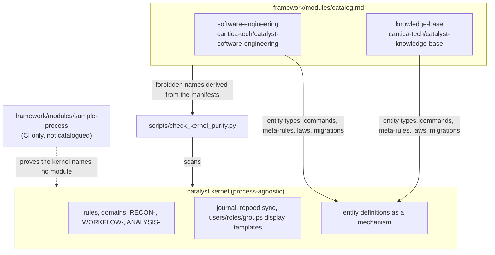

---

## 2. The module contract (what the kernel expects)

Normative source: `cantica-tech/catalyst:framework/kernel/MODULE-SPECIFICATION.md` (spec version 2.0.0), plus the
`catalyst init`, `module install|upgrade|list|verify|available` and `sync plan|apply` sections of
`cantica-tech/catalyst:framework/kernel/CLI.md`. The field tables of the spec are generated from
`framework/kernel/schemas/module-manifest.schema.json` and `entity-type-definition.schema.json` — those JSON schemas
are what modules are validated against.

### 2.1 Repository layout

Each production module is its own git repository named `catalyst-<module-id>`, released as versioned tags, **never**
vendored into catalyst nor a git submodule. For packaging and for `init` discovery, it is expected to be checked out as
a sibling of the catalyst checkout (`../catalyst-<id>/`).

Layout as actually used today (format 3; the spec's §2 tree still shows the format-2 `schemas/` folder):

```
catalyst-<module-id>/
├── module.yaml                  manifest (format 3: declares the entity types inline)
├── version.txt                  module version; wins over module.yaml's version when they differ
├── templates/                   templates catalyst does NOT generate (index skeletons, special files)
├── definitions/<type>/DEFINITION-<TYPE>-vN.md   frozen prose definitions catalyst does not generate
├── rules-of-rules.module.md     meta-rules  -> appended to the deployed rules/Rules-of-Rules.md
├── code-of-conduct.module.md    §3 doc types + §4 commands -> inserted into the deployed CODE-OF-CONDUCT.md
├── INVARIANTS.module.md         module laws (≤3) + invariants, read with the kernel's INVARIANTS.md
├── migrations/<kernel-version>/<name>.md + migrations/migrations.md
├── Taskfile.module.yml          LEGACY: not read since kernel 0.70.0 (§6.5)
├── ui/                          optional React components for catalyst-ui (not used by the CLI)
├── skills/<name>/SKILL.md       optional agent skills (neither module ships any)
└── catalyst/modules/<id>/v<ver>/  packaged release output (see §7); never shipped in a release
```

What a release ships is defined once, in `cantica-tech/catalyst:scripts/catalyst/modules.py` `shipped_files()`, and
is the same set `init`, `module install` and `sync apply` seed: no hidden files, no `node_modules`, `dist`, caches or
`catalyst/` (packaged releases), and **not the repository's own `catalyst.toml`** (a module repo may itself be a
catalyst-governed project, as `catalyst-knowledge-base` is).

### 2.2 `module.yaml` field by field

| Field | Req. | Meaning | SE value | KBM value |
|---|---|---|---|---|
| `id` | yes | lowercase-hyphen id; equals the repo suffix | `software-engineering` | `knowledge-base` |
| `name` | yes | human name | Software Engineering Process Module | Knowledge Base Module |
| `version` | yes | SemVer; keep equal to `version.txt` | 3.4.1 | 0.6.1 |
| `description` | yes | one line | … | … |
| `grounding_type` | yes | kernel entity every module artifact grounds to (INV-5) | `rule` | `rule` |
| `kernel_version` | no | version specifier; enforced by `init`, `sync`, `module install`, reported by `check`; becomes `kernelVersion` in the release manifest | `>=0.83.0` | `>=0.107.0` |
| `format` | no | `3` = types declared inline (§2.3); absent = format 2 (`schemas/*.yaml` ETD files). Both read until 1.0 | 3 | 3 |
| `namespace` | no | meta-rules `rr-<NS>-NNN`, invariants `INV-<NS>-n` (ADR-019) | `SE` | `KB` |
| `aliases` | no | old ID → new ID; old IDs keep resolving in `validate`, `view`, `why` | `rr-META-009/010/021/022 → rr-SE-001..004`, `INV-9/14/15/27/28 → INV-SE-1..5` | none |
| `tiers` | no | ceremony tiers (`rr-META-006`): `id`, `artifact` (type or `none`), `commit` prefix for an artifact-less tier. Default if absent: `chore` (none, `chore:`), `fix`, `feature` | chore/none, fix/BUG, feature/REQ | chore/none, kb/KB, build/KBUILD |
| `entities` | cond. | format 3 type declarations (§2.3) | 8 types | 3 types |
| `entity_types` | cond. | format 2: list of `{id, schema}` ETD files | — | — |
| `commands` | no | `{name, description, argument_hint}`; must match the bullet heads of `code-of-conduct.module.md` §4 (`scripts/check_command_parity.py`); `spec_path` unused | 9 | 6 |
| `templates` | no | `{entity_type, template_path}` — shipped template wins over the generated one | RM, REQ, FEAT | — |
| `definitions` | no | `{entity_type, path}` | backlog v2 | — |
| `required_paths` | no | `{path, invariant, seed}` every deployment must carry | BACKLOG.md, roadmaps.md | — |
| `contributions` | no | `rules_of_rules`, `code_of_conduct`, `invariants`, `taskfile`, `migrations` | all five | four (no `taskfile`) |
| `skills` | no | `{name, spec_path}` | — | — |

### 2.3 Format 3: entity declarations

Under `entities:`, keyed by ID prefix, each type declares (`MODULE-SPECIFICATION.md` §3.3, §4):

- `name`, `plural`, `folder`, `location` (parent folder in the criterion, e.g. `development` → `development/bugs/`;
  default criterion root).
- `grounding`: `required` (with `grounding_field`), `inherited` (through a parent ref, `grounding_field` names it), or
  `none`.
- `fields` (map, in order): `kind` ∈ `text | enum | ref | ref-list | date | user | user-list`; `required`; `to` (target
  prefix or kernel type `rule`/`domain`; a list allows several); `values` (enum); `backref` (the field on the target
  that lists this entity back — **derived**: written only by `catalyst new|link|unlink`, checked by `catalyst check` as
  the `derived` error, fixed by `catalyst repair derived`); `required_when_closed` (must be non-empty once Status is a
  closed state → `closed-incomplete` error); `hint` (what the generated template cell tells the author; an optional
  field not given to `catalyst new` is written `*(none yet)*`).
- `states`, `initial`, `closed`, `status_hint`.
- `guards`: state → list of `children_closed: <field>`, `nonempty: <field>`, `section_written: <heading>` (the section
  differs from the template's text), `holds: <condition>` (`<Field> is|is not|in|not in|at least|at most <value>`,
  `<Field> is set|is empty`; enum order for `at least/at most`). `catalyst status set` refuses to enter a guarded
  state while a guard fails (`--force` overrides, journaled); `catalyst check` warns about an artifact already in a
  state whose guard it fails.
- `transitions` (optional allowed `from → to`): **neither SE nor KBM declares any**, so any status move is allowed
  subject only to guards (and to a governing `WORKFLOW-`, kernel 0.104.0, if a deployment adds one).
- `due`: `<date field>` or `<date field> + <n> days`; past it, `catalyst inbox` lists the entity `overdue` and
  `catalyst check` warns.
- `storage: rows` (type kept as table rows of a file rather than one file per item — SE's `RM`).
- `contributors_create` (default `true`; `false` restricts creation to admins).
- `sections`: list of headings, or `Heading: hint` (literal block for multi-paragraph hints).
- `definition:` prose composed into the frozen definition document.

From this, catalyst **generates** per type: the item template (`TEMPLATE-<TYPE>-vN.md`: title, field table,
`Signed-off-by`, sections), the definition, and a **create command part** `/create <type> <title>` (alias
`/create-<type>`) unless the module's §4 defines one (ADR-021). A shipped file wins over the generated one; a shipped
template named `<folder>.template.md` is the type's **index** template, never its item template.

### 2.4 Composition into a deployment

A deployment's criterion lives at `$CATALYST_HOME/projects/<name>/criterion` (default `$HOME/.catalyst`); the project
gets only `catalyst.toml` (law L5). Composition is additive: module text is placed under `### From module <id>`
headings and never replaces kernel text (`MODULE-SPECIFICATION.md` §6).

| Module source | Deployed as | When |
|---|---|---|
| whole shipped tree | `<criterion>/modules/<id>/` + record in `modules/modules.json` (id, version, source, commit, sha256 of the tree with LF endings, installed date, history of moves) | `init --module`, `module install`, `sync apply` |
| `code-of-conduct.module.md` `## 3.` and `## 4.` | appended at the end of the deployed `CODE-OF-CONDUCT.md` §3 / §4 (kernel `rules-of-development.template.md`), under `### From module <id>` | same; `catalyst recompose` (three-way merge keeping local edits) |
| `rules-of-rules.module.md` | appended to `rules/Rules-of-Rules.md` after the kernel handbook; meta-rule IDs widened and signed (`rr-SE-001` → `rr-SE-000001-<installer userid>`) | same |
| `INVARIANTS.module.md` | first module: `<criterion>/INVARIANTS.module.md`; later modules: kept in `modules/<id>/`. The part above `<!-- catalyst: end of the session brief -->` (the laws) is injected at session start by `catalyst hook start` / `catalyst mcp` instructions; `catalyst why` reads all | same |
| entity declarations | one folder per type at its `location/folder`, each with `templates/` (README, catalog with a `v1` row, `TEMPLATE-<TYPE>-v1.md`), `README.md` and an index `<folder>.md` (INV-20) | init/install; a new type's folder on `sync apply` (kernel ≥0.83.0) |
| definitions (generated + shipped) | `definitions/<slug>.md`, latest version, then **frozen** (INV-23); moved only by `catalyst definition migrate` / `/migrate-definition` | first deploy of the type |
| `required_paths` | created from their `seed` | init/install; checked by `check` |
| §4 bullet heads (kernel + modules) | `Taskfile.common.yml` (one thin dispatch task per bullet head: `{{.AGENT_CMD}} "/<name> {{.CLI_ARGS}}"`, `AGENT_CMD` default `claude -p`) and the prompts of the user-level `catalyst mcp` server | generated since kernel 0.70.0 |
| `migrations/` | listed by `catalyst sync plan` / `catalyst migrate`, applied in version order with the kernel's | sync |

Where each part of a module release ends up in the criterion:

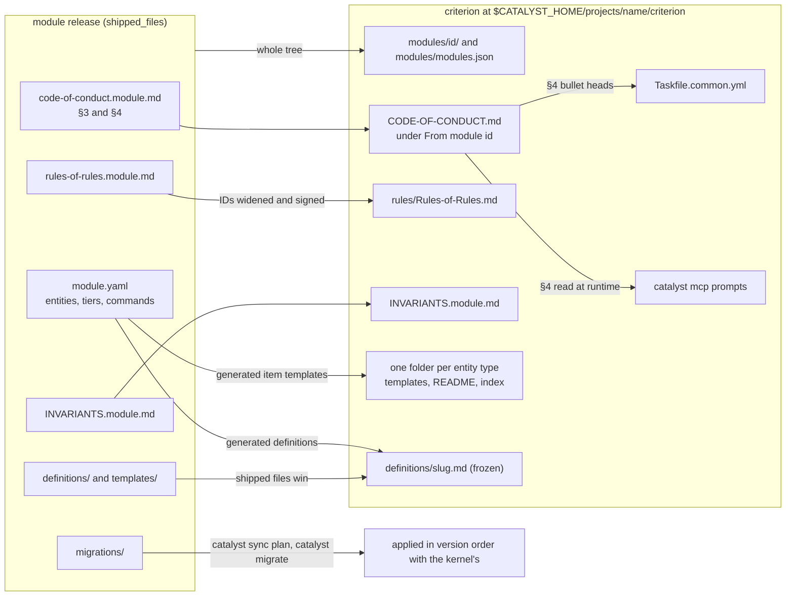

`composition.json` in the criterion records what composition was done with (first module, installer `userid`, rule
documents, test locations, rules dir). The deployed §4 is **the one command registry**: `catalyst spec <command>
[<part>]` prints only what one command needs from it, the MCP prompts are read from it at runtime, and the Taskfile is
generated from it. A module therefore ships no Taskfile tasks any more (see gotcha §9.1).

### 2.5 Several modules in one criterion

(`CLI.md`, "catalyst module install" → "Several modules"; `MODULE-SPECIFICATION.md` §1.)

- The project file's `module` names the **first** module; `modules/modules.json` lists all, in install order; every
  module under `modules/` is loaded in that order.
- Entity types, tiers, aliases and namespaces are the **union**. The catalogue (CODE-OF-CONDUCT §3/§4), handbook
  (Rules-of-Rules) and Taskfile carry each module's part under its own heading, in install order.
- `catalyst check` reports its scope as `modules <id>, <id>`.
- `module install` refuses, before writing anything, when the new module shares with the kernel or an installed
  module: its id (use `module upgrade`), an entity prefix, an entity folder, a definition, a namespace or meta-rule ID,
  a slash command (listed or generated), a tier id with a different artifact/commit prefix, **or a different
  grounding type**. SE and KBM both ground on `rule` and both declare `chore` identically, so they compose; the sample
  module (grounding `policy`) could not sit beside either.

`catalyst module install` decides before it writes anything:

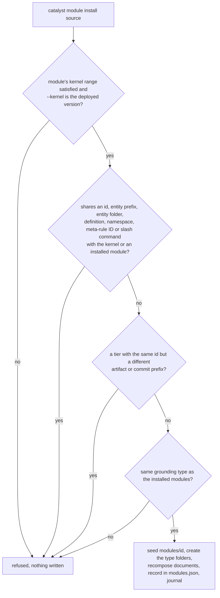

### 2.6 IDs, signatures, namespaces and aliases

- Entity IDs: `<PREFIX>-NNNNNN-<userid>`, e.g. `REQ-000001-abcd1234` (illustrative); the 8-character suffix is the creator's userid
  drawn at first signature (INV-26, `rr-META-020`), never changed. Allocated only by `catalyst new` or `catalyst id
  next <PREFIX> [--count n]`; never by hand, never before allocation. Filenames are `<PREFIX>-NNNNNN-<slug>.md`
  (no userid suffix in the file name).
- Rule IDs: `<doc-prefix>-<DOMAIN>-NNNNNN-<userid>` (`catalyst id next-rule <doc_prefix> <domain>`), e.g.
  `br-BILLING-000007-Ab3xR9pQ`. Meta-rules: `rr-META-NNNNNN-<userid>` (kernel), `rr-SE-NNNNNN-<userid>`,
  `rr-KB-NNNNNN-<userid>` (modules) once deployed.
- `Signed-off-by` on every artifact (INV-16): the signer is the identity catalyst-users verifies; since kernel 0.93.0
  the signer's roles must grant the command that writes the artifact (`cmd:create`, `cmd:status`, … or an alias such
  as `/create-req`).
- Aliases: `catalyst why rr-META-009` answers "rr-META-009 is now rr-SE-001" and prints the rule.

### 2.7 Versioning and kernel compatibility

- A module has its own SemVer in `version.txt` **and** `module.yaml` `version` (both bumped together; `version.txt`
  wins when read).
- `kernel_version` is a specifier (`>=0.83.0`, `>=0.52,<1.0`). It is enforced at `init`, `sync`, `module install`,
  `module upgrade`, and against the **shared criterion's gate kernel** (the `version.txt` of the shared branch as last
  fetched): the gate validates pull requests with its base branch's CLI, which could not read a module needing a newer
  kernel. Order for a shared criterion: **sync the kernel alone, publish and merge it, pull, then sync/upgrade the
  module**.
- A release manifest (`manifest.json`, in and beside the zip) carries `id, name, version, description,
  kernelVersion, frameworkVersion` (legacy duplicate for old UIs), `entry: "ui/index.js"`.

The order for a shared criterion, because the gate reads pull requests with the base branch's CLI:

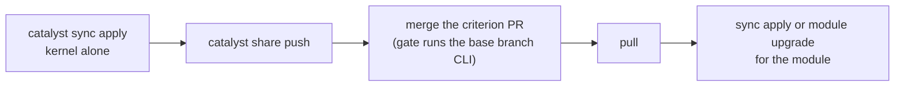

### 2.8 Migrations

- `migrations/<kernel-version>/<name>.md`, indexed in `migrations/migrations.md` with columns `From` / `Target` naming
  **kernel** versions (not module versions) and the module version in the description.
- `/sync-framework` (mechanically `catalyst sync plan|apply`, or `catalyst module upgrade`) lists kernel and module
  migrations between the deployed and target versions, in version order. `apply` does the mechanical half (module
  tree, recompose, definitions of new types, version record) and journals one `/sync-framework` entry; the
  **judgment steps stay with the agent and the user**. `catalyst migrate` lists what a deployment is still behind on
  and `--apply --template <TYPE>` adds a type's next generated template version (optional for module templates;
  frozen templates are never rewritten, INV-23); `--decline <TYPE>` records a declined template in
  `modules/declined.json`.
- Each migration is "never re-run once applied" and records the module version in `DEPLOYMENT.md`.

One `/sync-framework` run, split between the CLI and the people:

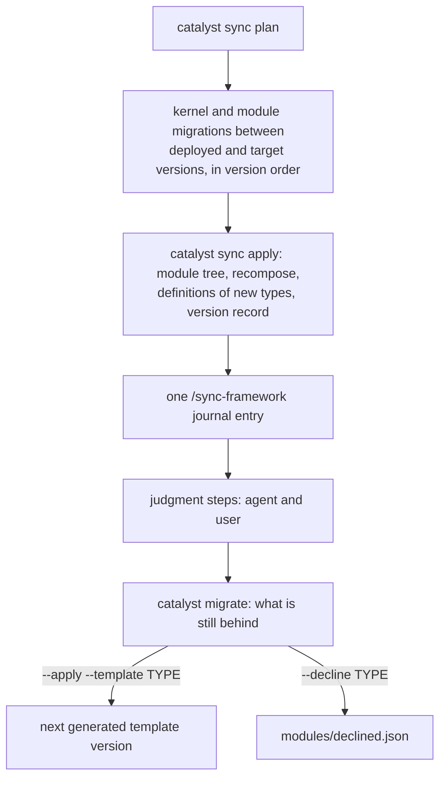

### 2.9 Code in modules (there is none) and UI descriptors

**Neither module ships executable Python.** The kernel's design states "a module carries no code today"
(`cantica-tech/catalyst-knowledge-base:docs/engine-and-onboarding.md` §2). The `catalyst/` folders in both module
repositories hold **packaged release zips and manifests** produced by `cantica-tech/catalyst:scripts/package_release.py`
(§7), not code. All behaviour is the kernel CLI's generic verbs (`new`, `status set`, `link`, `backlog`, `list`, `view`,
`inbox`, `index regen`, `journal append`) driven by the module's declarations and by the agent following the module's
§4 procedures. KBM's code lives in a separate package, `cantica-tech/catalyst-kb-engine` (§4.12).

UI: SE ships `ui/` (a private npm package of React components, §3.10) consumed by catalyst-ui's VS Code extension; KBM
ships none. The CLI ignores `ui/`.

---

## 3. Module software-engineering (SE)

### 3.1 Purpose

The development-artifact layer of catalyst's chain *work items → dev artifacts → rules → rules of rules*
(`cantica-tech/catalyst-software-engineering:README.md`). Grounding type `rule`: bugs, requirements, house-keeping
items and tests each target (or propose) rules, which belong to domains. It also records ideas (features), outside
directions (roadmap rows), implementation history (steps) and decisions (ADRs). It is the module that governs every
code repository in the fleet (catalyst itself, catalyst-ui, catalyst-users, catalyst-mcp, catalyst-kb-engine,
and the KBM repository itself).

### 3.2 Repository contents

`cantica-tech/catalyst-software-engineering` (branches `development` and `main`; tags `X.Y.Z` on `main`):

| Path | Role |
|---|---|
| `module.yaml` (≈26 KB) | format 3: tiers, namespace `SE`, aliases, the 8 types, 9 commands, templates, definitions, required paths, contributions |
| `version.txt` | `3.4.1` |
| `code-of-conduct.module.md` | §3 type table, §4 commands and their procedures |
| `rules-of-rules.module.md` | the tier table and `rr-SE-001`..`rr-SE-005` |
| `INVARIANTS.module.md` | law SE-L1 and the invariants |
| `templates/` | `backlog.template.md`, `roadmap.template.md` (a named roadmap file), `requirements.template.md` and `features.template.md` (index skeletons) |
| `definitions/backlog/DEFINITION-BACKLOG-v1.md`, `-v2.md` | the backlog's definition (the 8 types' definitions are generated) |
| `migrations/` | 11 migrations, kernel 0.4.0 → 0.87.0 |
| `ui/` | `@catalyst-modules/software-engineering-ui` |
| `Taskfile.module.yml` | legacy (not read) |
| `ROADMAP.md` | the historical modularization roadmap (moved from catalyst) |
| `.github/workflows/standards.yml` | calls `cantica-tech/standards/.github/workflows/lint.yml@v0.1.2` on PRs and pushes to `development` |
| `catalyst/modules/software-engineering/v*/` | packaged releases (committed on `main` only) |

### 3.3 Tiers and the law SE-L1

`module.yaml` `tiers:` and `rules-of-rules.module.md` "The tier decides the artifact":

| Tier | When | What it needs | Commit subject |
|---|---|---|---|
| `chore` | no rule's behaviour changes: typo, formatting, comment, dependency bump, docs fix | **no artifact**: one journal entry `--tier chore`, no target | `chore: …` |
| `fix` | restores the behaviour a documented rule describes | a `BUG-` targeting that rule; steps optional | `fix(BUG-…): …` (convention observed) |
| `feature` | new or changed behaviour | a `REQ-` vetted against every rule document (`rr-META-001`), targeting or proposing rules; **at least one `STEP-` before it closes**; the tests its rules' test plans call for | `feat(REQ-…): …` |

**SE-L1 — The tier decides the artifact.** A feature is a requirement whose steps are opened as the work happens, at
least one before it closes; a fix is a bug against the rule it restores; a chore has no artifact. A roadmap feature
(`FEAT-`) becomes a requirement when work starts, never a bug. The agent states the tier **before** starting and
escalates it if the change grows (kernel CODE-OF-CONDUCT §9; INV-SE-4). `catalyst trace <range>` accepts an ID-less
commit only with a no-artifact tier's prefix (`chore:`).

The tier decision the agent states before starting work:

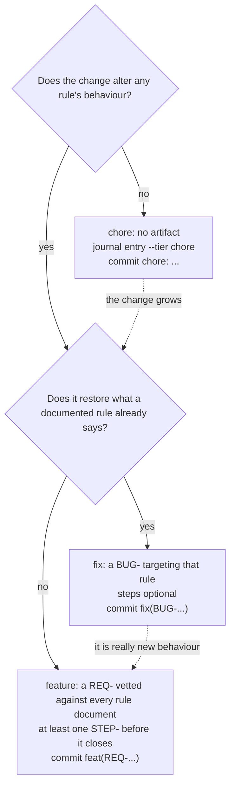

### 3.4 Entity types

Common to all: `ID`, `Name`, `Filename`, `Status`, `Opened`, `Signed-off-by` are written by `catalyst new`; every
`ref`/`ref-list` value is an ID; `Domain` is a registered domain code (`FORMAT.md` §3). `Assignee` (kind `user`,
optional, module 3.4.0) is a **registered** user, given only when the user says (`--field Assignee=<user>`);
`catalyst check` warns on an unknown name.

#### Overview

| Prefix | Name | Folder (in criterion) | Grounding | States (initial → … ; **closed**) | Guards |
|---|---|---|---|---|---|
| `BUG-` | Bug | `development/bugs/` | required, `Targets` → rule | `Open` → `Under Review` → `Fixed` → **`Closed`**, **`WontFix`** | `Fixed`, `Closed`: `children_closed: Steps` |
| `REQ-` | Requirement | `requirements/` | required, `Targets` → rule | `Draft` → `Proposed` → `Vetted` → `Active` → **`Completed`**, **`Abandoned`** | `Completed`: `nonempty: Steps`, `children_closed: Steps`; `Steps` `required_when_closed` |
| `HK-` | House-keeping | `development/house-keeping/` | required, `Targets` → rule (may say "none" explicitly) | `Open` → **`Completed`** | — |
| `TEST-` | Test | `tests/` | required, `Targets` → rule | `Draft`, `Active`, **`Passing`**, `Failing`, `Disabled` | — |
| `STEP-` | Step | `steps/` | inherited via `Parent` | `planned` → `in-progress` → **`done`**, **`abandoned`** (lowercase) | `done`: `section_written: Verification` |
| `FEAT-` | Feature | `features/` | none | `Draft` → `Triaged` → `Active` → **`Completed`**, **`Abandoned`** | — |
| `ADR-` | Decision | `decisions/` | none | `Proposed` → **`Accepted`**, **`Rejected`**, **`Superseded`** | — |
| `RM-` | Roadmap item | rows of `development/roadmaps/<name>.md` (`storage: rows`) | none | `Not triaged` → `Triaged` → `In progress` → **`Done`** | — |

#### `BUG-` — Bug

Asserts that an existing, documented rule does not hold; never introduces behaviour.

| Field | Kind | Req. | Notes |
|---|---|---|---|
| Assignee | user | | |
| Severity | enum `Critical`/`High`/`Medium`/`Low` | yes | scale: **Critical** data loss/corruption, security exposure, or a subsystem permanently disabled; **High** functional break with no workaround, or silent divergence; **Medium** UX/validation gap with workaround, or edge-case break; **Low** cosmetic, test/tech debt |
| Targets | ref-list → rule | yes | never empty |
| Domain | ref → domain | yes | |
| Area | text | | free label |
| Steps | ref-list → STEP | | back-populated from steps' `Parent`; optional for a bug |

Sections: Severity scale, Description, Reproduction, Expected vs actual, Root cause, Fix plan, Test plan, Related.
A duplicate is closed `WontFix` naming the original `BUG-` under Related. Index `development/bugs/bugs.md`.

The usual path through the states (neither module declares transitions, so only the guards are enforced, §9.10):

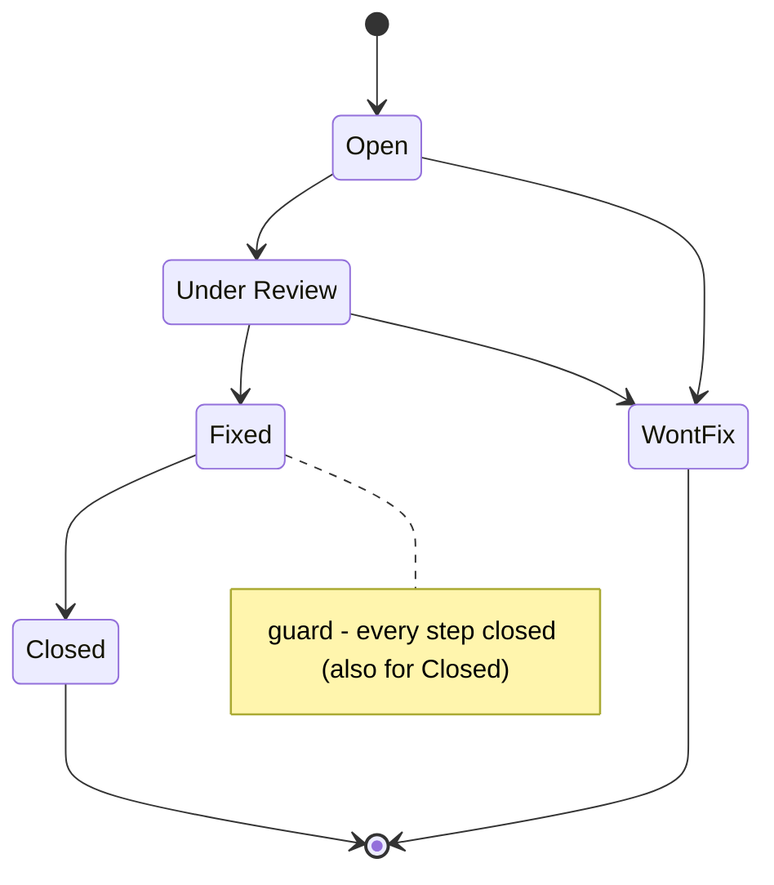

#### `REQ-` — Requirement

Concrete, application-bound requirement derived from the rule documents, or opened for a new feature. Vetted against
**every** rule document before opening.

| Field | Kind | Req. | Notes |
|---|---|---|---|
| Assignee | user | | |
| Targets | ref-list → rule | yes | never empty; if no rule exists yet, propose it in "New rules proposed" first |
| Domain | ref → domain | yes | |
| Feature | ref → FEAT | | declared `backref: Requirements`; the procedure says it is cited back in the feature's `Requirement(s)` (see §9.20) |
| Steps | ref-list → STEP | when closed | `required_when_closed` → `closed-incomplete` error |
| Tests | ref-list → TEST | | derived from tests' `Requirements` |

Sections: Vetted against existing rules, New domain proposed, New rules proposed, Source rules, Summary, Functional
requirements (each with source rules, application area, description, acceptance criteria), UI requirements, Business
rules, Non-functional requirements, Design / implementation plan, Test plan, Open questions, Related. Index
`requirements/requirements.md` (shipped skeleton).

The usual path through the states (neither module declares transitions, so only the guards are enforced, §9.10):

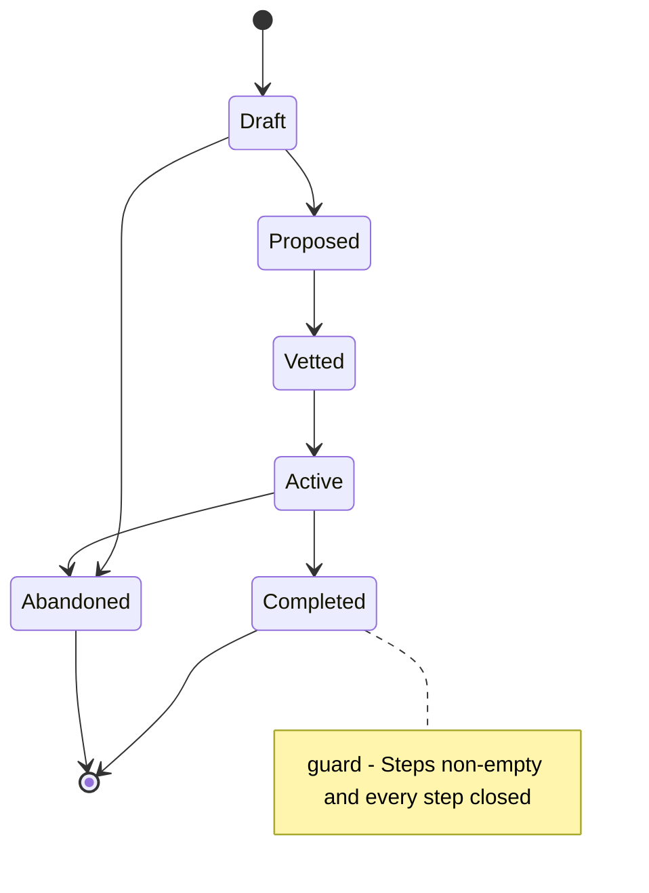

#### `HK-` — House-keeping

Tools, scripts or process that support development (CI, harnesses, release tooling). Fields: Assignee, Priority
(`High`/`Medium`/`Low`), Targets (required; may state explicitly that no rule applies), Domain (required; `META` for a
process rule), Area. Sections: Description, Plan, Verification, Related. Since module 2.2.0 an `HK-` is **no longer
required for a chore**; it is an optional record of maintenance worth tracking. Created through the generated
`/create house-keeping` part.

The usual path through the states (neither module declares transitions, so only the guards are enforced, §9.10):

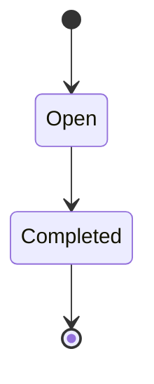

#### `TEST-` — Test

A rule-grounded development artifact (INV-SE-5): Assignee, Targets (required), Domain (required), Requirements
(ref-list → REQ, backref `Tests`), Steps (ref-list → STEP, backref `Tests`) — both optional, many-to-many. Sections:
Description, Procedure, Expected outcome, Actual outcome. `rr-SE-004`: not `Passing` without an Actual outcome from a
real run; `Failing`/`Disabled` say why.

The test states (closed state `Passing`; `Failing` and `Disabled` record why in Actual outcome):

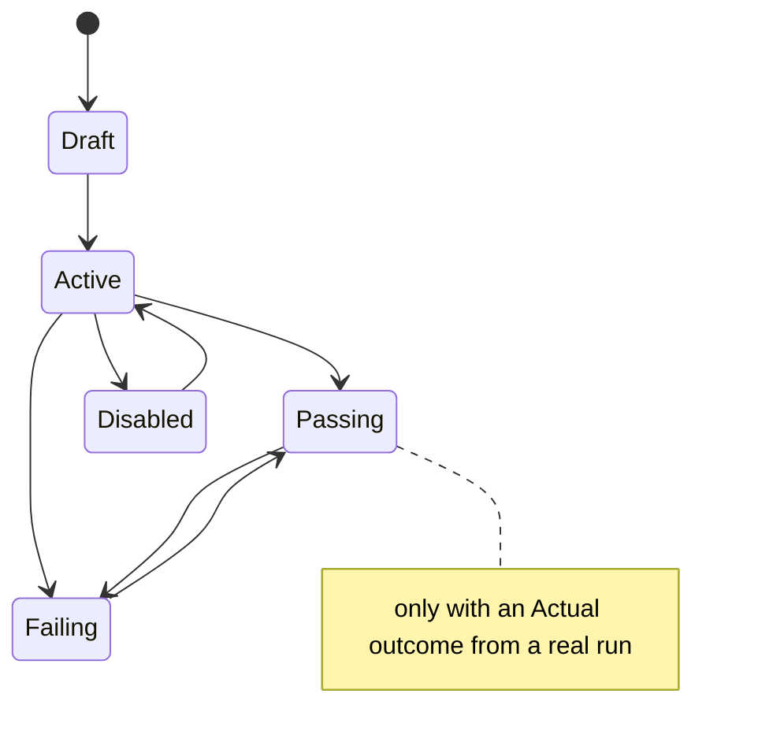

#### `STEP-` — Step

One concrete unit of implementation work toward exactly one parent. Fields: Assignee, Parent (ref → `REQ` or `BUG`,
required, backref `Steps`), Closed (date text, blank until done/abandoned), Tests (derived). Sections: Description,
Actions performed (literal record: files, commands, decisions, in order), Verification (how confirmed; for
`abandoned`, why), Related. Opened when the work starts and closed when it ends — never in advance, never backfilled
(`rr-SE-003`, kernel INV-29).

The usual path through the states (neither module declares transitions, so only the guards are enforced, §9.10):

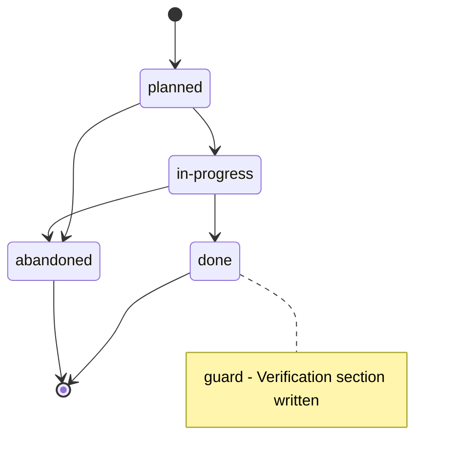

#### `FEAT-` — Feature

An idea or direction before any work; never rule-linked, never implemented itself. Fields: Area, Roadmap (ref → RM),
Requirement(s) (ref-list → REQ). Sections: Description, Motivation, Rough scope, Open questions, Related.

The usual path through the states (neither module declares transitions, so only the guards are enforced, §9.10):

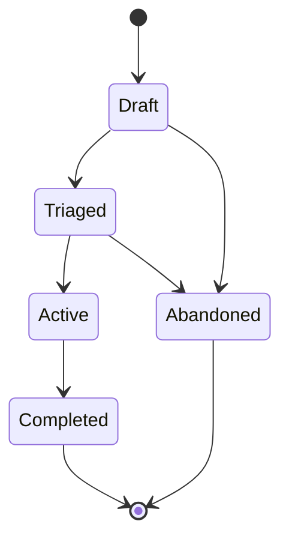

#### `ADR-` — Decision (module 3.3.0)

Fields: Rules (ref-list → rule: rules it introduces, changes, retires or that carry it out), Decided (date text),
Decided by (a person, never an agent — L4), Supersedes (ref-list → ADR, backref `Superseded by`), Superseded by
(derived). Sections: Context, Decision, Alternatives considered, Consequences. Not work: no tier, no steps.
`rr-SE-005`: never rewritten once `Accepted`/`Rejected`; a change of mind is a new ADR that supersedes it.

A decision's states; a change of mind is a new ADR, never an edit:

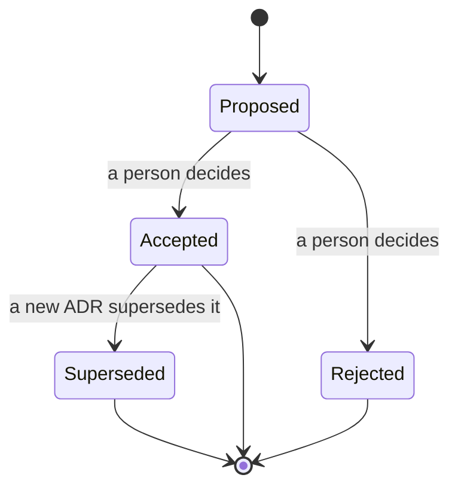

#### `RM-` — Roadmap item

Rows of a named roadmap file `development/roadmaps/<name>.md`, registered in `development/roadmaps/roadmaps.md`
(hand-edited row; roadmaps have no generated index). Row columns: `ID | Title | Description | Status | Linked | Start
| Due | Signed-off-by | Notes`. `Linked` is a list of `FEAT-`/`REQ-`. `Start`/`Due` optional dates (module 3.4.0),
taken from the source, never invented. File header: `Name`, `Source`, `Added`, `Last updated`, optional `Retired`.

`Status` is **derived** by `/show-backlog` from `Linked`: nothing → `Not triaged`; only a `FEAT-` → `Triaged`; ≥1
linked `REQ-` not closed → `In progress`; every linked `REQ-` `Completed`/`Abandoned` → `Done`. Never hand-edited;
`Notes` is free.

A roadmap row's Status is computed by `/show-backlog` from its `Linked` column, never set by hand:

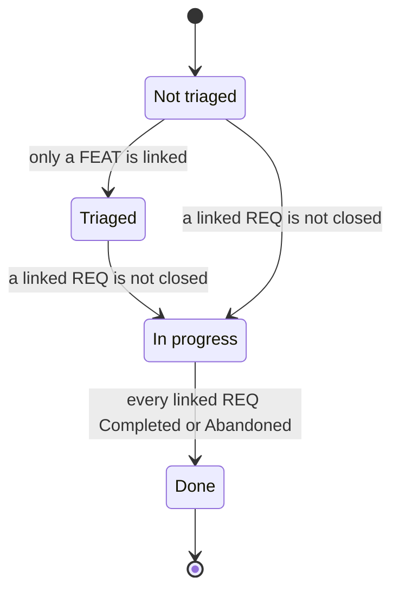

#### Relationships

How the eight types reference each other and ground to rules (arrows point from the field's owner to its target;
`REQ.Steps`, `BUG.Steps`, `REQ.Tests`, `STEP.Tests`, `FEAT.Requirement(s)` and `ADR.Superseded by` are the derived
back-references):

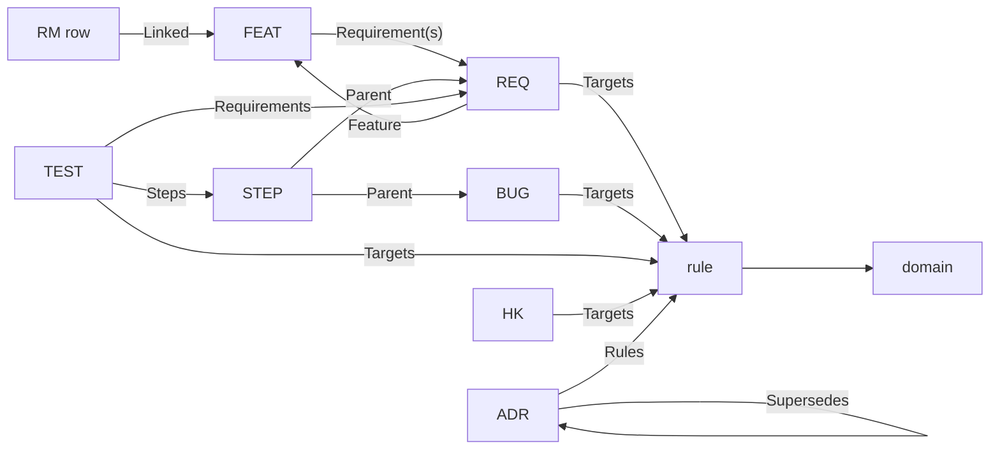

### 3.5 Rules of rules (`rr-SE-NNN`)

From `cantica-tech/catalyst-software-engineering:rules-of-rules.module.md`, appended to the deployed
`rules/Rules-of-Rules.md` under `### From module software-engineering`:

| ID (old alias) | Title | Substance |
|---|---|---|
| `rr-SE-001` (`rr-META-009`) | Features are ideas; requirements are work | A `FEAT-` is never implemented or done; work on it opens a `REQ-` (never a `BUG-`); the feature records its requirements. |
| `rr-SE-002` (`rr-META-010`) | Roadmap items decompose into requirements | An `RM-` row becomes a `FEAT-` via `/create-feature` when worth tracking; a large item becomes several REQs; Status/Linked derived by `/show-backlog`; a roadmap with linked rows is retired, never deleted. |
| `rr-SE-003` (`rr-META-021`) | Steps record the work as it happens | One step → one parent; opened at start, closed at end, never in advance or backfilled; a parent doesn't close while a step is open; `done` needs Verification; `abandoned` needs a reason there. |
| `rr-SE-004` (`rr-META-022`) | Tests are grounded like requirements | Targets its rules; optional REQ/STEP links with maintained back-references; not `Passing` without an actual run. |
| `rr-SE-005` | Decisions are recorded, and superseded, never rewritten | ADR content; decided by a person; supersession instead of edits; not work. |

Closing work beyond what `validate` checks is judgment: a REQ is `Completed` once its acceptance criteria and rule
targets are in the implementation; a BUG is `Closed` once its Test plan names the covering test.

### 3.6 Invariants

From `INVARIANTS.module.md` (old kernel numbers INV-9/14/15/27/28 retired in the kernel, kept as placeholders, and
aliased):

| Invariant | Law | Enforced by | Statement |
|---|---|---|---|
| INV-5 chain (module part) | L2, SE-L1 | `validate` | `REQ`/`BUG`/`HK`/`TEST` → rule → domain; `STEP`, `FEAT`, `RM` exempt; a chore carries no artifact and no rule. |
| INV-SE-1 | SE-L1 | `validate` | New work is a `REQ-`, never a `BUG-`. |
| INV-SE-2 | L6 | `/show-backlog`, `check` | `development/BACKLOG.md` always exists, never hand-edited, overwritten in full by each `/show-backlog`. |
| INV-SE-3 | L6 | `/roadmap`, `check` | `development/roadmaps/` and `roadmaps.md` always exist; named roadmaps only via `/roadmap add`; Status/Linked only by `/roadmap` and `/show-backlog`; a linked roadmap is retired, never deleted. |
| INV-16 (module part) | L7, L4 | `check`, every writing verb | Every SE artifact carries `Signed-off-by`; since kernel 0.93.0 the signer's roles must grant the writing command. |
| INV-26 (module part) | L7 | `id next`, `check` | Every SE ID carries the creator's userid suffix. |
| INV-SE-4 | L2, SE-L1 | journal `tier`, `required_when_closed`, `check` | Ceremony follows the tier (§3.3); no REQ/BUG closes while a step is open. |
| INV-SE-5 | L6 | `/create-test` back-references, `check` | Tests are development artifacts with optional (0,n) links; back-references never hand-edited. |

### 3.7 Commands

Every command that creates or changes an artifact allocates IDs through `catalyst new` / `catalyst id next` and ends
with the kernel's common steps: `catalyst index regen`, `catalyst journal append`, and `catalyst check` where no
end-of-turn hook runs it. The agent receives each command as a prompt of the user-level `catalyst mcp` server
(`/catalyst:<name>` in Claude Code) or via `catalyst spec <command> [<part>]`; a human can run any of them headless with
`catalyst task <name> -- <args>` (which runs `claude -p "/<name> <args>"` by default).

**Taskfile.** The deployed `Taskfile.common.yml` has one task per §4 bullet **head**. For SE that is `create` (all
`/create <type>` parts share the kernel's `create` task), `roadmap` and `show-backlog`. There is no `create-req` task:
run `catalyst task create -- req "<title>"`. (The module's own `Taskfile.module.yml`, declaring only `roadmap` and
`show-backlog`, is no longer read.)

| Command (aliases) | `module.yaml` argument hint | Mechanical call | Starts | Judgment the agent owns |
|---|---|---|---|---|
| `/create req <title>` (`/create-req`, `/create-requirement`) | `[<rule-id>]` | `catalyst new REQ --title "<t>" --field Targets=<rule IDs> --field Domain=<CODE> [--field Feature=<FEAT-id>] --command /create-req --tier feature --as <signer>` | `Draft`; cites itself in the feature's `Requirement(s)` | vet against every rule document; prompt for domain and target rule if not inferable; propose new rules (`catalyst id next-rule`) before implementation; write sections |
| `/create bug <title>` (`/create-bug`) | `[<rule-id>]` | `catalyst new BUG --title "<t>" --field Targets=… --field Domain=… --field Severity=<…> --command /create-bug --tier fix --as <signer>` | `Open` | domain/rule prompt; severity; sections |
| `/create test <title>` (`/create-test`) | `[<rule-id>]` | `catalyst new TEST … --field Targets=… --field Domain=… [--field Requirements=<REQ-ids>] [--field Steps=<STEP-ids>] --command /create-test --tier feature` | `Draft`; refuses unknown IDs; back-fills `Tests` on each REQ/STEP | not exempt from the rule gate |
| `/create feature <title>` (`/create-feature`) | — | `catalyst new FEAT --title "<t>" [--field Roadmap=<RM-id>] --command /create-feature --as <signer>` | `Draft` | never prompts for domain/rule; if from a roadmap row: set the row `Triaged`, `Linked` = the FEAT (hand edit, `catalyst journal append --action update`, no `--target`); later REQs are **appended** to `Linked` |
| `/create step <REQ-id\|BUG-id> <title>` (`/create-step`) | `<parent-id>` | `catalyst new STEP --title "<t>" --field Parent=<id> [--field Status=in-progress] --command /create-step --tier feature` (`--tier fix` for a BUG parent) | `planned` (or `in-progress` if work is underway); refuses an unknown parent; appends to the parent's `Steps` | no domain/rule prompt |
| `/create adr <title>` (`/create-adr`) | `[<rule-id>...]` | `catalyst new ADR --title "<t>" [--field Rules=…] [--field Supersedes=<ADR-ids>] --command /create-adr --as <signer>` | `Proposed`; cites back in superseded ADRs' `Superseded by` | write Context/Decision/Alternatives/Consequences from what the user said; set `Accepted`/`Rejected` (`catalyst status set`) with `Decided`/`Decided by` **only when the person says so**; superseded ones → `Superseded` in the same turn |
| `/create house-keeping <title>` (`/create-house-keeping`) — generated | — | `catalyst new HK --title … [--field Priority=…] --field Targets=… --field Domain=… [--field Area=…] --command /create-house-keeping` | `Open` | sections |
| `/create decision <title>` (`/create-decision`) — generated duplicate of `/create adr` (§9) | — | `catalyst new ADR …` | `Proposed` | — |
| `/roadmap add <name> <file>` (`/roadmap-add`) | `add\|update\|merge\|remove <name> [<file>]` | `catalyst id next RM --as <signer>` (first ID; rest consecutive, or `--count`) + file write + `catalyst journal append --action create` | rows `Not triaged`, `Linked` `*(none)*` | refuse if `<name>` exists; read local `<file>`, identify items, write one row per item with a real Description (not a restatement of Title), Start/Due only if the source gives them; register in `roadmaps.md`; report IDs |
| `/roadmap update <name> <file>` | | file write + `journal append --action update` | | full authoritative re-ingest: add new rows, update matched rows' Title/Description/Notes (ask when ambiguous), **flag** missing rows in Notes (never delete); update `Source` and `Last updated` |
| `/roadmap merge <name> <file>` | | same | | partial delta: add/update only mentioned rows; flag nothing; update `Last updated` only |
| `/roadmap remove <name>` | | delete or retire + `journal append --action retire` | | no linked rows → delete file and `roadmaps.md` entry; any linked row → add `Retired: <date>`, mark `retired` in `roadmaps.md`, keep every row/ID |
| `/show-backlog` | — | `catalyst index regen`; `catalyst backlog --json`; `catalyst list BUG --json`; `catalyst list FEAT --json`; journal changed rows with `--action status-change` | — | **overwrite `development/BACKLOG.md` in full** (from `templates/backlog.template.md`: Open bugs by Severity; Open requirements by Status; Work items missing links; Rules with no open work; Feature ideas with no requirement; Roadmap rows of non-retired roadmaps); refresh every active roadmap's Status/Linked; report the same summary. A stale BACKLOG.md is itself a deployment bug |

`/adopt` (kernel command) with SE: a change committed outside catalyst becomes, by tier, only the adopted journal entry
(`catalyst journal adopt <commit> --tier chore`), a `BUG-` (fix), or a `REQ-` plus at least one `STEP-` (feature),
adopted with `--tier fix|feature --target <BUG-id|REQ-id>`. Such artifacts state `Adopted from commit <sha>, written
outside catalyst by <author>`, a step starts `done`, dates are the adoption day (never back-dated); a commit changing
tested code without a test triggers a proposed `/create-test`, never a closed gap.

What `/adopt` makes of a commit written outside catalyst, by tier:

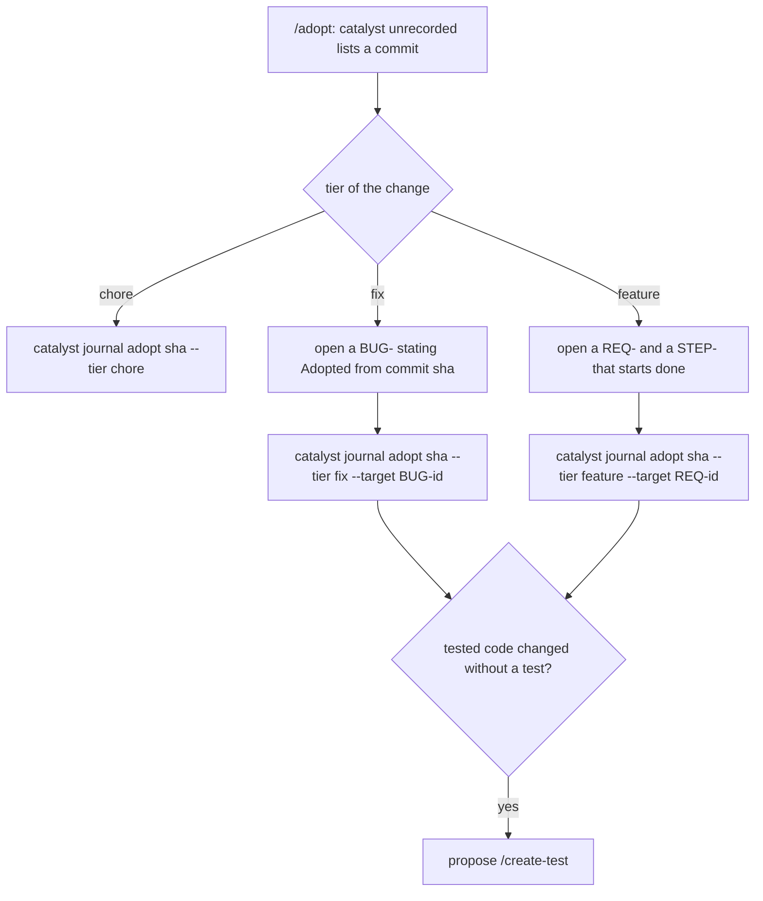

### 3.8 Templates, definitions, required paths

- **Generated item templates** for all 8 types (`TEMPLATE-BUG-vN.md`, `TEMPLATE-REQUIREMENT-vN.md`, …) under each
  folder's `templates/`, frozen per version (INV-20).
- **Shipped**: `templates/roadmap.template.md` (for `RM`: the named roadmap file, copied by `/roadmap add`, and seed
  of `development/roadmaps/roadmaps.md`), `templates/requirements.template.md` and `templates/features.template.md`
  (index skeletons), `templates/backlog.template.md` (seed of `development/BACKLOG.md`).
- **Definitions**: generated for the 8 types; shipped `definitions/backlog/DEFINITION-BACKLOG-v2.md` ("every open
  requirement", corrected from v1's "in-progress requirements").
- **Required paths**: `development/BACKLOG.md` (INV-SE-2, seeded from the backlog template) and
  `development/roadmaps/roadmaps.md` (INV-SE-3, seeded from the roadmap template).

Deployed layout:

```
<criterion>/
  requirements/  requirements.md  templates/TEMPLATE-REQUIREMENT-vN.md
  steps/         steps.md         templates/TEMPLATE-STEP-vN.md
  tests/         tests.md         templates/TEMPLATE-TEST-vN.md
  features/      features.md      templates/TEMPLATE-FEATURE-vN.md
  decisions/     decisions.md     templates/TEMPLATE-DECISION-vN.md
  development/
    bugs/          bugs.md          templates/TEMPLATE-BUG-vN.md
    house-keeping/ house-keeping.md templates/TEMPLATE-HOUSE-KEEPING-vN.md
    roadmaps/      roadmaps.md      templates/TEMPLATE-ROADMAP-vN.md   <name>.md …
    BACKLOG.md     (generated by /show-backlog)
  modules/software-engineering/   (the module tree)
  INVARIANTS.module.md            (if SE is the first module)
```

### 3.9 Migrations

`cantica-tech/catalyst-software-engineering:migrations/migrations.md` (they moved from the kernel's index in kernel
0.36.0). Keys are kernel versions.

| Dir (kernel) | From → Target | Module | What |
|---|---|---|---|
| `0.4.0` | 0.3.1 → 0.4.0 | — | audit `BUG-`s misfiled as features; confirmed ones become `REQ-`s, bug retired in place |
| `0.20.0` | 0.19.0 → 0.20.0 | — | roadmap rows gain `Description` (between Title and Status) |
| `0.29.0` | 0.28.0 → 0.29.0 | — | `STEP-` type; REQ gains `Steps`; roadmap `Linked` becomes a list |
| `0.30.0` | 0.29.0 → 0.30.0 | — | `TEST-` type; REQ and STEP gain `Tests` |
| `0.31.0` | 0.30.0 → 0.31.0 | — | step `Requirement` → `Parent` (REQ or BUG); bug gains `Steps` |
| `0.40.0` | 0.39.0 → 0.40.0 | 2.2.0 | ceremony tiers; REQ `Steps` `required_when_closed`; `location: development`; requirement template restored |
| `0.42.0` | 0.41.0 → 0.42.0 | 2.3.0 | what `/adopt` makes of an outside change per tier |
| `0.46.0` | 0.45.0 → 0.46.0 | 2.4.0 | definitions v2 (bug, step, backlog); ETDs aligned with templates |
| `0.47.0` | 0.46.1 → 0.47.0 | 2.5.0 | procedures call `catalyst new`/`backlog`/`list`; step `Parent` and test `Steps` back-references declared (`catalyst link` to fix `backref` warnings, with assent) |
| `0.83.0` | 0.82.0 → 0.83.0 | 3.3.0 | `ADR-` type, `/create adr`, `rr-SE-005`; optional import of existing decision records (never invent author/date) |
| `0.87.0` | 0.86.0 → 0.87.0 | 3.4.0 | `Assignee` on BUG/REQ/HK/TEST/STEP; `Start`/`Due` on roadmap rows (both optional, templates via `catalyst migrate --apply --template`) |

Module 3.0.0 (kernel 0.57.0) folded `schemas/`, item templates and type definitions into `module.yaml` (format 3); 3.1.1
and 3.2.0 merged roadmap commands into `/roadmap` and adopted `/create <type>` parts (ADR-020/021); 3.4.1 is a wording
change (INV-16's module part: roles grant commands).

### 3.10 UI package

`cantica-tech/catalyst-software-engineering:ui/` — private npm package `@catalyst-modules/software-engineering-ui`
(package version 2.0.0, independent of the module version), depends on `catalyst-core`, `react@18`, `marked`. Exports:

- `Backlog({ markdown })` — renders the generated `development/BACKLOG.md` as HTML via `marked` (trusted local file).
- `RoadmapDetails({ node })` — for a `ChainNode` of kind `roadmap`: roadmap name, `(retired)`, signer, notes.

`ui/tsconfig.json` resolves `catalyst-core` from a sibling `../../catalyst-ui/` checkout. Consumer: catalyst-ui's VS
Code extension (`cantica-tech/catalyst-ui:packages/catalyst-core/src/ui-module-manager.ts`, `remote-module-store.ts`),
which lists module zips from `https://raw.githubusercontent.com/cantica-tech/cantica-tech/main/catalyst/modules`,
checks `kernelVersion` (falling back to `frameworkVersion`) against the active kernel, and is switched by the user
("Switch Process UI Module"); never downloaded automatically. See the catalyst-ui chapter for the host side.

### 3.11 Roles

People and roles are catalyst-users' (kernel 0.106.0); the criterion only keeps display templates. Typical grants
(`README.md`, "Suggested role actions"):

| Role | SE commands |
|---|---|
| Product Owner | `/create-req`, approve/prioritize requirements, `/create-feature`, `/roadmap` |
| Scrum Master / Delivery Lead | `/show-backlog` |
| Tech Lead / Architect | vet a requirement's rule targets |
| Developer | `/create-bug`, `/create-req`, implement REQ/BUG |
| QA / Tester | `/create-bug`, `/create-test` |
| Stakeholder | propose FEAT ideas and roadmap items |

Grants are `cmd:<command>` (e.g. `cmd:create`, `cmd:status`, `cmd:*` for Admin); since kernel 0.93.0 every writing
verb checks them.

### 3.12 Worked example: a feature, FEAT → REQ → STEP → TEST → close

Project `invoicing`, rule document `billing-rules.md` prefix `br`, signer `ada` (userid `Ab3xR9pQ`). IDs below are
illustrative; real ones come from `catalyst new`. In practice the agent runs the slash commands; the CLI calls are shown
so an operator can do or audit each step.

The whole feature lifecycle below, as a sequence (IDs shortened):

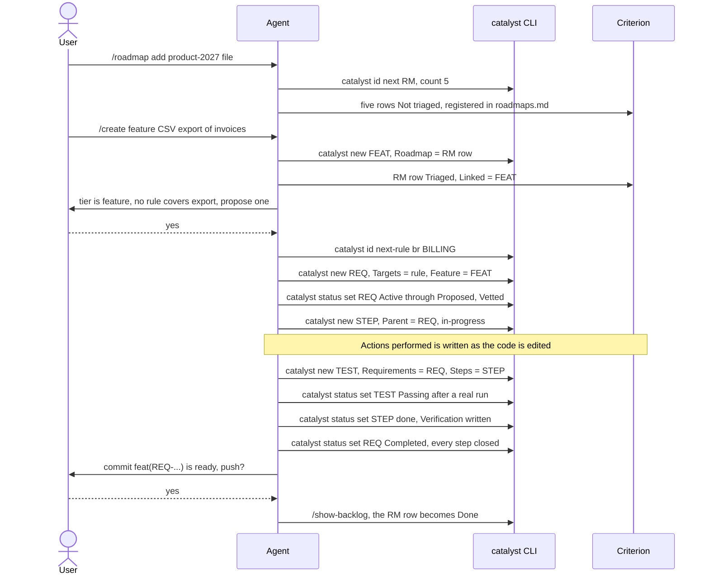

1. **Roadmap ingest** — `/roadmap add product-2027 ./roadmap-2027.md`. The agent refuses if
   `development/roadmaps/product-2027.md` exists; otherwise allocates `catalyst id next RM --count 5 --as ada`, writes
   five rows (`Not triaged`), registers the file in `roadmaps.md`, `catalyst journal append --action create`. Row
   `RM-000012-Ab3xR9pQ` "CSV export of invoices".
2. **Triage into a feature** — `/create feature CSV export of invoices`:
   `catalyst new FEAT --title "CSV export of invoices" --field Roadmap=RM-000012-Ab3xR9pQ --command /create-feature --as ada`
   → `FEAT-000004-Ab3xR9pQ` (`Draft`). The agent edits the RM row: `Status` `Triaged`, `Linked` `FEAT-000004-Ab3xR9pQ`,
   journaled `--action update`. Writes Description, Motivation, Rough scope.
3. **Start work: state the tier** — "feature". Vet against every rule document. No rule covers export, so propose one:
   `catalyst id next-rule br BILLING --as ada` → `br-BILLING-000007-Ab3xR9pQ`, added to `billing-rules.md` with status
   marker ❌ (with the user's assent).
4. **Open the requirement** — `/create req Export invoices as CSV`:
   `catalyst new REQ --title "Export invoices as CSV" --field Targets=br-BILLING-000007-Ab3xR9pQ --field Domain=BILLING --field Feature=FEAT-000004-Ab3xR9pQ --command /create-req --tier feature --as ada`
   → `REQ-000031-Ab3xR9pQ` (`Draft`), cited back in the feature's `Requirement(s)`. Agent appends the REQ to the RM row's
   `Linked`. Writes "Vetted against existing rules", "New rules proposed", Functional requirements with acceptance
   criteria, Test plan.
5. **Move it forward** — `catalyst status set REQ-000031-Ab3xR9pQ Active --through Proposed,Vetted --as ada` (or one
   state at a time; no declared transitions, so any move is allowed; `--through` records the walk as one journal entry).
   Set the FEAT `Active` when its first REQ is.
6. **Step as work starts** — `/create step REQ-000031-Ab3xR9pQ CSV writer and endpoint`:
   `catalyst new STEP --title "CSV writer and endpoint" --field Parent=REQ-000031-Ab3xR9pQ --field Status=in-progress --command /create-step --tier feature --as ada`
   → `STEP-000058-Ab3xR9pQ`, appended to the REQ's `Steps`. The agent fills **Actions performed** as it edits code
   (files, commands, decisions in order) — never afterwards.
7. **Test** — `/create test CSV export round-trip`:
   `catalyst new TEST --title "CSV export round-trip" --field Targets=br-BILLING-000007-Ab3xR9pQ --field Domain=BILLING --field Requirements=REQ-000031-Ab3xR9pQ --field Steps=STEP-000058-Ab3xR9pQ --command /create-test --tier feature --as ada`
   → `TEST-000019-Ab3xR9pQ`, back-filled in the REQ's and step's `Tests`. After a real run, write Actual outcome, then
   `catalyst status set TEST-000019-Ab3xR9pQ Passing`.
8. **Close the step** — write Verification (test run output), then `catalyst status set STEP-000058-Ab3xR9pQ done`
   (guard: `section_written: Verification`; set `Closed` to the date). Update the rule's marker ✅ in
   `billing-rules.md` (journaled).
9. **Close the requirement** — `catalyst status set REQ-000031-Ab3xR9pQ Completed`. Guards: `Steps` non-empty and every
   step closed; `validate` would otherwise report `closed-incomplete`. Judgment: acceptance criteria met, rules
   implemented, tests planned exist.
10. **Commit** the product change: `feat(REQ-000031-Ab3xR9pQ): CSV export of invoices`. The commit-msg hook /
    `catalyst trace` requires the artifact ID. Push only with the user's yes (L3).
11. **Backlog** — `/show-backlog`: BACKLOG.md rewritten; RM row recomputed to `Done` (its only linked REQ is
    `Completed`), journaled `--action status-change`. Set `FEAT-000004` `Completed` when all its REQs are closed.
12. `catalyst check` passes (or the Stop hook reports what the session broke).

### 3.13 Worked example: a fix (BUG)

1. Tier "fix": the behaviour of `br-BILLING-000003-Ab3xR9pQ` ("totals include VAT") no longer holds.
2. `/create bug Totals omit VAT on credit notes`:
   `catalyst new BUG --title "Totals omit VAT on credit notes" --field Targets=br-BILLING-000003-Ab3xR9pQ --field Domain=BILLING --field Severity=High --command /create-bug --tier fix --as ada`
   → `BUG-000022-Ab3xR9pQ` (`Open`). Write Description (in terms of the rule), Reproduction, Expected vs actual.
3. `catalyst status set BUG-000022-Ab3xR9pQ "Under Review"`; write Root cause (`file:line`), Fix plan (implementation
   vs rule change — a rule change needs the Rules-of-Rules §1 conflict check first), Test plan.
4. Optional step: `catalyst new STEP --field Parent=BUG-000022-Ab3xR9pQ … --tier fix` (then the bug cannot go
   `Fixed`/`Closed` until the step is `done`/`abandoned`).
5. Fix the code; commit `fix(BUG-000022-Ab3xR9pQ): credit notes include VAT in totals`.
6. `catalyst status set BUG-000022-Ab3xR9pQ Fixed`; once the covering test is named in Test plan (and passes),
   `Closed`. A duplicate → `WontFix` with the original under Related. If the "bug" is really new behaviour, it is
   a REQ (INV-SE-1; migration 0.4.0's audit).

The fix lifecycle at a glance:

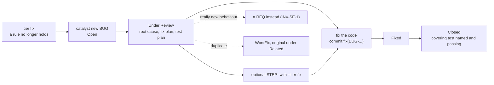

### 3.14 Worked example: a chore, a decision, a roadmap, an adoption

- **Chore**: dependency bump. No artifact: commit `chore: bump requests to 2.32.3`, then
  `catalyst journal append --tier chore --intent "dependency bump" …` (or `catalyst journal adopt HEAD --tier chore`
  if the commit was made first).
- **Decision**: `/create adr Store invoices as UTF-8 CSV` → `catalyst new ADR --title … --field Rules=br-BILLING-000007-Ab3xR9pQ --command /create-adr --as ada`
  (`Proposed`). When the product owner decides: `catalyst status set ADR-000005-Ab3xR9pQ Accepted`, with `Decided`
  and `Decided by` (a person). A later reversal: new ADR with `--field Supersedes=ADR-000005-Ab3xR9pQ`, and ADR-000005
  → `Superseded` in the same turn.
- **Roadmap re-ingest**: `/roadmap update product-2027 ./roadmap-2027-v2.md` adds new rows, updates matched ones,
  flags removed ones in Notes; `/roadmap remove product-2027` retires it (rows linked) rather than deleting.
- **Adoption** of a commit pushed outside catalyst: `/adopt` lists `catalyst unrecorded`; for a feature commit the
  agent opens the REQ and a `done` STEP stating "Adopted from commit <sha>, written outside catalyst by <author>",
  then `catalyst journal adopt <sha> --tier feature --target REQ-…`.

---

## 4. Module knowledge-base (KBM)

### 4.1 Purpose

One purpose: **building and maintaining knowledge bases** — a classified repository of markdown documents and
fresh pointers to outside documents, from which **versioned builds** are produced for models to read: organized
markdown folders or vector databases, in open formats readable without catalyst
(`cantica-tech/catalyst-knowledge-base:README.md`, `GUIDE.md`). Two kinds: **Project** (any information outside
catalyst) and **Reflective** (the Cantica ecosystem only: kernel, modules, plugins). It is catalyst's second production
module and the CI proof that the kernel names no module. It works **alone** (a criterion made for knowledge bases)
or **beside any other module** (a knowledge base built off that project), in either install order (KB-L2).

### 4.2 Repository contents

`cantica-tech/catalyst-knowledge-base` (single branch `main`; tags `X.Y.Z` on `main`; itself governed by catalyst
with the **software-engineering** module — its `catalyst.toml` names `module = "software-engineering"`, shared
criterion kept in the project's private criterion repository (`<project>-criterion` convention), branch `criterion`; that file is never shipped):

| Path | Role |
|---|---|
| `module.yaml` (≈12.7 KB) | format 3: tiers, namespace `KB`, 3 types, 6 commands, contributions (no `taskfile`) |
| `version.txt` | `0.6.1` |
| `GUIDE.md` | establishing/maintaining a KB; classification; onboarding; repository, document, pointer and build layouts; governance; engine |
| `code-of-conduct.module.md` | §3 types, §4 commands and procedures |
| `rules-of-rules.module.md` | KB-L1 tier text, `rr-KB-001`..`rr-KB-009` |
| `INVARIANTS.module.md` | KB-L1, KB-L2, INV-KB-1..9 |
| `docs/best-practices.md` | current practice for AI knowledge bases mapped to the module; §13 "a KB built from a catalyst criterion" |
| `docs/engine-and-onboarding.md` | engine design and technology research (Pydantic AI chosen) |
| `migrations/0.107.0/*.md` | 3 migrations |
| `catalyst/modules/{cantica-knowledge-base,knowledge-base}/v*/` | packaged releases (the module was first released as `cantica-knowledge-base` 0.1.0, renamed in 0.2.0) |

### 4.3 Tiers and the laws KB-L1, KB-L2

| Tier | Artifact | When |
|---|---|---|
| `chore` | none (`chore:`) | no rule's behaviour changes |
| `kb` | `KB` | establishing, reclassifying or retiring a knowledge base; also used when recording a source (`/create-knowledge-source --tier kb`) — a source is never a tier of its own |
| `build` | `KBUILD` | producing a build |

- **KB-L1 — Classification only rises.** Every document and pointer is classified, at the higher of its own mark and
  its knowledge base's; nothing reaches a build above its ceiling, or an embedding backend above its allowance; a mark
  is lowered only by a person's journaled decision.
- **KB-L2 — Alone or beside any module.** KBM never requires, names or assumes another module; its commands,
  documents and checks hold whichever module governs the project.

Beside SE, a deployment has tiers `chore`, `fix`, `feature`, `kb`, `build` (union; `chore` identical in both).

### 4.4 Entity types

| Prefix | Name | Folder | Grounding | States (initial; **closed**) | Guards | Due |
|---|---|---|---|---|---|---|
| `KB-` | Knowledge base | `knowledge-bases/` | required, `Serves` → rule | `Proposed` → `Established` → `Active` → `Frozen` → **`Retired`** | `Established`: Structure written; `Active`: Policy and Maintenance written, `Curator is set` | — |
| `KSOURCE-` | Knowledge source | `kb-sources/` | inherited via `Knowledge base` | `Active`, `Stale`, `Broken`, **`Retired`** | — | `Next check` |
| `KBUILD-` | Knowledge build | `kb-builds/` | inherited via `Knowledge base` | `Planned` → `Built` → `Published` → **`Superseded`**, **`Withdrawn`** | `Published`: Verification written, `Classification is set` | — |

#### `KB-` fields

| Field | Kind | Req. | Values / meaning |
|---|---|---|---|
| Serves | ref-list → rule | yes | the rules it exists for |
| Kind | enum | yes | `Project` / `Reflective` |
| Classification | enum | yes | `Public`/`Internal`/`Confidential`/`Restricted` — the **floor** of everything in it |
| Default classification | enum | yes | mark given to new/imported/unmarked content (before the floor applies) |
| Hosted embedding up to | enum | yes | `Local only`/`Public`/`Internal`/`Confidential`/`Restricted` — highest class a hosted embedding service may receive |
| Repository | text | yes | git URL or local path of the KB's own repository |
| Freshness | text | yes | check interval, e.g. `30 days` |
| Curator | user | (guard for `Active`) | a registered Knowledge Curator |
| Basis | enum | | `Criterion` / `Documents` (onboarding) |
| Document base | enum | | `Static` (no new source after first build) / `Dynamic` (default for criterion-based) |
| Target | enum | | `Folders` / `Vector database` |
| Sources | ref-list → KSOURCE | derived | from each source's `Knowledge base` |
| Builds | ref-list → KBUILD | derived | from each build's `Knowledge base` |

Sections: Scope, Structure, Policy, Maintenance, Related. `Frozen`: kept as is, no import, no build. `Retired`: in
place, builds withdrawn or superseded.

The usual path through the states (neither module declares transitions, so only the guards are enforced, §9.10):

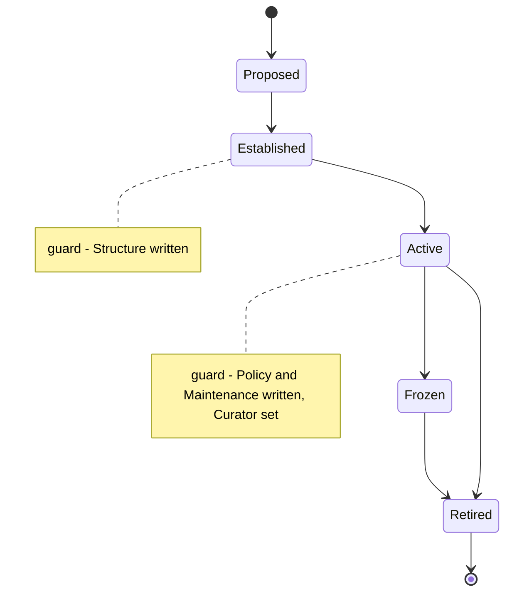

#### `KSOURCE-` fields

Knowledge base (ref → KB, required, backref `Sources`), Location (text, required: URL, path, or
`criterion:<project name>`), Kind (`Repository`/`Folder`/`Site`/`Criterion`), Visibility (`Public`/`Private`, as the
host shows it; a private source's documents are at least `Internal`; a build refuses when record and host disagree),
Classification (`Unmarked`/`Public`/…/`Restricted`: mark on import; `Unmarked` = the KB's default), Access (how it is
read — never the secret itself), Checked (date), Next check (date = Checked + KB `Freshness`; `due` field). Sections:
Description, Import, Related. `Stale` when not checked in time, `Broken` when unreadable; retired in place.

A source's states, moved by `/kb-refresh`:

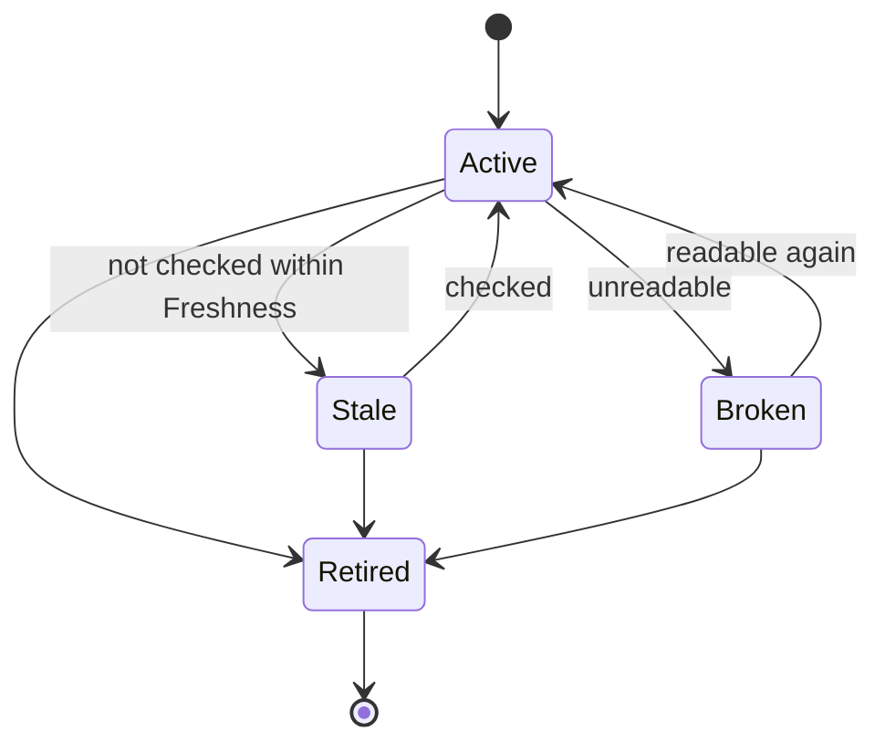

#### `KBUILD-` fields

Knowledge base (ref → KB, required, backref `Builds`), Version (text, required, `MAJOR.MINOR.PATCH`, unique in the KB),
Ceiling (enum, required), Classification (enum: the highest effective class contained, never above Ceiling; guard for
`Published`), Target (defaults to the KB's), Embedding model (required in practice for a vector build: model, version,
where it ran — `local` or the hosted service), Content commit (KB repository commit), Location (release asset, bucket,
path). Sections: Contents (counts by classification, what the ceiling left out), Verification (manifest checksums,
sample queries and results, nothing above ceiling), Related (the build it supersedes). Superseded or withdrawn, never
deleted.

The usual path through the states (neither module declares transitions, so only the guards are enforced, §9.10):

```mermaid
stateDiagram-v2
  [*] --> Planned
  Planned --> Built
  Built --> Published
  Published --> Superseded : a newer build is published
  Planned --> Withdrawn
  Built --> Withdrawn
  Published --> Withdrawn
  Superseded --> [*]
  Withdrawn --> [*]
  note right of Published : guard - Verification written, Classification set
```

Commands for creation: `KB-` via `/kb-setup`; `KSOURCE-` via `/create knowledge-source` (defined in KBM §4); `KBUILD-`
via `/kb-build`. The kernel also **generates** `/create knowledge-base` and `/create knowledge-build` parts (§9.4).

### 4.5 Classification model

Order: `Public` < `Internal` < `Confidential` < `Restricted` (`GUIDE.md`, "Classification"; `rr-KB-002`).

```
mark(doc)       = front matter `classification`, set when written:
                  source's KSOURCE.Classification, else KB.Default classification
floor(doc)      = max(KB.Classification, Internal if source.Visibility == Private)
effective(doc)  = max(mark(doc), floor(doc))
in build B      ⇔ effective(doc) ≤ B.Ceiling           (else left out and listed)
B.Classification = max(effective(doc) for doc in B)    (≤ Ceiling)
embed(doc)      = hosted service  if effective(doc) ≤ KB.Hosted embedding up to (and it is not "Local only")
                  local model     otherwise; no allowed backend → stop
```

Never lower a mark to fit a build or a backend — leave the document out. Lowering is a person's decision, journaled
with why; builds that contain the document keep their classification until a new build. `/kb-build` refuses while
anything is unmarked.

The same model as a decision procedure for one document:

```mermaid
flowchart TD
  D["document or pointer"] --> M{"front matter classification set?"}
  M -- no --> UN["unmarked: /kb-build refuses"]
  M -- yes --> F["floor = higher of the KB's Classification<br/>and Internal if the source is Private"]
  F --> E["effective = higher of mark and floor"]
  E --> C{"effective at most the build's Ceiling?"}
  C -- no --> L["left out, listed in Contents"]
  C -- yes --> IN["in the build"]
  IN --> V{"vector database target?"}
  V -- no --> FO["folders build, no embedding"]
  V -- yes --> H{"effective at most Hosted embedding up to,<br/>and that is not Local only?"}
  H -- yes --> HS["hosted embedding service"]
  H -- no --> LM{"local model available?"}
  LM -- yes --> LO["local model"]
  LM -- no --> STOP["stop: no allowed backend"]
```

### 4.6 Rules of rules (`rr-KB-NNN`)

| ID | Title | Substance |
|---|---|---|
| `rr-KB-001` | Established before filled, active only with its policy | `Established` once Structure is written; `Active` only with Policy, Maintenance (and Curator); no import before `Established`, no build unless `Active`; `Frozen` = no import/build; `Retired` in place. |
| `rr-KB-002` | Classification only rises | marks, effective classification, private-source floor, lowering only by a person. |
| `rr-KB-003` | Pointers kept fresh, never silently dropped | `/kb-refresh` within `Freshness`; broken pointers stay marked until a person acts; sources retired in place. |
| `rr-KB-004` | A build stays within its ceiling and embedding allowance | content ≤ Ceiling; classified at the highest content; backend per class; versioned, model and commit recorded; `Published` only with Verification; never deleted. |
| `rr-KB-005` | A reflective KB draws only on the Cantica ecosystem | sources = kernel, modules, plugins repos and releases; refreshed and rebuilt at each release. |
| `rr-KB-006` | A curator decides what goes in | import, classify, build: Knowledge Curator or Admin; refresh and audit: anyone; an agent proposes, never lowers. |
| `rr-KB-007` | Builds move as their workflow says | an `Active` `WORKFLOW-` governs `KBUILD` (optionally `KB`); a `Confidential`+ build needs two curators' approvals, neither its author; overdue sources wait in the inbox. |
| `rr-KB-008` | Alone or beside any module | `catalyst init --module knowledge-base` or `catalyst module install`, either order; never names another module. |
| `rr-KB-009` | A build is readable by any model, without catalyst | open formats only (UTF-8 markdown + YAML front matter, JSON, JSON Lines, Parquet); versioned `manifest.json` and `README.md`; classification on every document and chunk; chunks' text and documents beside the vectors so a consumer can re-embed. |

### 4.7 Invariants

| Invariant | Law | Enforced by |
|---|---|---|
| INV-5 chain (module part) | L2, KB-L1 | `validate`: `Serves` required; sources and builds inherit it |
| INV-KB-1 sources and builds cite their KB back | L6 | `backref`, `check` |
| INV-KB-2 an active KB has its policy | KB-L1 | `Active` guard (Policy, Maintenance) |
| INV-KB-3 a published build has its verification | KB-L1 | `Published` guard (Verification) |
| INV-KB-4 nothing unmarked, nothing over its ceiling | KB-L1 | `/kb-audit`; `/kb-build` refuses an unmarked document |
| INV-KB-5 an active KB has its curator; a published build its classification | KB-L1 | `holds` guards |
| INV-KB-6 a source past its next check is overdue | L1 | `due: "Next check"`: `catalyst inbox`, `catalyst check` |
| INV-KB-7 builds move as their workflow says; a sensitive build needs two curators | L4 | governing `WORKFLOW-`; gate with `when` (kernel 0.104.0) |
| INV-KB-8 alone or beside any module | KB-L2, L9 | catalyst CI installs KBM alone, beside another module, and another beside it |
| INV-KB-9 a build is readable by any model without catalyst | KB-L1, L9 | `GUIDE.md` "A build"; the engine's build writer and tests |

### 4.8 Commands

Permissions (`rr-KB-006`): `/kb-setup`, `/kb-import`, `/kb-classify`, `/kb-build` → Knowledge Curator or Admin;
`/kb-refresh`, `/kb-audit` → anyone. Taskfile tasks (generated): `kb-setup`, `kb-import`, `kb-classify`, `kb-refresh`,
`kb-build`, `kb-audit`, plus the kernel's `create` for `/create knowledge-source`. Run headless with e.g.
`catalyst task kb-audit -- KB-000001-abcd1234` (an illustrative ID).

#### `/kb-setup project|reflective <title>` — onboard and establish

Every choice is the user's; the agent proposes. Steps (`code-of-conduct.module.md` §4):

1. **What it serves**: what it must make known, for whom, its classification; if no rule says so, propose one
   (`catalyst id next-rule`) and add it only with assent. Reflective → Cantica ecosystem only.
2. **Basis and sources**: propose `Criterion` when another module governs the deployment (`catalyst module list`),
   else `Documents`. Criterion: the project's criterion is the first source, read through the CLI (`list`, `view`,
   `graph`); ask for enriching sources. Documents: gather sources (what, where, how reached, classification).
3. **Location and storage**: repository location and folder plan (goes into Structure).
4. **Target**: `Folders` or `Vector database`.
5. **Document base**: `Dynamic` (default for criterion-based) or `Static`.
6. `catalyst new KB --title "<title>" --field Serves=<rule IDs> --field Kind=<Project|Reflective> --field Classification=<level> --field "Default classification=<level>" --field "Hosted embedding up to=<level|Local only>" --field Repository=<url|path> --field Freshness=<interval> --field Basis=<…> --field "Document base=<…>" --field Target=<…> [--field Curator=<user>] --command /kb-setup --tier kb --as <signer>`.
   Propose `Default classification` ≥ `Classification` and `Hosted embedding up to` ≤ `Internal` unless told otherwise.
   Then one `/create knowledge-source` per source (the criterion first: `Location criterion:<project>`, `Kind
   Criterion`, `Visibility Private` unless its criterion repo is public).
7. **Curator**: if the identity provider lacks a Knowledge Curator role, offer the admin
   `catalyst-users roles provision <roles document naming Knowledge Curator with /kb-setup, /kb-import, /kb-classify, /kb-build, /kb-refresh, /kb-audit, /create, /status, /journal>`
   and to add the curator — each with assent; check with `catalyst identity whoami`.
8. Create the KB repository (`KB.md`, `docs/`, `pointers/`, `builds/`, with its own `catalyst.toml`); ask before any
   push (L3).
9. Write Scope and Structure → `catalyst status set <KB> Established`; then Policy and Maintenance, curator named →
   `Active`.
10. Offer governance (§4.10): a `WORKFLOW-` for `KBUILD` (and optionally `KB`), made `Active`, and the
    `kb-sensitive-build` gate in `IAM/gates.json`, journaled — each only with assent.

The onboarding as a flow; every choice is the user's:

```mermaid
flowchart TD
  S1["1 what it serves<br/>a rule proposed with assent"] --> S2{"another module governs<br/>the deployment?"}
  S2 -- yes --> CR["Basis Criterion<br/>the criterion is the first source"]
  S2 -- no --> DO["Basis Documents<br/>gather the sources"]
  CR --> S3["3 repository location and folder plan"]
  DO --> S3
  S3 --> S4["4 Target: Folders or Vector database"]
  S4 --> S5["5 Document base: Dynamic or Static"]
  S5 --> S6["6 catalyst new KB<br/>then one /create knowledge-source per source"]
  S6 --> S7["7 Knowledge Curator role and curator, with assent"]
  S7 --> S8["8 create the KB repository, push only on yes"]
  S8 --> S9["9 Structure written: Established<br/>Policy, Maintenance, Curator: Active"]
  S9 --> S10["10 offer a WORKFLOW- and the kb-sensitive-build gate"]
```

#### `/create knowledge-source <title>` (`/create-knowledge-source`)

`catalyst new KSOURCE --title "<t>" --field "Knowledge base=<KB-id>" --field Location=<url|path> [--field Kind=…] [--field Visibility=…] [--field Classification=<level|Unmarked>] [--field Access=<how>] --command /create-knowledge-source --tier kb --as <signer>`
(cited back in the KB's `Sources`), then Description and Import. Ask Kind and Visibility; verify visibility on the
host (`gh repo view <repo> --json visibility`; a criterion's from its `catalyst.toml` `catalyst_repo_url`). Refuses a
non-Cantica source for a reflective KB, and any new source for a `Static` KB once its first build exists.

#### `/kb-import <KSOURCE-id>`

Read source and KB (`catalyst view <id> --json`). For each document, per the source's Import section (copy as
markdown, summarise, or keep as pointer), write under `docs/` or `pointers/` with front matter: `classification`
(source mark, else KB default, raised to `Internal` for a private source), `source` (the KSOURCE ID), `imported`
(today). A `Criterion` source is read only via `catalyst list all --json` / `catalyst view <ID> --json` — one document
per entity citing ID, criterion and status. Refuses when Visibility and host disagree. Never copies what access does
not allow; never writes a secret. Reports additions by directory and classification.

#### `/kb-classify <path> <level>`

Sets the front-matter `classification` and reports the effective one. Lowering: say what it was, ask, and name the
builds containing the document (they keep their classification until a new build).

#### `/kb-refresh <KB-id>`

For each pointer: check the target answers and whether content changed (HTTP, file or repo state, `etag`/hash);
update `checked`, set `status` `ok`/`moved` (with new URL)/`broken`. For each KSOURCE: `Checked` = today, `Next check`
= today + Freshness, journaled; `catalyst status set` to `Stale`/`Broken`/`Active`. Never deletes a pointer.

#### `/kb-build <KB-id> [<ceiling>]`

1. Refuse unless the KB is `Active` and `/kb-audit` finds nothing unmarked.
2. Take everything with effective class ≤ ceiling (default: the KB's `Classification`); list what is left out.
   Criterion-based: first read the criterion's current records into documents; `Dynamic`: only what changed since
   the last build.
3. Vector target: embed per class within the allowance; no allowed backend → stop. Folders: no embedding.
4. Write the build per `GUIDE.md` "A build" with `manifest.json` and `README.md`.
5. `catalyst new KBUILD --title "<KB title> <version>" --field "Knowledge base=<KB-id>" --field Version=<version> --field Target=<…> --field Ceiling=<level> --field Classification=<level> [--field "Embedding model=<model, where>"] --field "Content commit=<sha>" --field Location=<where> --command /kb-build --tier build --as <signer>`,
   set `Built`, write Contents.
6. Publishing is separate: write Verification, set `Published`, the replaced build `Superseded`. Publishing outside
   the machine needs the user's yes (L3).

The build flow end to end:

```mermaid
flowchart TD
  A["/kb-build KB-id ceiling"] --> B{"KB Active and /kb-audit<br/>finds nothing unmarked?"}
  B -- no --> R["refused"]
  B -- yes --> C{"Basis Criterion?"}
  C -- yes --> CR["read the criterion's current records into documents<br/>Dynamic: only what changed since the last build"]
  C -- no --> SEL
  CR --> SEL["take effective class at most the ceiling<br/>list what is left out"]
  SEL --> T{"Target"}
  T -- "Vector database" --> EMB["embed per class within the allowance<br/>no allowed backend: stop"]
  T -- "Folders" --> W
  EMB --> W["write the build per GUIDE.md<br/>manifest.json, README.md and the target's files"]
  W --> N["catalyst new KBUILD, Built, write Contents"]
  N --> P["write Verification, Published<br/>the replaced build Superseded"]
  P -. "publishing outside the machine" .-> Y["the user's yes (L3)"]
```

#### `/kb-audit [<KB-id>]`

Reports, changing nothing: documents/pointers without `classification`; pointers not checked within Freshness,
`moved` or `broken`; sources `Stale`/`Broken`; documents whose effective class is above a `Published` build's ceiling
but inside it; builds older than the repository's latest commit.

### 4.9 The knowledge base repository and the build formats

A KB is **its own repository**, a catalyst project governed by KBM (own `catalyst.toml`), so every document change is
journaled:

```
<knowledge base>/
├── catalyst.toml
├── KB.md              KB- ID, title, classification, default classification, policy, basis/base/target, contents tree
├── docs/<topic>/README.md, <document>.md
├── pointers/<topic>/<pointer>.md     (mirrors docs/)
└── builds/<version>/manifest.json    (manifest only; the build lives at KBUILD.Location)
```

Document front matter: `title`, `classification` (required), `source`, `imported`, `updated`. Pointer front matter:
`title`, `url`, `classification`, `source`, `checked`, `status` (`ok|moved|broken`), `etag`; body = summary (what a
build embeds).

**Folders build** (`<version>/`): `manifest.json` (`"target": "folders"`, no embedding/chunking, files listed),
`README.md`, `index.md` (path, title, one-line summary, relative links), `docs/<topic>/<document>.md` with front matter
plus `hash` (SHA-256); pointers become documents with summary and URL.

**Vector database build** (`<version>/`): `manifest.json`, `README.md`, `chunks.jsonl` (one line per chunk: `id`,
`path`, `title`, `heading`, `text`, `classification`, `source`, `url`), `vectors.parquet` (`id`, `vector` fixed-size
float list of `dimensions`, same order), `docs/`. Manifest `format: "kbm-build/1"`:

```json
{
  "format": "kbm-build/1", "target": "vector-database",
  "knowledge_base": "KB-…", "build": "KBUILD-…", "version": "1.2.0",
  "classification": "Internal", "ceiling": "Internal", "content_commit": "<sha>",
  "embedding": {"model": "nomic-embed-text-v1.5", "dimensions": 768, "where": "local", "normalized": true,
                "distance": "cosine", "input": "context",
                "document_prefix": "search_document: ", "query_prefix": "search_query: "},
  "chunking": {"max_tokens": 512, "overlap": 64, "by": "heading"},
  "incremental": {"previous": "1.1.0", "reused": 3080, "embedded": 40},
  "counts": {"documents": 412, "pointers": 57, "chunks": 3120, "left_out": 9},
  "files": {"chunks.jsonl": "sha256:…", "vectors.parquet": "sha256:…"},
  "built": "2026-10-22T10:00:00Z"
}
```

`embedding.input`: `text` (chunk text only) or `context` (title, newline, heading, blank line, text);
`document_prefix`/`query_prefix` as some models expect (module 0.6.1). Any vector store (FAISS, LanceDB, pgvector,
Chroma) loads the files; a store built from them is never the only copy. A build is stored and shared only where its
classification allows.

### 4.10 Governance: workflow and gate

Offered by `/kb-setup`, added only with assent (kernel ≥0.104.0, `CLI.md` "Workflow governance"):

- `WORKFLOW-` with `Governs: KBUILD`, `Escalates to: Knowledge Curator`, `Active`, transitions:

  | From | To | Role | When |
  |---|---|---|---|
  | Planned | Built | Knowledge Curator | |
  | Built | Published | Knowledge Curator | Classification at most Internal |
  | Built | Published | Admin | |
  | Published | Superseded | Knowledge Curator | |
  | * | Withdrawn | Knowledge Curator | |

  Catalyst refuses any other move; `--force` does not bypass a workflow.
- Gate in `IAM/gates.json`:
  `{"id": "kb-sensitive-build", "covers": {"type": "KBUILD", "to": "Published"}, "when": "Classification at least Confidential", "approvals": 2, "role": "Knowledge Curator"}`
  — two curators approve the exact version (`catalyst approve <id>`), neither its author.
- Optional `WORKFLOW-` governing `KB`: `Proposed → Established → Active → Frozen → Retired` by a Knowledge Curator,
  `Retired` by an Admin.
- Freshness: sources past `Next check` show as `overdue` in `catalyst inbox`, escalated to the workflow's role.

How a move to `Published` is decided once the workflow and the gate are in place:

```mermaid
flowchart TD
  A["catalyst status set KBUILD Published"] --> GU{"guards hold?<br/>Verification written, Classification set"}
  GU -- no --> REF["refused"]
  GU -- yes --> W{"an Active WORKFLOW- governs KBUILD?"}
  W -- no --> GT
  W -- yes --> RL{"signer's role"}
  RL -- "Admin" --> GT
  RL -- "Knowledge Curator" --> CL{"Classification at most Internal?"}
  CL -- yes --> GT
  CL -- no --> REF
  RL -- "other" --> REF
  GT{"kb-sensitive-build gate:<br/>Classification at least Confidential?"} -- no --> OK["Published"]
  GT -- yes --> AP{"two Knowledge Curators approved this exact<br/>version with catalyst approve, neither its author?"}
  AP -- yes --> OK
  AP -- no --> WAIT["waits for the approvals"]
```

### 4.11 Migrations

All three are filed under kernel `0.107.0` (`migrations/migrations.md`):

| File | From → Target | Module | What | Judgment |
|---|---|---|---|---|
| `onboarding-and-readable-builds.md` | 0.106.1 → 0.107.0 | 0.5.0 | KB gains `Basis`, `Document base`, `Target`; KBUILD gains `Target`, `Embedding model` required only for vectors; `/kb-setup` onboards; curator role from catalyst-users; `rr-KB-009`/INV-KB-9 | optional templates (`catalyst migrate --apply --template KB`, `--template KBUILD`); record onboarding fields per KB with curator agreement |
| `local-only-embedding.md` | 0.107.0 → 0.107.0 | 0.5.1 | `Hosted embedding up to` value `None` → `Local only` (catalyst read `none` as empty and `check` failed) | set `Local only` on every KB that had `None`, journaled |
| `source-kind-and-visibility.md` | 0.107.0 → 0.107.0 | 0.6.0 | KSOURCE gains `Kind` and `Visibility`; private-source floor; build refuses on mismatch | record Kind/Visibility per source (a private source without Visibility gets **no** floor); re-mark documents from private sources marked Public to Internal and supersede builds holding them |

0.6.1 (a chore: embedding input, prefixes and incremental record in the build format) has no migration. Earlier
versions (0.1.0 as `cantica-knowledge-base`, 0.2.0 rename, 0.3.x governance and best practices, 0.4.x alone/beside)
predate the index.

### 4.12 The engine (catalyst-kb-engine)

`cantica-tech/catalyst-kb-engine` (Apache-2.0, Python, Pydantic AI + `pydantic-graph`, catalyst-governed with SE; tags
up to 0.9.0) carries onboarding and builds as workflows: it proposes, a person decides, and its state is the
criterion's `KB-`/`KSOURCE-`/`KBUILD-`/`WORKFLOW-` records, journaled through catalyst's CLI. Installed with `uv tool
install "catalyst-kb-engine[vectors,openai,search,mcp,serve]"`; e.g. `catalyst-kb-engine onboard "Support KB" --project
app --other-module software-engineering`. Default embedding: local `nomic-embed-text`; a
hosted one only when configured and within the allowance. Without it, an agent carries out the KBM commands by hand.
Full detail belongs to the engine's chapter.

### 4.13 Worked example: a knowledge base from onboarding to its second build

Setting: product `helpdesk` governed by SE; the team adds KBM beside it to build a support KB off the criterion plus a
wiki. Curator `ben` holds Knowledge Curator in catalyst-users. IDs illustrative.

1. **Install KBM** (assent required): from the project root,
   `catalyst module install git@github.com:cantica-tech/catalyst-knowledge-base.git@0.6.1 --kernel <framework/kernel of the deployed kernel release>`.
   Creates `knowledge-bases/`, `kb-sources/`, `kb-builds/`, `modules/knowledge-base/`, recomposes the catalogue and
   handbook, adds `kb-*` tasks; `catalyst module list` shows both modules.
2. **Rule**: `catalyst id next-rule sup KNOWLEDGE` → `sup-KNOWLEDGE-000001-Xy12Ab34` "Support answers are drawn from
   the current product records", added with assent.
3. **`/kb-setup project Helpdesk support`** — onboarding answers: Basis `Criterion` (another module governs this
   deployment); enrich with the support wiki; repository `git@github.com:acme/helpdesk-kb.git`, folders
   `docs/product`, `docs/procedures`; Target `Vector database`; Document base `Dynamic`; Classification `Internal`,
   Default `Internal`, Hosted embedding up to `Local only`; Freshness `14 days`.
   `catalyst new KB … --command /kb-setup --tier kb --as ben` → `KB-000001-Xy12Ab34` (`Proposed`).
4. **Sources**: `/create knowledge-source helpdesk criterion` → `KSOURCE-000001` (`Location criterion:helpdesk`,
   `Kind Criterion`, `Visibility Private`); `/create knowledge-source support wiki` → `KSOURCE-000002` (`Kind Site`,
   `Visibility Private`, `Classification Unmarked`, `Access` "token in the curator's environment as WIKI_TOKEN").
5. **Repository**: create `helpdesk-kb` with `catalyst.toml` (its own `catalyst init --module knowledge-base`),
   `KB.md` naming `KB-000001`; push only on the user's yes.
6. Write Scope and Structure → `catalyst status set KB-000001-Xy12Ab34 Established`; write Policy and Maintenance,
   Curator `ben` → `Active` (guards checked).
7. **Governance** (offered, accepted): `WORKFLOW-` governing `KBUILD` as in §4.10, and the `kb-sensitive-build` gate.
8. **Import**: `/kb-import KSOURCE-000001-Xy12Ab34` writes one document per entity (`catalyst list all --json`,
   `catalyst view <ID> --json`), each `classification: Internal` (private floor); `/kb-import KSOURCE-000002-…`
   writes wiki pages and pointers.
9. **Audit**: `/kb-audit KB-000001-Xy12Ab34` → nothing unmarked.
10. **First build**: `/kb-build KB-000001-Xy12Ab34` → embeds locally (`Local only`), writes `1.0.0/` (manifest,
    README, chunks.jsonl, vectors.parquet, docs/), `catalyst new KBUILD … --field Version=1.0.0 --field Ceiling=Internal --field Classification=Internal --field "Embedding model=nomic-embed-text v1.5, local" --field "Content commit=<sha>" --field Location=<bucket path> --tier build`
    → `KBUILD-000001` `Built`; write Contents.
11. **Publish**: write Verification (checksums, sample queries and top hits, nothing above ceiling) →
    `catalyst status set KBUILD-000001-Xy12Ab34 Published` (workflow: Internal → a curator may publish; no gate since
    below Confidential).
12. **Maintain**: `/kb-refresh KB-000001-…` every 14 days (overdue sources appear in `catalyst inbox`); a wiki page
    marked Confidential by mistake → `/kb-classify docs/procedures/refunds.md internal` (lowering: the curator decides,
    journaled).
13. **Second build**: `/kb-build` → `1.1.0` with `incremental.previous: "1.0.0"`; `Published`; `KBUILD-000001` →
    `Superseded`.
14. **End of life**: `Frozen`, then `Retired`; builds `Withdrawn` or `Superseded`, never deleted.

A public instance: `cantica-tech/catalyst-docs` is governed by KBM alone (its `catalyst.toml` names
`module = "knowledge-base"`); its site serves its build as a vector database at
`https://cantica-tech.github.io/catalyst-docs/vectors/catalyst-vectors.tar.gz`, embedded with `nomic-embed-text`, and
its `KB.md` describes the knowledge base: classification, policy and sources (`cantica-tech/catalyst-docs:README.md`).

---

## 5. Installing modules

Prerequisites (other chapters cover them in full):

1. **catalyst CLI** at a kernel version within the module's range (SE ≥0.83.0, KBM ≥0.107.0): `dist/catalyst.pyz` from
   a catalyst checkout (`task build:cli`) or the kernel release zip in `cantica-tech/cantica-tech:catalyst/kernel/`.
   Python 3.11+, git.
2. **catalyst-users** with an identity provider (the fleet runs a local Keycloak): `init` refuses without a verified
   identity (`catalyst: people are catalyst-users' … pass --identity-issuer <url> and log in first` — reproduced in a
   sandbox). Log in (`catalyst identity login --issuer <url>`) or rely on the machine's system account.
3. **Roles granting the module's commands** in the provider (INV-16 module part), including Knowledge Curator for
   KBM (`catalyst-users roles provision …`).
4. **Agent wiring** once per machine: `catalyst agent install claude-code` (user-level `catalyst mcp` server, Stop
   and session-start hooks).
5. **The module itself**, one of: a sibling checkout `catalyst-<id>/` at its release tag; a release zip from
   `cantica-tech/cantica-tech:catalyst/modules/<id>/v<ver>/<id>-v<ver>.zip`; or a git URL with `@<tag>`.

What has to be in place before a module can be installed, and what follows:

```mermaid
flowchart TD
  CLI["1 catalyst CLI within the module's kernel range"] --> INIT
  IDP["2 catalyst-users and an identity provider<br/>a verified identity"] --> ROLES["3 roles granting the module's commands"]
  ROLES --> INIT
  AG["4 catalyst agent install claude-code<br/>once per machine"] --> INIT
  MS["5 the module: sibling checkout, release zip or git URL"] --> INIT
  INIT["catalyst init --module first-module"] --> J["judgment steps of BOOTSTRAP.md §2"]
  INIT --> MI["catalyst module install second-module<br/>either order"]
  MI --> V["catalyst module list, module verify, check"]
```

**First module at install** (from the product's root; INV-2 — only on explicit request):

```sh
python3 <catalyst>/dist/catalyst.pyz init --kernel <catalyst>/framework/kernel \
    --name <name> --module software-engineering --git-username <u> \
    --rule-doc business-rules:br --agent claude-code \
    [--module-dir <path to catalyst-software-engineering>]   # when not a sibling of the project or of catalyst
```

`--module` has no default; without it `init` lists modules found in sibling `catalyst-<id>` checkouts. KBM alone:
`--module knowledge-base`. Kernel only: `--no-module`, then `catalyst module install` later (same seeding code, same
result). Result: criterion at `$CATALYST_HOME/projects/<name>/criterion`, `catalyst.toml` in the project, the module
in `modules/<id>/`, its folders, definitions, composed documents, `INVARIANTS.module.md`, Taskfile, the install as the
journal's first entry. Then the judgment steps of catalyst's `BOOTSTRAP.md` §2 (rule documents, domains, first rules).

**Adding a second module** (either order):

```sh
catalyst module install <dir | release zip | git-url[@ref]> --kernel <framework/kernel at the deployed version> [--as <signer>] [--intent "<why>"]
catalyst module list            # id, version, source, commit, sha256 (no network)
catalyst module verify          # recompute hashes; exit 1 on a difference or missing folder
catalyst check                  # scope "modules software-engineering, knowledge-base"
```

Refusals happen before any write (kernel range, `--kernel` not the deployed version, merge conflicts with local edits
in governing documents, collisions per §2.5, option-like URL/ref).

Verification performed for this chapter: catalyst's own test suites `tests/test_catalyst_several_modules.py`,
`tests/test_second_module.py` and `tests/test_catalyst_module_install.py` were run against the local checkouts in an
isolated `CATALYST_HOME`: 35 passed (KBM end to end alone, KBM installed beside another module, another module beside
KBM).

## 6. Upgrading modules

```sh
catalyst module available <id>                      # tags at the recorded repository (git ls-remote), newer/installed
catalyst module upgrade <id> [<source>[@<ref>]] --kernel <deployed kernel> --plan   # dry run
catalyst module upgrade <id> [<source>[@<ref>]] --kernel <deployed kernel>          # through sync plan|apply
catalyst migrate                                    # what is still behind; judgment steps
catalyst migrate --apply --template <TYPE>          # optional next template version (INV-23 keeps old ones)
catalyst migrate --decline <TYPE>                   # record a declined template (modules/declined.json)
catalyst check
```

- Without `<source>`, the record's repository is fetched; a module installed from a directory or zip must be given a
  source again.
- `catalyst sync apply --kernel <kernel zip|dir> --module <module zip|dir|git-url>` moves the kernel and one module
  together; with several modules, `--module` moves only the named one; without `--module`, documents are recomposed
  with every installed module.
- **Shared criteria**: kernel first (sync, publish via `catalyst share push`, merge, pull), then the module, because the
  criterion's CI gate validates PRs with the base branch's CLI.
- Record each move in the criterion's `DEPLOYMENT.md`.
- Judgment steps in module migrations (SE 0.83.0 ADR import, 0.87.0 templates; KBM 0.107.0 onboarding fields,
  Local only, source visibility) are run by the agent with the user's assent.

The upgrade sequence for one module:

```mermaid
flowchart LR
  AV["catalyst module available id"] --> PL["module upgrade --plan<br/>dry run"]
  PL --> UP["module upgrade<br/>through sync plan and apply"]
  UP --> MG["catalyst migrate<br/>judgment steps with assent"]
  MG --> CK["catalyst check"]
  UP -. "shared criterion" .-> KF["kernel first: sync, share push, merge, pull"]
```

## 7. Releasing and publishing modules

### 7.1 Branching and tags

| Repo | Branches | Release |
|---|---|---|
| `cantica-tech/catalyst-software-engineering` | `development` (work), `main` | PR `development → main` (CI: `Standards` lint workflow); merge commit; `gh release create X.Y.Z --target main --title vX.Y.Z` — **no `release` branch** (unlike catalyst) |
| `cantica-tech/catalyst-knowledge-base` | `main` only | commits land on `main`; annotated tags `X.Y.Z` on `main` (e.g. `0.6.1` on "chore: a vector build's embedding input…; 0.6.1"); no CI workflow in the repo |

Before tagging: bump `version.txt` **and** `module.yaml` `version`; update `kernel_version` if the module needs a newer
kernel; add a migration under `migrations/<kernel-version>/` and its index row if entity shapes change; keep §4 bullet
heads and `module.yaml` `commands` in parity. The module's release notes state the required kernel version. When a
kernel and modules ship together, release **modules first, then the kernel** (the kernel's notes name module
versions).

The software-engineering module's branch model (no `release` branch; the tag goes on `main`):

```mermaid
gitGraph
  commit id: "previous release" tag: "3.4.0"
  branch development
  checkout development
  commit id: "change"
  commit id: "bump version.txt and module.yaml"
  checkout main
  merge development id: "PR development to main" tag: "3.4.1"
```

### 7.2 Packaging and distribution

From a catalyst checkout with the modules checked out as siblings:

```sh
task release:publish PUBLISH_DIR=../cantica-tech
# = python3 scripts/package_release.py --publish-dir ../cantica-tech --push
```

`cantica-tech/catalyst:scripts/package_release.py`:

1. For **every** module in `framework/modules/catalog.md` checked out at `../catalyst-<id>/`: read id/name/description
   from `module.yaml`, version from `version.txt`; write `manifest.json` (`kernelVersion` = module's
   `kernel_version`, or `>=<packaging kernel>` with a warning if absent; `frameworkVersion` duplicate; `entry:
   ui/index.js`) and `<id>-v<ver>.zip` (manifest + `shipped_files()`, fixed 1980 timestamps) into
   `<module repo>/catalyst/modules/<id>/v<ver>/`.
2. With `--push`: commit that folder onto the module repo's `origin/main` through a temporary detached worktree
   ("Release <id> module v<ver>") and push — the development checkout is never touched.
3. Package the kernel (`framework/kernel/` + `bin/catalyst.pyz`) into `catalyst/kernel/v<ver>/`.
4. With `--publish-dir`: copy every release into `<dir>/catalyst/{kernel,modules}/…`, regenerate the READMEs
   (`catalyst/README.md`, `catalyst/modules/README.md` table: module, latest version, required kernel), and with
   `--push` commit "Deploy release: kernel vX, software-engineering module vY, knowledge-base module vZ" and push
   `cantica-tech/cantica-tech` `main`.

Refusal: `--publish-dir` refuses a kernel that is not at its release tag (`--unreleased` overrides). There is **no
such check for modules** (§9.7). Distribution layout today:

What one `task release:publish` run does:

```mermaid
flowchart TD
  T["task release:publish PUBLISH_DIR=../cantica-tech"] --> P["scripts/package_release.py --publish-dir --push"]
  P --> M["each catalogued module at ../catalyst-id<br/>(working tree, not the tag)"]
  M --> MZ["manifest.json and id-vver.zip into<br/>the module repo's catalyst/modules/id/vver/"]
  MZ --> MP["commit onto origin/main through a<br/>temporary detached worktree, push"]
  P --> K{"kernel at its release tag?"}
  K -- no --> R["refused unless --unreleased"]
  K -- yes --> KP["package the kernel into catalyst/kernel/vver/"]
  MP --> D["copy every release into cantica-tech/cantica-tech catalyst/"]
  KP --> D
  D --> RD["regenerate the READMEs, commit Deploy release, push main"]
  RD --> CON["consumers: module install, sync apply --module,<br/>catalyst-ui's VS Code extension"]
```

```
cantica-tech/cantica-tech:catalyst/modules/
  README.md
  software-engineering/v1.0.0 … v3.4.1/{manifest.json, software-engineering-v<ver>.zip}
  knowledge-base/v0.2.0 … v0.6.1/{manifest.json, knowledge-base-v<ver>.zip}   (v0.4.x not published)
```

Consumers: `catalyst module install <zip>`; `catalyst sync apply --module <zip>`; catalyst-ui's VS Code extension
(raw GitHub URLs of that repo). Publishing is an outward action: only with the owner's explicit yes (L3).

## 8. Fleet repositories by module

The module each public fleet repository names in its `catalyst.toml` (its first module; a deployment's full module list
and installed versions are kept in its criterion's `modules/modules.json`), as read on 2026-10-31:

| Repository | `module` | `kernel_version` |
|---|---|---|
| `cantica-tech/catalyst` | software-engineering | 0.119.2 |
| `cantica-tech/catalyst-ui` | software-engineering | 0.119.2 |
| `cantica-tech/catalyst-users` | software-engineering | 0.119.2 |
| `cantica-tech/catalyst-mcp` | software-engineering | 0.119.2 |
| `cantica-tech/catalyst-kb-engine` | software-engineering | 0.119.2 |
| `cantica-tech/catalyst-knowledge-base` (the KBM repo itself) | software-engineering | 0.119.2 |
| `cantica-tech/catalyst-docs` | knowledge-base (alone) | 0.114.0 |

## 9. Oddities and gotchas

1. **`Taskfile.module.yml` is dead weight.** Not read since kernel 0.70.0 (`MODULE-SPECIFICATION.md` §6.5), yet SE
   still ships it, lists it under `contributions.taskfile`, and its `code-of-conduct.module.md` preamble still says
   each command has "a matching task in `Taskfile.module.yml`". The real tasks come from §4 bullet heads; `/create-*`
   commands all go through the single `create` task.
2. **Stale spec text.** `MODULE-SPECIFICATION.md` §2 shows `schemas/` (format 2) and says the module is seeded into
   `.criterion/modules/<id>/`; deployments now keep it in `$CATALYST_HOME/projects/<name>/criterion/modules/<id>/`.
   Several SE templates and migrations still cite old section numbers (`Rules-of-Rules.md` §20/§21, INV-14/27).
   `ui/Backlog.tsx` cites INV-14 (now INV-SE-2). SE `ROADMAP.md` is a historical, largely realized plan still labelled
   "Draft / Proposed".
3. **Migrations are keyed by kernel version, not module version.** KBM's three migrations all live under `0.107.0`
   although modules 0.5.1 and 0.6.0 shipped alongside kernels 0.109.0 and 0.114.0; two have From = Target = 0.107.0.
   Read the "Module x.y.z" in the description to know which module upgrade triggers each.
4. **Duplicate create commands.** SE defines `/create adr`; the kernel also generates `/create decision`
   (`/create-decision`) for the same `ADR` type, both present in deployed catalogues. KBM: `/create knowledge-source`
   is hand-written, while `/create knowledge-base` and `/create knowledge-build` are generated — they bypass
   `/kb-setup`'s onboarding and `/kb-build`'s checks; use the `kb-*` commands.
5. **`module.yaml` commands vs §4.** KBM's `commands:` omits `create-knowledge-source` and `kb-audit` has no
   `argument_hint` though §4 says `[<KB-id>]`; KBM's `kb-build` description says "vector database" though Folders
   builds exist. (Parity script accepted; not a runtime issue.)
6. **`entry: "ui/index.js"` in every manifest** — hard-coded by the packager. KBM has no `ui/`; SE ships `.tsx`
   sources only (no compiled `index.js` in the zip). SE's `ui/package.json` version (2.0.0) is unrelated to the
   module version.
7. **Module packaging takes the working tree, not the tag.** `package_release.py` packages whatever each sibling
   checkout holds (it refuses an untagged kernel, never an untagged module) and re-packages **every** catalogued
   module each run. Check out each module at its release tag before publishing. Packaging also leaves untracked
   `catalyst/modules/<id>/v*/` folders in the module's development checkout (seen in SE).
8. **KBM's `GUIDE.md` says the engine is unreleased** ("until it is released, the commands … are carried out by the
   agent"), while `catalyst-kb-engine` has tags up to 0.9.0. Treat the engine as optional; agent-run procedures are
   authoritative.
9. **KBUILD `Version` is free text**: the field hint asks for `MAJOR.MINOR.PATCH`, unique in the knowledge base,
   but the field's kind is `text`, so nothing enforces the format.
10. **No declared transitions** in either module: any status move passes unless a guard fails (e.g. `Draft →
    Completed` for a REQ with closed steps). Order is convention plus, for KBM builds, an optional `WORKFLOW-`.
11. **Roadmap Status is purely link-derived**: rows completed outside catalyst stay `Not triaged`. Link a FEAT/REQ to get a
    meaningful status.
12. **Step `Closed` date is not automatic**: `catalyst status set` does not fill it; set it when closing.
13. **`Hosted embedding up to`: never write `None`** — catalyst reads `none` as empty; use
    `Local only`.
14. **A private source without `Visibility` gets no floor** (migration 0.6.0): record Visibility on every source.
15. **catalyst CI pins the KBM fixture at 0.4.1** (`cantica-tech/catalyst:.github/workflows/tests.yml`,
    `CATALYST_KB_MODULE`), well behind 0.6.1; the SE module is not a CI fixture there.
16. **The KBM repository is governed by SE**, not by KBM (its `catalyst.toml` says `module = "software-engineering"`);
    its `catalyst.toml` is excluded from the release. The module repo has no CI and no development branch.
17. **Distribution gaps**: KBM 0.4.0/0.4.1 never reached `cantica-tech/cantica-tech`; the old
    `cantica-knowledge-base` 0.1.0 package remains only in the module repo.
18. **Identity is mandatory for install**: no `init`/`module install` without catalyst-users and a verified identity
    (tests use a `static` backend gated by `CATALYST_ALLOW_STATIC_IDENTITY=1`, not for production).
19. **One grounding type per criterion**: a module grounding on anything but `rule` cannot join SE/KBM.
20. **Feature back-reference name mismatch**: `REQ.Feature` declares `backref: Requirements`, but the `FEAT-` field
    is named `Requirement(s)`; whether `catalyst new` back-fills it was not verified (§11).

## 10. Roadmap and next steps

From `cantica-tech/catalyst:docs/roadmap.md` and the modules' own documents:

- **R4.9 module install — N4 (signed module releases)**: waits for R7's signed releases from an org-owned feed.
- **R2 leftovers concerning SE verbs**: roadmap Status refresh and removal are still agent procedures, not CLI verbs;
  "untested rules" is a module notion still open.
- **Open**: `analysis` and `module` verbs with `--json` and a dry run of `module upgrade` (`--plan` exists; the
  roadmap row still lists it as open).
- **R7**: KBM as the second module and CI fixture (done since 2026-10-19/22; "not a 1.0 product promise"); the human
  beta trial; signed releases; format 1.0 (manual-change detection becomes an error, legacy layouts read-only).
- **Format 2 sunset**: the kernel reads both module formats "until 1.0".
- **KBM**: release/integration of `catalyst-kb-engine` as the executor of `/kb-setup` and `/kb-build`
  (`docs/engine-and-onboarding.md` §5–6: onboarding and build graphs, Docling parsing, LanceDB/Parquet output,
  durable state in criterion records).
- **SE**: no open roadmap of its own; its `ROADMAP.md` (modularization) is realized (format 3, kernel module-agnostic,
  sample module in CI).
- Housekeeping implied by §9: drop `Taskfile.module.yml` and its contribution, fix stale citations, reconcile the
  duplicate `/create decision`, move CI's KBM fixture to the current tag, add a module-tag check to packaging.

## 11. Unverified

- A full `catalyst init --module …` against a real identity provider was **not** run (the sandbox has no Keycloak;
  `init` refused as documented). Installation behaviour is asserted from `CLI.md` and from catalyst's own test suites,
  which passed (35 tests) in an isolated home.
- Whether catalyst-ui's extension can actually load SE's UI from a zip that contains only `.tsx` (manifest
  `entry: ui/index.js`) was not tested.
- Whether `catalyst new REQ --field Feature=…` writes the feature's `Requirement(s)` despite the `backref: Requirements`
  name (§9.20).
- Whether `scripts/check_command_parity.py` flags KBM's `commands:` omissions was not run.
- `catalyst module install` from a git URL with `@<tag>` over the network, `module available`, and `module upgrade`
  without a source were not exercised.
- The worked examples' IDs, rule prefixes and repositories (`invoicing`, `helpdesk`, `acme/helpdesk-kb`) are
  illustrative; the command lines follow the modules' §4 procedures verbatim but were not executed end to end.
