Hand-off chapter for an engineer installing and operating the catalyst fleet's identity layer from nothing: the
identity provider (a local Keycloak), the `catalyst-users` facade and CLI, how the catalyst kernel signs through it,
and the `catalyst-mcp` MCP server that orchestrates both.

State described: `cantica-tech/catalyst-users` **0.10.0** (2026-10-30), `cantica-tech/catalyst-mcp` **0.4.0**
(2026-10-30), catalyst kernel **0.119.2**, Keycloak image `quay.io/keycloak/keycloak:26.4.0`. Every claim cites its
source as `cantica-tech/<repo>:path`. Secrets are never quoted: the text says where each one is configured.

## Contents

1. [Where this sits in the fleet](#1-where-this-sits-in-the-fleet)
2. [catalyst-users: architecture](#2-catalyst-users-architecture)
   - 2.1 Package map · 2.2 Data model · 2.3 Files on disk · 2.4 Configuration and precedence · 2.5 Security model ·
     2.6 Provider registry · 2.7 FastAPI integration · 2.8 Dev scripts in `keycloak/`
3. [catalyst-users: CLI reference](#3-catalyst-users-cli-reference)
4. [How the catalyst kernel signs through catalyst-users](#4-how-the-catalyst-kernel-signs-through-catalyst-users)
5. [catalyst-mcp: architecture and authorization model](#5-catalyst-mcp-architecture-and-authorization-model)
6. [catalyst-mcp: reference (CLI, settings, tools, transports)](#6-catalyst-mcp-reference)
7. [Deployment from scratch, step by step](#7-deployment-from-scratch-step-by-step)
8. [Registering catalyst-mcp in MCP clients](#8-registering-catalyst-mcp-in-mcp-clients)
9. [Backup and restore of Keycloak data](#9-backup-and-restore)
10. [How-tos](#10-how-tos)
11. [Failure modes; when Keycloak is down](#11-failure-modes-when-keycloak-is-down)
12. [Gotchas and oddities](#12-gotchas-and-oddities)
13. [Next steps seen in docs, CHANGELOGs and designs](#13-next-steps-seen-in-the-sources)
14. [Unverified in this chapter](#14-unverified-in-this-chapter)
15. [Source index](#15-source-index)

---

## 1. Where this sits in the fleet

Everything runs on one machine: a person approves logins in a browser, the catalyst-users core talks OIDC and the
admin REST API to Keycloak, the kernel carries its own copy of that core to sign, and catalyst-mcp uses both.

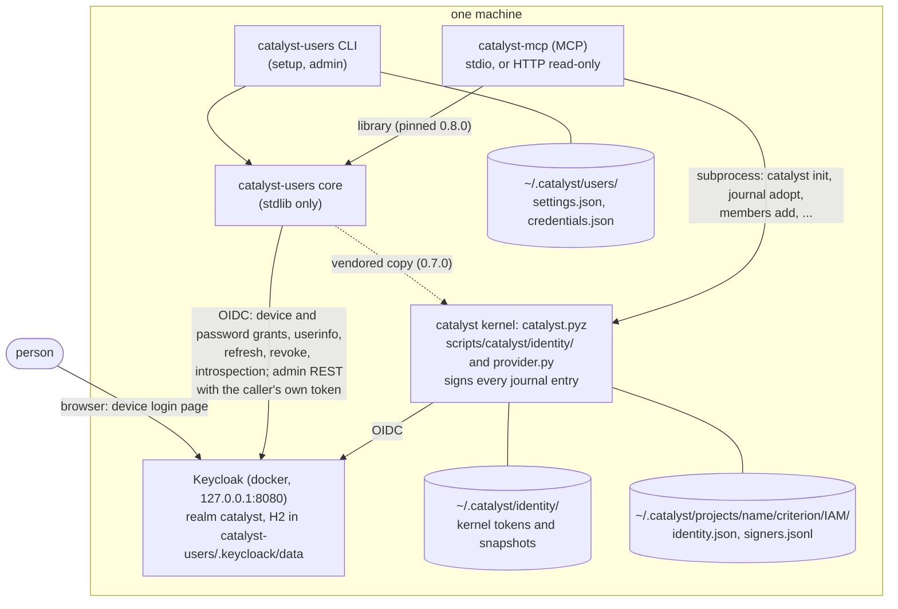

- **catalyst-users** is not a service. It is a library (stdlib-only core), a CLI, and a FastAPI dependency; it keeps
  no state of its own beyond a settings file and a token file (`cantica-tech/catalyst-users:docs/membership.md`
  "Where things live").
- **The kernel does not shell out to the `catalyst-users` CLI.** It carries a vendored copy of catalyst-users' core
  under `scripts/catalyst/identity/` (`cantica-tech/catalyst:scripts/catalyst/identity/VERSION` names release
  **0.7.0** with a sha256 per file; `scripts/vendor_identity.py` refreshes it; `tests/test_catalyst_identity_vendored.py`
  checks the hashes). It reads the **same** settings file the CLI writes.
- **catalyst-mcp** imports catalyst-users as a Python dependency (`pyproject.toml`: `catalyst-users @
  git+https://github.com/cantica-tech/catalyst-users@0.8.0`) and runs the `catalyst` CLI as a subprocess.
- Every catalyst deployment of the fleet signs through the same realm, `http://localhost:8080/realms/catalyst`,
  named in its criterion's `IAM/identity.json`, which comes in **two shapes**:
  `{"provider","issuer"}` (written by `catalyst identity configure`) or `{"provider","url","realm","client",
  "password_client","catalyst_client"}` (copied from catalyst-users' settings by a `catalyst init` without
  `--identity-issuer`). Both are valid; see gotcha 21 for the consequence.
- All three repos involved are themselves catalyst-governed: `catalyst.toml` in `cantica-tech/catalyst-users`
  (`project_name = "catalyst-users"`, its criterion in a private criterion repository, branch `criterion`,
  rule prefixes `env-…`, `id-…`) and `cantica-tech/catalyst-mcp` (`project_name = "catalyst-mcp"`, a private
  criterion repository, rule prefix `mcp-…`). Both at `kernel_version = "0.119.2"`, module
  `software-engineering`, agent `claude-code`.

---

## 2. catalyst-users: architecture

### 2.1 Package map

`cantica-tech/catalyst-users:src/catalyst_users/` (Python ≥ 3.11; `dependencies = []`; optional extra `fastapi`).

| Module | Lines | Role |
| --- | ---: | --- |
| `cli.py` | 467 | argparse CLI `catalyst-users` (`[project.scripts] catalyst-users = "catalyst_users.cli:main"`). Exit 0/1/2. |
| `config.py` | 189 | Home directory resolution, `Settings` dataclass (Keycloak defaults), `IAM/settings.json` read/write, pointer resolution, `CATALYST_USERS_*` env. |
| `provider.py` | 266 | The facade: `Provider` protocol, `Whoami` (+ grants/administers), registry (`registered()`, `provider_class()`, entry-point group `catalyst_users.providers`), `from_pointer()`, `secret_from_command()`. |
| `providers/keycloak.py` | 391 | `KeycloakProvider`: device/password login, userinfo, directory via admin API, setup (realm creation), system account (password grant on `catalyst-admin-cli`), criteria, members. Realm-definition secret/person scanner. |
| `providers/static.py` | 159 | `StaticProvider`: people declared in the pointer, verifies nobody; refused unless `CATALYST_ALLOW_STATIC_IDENTITY=1`. Tests only. |
| `admin.py` | 427 | `KeycloakAdmin`: admin REST with the caller's token — users (no delete), groups (nested), realm roles, role holders, criteria groups, fine-grained admin permissions (FGAP v2). |
| `provision.py` | 200 | Writes a catalyst roles document into Keycloak (realm roles, `catalyst` client roles = grants, composites, claim mapper); imports a legacy catalyst `users.json`. |
| `oidc.py` | 256 | `OIDCClient`: discovery, device grant (RFC 8628), password grant, refresh, revoke, userinfo, introspection (RFC 7662), `accepts()` (issuer + audience). |
| `session.py` | 69 | A logged-in person: login, refresh when < 30 s left, identity, logout (revoke then delete). |
| `credentials.py` | 58 | `CredentialStore`: `credentials.json` 0600 in a 0700 dir, atomic writes, keyed by issuer + client. |
| `keychain.py` | 53 | Store a typed password in the OS keychain (macOS `security`, else libsecret `secret-tool`); returns the command that reads it back. |
| `http.py` | 108 | urllib transport: HTTPS required except loopback, no redirects, timeout on every call; injectable transport for tests. |
| `identity.py` | 62 | `Identity` (service side): claims → issuer/subject/username/groups/roles; `signer()` record. |
| `errors.py` | 52 | `CatalystUsersError` and subclasses (`InsecureURLError`, `ProviderUnavailableError`, `OIDCError`, `LoginDeniedError`, `LoginExpiredError`, `NotLoggedInError`, `AdminError`, `NotFoundError`). |
| `fastapi_auth.py` | 114 | `KeycloakAuth` FastAPI dependency: introspection, 30 s cache keyed by token SHA-256, `require_roles`, `require_groups`; 401/403/503. |

Other top-level content: `compose.yaml` (the pinned Keycloak), `keycloak/realm-catalyst.json` (dev realm, no person,
no secret), `keycloak/catalyst-roles.json` (catalyst's roles and their actions), `keycloak/set_admin.py`,
`keycloak/sync_clients.py`, `examples/api.py` (a protected FastAPI service), `docs/onboarding.md`,
`docs/membership.md`, `docs/development/python-identity-libraries.md`, `tests/` (unit, fake transport) and
`tests/integration/` (against Keycloak; `tests/integration/onboarding/` spins its own Keycloak), `.standards/`
(synced cantica-tech Ruff standard; never edit), `.github/workflows/ci.yml`.

### 2.2 Data model

Everything below lives **in Keycloak**. catalyst-users stores no person, group or role.

#### Realm

Dev realm definition `cantica-tech/catalyst-users:keycloak/realm-catalyst.json`:

| Setting | Value | Consequence |
| --- | --- | --- |
| `realm` | `catalyst` | issuer `http://<host>:8080/realms/catalyst` |
| `displayName` | "catalyst (DEV ONLY …)" | |
| `sslRequired` | `external` | plain HTTP accepted only from local/private addresses |
| `bruteForceProtected` | `true` | repeated bad passwords lock the account temporarily |
| `passwordPolicy` | `length(12) and notUsername` | every password ≥ 12 chars, ≠ username |
| `registrationAllowed` / `resetPasswordAllowed` | `false` / `false` | nobody self-registers or self-resets: an admin sets passwords |
| `accessTokenLifespan` | `300` s | CLI refreshes when < 30 s remain |
| `oauth2DeviceCodeLifespan` / `oauth2DevicePollingInterval` | `600` s / `5` s | device code valid 10 min |
| `adminPermissionsEnabled` | `true` | Keycloak 26.2+ fine-grained admin permissions v2 (needed for criterion-admins) |

The definition is refused by `setup` if it holds a person (`users`, `federatedUsers`) or any non-empty `secret`,
`credentials`, `password`, `clientSecret` key anywhere (`providers/keycloak.py: definition_problems`).

#### Clients

| clientId | Type | Flows | Purpose | Mappers |
| --- | --- | --- | --- | --- |
| `catalyst-cli` | public | **device grant only** (`oauth2.device.authorization.grant.enabled`) | people's interactive login (`catalyst-users login`, `catalyst identity login`) | `groups` (full path), `audience catalyst-api`, `realm roles in userinfo`, `catalyst grants` |
| `catalyst-admin-cli` | public | **password grant only** (`directAccessGrantsEnabled`) | the **system account** sign-in, and `login --password` (0.9.0) | same four |
| `catalyst-api` | **confidential** (`client-secret`) | none | token **introspection** by services (`catalyst serve --identity-issuer`, catalyst-mcp HTTP, FastAPI apps); also the audience every token must carry | none |
| `catalyst` | confidential, no flow | none | a container: its **client roles are the grants** (`cmd:<command>`, `cmd:*`, `reconcile:full`, `reconcile:propose`) | none |
| `catalyst-tests` | public | password grant | DEV ONLY: integration tests | same four |

The `catalyst-api` secret is **generated by Keycloak** on import/creation; it is never in the realm file. Read or
regenerate it in the Keycloak admin console (Clients → `catalyst-api` → Credentials).

How the realm's clients, roles, grants and groups fit together and end up as token claims:

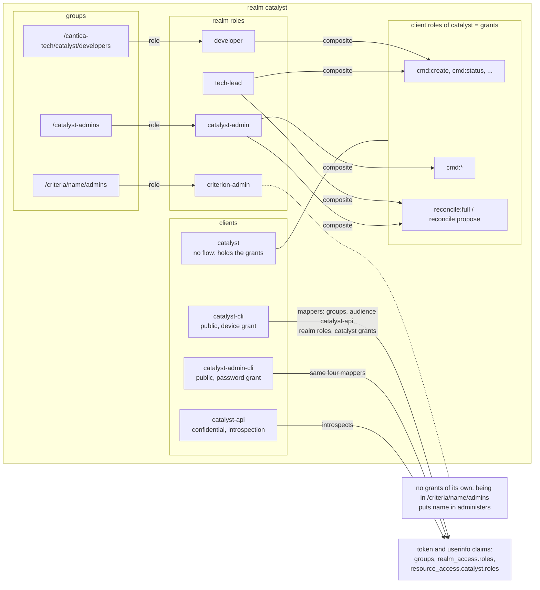

The `catalyst grants` mapper is an `oidc-usermodel-client-role-mapper` for client `catalyst`, claim
`resource_access.${client_id}.roles`, added to userinfo, access token and introspection. `whoami_from_claims`
(`provider.py`) reads `resource_access.catalyst.roles` as grants, `realm_access.roles` as roles, `groups` as group
paths.

#### Realm roles

From the realm file (and created by `roles provision` from `keycloak/catalyst-roles.json`):

| Realm role | Display (`catalyst.name` attribute) | Grants composed in (after `roles provision`) | Reconciliation |
| --- | --- | --- | --- |
| `product-owner` | Product Owner | `cmd:create`, `cmd:status`, `cmd:adopt`, `cmd:journal` | `reconcile:propose` |
| `scrum-master` | Scrum Master / Delivery Lead | `cmd:status`, `cmd:journal` | `reconcile:propose` |
| `tech-lead` | Tech Lead / Architect | `cmd:create`, `status`, `adopt`, `journal`, `freeze`, `migrate-definition`, `run-analysis` | `reconcile:full` |
| `developer` | Developer | `cmd:create`, `status`, `adopt`, `journal`, `run-analysis` | `reconcile:propose` |
| `qa` | QA / Tester | `cmd:create`, `status`, `adopt`, `journal` | `reconcile:propose` |
| `stakeholder` | Stakeholder | none (descriptive actions only) | none |
| `release-manager` | Release Manager | `cmd:sync-framework`, `cmd:share` | `reconcile:full` |
| `catalyst-admin` | Admin | `cmd:*` | `reconcile:full` |
| `criterion-admin` | Criterion Admin | **none** (`"scope": "criterion"`) — rights come from `administers` | — |

Rule of translation (`provision.py: grants_of`): an `actions` entry starting with `/` grants `cmd:<first word>`; `*`
grants `cmd:*`; the role named `Admin` always gets `cmd:*`; `reconciliation` `full|propose` adds
`reconcile:<level>`; descriptive actions grant nothing. A realm role's ID is its `id`, else `provider_role`, else a
slug of its name. **Grants are realm-wide**: a `developer` holds `cmd:create` in every criterion signing through this
realm. Only `criterion-admin` is criterion-scoped (below).

#### Groups (nested; roles inherit downward)

```text
/cantica-tech                    [stakeholder]
  /cantica-tech/catalyst
    /cantica-tech/catalyst/developers    [developer]
    /cantica-tech/catalyst/maintainers   [tech-lead, release-manager]
/catalyst-admins                 [catalyst-admin] + client role realm-management:realm-admin
/criteria
  /criteria/<name>               one per catalyst deployment (its project_name)
    /criteria/<name>/admins      [criterion-admin]   ← the criterion's admins
    /criteria/<name>/members     ← the criterion's members (0.7.0+)
```

`groups add /a/b/c` creates missing parents. A token's `groups` claim carries full paths. `administers` (the
criteria someone administers) = every `<name>` such that the person is in exactly `/criteria/<name>/admins`
(`provider.py: administers_from_groups`; a subgroup of `admins` does not count).

#### Criteria, admins, members

- Criterion name regex: `^[a-z0-9][a-z0-9._-]{0,62}$` (= catalyst `project_name`).
- `prepare_criteria()` (run by `setup` and `criteria add`): turns `adminPermissionsEnabled` on, creates role
  `criterion-admin`, group `/criteria` — only what is missing.
- `add_criterion(name)`: creates `/criteria/<name>/admins` (granted `criterion-admin`), `/criteria/<name>/members`,
  then FGAP v2 objects in the `admin-permissions` client's authz resource server:
  - group policy **`criterion <name>: its admins`** (members of `/criteria/<name>/admins`);
  - scope permission **`criterion <name>: its groups`** on resource type `Groups`, scopes `view`, `view-members`,
    `manage-members`, `manage-membership`, resources = **every group id under `/criteria/<name>`** (a group
    permission does not reach subgroups; re-run `criteria add` after adding a subgroup), `UNANIMOUS`;
  - one shared permission **`criteria: their admins find users`** on `Users`, scopes `view`,
    `manage-group-membership`, `AFFIRMATIVE`, listing every criterion's admin policy.
- Idempotent; returns what it added/refreshed.
- Two admin roles: **catalyst-admin** (everything: users, groups, roles, creates criteria, appoints first admins) and
  **criterion-admin** (in each criterion it administers: every catalyst command at reconciliation `full`; the
  membership of that criterion's groups, its admins included; never a user, group or role).
- Members: `is_member` asks Keycloak **now**, never a token's `groups` claim. No CLI command changes members:
  catalyst's `catalyst members add|remove|adopt` does, through `catalyst serve`, which keeps an encrypted ledger
  (`cantica-tech/catalyst-users:docs/membership.md`).

What `criteria add <name>` creates in Keycloak (fine-grained admin permissions v2):

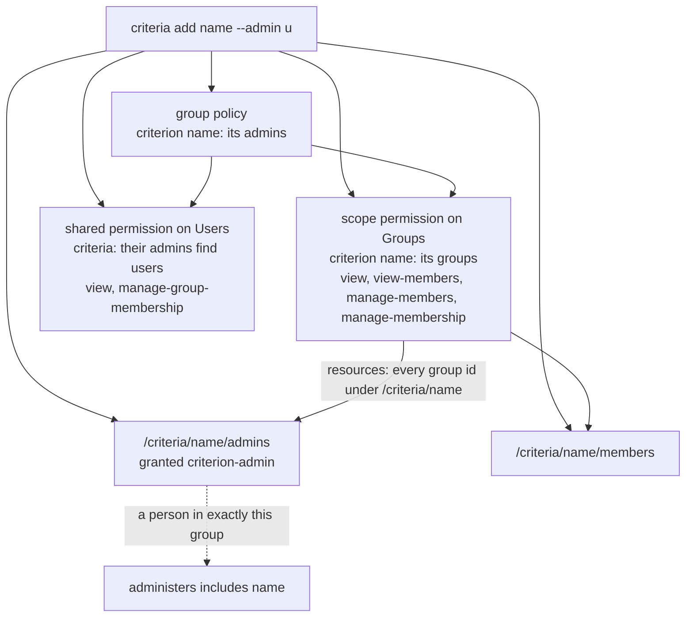

#### The system account

"The account a client such as catalyst uses locally, on the system's behalf, is setup's admin." Concretely: the
username and `password_command` stored in `~/.catalyst/users/IAM/settings.json`. Signed in **on every use** with the
OAuth password grant on the public client `catalyst-admin-cli` (no token caching); the password is the first line the
command prints, run **without a shell** (`shlex.split`), 30 s timeout, never shown even in errors
(`provider.py: secret_from_command`). Keycloak's built-in `admin-cli` is not used because its tokens carry no groups,
roles, grants or `catalyst-api` audience. (0.3.0 used a confidential `catalyst-system` service account; removed in
0.4.0.)

The system account's sign-in, repeated on every use:

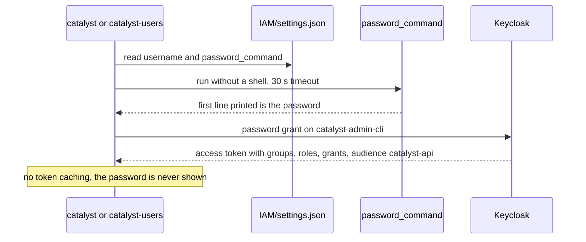

#### The pointer document and the provider registry

A **pointer** is a JSON object that names a registered provider and its settings:

```json
{"provider": "keycloak", "issuer": "https://id.example.com/realms/catalyst", "client": "catalyst-cli", "catalyst_client": "catalyst"}
```

Keycloak pointer keys (`providers/keycloak.py: from_pointer`): `issuer` **or** `url` (+ `realm`, default
`catalyst`), `client` (default `catalyst-cli`), `catalyst_client` (default `catalyst`), `password_client` (default
`catalyst-admin-cli`), `timeout` (default 10), `username`, `password_command`. Only `url`/`issuer` is required.

Registry (`provider.py: registered`): built-in `keycloak` → `catalyst_users.providers.keycloak:KeycloakProvider`,
`static` → `…static:StaticProvider`; plus every entry point in group `catalyst_users.providers` from installed
distributions; an entry point never replaces a built-in name.

#### `Whoami` (the facade's answer)

`issuer`, `subject` (`sub`), `username` (`preferred_username`), `name`, `email`, `groups` (sorted full paths),
`roles` (realm roles), `grants` (catalyst client roles), `administers` (criteria). Derived: `commands` (grants without
`cmd:`), `reconciliation` (highest of `full|propose|none`), `grants_command(cmd)`, `signer()` →
`{"iss","sub","username","name","at"}`. **A person is identified by `iss` + `sub`, never the username.**

### 2.3 Files on disk

| Path | Written by | Content | Mode |
| --- | --- | --- | --- |
| `~/.catalyst/users/` (the **home**) | first use | — | `0700` |
| `~/.catalyst/users/IAM/settings.json` | `catalyst-users setup` | `{"type", "username", "provider": {url, realm, client, password_client, catalyst_client[, timeout]}, "password_command"}` — **never a secret** | `0600` in `0700` dir, atomic |
| `~/.catalyst/users/config.toml` | you (optional, legacy) | top-level Keycloak keys (`server_url`, `realm`, `client_id`, `api_client_id`, `api_client_secret`, `timeout`, `catalyst_client`), or `provider = "<name>"` + `[<name>]` table | — |
| `~/.catalyst/users/credentials.json` | `catalyst-users login` | `{"issuer","client_id","tokens"}` — **one** login at a time | `0600`, atomic |
| OS keychain item, service `catalyst-users`, account `<username>@<url>/<realm>` | `setup` when the password is **typed** | the admin's password | keychain |
| `~/.catalyst-users/` | catalyst-users < 0.6.0 | moved once into `~/.catalyst/users`, symlink left behind | — |

Home resolution (`config.py: home`): `CATALYST_USERS_HOME` if set; else `$CATALYST_HOME/users`; else
`~/.catalyst/users` (only this last case adopts a legacy `~/.catalyst-users`).

The kernel keeps **its own** token store, separate from the CLI's (§4.3).

### 2.4 Configuration and precedence

**Which provider** (`config.py: pointer`), first match wins:

1. `--pointer FILE` or `CATALYST_USERS_POINTER` (a JSON pointer document).
2. `IAM/settings.json` — **unless** any of `--server/--realm/--client-id` or `CATALYST_USERS_SERVER/REALM/CLIENT_ID`
   is given explicitly, in which case settings.json is skipped.
3. `config.toml`: `provider = "<name>"` with its `[<name>]` table (default name `keycloak`).
4. Explicit Keycloak settings from flags/env.
5. None of them → `NoSettingsError`: in a terminal the CLI runs `setup` interactively; otherwise it fails with
   `no IAM settings (…/IAM/settings.json): run \`catalyst-users setup\``.

The same precedence as a decision procedure:

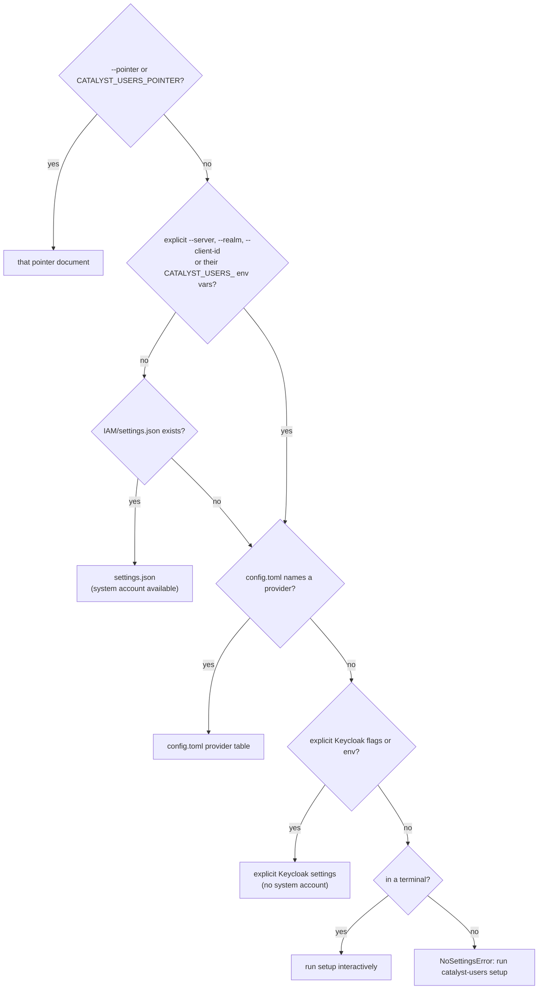

**Keycloak `Settings`** (lowest precedence first): built-in defaults → `config.toml` top-level keys →
`CATALYST_USERS_*` env → CLI flags.

| Setting | Env var | Default | Notes |
| --- | --- | --- | --- |
| `server_url` | `CATALYST_USERS_SERVER` | `http://localhost:8080` | flag `--server` |
| `realm` | `CATALYST_USERS_REALM` | `catalyst` | flag `--realm` |
| `client_id` | `CATALYST_USERS_CLIENT_ID` | `catalyst-cli` | flag `--client-id` |
| `api_client_id` | `CATALYST_USERS_API_CLIENT_ID` | `catalyst-api` | services only |
| `api_client_secret` | `CATALYST_USERS_API_CLIENT_SECRET` | none | services (introspection) need it |
| `timeout` | `CATALYST_USERS_TIMEOUT` | `10` s | |
| `catalyst_client` | `CATALYST_USERS_CATALYST_CLIENT` | `catalyst` | |

Other environment variables:

| Variable | Effect |
| --- | --- |
| `CATALYST_USERS_HOME` | home directory override |
| `CATALYST_HOME` | catalyst's home; catalyst-users' home becomes `$CATALYST_HOME/users` |
| `CATALYST_USERS_POINTER` | pointer file |
| `CATALYST_ALLOW_STATIC_IDENTITY=1` | allows the `static` provider (tests only) |
| `CATALYST_USERS_IT=1` | enables integration tests |
| `CATALYST_USERS_IT_SERVER` | integration Keycloak (default `http://127.0.0.1:8080`) |
| `CATALYST_USERS_IT_ADMIN`, `CATALYST_USERS_IT_ADMIN_PASSWORD_COMMAND` | `master` admin for integration tests on a persistent dev Keycloak |
| `KC_BOOTSTRAP_ADMIN_USERNAME`, `KC_BOOTSTRAP_ADMIN_PASSWORD` | read by `keycloak/set_admin.py` and `sync_clients.py` (defaults: compose.yaml's dev values) |
| `CATALYST_CHECKOUT` | onboarding integration test: catalyst checkout (default `../catalyst`) |

Keycloak builds the issuer from the **host you call**: `localhost` and `127.0.0.1` produce different issuers. Use
one spelling everywhere (CLI settings, `IAM/identity.json`, services) — see §12.

### 2.5 Security model

From `cantica-tech/catalyst-users:README.md` "Security model" and the code:

- **Login**: device authorization grant (RFC 8628) on public `catalyst-cli`; no password passes through
  catalyst-users — except on explicit `login --password` (0.9.0), where it is read from stdin or a
  no-echo prompt, sent once to the token endpoint via `password_client`, never stored/logged/shown.
- **Tokens**: `credentials.json` 0600/0700, atomic; never in logs, errors or output except `token`. Refreshed when
  < 30 s left. `Tokens.__repr__` hides them.
- **Services**: a token is accepted only if introspection says `active`, the issuer matches, and audience contains
  `catalyst-api`; cached ≤ 30 s, never past expiry, keyed by SHA-256 of the token.
- **Transport**: HTTPS required except loopback (`localhost`, `127.0.0.1`, `::1`); redirects never followed; timeout
  on every call (`http.py`).
- **Directory changes** run with the **caller's own** access token; Keycloak decides. catalyst-users holds **no
  admin secret**.
- **Users are never deleted**, only disabled (no delete method exists: `admin.py` docstring).
- **Signers** are recorded by `iss` + `sub` with a username/name snapshot.

### 2.6 Provider registry: writing another provider

Register in your package's `pyproject.toml`:

```toml
[project.entry-points."catalyst_users.providers"]
acme = "acme_identity.provider:AcmeProvider"
```

The class needs `from_pointer(doc, store=None, transport=None)`, `problems(doc) -> list[str]`, optionally
`setup(...) -> SetupOutcome`, and the `Provider` protocol (`provider.py`): `login`, `login_password`, `logout`,
`whoami`, `token`, `users`, `groups`, `roles`, `directory`, `provision_roles`, `import_users`, `criteria`,
`add_criterion`, `appoint`, `dismiss`, `members`, `is_member`, `add_member`, `remove_member`, `system_token`,
`system_whoami`. Unsupported operations raise `ProviderError` (use `unsupported(kind, what)`). Every provider must
report `administers` (empty without criteria). **The kernel only knows `keycloak` and `static`**:
`catalyst identity configure --provider` accepts only those two choices
(`cantica-tech/catalyst:scripts/catalyst/__main__.py`), and its vendored registry has no entry points of its own
beyond what is importable in the zipapp — a third-party provider is not usable for kernel signing today (§14).

### 2.7 FastAPI integration

`catalyst_users.fastapi_auth.KeycloakAuth()` reads `CATALYST_USERS_*` and **requires**
`CATALYST_USERS_API_CLIENT_SECRET` (raises `ValueError` otherwise). Dependencies: `Depends(auth)` → `Identity`;
`auth.require_roles(...)`; `auth.require_groups("/cantica-tech/catalyst")` (subgroups count). Responses: 401 with
`WWW-Authenticate: Bearer` (missing/malformed/not accepted), 403 (role/group missing), 503 (Keycloak unreachable).
Runnable example: `cantica-tech/catalyst-users:examples/api.py`.

### 2.8 Dev scripts in `keycloak/`

| Script | What it does | Auth used | Notes |
| --- | --- | --- | --- |
| `uv run python keycloak/set_admin.py --email you@example.com [--service S] [--server URL] [--first-name] [--last-name]` | reads username (`acct`) and password of macOS keychain item `--service` (its default is a developer-specific item name — always pass `--service`); creates/updates that user in realm `catalyst` (enabled, email verified, password not temporary), makes them the **only** member of `/catalyst-admins` (removes all others) | Keycloak bootstrap admin from `KC_BOOTSTRAP_ADMIN_*` (defaults: compose's dev values), loopback only | **macOS only** (`security`) |
| `uv run python keycloak/sync_clients.py [--server URL]` | adds clients declared in `realm-catalyst.json` that the running realm lacks, and missing protocol mappers; never changes/deletes; prints no secret | bootstrap admin | needed because `--import-realm` only imports a realm that does not exist yet |

---

## 3. catalyst-users CLI reference

Source: `cantica-tech/catalyst-users:src/catalyst_users/cli.py`, verified against `catalyst-users --help` output of
0.10.0.

### 3.1 Invocation, global options, exit codes

```text
catalyst-users [-h] [--version] [--pointer POINTER] [--server SERVER_URL] [--realm REALM]
               [--client-id CLIENT_ID] [--json] COMMAND ...
```

| Option | Meaning |
| --- | --- |
| `--version` | prints `catalyst-users 0.10.0` |
| `--pointer FILE` | pointer document (JSON) naming the provider and settings |
| `--server URL` | Keycloak server URL (default `http://localhost:8080`); **explicit → settings.json is ignored** |
| `--realm NAME` | Keycloak realm (default `catalyst`); same caveat |
| `--client-id ID` | public login client (default `catalyst-cli`); same caveat |
| `--json` | machine-readable output (JSON, indent 2) |

**Global options go before the command.** `catalyst-users --json whoami` works; `catalyst-users whoami --json`
fails with `error: unrecognized arguments: --json`, exit 2 (verified). The README's table shows `whoami [--json]`,
which is misleading.

Exit codes: **0** done; **1** refused or failed (`catalyst-users: error: <message>` on stderr; also Ctrl-C:
`catalyst-users: interrupted`); **2** usage error (argparse).

Errors you will see (all exit 1): `not logged in: run \`catalyst-users login\``; `identity provider unreachable: …`;
`refusing http:// to <host>: HTTPS is required`; `not allowed: your account lacks the realm-management rights for
this` (HTTP 401/403 from admin API); `not found: …` (404); `already exists` (409); `the directory refused the change
(HTTP n) …`; `no IAM settings (…): run \`catalyst-users setup\``.

### 3.2 `providers`

`catalyst-users providers` — lists registered providers: `name  source  target` (source `built-in` or the
distribution name). `--json`: `[{"name","target","source"}]`. No network, no settings needed.

### 3.3 `setup`

```text
catalyst-users setup [--type TYPE] [--provider JSON_OR_FILE] [--username USER]
                     [--password-command CMD] [--server-admin USER]
                     [--server-admin-password-command CMD] [--email EMAIL]
                     [--first-name F] [--last-name L] [--force] [--criterion NAME]...
```

| Option | Meaning | If missing |
| --- | --- | --- |
| `--type` | registered provider name | asked (default `keycloak`); no TTY → error |
| `--provider` | provider settings: a JSON file path or inline JSON. Keycloak: `{"url", "realm", "definition"?, "client"?, "password_client"?, "catalyst_client"?, "timeout"?, "admin_group"?}` | asked |
| `--username` | the admin = **local system account** | asked |
| `--password-command` | command printing the admin's password (first line) | in a TTY you are asked for a command or Enter to type the password (no echo); typed → stored in OS keychain |
| `--server-admin` | Keycloak's own `master` admin, only if the realm must be created | asked only if needed |
| `--server-admin-password-command` | command printing it | asked only if needed; used once, never stored |
| `--email`, `--first-name`, `--last-name` | the admin's profile, needed only when creating the realm+admin (Keycloak signs nobody in without them) | asked; names default from `git config user.name` |
| `--force` | replace an existing `IAM/settings.json` | refused: `<path> exists: pass --force to replace it` |
| `--criterion NAME` | repeatable; add `/criteria/NAME` with the admin appointed | none added |

Behaviour (`providers/keycloak.py: setup`):

| Keycloak state (GET `<url>/realms/<realm>/.well-known/openid-configuration`) | Outcome | What it does |
| --- | --- | --- |
| unreachable | `unreachable` | writes settings from the JSON **unchecked**; exits 0 (!) |
| 404 (no realm) | `created` | needs `definition`; gets a `master` token as server admin via `admin-cli`, `POST /admin/realms` with the definition, creates the admin user (email verified, password not temporary), adds them to `/catalyst-admins` (or `admin_group`), then signs in |
| 200 | `authenticated` | signs the admin in (password grant on `password_client`) — **the admin must already exist** |
| other | error | `Keycloak answered HTTP n …` |

The same behaviour as a flow:

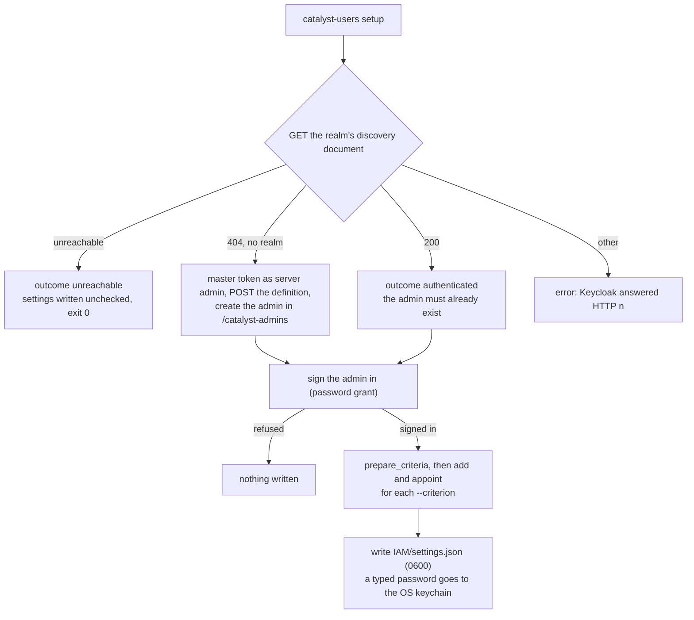

After sign-in: `prepare_criteria()` and `add_criterion` + `appoint` for each `--criterion`. A refused sign-in writes
nothing. If the password was typed, it is stored in the keychain under account `<username>@<url>/<realm>`, service
`catalyst-users`, and `password_command` becomes `security find-generic-password -s catalyst-users -a <account> -w`
(macOS) or `secret-tool lookup service catalyst-users account <account>` (Linux, needs libsecret; no keychain →
error "give a password command instead").

Output: `<note>.\nWrote <path>.`; `--json`: `{"outcome","settings","type","username"}`. Writes
`IAM/settings.json` (0600) — `definition` is never stored.

Realm creation failure messages: `the realm definition holds a person or a secret: …`; `the realm definition is for
'x', not 'y'`; `Keycloak's server admin <u> was refused (HTTP n)`; `the realm <r> was created, but not its admin
<u>: …` (realm left in place); `<u> is signed in, but the realm <r> is not ready for criteria: …`;
`the realm has no client catalyst-admin-cli allowing a password sign-in (on a dev realm, keycloak/sync_clients.py adds
it)`.

### 3.4 `login`, `logout`, `whoami`, `token`

| Command | Options | Does | Output (`--json` before the command) |
| --- | --- | --- | --- |
| `login` | — | device grant on `client` (`catalyst-cli`): prints `Open <verification_uri_complete>` and `and confirm the code <user_code>. Waiting…`; polls every 5 s (+5 on `slow_down`); stores tokens | `Logged in as <user> (<name>).` / signer record |
| `login --password [--username U]` | | password grant on `password_client` (`catalyst-admin-cli`); password from stdin (one line) if not a TTY, else no-echo prompt; username prompted if TTY, required otherwise | same |
| `logout` | — | revokes at Keycloak (refresh token) via the client that issued it, then deletes `credentials.json` regardless; warning on stderr if revocation not confirmed | `Logged out.` |
| `whoami` | `--system` | without: userinfo of the logged-in person; with: signs the system account in and reads its userinfo | 7 lines: `user (name)`, `subject`, `issuer`, `groups`, `roles`, `grants`, `administers`; JSON: signer fields + `email, groups, roles, grants, administers` |
| `token` | `--system` | prints a fresh access token (refreshing if needed); `--system`: password-grant token for the system account | raw token; `--system --json`: `{"access_token","token_type":"Bearer","expires_at"}`. **Secret.** (help text "client credentials" is stale: it is a password grant) |

Login failures: `the login was declined`; `the login code expired before it was approved: run \`login\` again`;
`logged in as X, not Y`; Keycloak refusal `Keycloak refused <u>'s sign-in at <issuer>: invalid_grant: …`.

The device login (`catalyst-users login`; `catalyst identity login` follows the same grant):

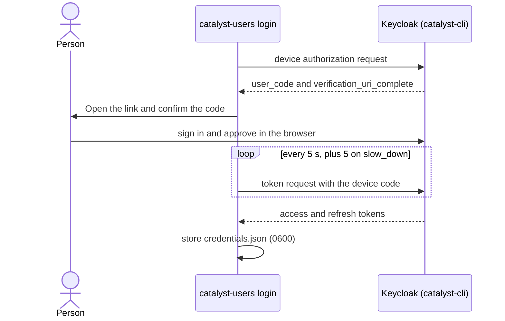

Which stored login is used: the device-login client's tokens if present, else the password client's
(`KeycloakProvider._session`). Only one `credentials.json` exists: a new login replaces the previous one.

### 3.5 `users`

All run against the admin API **with your own token** (log in first).

| Subcommand | Arguments | Effect | Output |
| --- | --- | --- | --- |
| `users list` | `[--search S]` | up to 100 users (`briefRepresentation`) | `username  enabled/DISABLED  name` |
| `users add` | `USERNAME [--email E] [--first-name F] [--last-name L] [--temporary-password]` | creates enabled user; `--temporary-password` prompts (no echo) for a password the user must change at first login | `Added <u>.` |
| `users update` | `USERNAME [--email] [--first-name] [--last-name]` (≥ 1 required) | changes only those; changed email → `emailVerified=false`; username never changes (0.8.0) | `Updated <u>.` |
| `users disable` / `enable` | `USERNAME` | sets `enabled`; never deletes | `<u> is disabled.` |
| `users groups` | `USERNAME` | group paths | one per line |
| `users roles` | `USERNAME` | realm roles held: `direct` and/or `through <group>` (parent groups included); roles reached only via composites are not listed (0.10.0) | `role  direct, through /g` |
| `users import` | `FILE --roles ROLES_FILE` | imports a legacy catalyst `IAM/users/users.json`: username = `git_username` or slug(name); no password; disabled if `active: false`; realm roles by role-name mapping; existing users left untouched | `N created, M already there` |

### 3.6 `groups`

| Subcommand | Arguments | Effect |
| --- | --- | --- |
| `groups list` | — | tree with `[roles]` |
| `groups add` | `PATH` | creates the path, parents included; prints `Group <path> exists.` |
| `groups members` | `PATH` | direct members |
| `groups add-member` | `PATH USERNAME` | adds (a criterion-admin may, on groups under its criterion) |
| `groups remove-member` | `PATH USERNAME` | removes membership |
| `groups grant-role` | `PATH ROLE` | realm role on group; members and subgroups inherit |

### 3.7 `roles`

| Subcommand | Arguments | Effect |
| --- | --- | --- |
| `roles list` | — | `name  description` |
| `roles add` | `NAME [--description D]` | realm role |
| `roles grant` | `USERNAME ROLE` | realm role directly on a user |
| `roles holders` | `NAME` | groups granted it and users holding it, directly or through which groups (subgroup members included) (0.10.0) |
| `roles provision` | `FILE [--catalyst-client C] [--login-client C]...` | writes a catalyst roles document: ensures client `catalyst` (default), the `catalyst grants` mapper on each login client (default only `catalyst-cli`; **pass `--login-client catalyst-cli --login-client catalyst-admin-cli`** so the system account's tokens carry grants), realm roles, client roles `cmd:*`/`reconcile:*`, composites. Adds, never deletes. Output `N created, M already there` |

### 3.8 `criteria`

| Subcommand | Arguments | Who may | Effect |
| --- | --- | --- | --- |
| `criteria list` | — | anyone (sees what Keycloak lets them) | `name  admins` or `(not visible)` |
| `criteria add` | `NAME [--admin USER]` | catalyst-admin | §2.2; idempotent; re-run after adding subgroups. Output `Criterion N: <what was added>` or `already there` |
| `criteria admins` | `NAME` | | members of `/criteria/NAME/admins` |
| `criteria members` | `NAME` | | members of `/criteria/NAME/members` (read only) |
| `criteria appoint` | `NAME USERNAME` | catalyst-admin or NAME's admins | add to `/criteria/NAME/admins` |
| `criteria dismiss` | `NAME USERNAME` | same | remove from it (never the person) |

---

## 4. How the catalyst kernel signs through catalyst-users

Sources: `cantica-tech/catalyst:scripts/catalyst/provider.py`, `scripts/catalyst/__main__.py` (`cmd_identity`,
`_identity_doc`, `cmd_serve`), `scripts/catalyst/ids.py` (`resolve_signer`), `scripts/catalyst/permissions.py`,
`docs/design/28-identity-providers.md`, `docs/design/29-users-outside-catalyst.md`,
`docs/design/32-project-membership.md`, `CHANGELOG.md` 0.105.0–0.119.2.

### 4.1 The pointer: `IAM/identity.json` in the criterion

```json
{"provider": "keycloak", "issuer": "http://localhost:8080/realms/catalyst"}
```

Optional keys: `client` (default `catalyst-cli`), `catalyst_client` (default `catalyst`). A workspace member inherits
its workspace's pointer. `catalyst check` errors if missing (`IAM/identity.json is missing: point the deployment at
catalyst-users (\`catalyst identity configure --issuer <url>\`)`), if not a JSON object, or if
`pointer_problems()` reports anything; warns if `static`.

Written by:

- `catalyst init` — with `--identity-issuer URL [--identity-client C] [--catalyst-client C]`, from those; **without
  them, from this machine's `~/.catalyst/users/IAM/settings.json`** (`{"provider": type, **provider}` — connection
  settings only, never username/password command).
- `catalyst identity configure [--provider keycloak|static] --issuer URL [--client C] [--catalyst-client C]
  [--link RETIRED_USER] [--as U] [--intent TEXT]...` — journaled (`artifact: identity pointer`), signed by the
  identity the new pointer authenticates; rolled back if no signer.

There is **no** user or role registry in a criterion since kernel 0.106.0 (`catalyst user …`/`catalyst role …`
refuse and point to catalyst-users).

### 4.2 Signer resolution (every writing verb)

`ids.resolve_signer(dep, corpus, as_user, command)` → `provider.signer()` → `provider.verify()`:

1. Build the facade from `IAM/identity.json` with the kernel's own credentials file (§4.3).
2. `backend.whoami()` — userinfo with the logged-in person's token (refreshed if needed).
3. If **not logged in** (`NotLoggedInError`): `system_backend(issuer)` reads `~/.catalyst/users/IAM/settings.json`;
   if it has `username` + `password_command` **and its issuer equals the pointer's issuer** (string compare after
   stripping `/`), sign in the system account (password grant) and use it; stderr
   `catalyst: no one is logged in: signing as the system account <user>`. If `--as` names someone other than the
   system account → refused (since kernel 0.117.1). No system account → `no verified identity: not logged in to <issuer>
   (\`catalyst identity login\`)`.
4. **Any other error** (provider unreachable, refused, insecure URL) → `no verified identity (<cause>): \`catalyst
   identity login\`, then try again`. **No offline fallback** (the snapshot is never used to sign).
5. `--as NAME` must name the verified identity (username, name, subject, ledger userid/username) — "you sign only as
   yourself".
6. Roles → display names via the criterion's roles template; grants and reconciliation from the token; if the
   deployment's `project_name` ∈ `administers`, add `cmd:*` and `reconcile:full`.
7. Write the per-machine **snapshot** (read-only `0400`, with SHA-256 of content; an edited one is discarded).
8. **Permission check** (`permissions.refusal`): the command must be one of the deployment's `CODE-OF-CONDUCT.md` §4
   commands granted by `cmd:<command>` / alias / `cmd:*` / `Admin` role. `catalyst.toml role_check = "warn"` turns a
   refusal into a warning. Refusal text ends with how to grant it in catalyst-users.
9. **Enrolment**: an identity signing for the first time gets a line appended to the criterion's
   `IAM/signers.jsonl` — `{"userid","iss","sub","username","name","first_signed"}` — journaled as
   `catalyst identity create signer <userid>` (tier `chore`). `userid` is a fresh 8-character ID; every ID the person
   creates afterwards ends with it. The ledger is **append-only** (`catalyst check` reports changed/removed lines
   against the journal history, malformed lines, and a userid naming two identities). A username already taken gets
   `-<userid>` appended.

Signer resolution with the system-account fallback, as the kernel runs it on every writing verb:

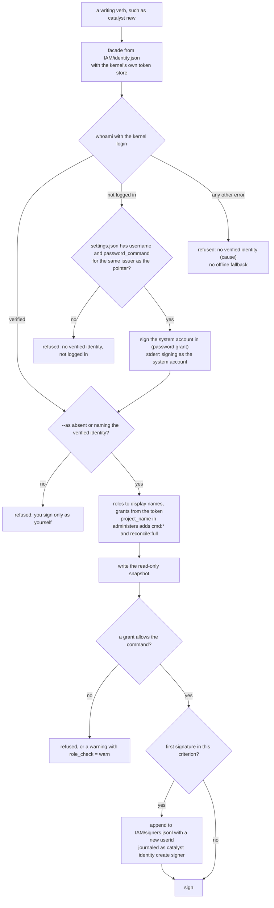

`catalyst identity link <retired user>` (or `configure --link`) lets a person who signed under the pre-0.106 model keep
their old userid, once, only for themselves.

The same signature as a sequence between the parties:

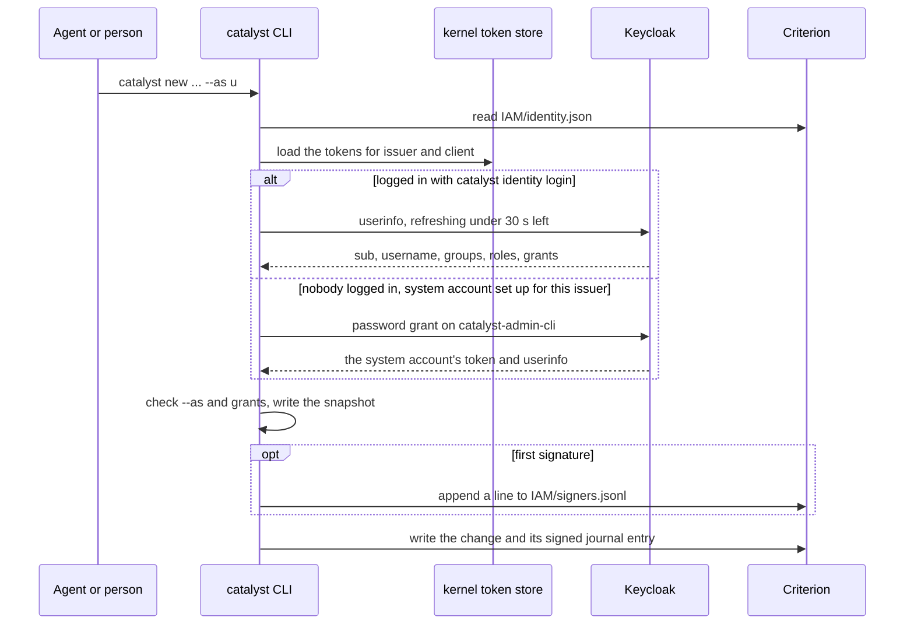

### 4.3 Kernel token store (separate from the CLI's)

| Path | Content |
| --- | --- |
| `$CATALYST_HOME/identity/<sha256(issuer\nclient)[:16]>.json` | tokens from `catalyst identity login` (0600 dir 0700) |
| `$CATALYST_HOME/identity/<same>.snapshot.json` | verified identity snapshot (0400) |

So **`catalyst-users login` does not log you in for catalyst signing, and `catalyst identity login` does not log
you in for `catalyst-users` admin commands or catalyst-mcp.** Both share only `IAM/settings.json` (system account).

The two token stores and the one file they share:

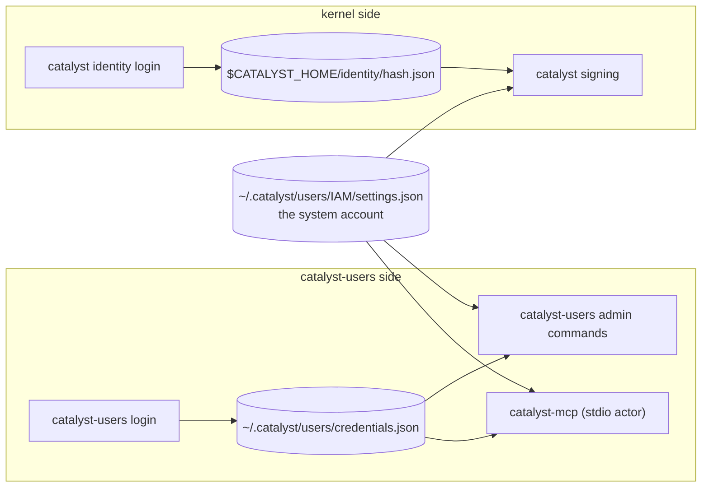

### 4.4 `catalyst identity` commands (kernel CLI)

| Command | Options | Notes |
| --- | --- | --- |
| `catalyst identity configure` | `--provider {keycloak,static}`, `--issuer`, `--client`, `--catalyst-client`, `--link`, `--as`, `--intent` | writes and journals `IAM/identity.json` |
| `catalyst identity login` | `[--issuer URL [--client C]] [--json]` | **device flow only** (no `--password`: the vendored core is 0.7.0); then prints whoami; `--issuer` works outside a deployment (before `init`) |
| `catalyst identity logout` | `[--issuer --client]` | revoke + delete kernel tokens + snapshot |
| `catalyst identity whoami` | `[--issuer --client] [--json] [--as]` | verified now; shows `userid` (or "none yet: given at your first signature"), groups, roles, grants, reconciliation, administers |
| `catalyst identity status` | `[--issuer --client] [--json]` | no network: provider, issuer, `logged_in` (kernel tokens file exists) |
| `catalyst identity link USER` | `[--as]` | keep a retired user's userid |

Exit 1 with `catalyst: <message>` on any identity failure.

### 4.5 `catalyst serve` and membership (the server side)

- `catalyst serve --identity-issuer URL [--identity-api-client catalyst-api] [--criterion NAME]` accepts provider
  access tokens by introspection; the confidential client's secret must be in **`CATALYST_IDENTITY_API_SECRET`**
  (else `catalyst: --identity-issuer needs the API client's secret in CATALYST_IDENTITY_API_SECRET`). Default port
  8765. A pusher who administers `--criterion` holds every grant.
- `catalyst members {list,add,remove,adopt} [member] [--reason R] [--json]` changes a served criterion's membership,
  calling catalyst-users' `add_member/remove_member(system=True)` and recording each change in an encrypted ledger in
  the server database (`~/.catalyst/serve/serve.db`); master key via `catalyst serve key init|escrow|recover`. A
  criterion shared by git only has admins only; `members add` is refused there. Detail: chapter on `catalyst serve`
  and `cantica-tech/catalyst-users:docs/membership.md`.

### 4.6 Vendoring procedure

A change to identity code is made in catalyst-users first, released (tag), then in a catalyst checkout:
`python3 scripts/vendor_identity.py <catalyst-users checkout> <tag>` (reads files at the tag, rewrites
`catalyst_users` imports to `catalyst.identity`, writes `VERSION` with hashes). Currently vendored: 0.7.0. Not yet in
the kernel: 0.8.0 `update_user`, 0.9.0 `login --password`, 0.10.0 `user_roles`/`role_holders`.

The vendoring path from a catalyst-users change to the kernel:

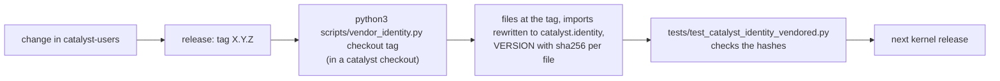

---

## 5. catalyst-mcp: architecture and authorization model

Sources: `cantica-tech/catalyst-mcp:README.md`, `docs/design.md`, `CHANGELOG.md`, `src/catalyst_mcp/**`.

### 5.1 Purpose and decisions

"An MCP server that keeps catalyst criteria in step with the git repositories they mirror: watchers, criteria,
templates and users." It **orchestrates** (decision D1): criteria via the `catalyst` CLI, people via catalyst-users
as a library. What it owns: the watchers, the authorization gate, its audit log, and the tool surface.

| # | Decision (2026-10-28) |
| --- | --- |
| D1 | Orchestrate catalyst and catalyst-users; no criterion engine of its own |
| D2 | A criterion is a **group** `/criteria/<name>` in one realm, not a realm of its own |
| D3 | IAM through catalyst-users as a library, with the caller's own token, no admin secret |
| D4 | cantica-tech standard (`.standards/`, ruff 0.16.10, pyright) |
| D5 | `catalyst journal adopt` must sign as the verified identity (fixed in kernel 0.119.1) |

### 5.2 Module map (`src/catalyst_mcp/`)

| Path | Role |
| --- | --- |
| `server.py` | builds `MCPServer("catalyst-mcp")` (package `mcp` ≥ 2.3 < 3), registers tool modules; `main()` parses `--transport/--host/--port`; HTTP mode adds `CatalystUsersTokenVerifier` + `AuthSettings(issuer_url=<realm issuer>, resource_server_url=http://host:port/mcp)` |
| `settings.py` | `Settings(BaseSettings)`, env prefix `CATALYST_MCP_` (pydantic-settings) |
| `services.py` | shared `Services`: directory, `Gate(StdioOnly(RoleMapping))`, actor resolver per transport, `CatalystCli`, `CriterionService`, `WatchManager`, `TemplateCatalog` |
| `log.py` | JSON (or console) records on **stderr** (stdout is the stdio transport); redacts fields whose key contains token, secret, password, passwd, authorization, credential, api_key or cookie, `Bearer …`, JWTs, `SecretStr` |
| `auth/actor.py` | `Actor` (iss, sub, username, via ∈ session/system/token, roles, grants, groups, administers); `SessionResolver`, `TokenResolver`, `PinnedResolver` |
| `auth/permissions.py` | `Action` enum; `RoleMapping`, `StdioOnly`, `DenyAll` |
| `auth/gate.py` | `Gate.authorize()` — sole maker of `AuthorizedAction` (guarded by a private sentinel); logs `authz.decision` |
| `auth/token.py` | `CatalystUsersTokenVerifier`: introspection via catalyst-users `OIDCClient`, cache ≤ 30 s keyed by SHA-256 |
| `iam/catalyst_users.py` | `CatalystUsersDirectory`: async wrapper (worker threads) over catalyst-users' provider; maps `AdminError` 404/409 to `IamNotFoundError`/`IamConflictError` |
| `iam/directory.py` | `IdentityDirectory` protocol, `Person`, `Registered`, `Role`, `Iam*Error` |
| `criterion/service.py` | atomic create (validate → repo → `catalyst init` → keep rules → group → members) with undo |
| `criterion/catalyst_cli.py` | subprocess runner: `init`, `journal append`, `members add`, `unrecorded --json`, `journal adopt --as`; exit 3 (assent) is a failure, never answered with `--yes` |
| `criterion/schema.py` | criterion JSON Schema v0 (stub) and v1 |
| `watch/manager.py`, `triggers.py`, `diff.py` | watches (watchfiles), git plumbing |
| `templates/loader.py`, `templates/catalog/blank/1.0.0.json` | versioned templates |
| `tools/*.py` | the MCP tools |

### 5.3 Actor resolution (who acts)

| Transport | Resolver | Actor |
| --- | --- | --- |
| stdio | `SessionResolver` | the person logged in via **`catalyst-users login`** (catalyst-users' `credentials.json`), else the **system account** (`IAM/settings.json`); `via` = `session` / `system`; neither → refusal "no verified actor" |
| streamable-http | `TokenResolver` | claims of the bearer token the verifier accepted (`via = token`) |
| a watch trigger | `PinnedResolver(SessionResolver)` | whoever the session resolves **now**, only if same `iss`+`sub` as the identity that started the watch |

A git commit's author never authorizes anything.

### 5.4 The gate and the role mapping (deny by default)

`Gate.authorize(resolver, action, criterion_id)`: resolve actor → `permissions.can()` → log → `AuthorizedAction` or
`DeniedError("refused: <action> on criterion <id>|the realm: <reason>")`. Any exception or non-`Decision` answer is
a refusal. Every service method that writes calls `authorized.require(action, criterion_id)`.

`RoleMapping` (`cantica-tech/catalyst-mcp:docs/design.md`):

| Action | Required | Checked how |
| --- | --- | --- |
| `criterion.create` | realm role **`catalyst-admin`** | `actor.roles` (from token/userinfo) |
| `user.register` | `catalyst-admin` | same |
| `user.update` (details, or enable) | `catalyst-admin` | same |
| `user.disable` | `catalyst-admin` | same |
| `role.assign` | `catalyst-admin` | same |
| `criterion.update` (watch adopt) | an **admin of that criterion** | live `directory.criteria()` → `admins` list contains `actor.username` |
| `watch.start`, `watch.stop` | admin of that criterion | same |
| `user.read` | — | only asked over HTTP, where it is refused |
| anything else | — | "no one may …" |

Note: a `catalyst-admin` who is **not** in `/criteria/<name>/admins` cannot start a watch on `<name>` (the realm role
is not consulted for criterion actions). Criterion admins are checked by **username** against the provider's list,
fetched with the server's own session — if that session cannot see a criterion's admins, the action is refused
("not visible to this session").

`StdioOnly` wraps the mapping: when `transport != "stdio"`, **every** action is refused
("over HTTP catalyst would sign and catalyst-users would act as this server, not the caller"). Effect over HTTP:
only `list_templates`, `get_template`, `list_watches` work; `list_users`/`get_user` are refused (they ask
`user.read`).

The full authorization decision for a gated tool call (read-only tools such as `list_templates` do not reach the gate):

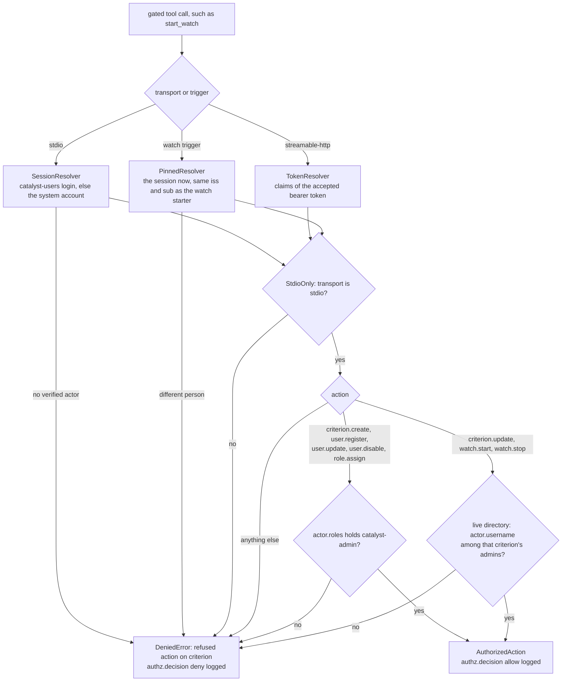

Audit record (stderr, JSON): `{"event":"authz.decision","actor":{"iss","sub","username","via"},"criterion",
"action","decision":"allow|deny","reason"}`.

### 5.5 Creating a criterion (atomic order)

`CriterionService._create` (`criterion/service.py`):

1. Validate `{"id": name, "name": name, "rules": rules}` against schema **v1** (`rules` may contain only `naming`
   (`max_length` int) and `branches` (string list)); owner non-empty; users non-empty, unique. A criterion already
   kept under v0 with the same document stays valid.
2. If `users` given, the repo's `catalyst.toml` must have `share = "serve"`, else refused ("has admins only").
3. Existing-state checks: repo governed by another `project_name` → `CriterionExists`; new-repo path exists without
   `catalyst.toml` → refused; `$CATALYST_HOME/projects/<name>` exists without pointer → "name taken on this
   machine"; group exists with another owner → refused; kept rules differ → refused.
4. `git init -q -b main` at `<projects_root>/<name>` (create_criterion only). Undo: `rm -rf`.
5. `catalyst init --name <name> --module <module> [--identity-issuer <catalyst-users issuer>] [--kernel] [--module-dir]
   [--agent]` from the repo. Undo: delete `catalyst.toml`, the criterion dir, `.git/refs/catalyst/journal`.
6. Keep rules in `<criterion>/catalyst-mcp/criterion.json` (`$schema` + document) and journal it via
   `catalyst journal append --command catalyst-mcp --action create --artifact "criterion <id>" --tier chore
   --intent … --file .criterion/catalyst-mcp/criterion.json`.
7. `add_criterion(name, admin=owner)` in the provider (idempotent, never undone).
8. `catalyst members add <u> --reason …` per user (served criteria only); a failure → `CriterionPartialError`
   (repeat the create).

`create_criterion_from_repo` skips 1's rules (empty `{}`), requires an absolute path with `.git`, owner = actor.

The create as a sequence, with each step's undo:

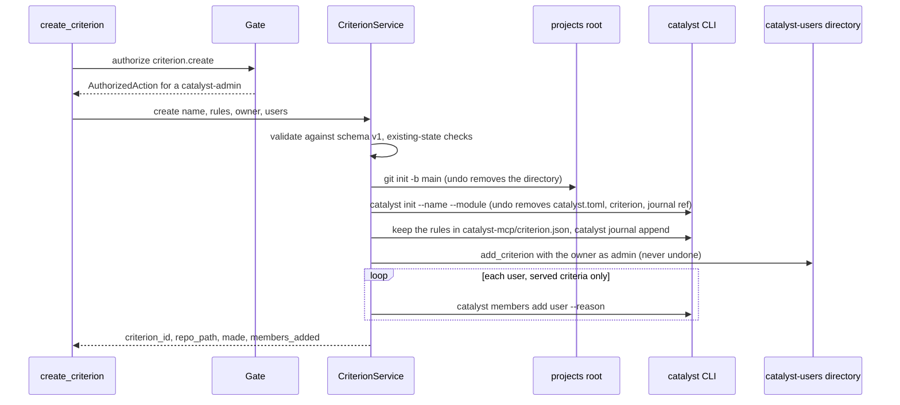

### 5.6 Watches

- `commit` mode: watchfiles on `.git/HEAD`, `refs/`, `packed-refs` (nothing installed in the project). On trigger:
  `catalyst unrecorded --json <last>..HEAD`, keep commits made here and not on any remote-tracking branch, authorize
  `criterion.update` as the pinned actor, then `catalyst journal adopt <commit> --intent <subject> --as <username>
  --json`. Refused/failed → nothing written, last processed commit unchanged (retry next trigger).
- `file_change` mode: watchfiles on the work tree (excluding `.git/` and ignored files); refreshes the working-tree
  diff shown by `list_watches`; writes nothing.
- Debounce `CATALYST_MCP_WATCH_DEBOUNCE_MS` (500). A watch never pushes and never answers assent prompts. Watches live
  in memory as long as the server process; one watch per criterion.
- `start_watch` refuses: non-absolute / not a work tree; repo's `catalyst.toml` `project_name` ≠ `criterion_id`;
  criterion already watched with another repo/mode/actor (same → returns existing, `started: false`).

A `commit` watch, from a new commit to its adoption:

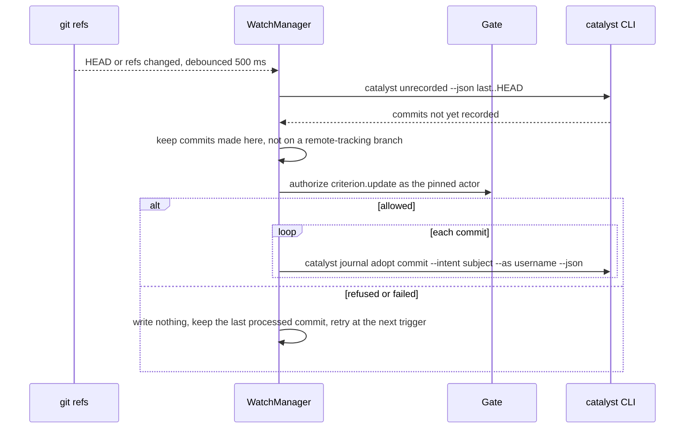

### 5.7 Templates

Catalog: `src/catalyst_mcp/templates/catalog/<name>/<semver>.json` (shipped in the wheel) or
`CATALYST_MCP_TEMPLATES_DIR`. Envelope: `name` (criterion-name regex), `version` (semver), `description`,
`parameters` (JSON Schema), `criterion` (`name`, `rules`, optional `owner`, `users`) with `${param}` placeholders
(`$${` escapes). Shipped: `blank` 1.0.0 — params `name` (required), `owner` (default null → the actor), `users`
(default `[]`); `rules: {}`.

### 5.8 Prompts and resources

**None.** catalyst-mcp registers tools only (no `@app.prompt`/`@app.resource` in the source). Do not confuse it with
the kernel's own `catalyst mcp` server (prompts per `CODE-OF-CONDUCT.md` §4 command, tools `catalyst` and `command`),
covered in the kernel chapter.

---

## 6. catalyst-mcp reference

### 6.1 Command line

```text
catalyst-mcp [-h] [--version] [--transport {stdio,streamable-http}] [--host HTTP_HOST] [--port HTTP_PORT]
```

Flags override `CATALYST_MCP_*` env. `--version` → `catalyst-mcp 0.4.0`. stdio is the default; streamable HTTP
listens at `http://127.0.0.1:8765/mcp` by default. Logs on stderr. Exit 0 on normal stop; settings validation errors
(e.g. bad `CATALYST_MCP_CATALYST_ROOT`) abort at start.

### 6.2 Settings (`CATALYST_MCP_*`, `settings.py`)

| Env var | Default | Meaning |
| --- | --- | --- |
| `CATALYST_MCP_TRANSPORT` | `stdio` | `stdio` / `streamable-http` |
| `CATALYST_MCP_HTTP_HOST` | `127.0.0.1` | |
| `CATALYST_MCP_HTTP_PORT` | `8765` | 1–65535 (**same default as `catalyst serve`**) |
| `CATALYST_MCP_HTTP_PATH` | `/mcp` | |
| `CATALYST_MCP_KEYCLOAK_URL` | — | overrides catalyst-users `server_url` (and makes catalyst-users ignore its settings.json, §2.4) |
| `CATALYST_MCP_KEYCLOAK_REALM` | — | overrides `realm` (same caveat) |
| `CATALYST_MCP_KEYCLOAK_CLIENT_ID` | — | overrides `client_id` (same caveat) |
| `CATALYST_MCP_KEYCLOAK_API_CLIENT_ID` | — | overrides `api_client_id` |
| `CATALYST_MCP_KEYCLOAK_API_CLIENT_SECRET` | — | **required for HTTP transport** (the `catalyst-api` secret); start fails without it |
| `CATALYST_MCP_USERS_POINTER` | — | catalyst-users `--pointer` file |
| `CATALYST_MCP_CATALYST_ROOT` | — | a catalyst checkout or release with `dist/catalyst.pyz` and `framework/kernel` (validated at start); derives the next three and a sibling `catalyst-<module>` dir if it has `module.yaml` |
| `CATALYST_MCP_CATALYST_CLI` | `["catalyst"]` | JSON list argv; from root: `[<python>, <root>/dist/catalyst.pyz]` |
| `CATALYST_MCP_CATALYST_KERNEL` | — | `catalyst init --kernel` |
| `CATALYST_MCP_CATALYST_HOME` | `$CATALYST_HOME` or `~/.catalyst` | passed to the CLI as `CATALYST_HOME` |
| `CATALYST_MCP_PROJECTS_ROOT` | `~/catalyst-mcp/projects` | where `create_criterion` makes new repos |
| `CATALYST_MCP_CRITERION_MODULE` | `software-engineering` | |
| `CATALYST_MCP_CRITERION_MODULE_DIR` | — | `catalyst init --module-dir` |
| `CATALYST_MCP_CRITERION_AGENT` | — | `catalyst init --agent` |
| `CATALYST_MCP_IDENTITY_ISSUER` | catalyst-users' issuer | `catalyst init --identity-issuer` |
| `CATALYST_MCP_TEMPLATES_DIR` | shipped catalog | |
| `CATALYST_MCP_WATCH_DEBOUNCE_MS` | `500` | |
| `CATALYST_MCP_LOG_LEVEL` | `INFO` | DEBUG/INFO/WARNING/ERROR |
| `CATALYST_MCP_LOG_FORMAT` | `json` | `json` / `console` |

catalyst-users' own variables (`CATALYST_USERS_HOME`, `CATALYST_HOME`, …) are honoured too, since it is used as a
library.

### 6.3 Tools

Annotations: `READ_ONLY` (`readOnlyHint`), `WRITE` (idempotent, non-destructive), `delete_user` destructive.
Failures are MCP tool errors `"<tool>: <cause>"` (redacted); unexpected exceptions → `"<tool> failed unexpectedly
(<Type>); see the server's log"`.

| Tool | Inputs | Output | Gate action → required (stdio) | HTTP |
| --- | --- | --- | --- | --- |
| `create_criterion` | `name` str, `rules` object, `owner` str, `users` str[]? | `{criterion_id, repo_path, criterion_path, owner, made[], members_added[], unchanged}` | `criterion.create` → `catalyst-admin` | refused |
| `create_criterion_from_repo` | `repo_path` (absolute, git), `name`, `users`? | same | `criterion.create` → `catalyst-admin` | refused |
| `list_templates` | — | `[{name, versions, latest, description, invalid…}]` | none | allowed |
| `get_template` | `name`, `version`? (latest) | template description incl. parameter JSON Schema | none | allowed |
| `create_from_template` | `name`, `params` object, `version`? | create output + `template` | `criterion.create` → `catalyst-admin` | refused |
| `register_user` | `username`, `email`?, `first_name`?, `last_name`? | `{username, email, name, enabled, created}`; same person+details → `created:false`; other details → conflict error | `user.register` → `catalyst-admin` | refused |
| `update_user` | `username`, `email`?, `first_name`?, `last_name`?, `enabled`? | person; nothing given → read only | `user.update` (details / enable), `user.disable` (enabled=false), each authorized separately | refused |
| `delete_user` | `username` | person + `deleted:false` (disabled, never deleted) | `user.disable` → `catalyst-admin` | refused |
| `assign_role` | `username`, `role`, `criterion_id` (must be null) | `{username, role, granted:true}` | `role.assign` → `catalyst-admin`; with `criterion_id` → refused (criterion roles are admins/members, kept by catalyst) | refused |
| `list_users` | `criterion_id`?, `search`? | persons (realm, or that criterion's members) | none over stdio (runs with the server's session's Keycloak rights) | refused (`user.read`) |
| `get_user` | `username` | person + `groups[]` + `criteria[]` | none over stdio | refused |
| `start_watch` | `repo_path`, `criterion_id`, `mode` `commit`\|`file_change` (default `commit`) | watch description + `started` | `watch.start` → admin of criterion | refused |
| `stop_watch` | `criterion_id` | `{criterion_id, stopped}` | `watch.stop` → admin of criterion | refused |
| `list_watches` | — | `[{criterion_id, repo_path, mode, actor, started, last_commit, diff[≤50], diff_count, last_trigger, last_outcome, running}]` | none | allowed |

Effective Keycloak rights: the directory calls run with the **session's** token (whoever ran `catalyst-users login`
on the server's machine). The gate decides on the actor's roles, then Keycloak independently enforces the session's
rights — normally the same person over stdio.

### 6.4 Transports

| | stdio | streamable-http |
| --- | --- | --- |
| Start | `catalyst-mcp` | `catalyst-mcp --transport streamable-http [--host] [--port]` |
| Auth | none at transport; actor = local session/system account | every request needs `Authorization: Bearer <Keycloak access token>` with audience `catalyst-api`; 401 otherwise |
| Writes | all, gated | none |
| Needs | catalyst-users settings + login | plus `CATALYST_MCP_KEYCLOAK_API_CLIENT_SECRET` |

The two transports side by side:

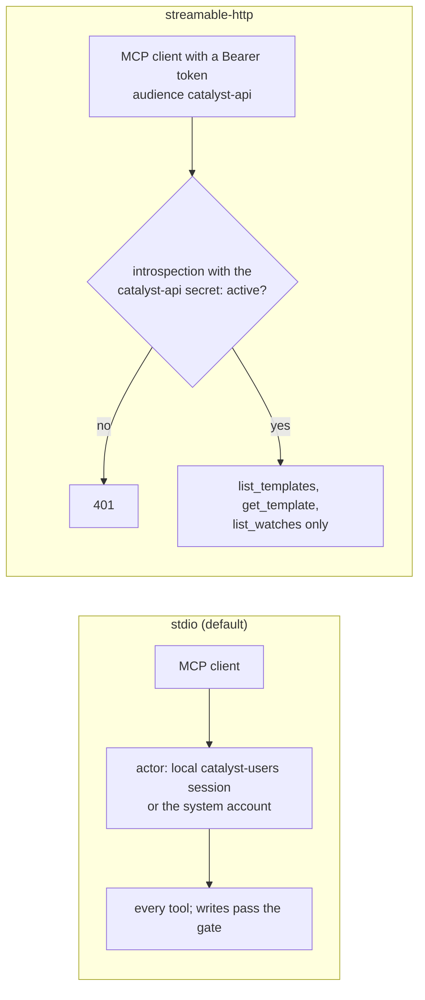

---

## 7. Deployment from scratch, step by step

Dependencies on other chapters: the **catalyst kernel/CLI** (build `dist/catalyst.pyz`, `catalyst init`) and the
**process module** (`cantica-tech/catalyst-software-engineering`) are covered elsewhere; here they appear only as the
consumer of identity. Order matters: **Keycloak → catalyst-users settings (system account) → roles provisioned →
`catalyst init` (reads settings) → first signature → people → catalyst-mcp.**

The deployment steps below and what each one needs first:

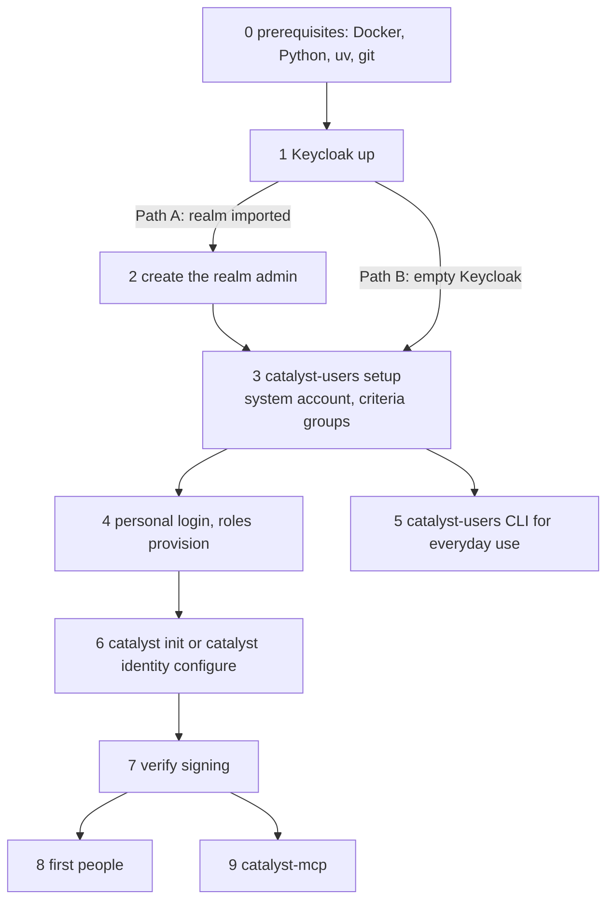

Two paths for the realm:

- **Path A — compose.yaml (the fleet's current dev setup)**: Keycloak imports the realm at first start; you then
  create the admin user (set_admin.py on macOS, or kcadm), then `setup` signs in.
- **Path B — greenfield (what `docs/onboarding.md` and `beta/QUICKSTART.md` use)**: an empty Keycloak; `setup`
  creates the realm and the admin. Tested end to end by `tests/integration/onboarding/test_onboarding.py`. Add a
  volume if you want it to persist.

### Step 0 — Prerequisites

| Need | Version | Check |
| --- | --- | --- |
| Docker (or Podman with compose) | compose v2 | `docker compose version` |
| Python | ≥ 3.11 (catalyst-mcp < 3.14) | `python3 --version` |
| uv | CI pins 0.11.26; build backend `uv_build>=0.11.26,<0.12` | `uv --version` |
| git | with `user.name`/`user.email` set | `git config user.name` |
| OS keychain (optional) | macOS `security`, or Linux `secret-tool` (libsecret) | only if you type passwords into `setup` |
| curl | for health checks | |

Podman: `podman compose` / `podman-compose` should work with the same file (unverified). On Linux, pre-create the H2
directory writable by Keycloak's non-root user (step 1).

### Step 1 — Get catalyst-users and bring Keycloak up (Path A)

```sh
git clone -b development git@github.com:cantica-tech/catalyst-users.git
cd catalyst-users
uv sync --all-extras                      # .venv with the CLI, fastapi extra, dev tools
mkdir -p .keycloack/data && chmod 777 .keycloack/data   # Linux: else Docker creates it root-owned and H2 cannot write
docker compose up -d
until curl -sf http://127.0.0.1:8080/realms/catalyst/.well-known/openid-configuration >/dev/null; do sleep 2; done
```

What `compose.yaml` defines (single service `keycloak`):

| Item | Value |
| --- | --- |
| image | `quay.io/keycloak/keycloak:26.4.0` (pinned) |
| command | `start-dev --import-realm` (dev mode: HTTP, H2 file DB) |
| env | `KC_BOOTSTRAP_ADMIN_USERNAME` / `KC_BOOTSTRAP_ADMIN_PASSWORD` (a **dev-only** credential written in `compose.yaml`; change it for anything but a laptop), `KC_HEALTH_ENABLED=true` |
| ports | `127.0.0.1:8080:8080` (loopback only). Management port 9000 (health) is **not** published |
| volume 1 | `./keycloak/realm-catalyst.json` → `/opt/keycloak/data/import/realm-catalyst.json:ro` — imported on start **only if the realm does not exist** |
| volume 2 | `./.keycloack/data` → `/opt/keycloak/data/h2` — the H2 database (users, realm, master realm, bootstrap admin) persists across `--force-recreate` |

Creates: container `catalyst-users-keycloak-1` (compose project `catalyst-users`), realm `catalyst` with clients,
roles, groups, **no users**; master realm with the bootstrap admin.

Verify: `docker compose ps`; the discovery URL returns 200; admin console at `http://localhost:8080/admin/`
(bootstrap admin).

Common failures: port 8080 busy; H2 permission denied (Linux, see mkdir above); realm not imported because
`.keycloack/data` already holds one (delete the dir to start over — destroys all users).

**Path B instead** (empty Keycloak, persisted):

```sh
docker run -d --name keycloak-catalyst -p 127.0.0.1:8080:8080 \
  -e KC_BOOTSTRAP_ADMIN_USERNAME=admin -e KC_BOOTSTRAP_ADMIN_PASSWORD="$(<command printing a password you chose>)" \
  -v "$PWD/.keycloack/data:/opt/keycloak/data/h2" \
  quay.io/keycloak/keycloak:26.4.0 start-dev
until curl -sf http://127.0.0.1:8080/realms/master >/dev/null; do sleep 3; done
```

(The quickstart uses port 8081 and `--rm` with no volume: throwaway.)

### Step 2 — (Path A only) create the realm admin

The imported realm has no person; `setup` on an existing realm only signs in, so the admin must exist first.

macOS:

```sh
security add-generic-password -s <service>@catalyst-users -a <username> -w   # prompts for the password (≥ 12 chars)
uv run python keycloak/set_admin.py --service <service>@catalyst-users --email <email> [--first-name F --last-name L]
```

Creates/updates `<username>` (enabled, email verified, password permanent) and makes them the **only** member of
`/catalyst-admins` (→ `catalyst-admin` realm role + `realm-management:realm-admin`).

Linux (unverified commands, standard Keycloak `kcadm.sh`):

```sh
docker compose exec keycloak /opt/keycloak/bin/kcadm.sh config credentials \
  --server http://localhost:8080 --realm master --user admin            # prompts for the bootstrap password
docker compose exec keycloak /opt/keycloak/bin/kcadm.sh create users -r catalyst \
  -s username=<u> -s enabled=true -s emailVerified=true -s email=<e> -s firstName=<f> -s lastName=<l>
docker compose exec -it keycloak /opt/keycloak/bin/kcadm.sh set-password -r catalyst --username <u>   # prompts
# then add <u> to /catalyst-admins (admin console: Users → <u> → Groups → Join group), or
# kcadm.sh update users/<user-id>/groups/<group-id> -r catalyst -s realm=catalyst -s userId=<user-id> -s groupId=<group-id> -n
```

Verify: admin console → realm `catalyst` → Users → `<u>` → Groups shows `/catalyst-admins`.

### Step 3 — `catalyst-users setup` (system account + criteria groups)

Choose how the admin's password is read — a command printing it (keychain lookup, `cat` of a 0600 file, a secrets
manager CLI) — never the password itself on the command line.

Path A (realm exists → `authenticated`):

```sh
uv run catalyst-users setup --type keycloak \
  --provider '{"url": "http://localhost:8080", "realm": "catalyst"}' \
  --username <u> --password-command "<command printing u's password>" \
  --criterion <first-deployment-name> [--criterion <another>]...
```

Path B (no realm → `created`):

```sh
uv run catalyst-users setup --type keycloak \
  --provider '{"url": "http://localhost:8080", "realm": "catalyst", "definition": "keycloak/realm-catalyst.json"}' \
  --username <u> --password-command "<command printing u's password>" \
  --server-admin admin --server-admin-password-command "<command printing the bootstrap admin password>" \
  --email <e> --first-name <f> --last-name <l> \
  --criterion <first-deployment-name>
```

Creates: `~/.catalyst/users/IAM/settings.json` (0600); in Keycloak (B: realm + admin in `/catalyst-admins`);
FGAP on, role `criterion-admin`, `/criteria`, `/criteria/<name>/{admins,members}` + permissions, admin appointed.
`<name>` must equal the future deployment's `project_name`.

Verify:

```sh
uv run catalyst-users --json whoami --system
```

Expect `username <u>`, issuer `http://localhost:8080/realms/catalyst`, groups `/catalyst-admins`,
`/criteria/<name>/admins`; roles include `catalyst-admin`, `criterion-admin`; `administers: [<name>]`. Grants are
empty until step 4.

Common failures: outcome `unreachable` (Keycloak not up — settings written unchecked, exit 0: re-run with `--force`
once it is up); `invalid_grant` (wrong password, user missing, or Keycloak "Account is not fully set up": missing
email/names or temporary password); `the realm has no client catalyst-admin-cli …` (old persisted realm: run
`uv run python keycloak/sync_clients.py`); `refusing http:// to <host>` (non-loopback HTTP: use HTTPS);
`<path> exists: pass --force`.

### Step 4 — Provision catalyst's roles and grants

Needs a **personal login** (the directory runs with your own token, not the system account's):

```sh
uv run catalyst-users login                    # device flow: open the printed link, sign in as <u>, approve
#   or, without a browser (0.9.0): printf '%s\n' "$(<password command>)" | uv run catalyst-users login --password --username <u>
uv run catalyst-users roles provision keycloak/catalyst-roles.json \
  --login-client catalyst-cli --login-client catalyst-admin-cli
uv run catalyst-users --json whoami --system   # now: grants cmd:*, reconcile:full
```

Creates: client `catalyst` (if missing), mapper `catalyst grants` on both login clients, realm roles, client roles
`cmd:*`, `cmd:create`, …, `reconcile:full|propose`, composites. Safe to repeat. Tokens issued **before** this step
lack the grants: log in again / let them refresh.

### Step 5 — Install the catalyst-users CLI for everyday use

Options (pick one):

1. From the checkout: `alias catalyst-users='uv run -q --project <catalyst-users checkout> catalyst-users'` (what the
   quickstart does; the VS Code extension's **IAM → Command** setting takes the same string).
2. As a uv tool (standard uv, not documented in the repo): `uv tool install
   git+https://github.com/cantica-tech/catalyst-users@0.10.0` → `catalyst-users` on `PATH`.

Verify: `catalyst-users --version` → `catalyst-users 0.10.0`; `catalyst-users providers`.

The kernel does **not** need this CLI to sign (it carries its own copy); you need it for setup and administration.

### Step 6 — Configure a catalyst deployment to sign through it

New deployment (from the project root; CLI built per the kernel chapter):

```sh
python3 <catalyst>/dist/catalyst.pyz init --kernel <catalyst>/framework/kernel \
  --name <name> --module software-engineering --git-username <u> \
  --rule-doc <file>:<prefix> --agent claude-code
#   explicit provider instead of this machine's settings:  --identity-issuer http://localhost:8080/realms/catalyst
```

Without `--identity-issuer`, `init` writes `IAM/identity.json` from `~/.catalyst/users/IAM/settings.json`
(`{"provider":"keycloak","url":…,"realm":…,"client":…,"password_client":…,"catalyst_client":…}`). The criterion goes
to `$CATALYST_HOME/projects/<name>/criterion`; only `catalyst.toml` is added to the project. `init` signs as the
verified identity (logged-in kernel user, else system account) — a fix in kernel 0.117.1.

Existing deployment (pre-0.106 or repointing):

```sh
catalyst identity configure --issuer http://localhost:8080/realms/catalyst [--link <retired user>]
```

Then make sure `<name>` has a criterion group: `catalyst-users criteria add <name> --admin <u>`.

### Step 7 — Verify signing works

```sh
catalyst identity status          # provider, issuer, logged_in (no network)
catalyst identity whoami          # verified now: userid, groups, roles, grants, reconciliation, administers
catalyst check                    # IAM/identity.json valid; signers ledger well-formed and append-only
tail -n 1 "$(catalyst where)/IAM/signers.jsonl"   # {"userid","iss","sub","username","name","first_signed"}
```

Expected: `whoami` shows a userid (after the first signature, which `init` performed), `administers <name>`, grants
`cmd:*`, `reconcile:full`. Journal entries name the ledger username as actor. If nobody ran `catalyst identity login`
you see `catalyst: no one is logged in: signing as the system account <u>` on stderr — that is normal.

### Step 8 — First people

```sh
catalyst-users users add alice --email alice@example.com --first-name Alice --last-name Example --temporary-password
catalyst-users groups add-member /cantica-tech/catalyst/developers alice      # gives realm role developer
#   or appoint as criterion admin:  catalyst-users criteria appoint <name> alice
```

Alice then, on her machine: `catalyst identity login` (device flow; Keycloak asks her to change the temporary
password on the web page), `catalyst identity whoami`. Her first signature appends her ledger line.

### Step 9 — catalyst-mcp

```sh
git clone -b development git@github.com:cantica-tech/catalyst-mcp.git
cd catalyst-mcp && uv sync                         # resolves catalyst-users @ git tag 0.8.0 over HTTPS
CATALYST_MCP_CATALYST_ROOT=<catalyst checkout with dist/catalyst.pyz> uv run catalyst-mcp --version
catalyst-users login                               # the session catalyst-mcp acts as (stdio)
```

Register it in your MCP client (§8). Verify from the client: `list_templates` returns `blank`; `list_users` returns
people; `start_watch` on a criterion you administer returns `started: true`.

---

## 8. Registering catalyst-mcp in MCP clients

**Claude Code, user level** (`cantica-tech/catalyst-mcp:README.md`):

```sh
claude mcp add-json -s user catalyst-mcp '{"type":"stdio","command":"uv",
  "args":["run","--directory","<catalyst-mcp checkout>","catalyst-mcp"],
  "env":{"CATALYST_MCP_CATALYST_ROOT":"<catalyst checkout>"}}'
claude mcp list            # verify it connects
```

Tools then appear as `mcp__catalyst-mcp__<tool>`. Keep it at user level: catalyst puts nothing in a project but
`catalyst.toml`.

**Other stdio clients** (Claude Desktop, Cursor, VS Code MCP, etc.): the same command/args/env in their
`mcpServers` JSON:

```json
{"mcpServers": {"catalyst-mcp": {"command": "uv",
  "args": ["run", "--directory", "<catalyst-mcp checkout>", "catalyst-mcp"],
  "env": {"CATALYST_MCP_CATALYST_ROOT": "<catalyst checkout>"}}}}
```

**HTTP clients** (read-only use): run `CATALYST_MCP_KEYCLOAK_API_CLIENT_SECRET=<from your secret store>
catalyst-mcp --transport streamable-http --port 8766` (pick a port other than `catalyst serve`'s 8765), point the client
at `http://127.0.0.1:8766/mcp` with a bearer token (`catalyst-users token`). Only templates and watch listing work.

---

## 9. Backup and restore

What holds state:

| State | Where | Backup |
| --- | --- | --- |
| Realm `catalyst` (users + password hashes, groups, roles, clients + generated secrets, FGAP), master realm (bootstrap admin) | H2 files in `catalyst-users/.keycloack/data/` (`keycloakdb.mv.db`, `keycloakdb.trace.db`) | file copy with Keycloak **stopped**, or `kc.sh export` |
| catalyst-users settings | `~/.catalyst/users/IAM/settings.json` | copy (no secret) |
| admin password | OS keychain / your secret store | per your secret store |
| tokens | `~/.catalyst/users/credentials.json`, `~/.catalyst/identity/*` | don't back up; log in again |
| signers ledger, identity pointer | in each criterion's git repo | git (`catalyst share push`) |
| membership ledgers | `~/.catalyst/serve/serve.db` + master key in keychain | serve chapter |

**Cold file backup (simplest; consistent):**

```sh
cd <catalyst-users checkout>
docker compose stop keycloak
tar czf keycloak-h2-$(date +%F).tgz .keycloack/data
docker compose start keycloak
```

Restore: `docker compose stop keycloak && rm -rf .keycloack/data && tar xzf keycloak-h2-<date>.tgz && docker compose
start keycloak`. Stops every deployment's signing while down (§11). Treat the archive as **secret** (password
hashes, client secrets).

The cold backup, step by step:

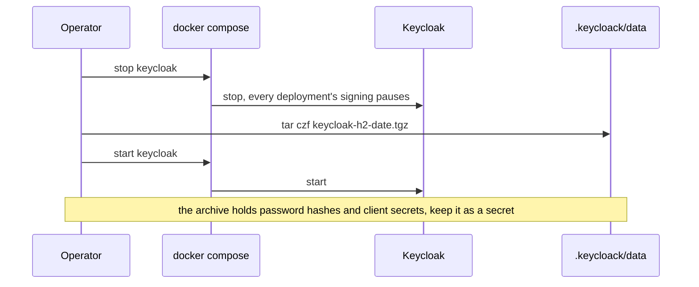

**Logical export (realm JSON, unverified here):**

```sh
docker compose stop keycloak
docker compose run --rm -v "$PWD/backup:/backup" keycloak export --dir /backup --realm catalyst --users realm_file
docker compose start keycloak
```

(`docker compose run` replaces the service's `start-dev` command with `export`; `/backup` must be writable by uid
1000.) Restore into an empty Keycloak: `… keycloak import --dir /backup --override true`. The export contains client
secrets and credential hashes: store it as a secret, and never put it in `keycloak/realm-catalyst.json` (setup refuses
a definition with persons/secrets).

After restoring an **older** backup, `sub` values are those of the backup; anyone created after it gets a new `sub`
when re-created and will be enrolled as a **new signer** with a new userid. Back up after every people change.

---

## 10. How-tos

### Add a user

```sh
catalyst-users login                                   # as a catalyst-admin
catalyst-users users add bob --email bob@example.com --first-name Bob --last-name Builder --temporary-password
catalyst-users users roles bob                         # verify (empty until grouped)
```

Via MCP: `register_user(username="bob", email=…, first_name=…, last_name=…)` (no password: set one in the admin
console, or use the CLI's `--temporary-password`). Email + both names are required in practice (Keycloak 26 refuses
sign-in to incomplete profiles). Passwords ≥ 12 chars, not the username.

### Grant a role (realm-wide)

```sh
catalyst-users groups add-member /cantica-tech/catalyst/developers bob   # preferred: by group
catalyst-users roles grant bob qa                                         # or direct
catalyst-users roles holders developer                                    # verify both ways
```

MCP: `assign_role(username="bob", role="developer")`. Effect in catalyst: next signature's token carries
`cmd:create`, `cmd:status`, … in **every** criterion of the realm. Tokens refresh within 5 min; or re-login.

### Grant rights on one criterion only

Only two criterion-scoped positions exist:

- **Admin of the criterion**: `catalyst-users criteria appoint <name> bob` → every command at `reconcile:full` in
  `<name>` only, and membership management there. Also what catalyst-mcp's criterion actions check.
- **Member** (served criteria only): `catalyst members add bob --reason "…"` from the project (through `catalyst
  serve`); never with `groups add-member /criteria/<name>/members` (fail-closed: the ledger would not name him).

`assign_role` with `criterion_id` is refused by catalyst-mcp by design.

### Remove a user's access

`catalyst-users users disable bob` (MCP: `delete_user` / `update_user(enabled=false)`). Never delete in the admin
console: past signatures reference `iss`+`sub`. Disabled users' existing access tokens remain valid until expiry
(≤ 5 min); services re-introspect within 30 s.

### Change a person's details

`catalyst-users users update bob --email new@example.com` (MCP `update_user`). Username never changes. Email becomes
unverified.

### Add a new deployment's criterion group

`catalyst-users criteria add <project_name> --admin <u>` (catalyst-admin). Re-run after creating subgroups under
`/criteria/<name>`.

### Rotate secrets

| Secret | Where it lives | Rotate |
| --- | --- | --- |
| System account / admin password | Keycloak + your password store (keychain item, file, …) referenced by `password_command` | change in Keycloak (admin console → Users → Credentials → Reset password, non-temporary; or `kcadm.sh set-password`), then update the store (`security add-generic-password -U -s catalyst-users -a <acct> -w` on macOS). Verify `catalyst-users whoami --system` |
| `catalyst-api` client secret | Keycloak; consumers: `CATALYST_IDENTITY_API_SECRET` (`catalyst serve`), `CATALYST_MCP_KEYCLOAK_API_CLIENT_SECRET`, `CATALYST_USERS_API_CLIENT_SECRET` (FastAPI apps) | admin console → Clients → `catalyst-api` → Credentials → Regenerate; restart each consumer with the new value. Old tokens remain verifiable only with the new secret (introspection authenticates the client, not the token) |
| Keycloak bootstrap admin | master realm DB; `compose.yaml` env only seeds it on first start | change in the admin console (master realm → Users). Editing compose.yaml later does **not** change an existing admin. Update `KC_BOOTSTRAP_ADMIN_PASSWORD` in your env for `set_admin.py`/`sync_clients.py`, which default to compose's dev value |
| Personal tokens | `credentials.json`, `~/.catalyst/identity/` | `catalyst-users logout`, `catalyst identity logout` (revokes the session) |
| Typed setup password moved | keychain | `setup --force` with a new `--password-command` |

### Use a non-default home (sandbox)

`export CATALYST_HOME=/path/sandbox` — moves catalyst's home and catalyst-users' (`$CATALYST_HOME/users`) together.
`CATALYST_USERS_HOME` moves only catalyst-users'.

### Add a client declared later in the realm file

`uv run python keycloak/sync_clients.py` (bootstrap admin env if changed).

### Reset the dev realm completely

`docker compose down && rm -rf .keycloack && docker compose up -d` — **destroys all users**; every deployment's
signers then re-enrol under new `sub`s (new userids) unless restored from backup. Never do this on the machine whose
deployments sign through it.

---

## 11. Failure modes; when Keycloak is down

### Keycloak unreachable

| Component | What happens | Why |
| --- | --- | --- |
| `catalyst` writing verbs (`new`, `journal adopt`, `identity configure`, `init`, …) | fail: `no verified identity (identity provider unreachable: …): \`catalyst identity login\`, then try again` | `verify()` calls userinfo (logged-in) or the password grant (system account) on every signature; no offline signing, snapshot is not used for signing |
| `catalyst` read-only commands (`where`, `list`, `check`, `identity status`) | work (`check` validates files, not the provider) | no signature |
| Stop hook / commit-msg hook | trace checks work; anything that must journal fails | |
| `catalyst-users` everything except `providers` | exit 1 `identity provider unreachable` | |
| `catalyst-users setup` | writes settings **unchecked**, exit 0 | by design (`unreachable` outcome) |
| `catalyst serve --identity-issuer` | provider tokens rejected (introspection fails) | |
| catalyst-mcp stdio | every gated write refused ("no verified actor"); `list_templates`, `list_watches` still work; watches keep running but every adopt is refused and retried at the next trigger | gate resolves actor via catalyst-users |
| catalyst-mcp HTTP | 401 on every request | token verifier can't introspect |
| FastAPI apps | 503 | |

Recovery: `docker compose ps` / `docker compose logs keycloak | tail -50`; `docker compose up -d`; wait for the
discovery URL. If the H2 is corrupt, restore (§9). There is no supported bypass: `CATALYST_ALLOW_STATIC_IDENTITY`
plus a `static` pointer is for tests only, is reported by `catalyst check`, and would itself be a journaled change.
Do not edit `IAM/identity.json` by hand (L6/L1).

Triage when a catalyst command cannot sign:

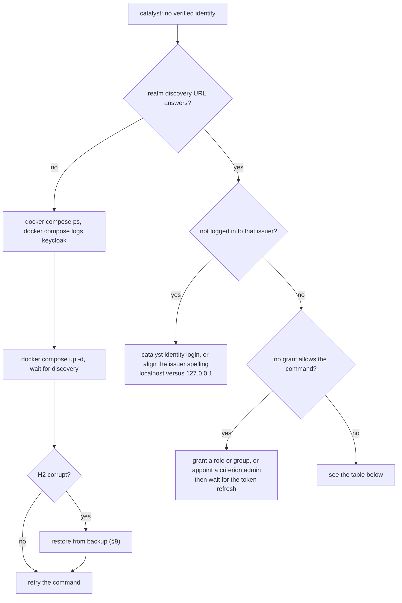

### Other common failures

| Symptom | Cause | Fix |
| --- | --- | --- |
| `no verified identity: not logged in to <issuer>` | no kernel login, and no system account for **that issuer** | `catalyst identity login`, or fix issuer spelling (`localhost` vs `127.0.0.1`) so it matches settings.json |
| catalyst signs as the system account though you "logged in" | you ran `catalyst-users login`, not `catalyst identity login` | separate token stores (§4.3) |
| `--as X: you are logged in as Y` | `--as` names someone else | log in as X |
| `<who> may not … : no grant allows it` | missing `cmd:` grant | grant a role/group; or appoint criterion admin; tokens refresh ≤ 5 min |
| `not allowed: your account lacks the realm-management rights` | directory command without realm-admin / outside your criterion | log in as catalyst-admin |
| `refused: watch.start on criterion X: … needs an admin of criterion X` (MCP) | actor not in `/criteria/X/admins` (even a catalyst-admin) | `criteria appoint X <u>` |
| `refused: … no verified actor: no one is logged in and the system account could not be verified` (MCP) | no `catalyst-users login`, system password command failing | log in; test `catalyst-users whoami --system` |
| `catalyst init failed (exit 3)` from MCP | catalyst asked for assent; MCP never answers `--yes` | run that step by hand |
| `invalid_grant: Account is not fully set up` | missing email/first/last name, temporary password with password grant, required action pending | complete the profile; use device login once |
| `unauthorized_client` / `invalid_client` on system sign-in | realm lacks `catalyst-admin-cli` with direct grants | `sync_clients.py` |
| grants empty in `whoami --system` | `roles provision` without `--login-client catalyst-admin-cli` | re-run provision with both login clients |
| HTTP MCP server won't start | `CATALYST_MCP_KEYCLOAK_API_CLIENT_SECRET` missing | set it |
| `catalyst_root … is no catalyst checkout or release` | `dist/catalyst.pyz` not built | build the CLI (kernel chapter) |

---

## 12. Gotchas and oddities

1. **Directory name typo is real**: Keycloak's data lives in `.keycloack/` (sic), gitignored. Don't "fix" it — compose,
   CI and docs all use it.
2. **Global flags before the command** (`catalyst-users --json whoami`); README's `whoami [--json]` form fails.
3. **Two token stores**: `catalyst-users login` (CLI + catalyst-mcp) vs `catalyst identity login` (kernel signing).
   catalyst-mcp watches adopt with `catalyst journal adopt --as <catalyst-users session username>`; the kernel then
   verifies **its** login or the system account. If the person logged into catalyst-users is neither the kernel's
   logged-in identity nor the system account, the adopt is refused (inferred from code; see §14).
4. **Issuer string must match exactly** between `IAM/identity.json` and `IAM/settings.json` for the system-account
   fallback (`localhost` ≠ `127.0.0.1`; trailing slash stripped only). The quickstart uses `127.0.0.1:8081`; compose
   setups use `localhost:8080`.
5. **Kernel vendors catalyst-users 0.7.0**, catalyst-mcp pins **0.8.0**, the CLI is **0.10.0**. Hence no
   `catalyst identity login --password` in the kernel.
6. **Explicit Keycloak flags/env disable settings.json**: setting `CATALYST_USERS_SERVER` (or catalyst-mcp's
   `CATALYST_MCP_KEYCLOAK_URL`/`REALM`/`CLIENT_ID`) makes catalyst-users skip `IAM/settings.json` and therefore lose
   the system account (no username/password_command) — catalyst-mcp's README calls these "overrides", but they
   switch the source (inferred from `config.pointer`).
7. **`setup` exits 0 when Keycloak is down** and writes unchecked settings; check its `outcome` (`--json`).
8. **compose `--import-realm` never updates an existing realm**: realm-file edits need `sync_clients.py` (clients and
   mappers only) or manual changes; roles/groups are not synced.
9. **Health endpoint not reachable from the host**: `KC_HEALTH_ENABLED` serves on management port 9000, not published;
   use the realm discovery URL as readiness probe (CI does).
10. **Port 8765** is the default of both `catalyst serve` and catalyst-mcp HTTP.
11. **`token --system` help says "client credentials"** — stale since 0.4.0 (it is a password grant on
    `catalyst-admin-cli`). `groups add-member` help reads "add member to/from a group" (cosmetic).
12. **`set_admin.py` defaults `--service` to a developer-specific keychain item** and removes every other member of
    `/catalyst-admins`. macOS-only.
13. **System account = a human admin's account**. Anything that signs with nobody logged in signs as that admin; on a
    shared machine everyone's unattended work is attributed to them.
14. **Grants are realm-wide**; criterion scoping exists only for admins (and members on served criteria).
15. **catalyst-mcp checks criterion admins by username**, fetched with the server's own session; Keycloak usernames
    are immutable via catalyst-users, but a rename in the admin console would break it.
16. **catalyst-mcp's `catalyst-admin` cannot watch** criteria they don't administer (`RoleMapping` doesn't let the realm
    role cover criterion actions).
17. **compose.yaml carries a dev bootstrap credential** in plain text (marked DEV ONLY, loopback-bound). Replace for any
    shared host; Keycloak `start-dev` is not production mode (no TLS, H2).
18. catalyst-mcp `create_criterion` makes new repos on branch `main` under `~/catalyst-mcp/projects` by default, not
    under your sources tree.
19. The `catalyst-tests` client (password grant) is in the dev realm file: remove it for any non-dev realm.
20. Restoring an older Keycloak backup or resetting the realm changes `sub`s → people re-enrol as new signers with new
    userids; the ledger never rewrites (L7), so the old line stays orphaned.
21. **Two pointer shapes, two kernel logins.** The kernel's token file name is a hash of the pointer's `issuer` key
    and client (`provider.credentials_path`). A `url`+`realm` pointer has no `issuer` key, so it hashes differently
    from an `issuer` pointer to the very same realm: `catalyst identity login` in one deployment does not log you in
    for a deployment of the other shape, and `catalyst identity status` prints an empty issuer for the `url` shape. Signing still works in
    both (the system account fallback compares the computed issuer). To unify, `catalyst identity configure --issuer
    http://localhost:8080/realms/catalyst` in the `url`-shaped deployments (a journaled change), or pass
    `--identity-issuer` to `catalyst init`. (Inferred from code.)

---

## 13. Next steps seen in the sources

- **catalyst-mcp HTTP writes**: "To revisit once catalyst can sign for a verified caller"
  (`cantica-tech/catalyst-mcp:docs/design.md`).
- **catalyst-mcp knowledge-base server** "(to be detailed)": signed changes to a central KB, tenancy as spaces =
  groups `/spaces/<name>` in one realm; a new service reading served journals (`docs/design.md`).
- **Criterion schema** v1 "to be extended in later versions"; rules kept as JSON, not mapped to catalyst rules.
- **Onboarding in the UI** (`cantica-tech/catalyst-users:docs/onboarding.md` "What the UI needs", status 2026-10-24):
  onboarding JSON editor, running `setup`/`roles provision`, masked password field → keychain, `catalyst init` from
  the UI, step-by-step outcomes. Open: where the onboarding JSON is kept (proposed: nowhere), non-Keycloak provider
  forms.
- **Stage two**: catalyst-users integrated into catalyst (done via vendoring; kernel lags at 0.7.0 — re-vendor
  0.8.0–0.10.0 pending).
- **User groups on the server** wait for user groups themselves (catalyst design 30; `docs/membership.md`).
- **Changing provider** procedure exists on paper (adapter + recreate `/criteria/<name>/members` from the ledger +
  `catalyst serve members check`); no second provider implemented.
- catalyst design 29 §5 items are decided (E, F, G, H); design 32 phases built in kernel 0.115.0.

---

## 14. Unverified in this chapter

- Nothing was executed against Keycloak (read-only constraint): no `setup`, `login`, `provision`, `users add`,
  export/import, or MCP tool call was run. `--help` outputs, `docker ps`, the discovery URL (HTTP 200 on a running
  local instance) and `catalyst identity status` were observed.
- The `kcadm.sh` sequence (step 2, Linux), `kc.sh export/import` via `docker compose run`, Podman compatibility, and
  `uv tool install git+https://…catalyst-users@0.10.0` are standard tool usage, not documented or tested in the repos.
- Gotcha 3 (adopt refused when the catalyst-users session differs from the kernel signer) and gotcha 6 (explicit
  Keycloak overrides drop settings.json and the system account in catalyst-mcp) are inferred from code paths, not
  reproduced.
- Keycloak behaviour statements (incomplete-profile refusal, temporary password with password grant, consent screen
  on device login, ≤ 5 min grant propagation) come from the repos' wording plus Keycloak defaults, not from a run.
- Whether a third-party provider registered by entry point could be loaded by the kernel's zipapp was not tested; the
  kernel CLI only offers `keycloak|static` to `identity configure`.
- `list_templates` output field names beyond `name/versions/latest/description` were not read in full in
  `templates/loader.py`.

---

## 15. Source index

| Topic | Source |
| --- | --- |
| catalyst-users overview, CLI table, config, security | `cantica-tech/catalyst-users:README.md` |
| Versions and changes | `cantica-tech/catalyst-users:CHANGELOG.md` (0.1.0–0.10.0) |
| CLI parser | `cantica-tech/catalyst-users:src/catalyst_users/cli.py` |
| Settings, home, pointer | `cantica-tech/catalyst-users:src/catalyst_users/config.py` |
| Facade, registry, Whoami | `cantica-tech/catalyst-users:src/catalyst_users/provider.py` |
| Keycloak provider, setup, system account | `cantica-tech/catalyst-users:src/catalyst_users/providers/keycloak.py` |
| Admin API, criteria, FGAP | `cantica-tech/catalyst-users:src/catalyst_users/admin.py` |
| Roles provisioning, import | `cantica-tech/catalyst-users:src/catalyst_users/provision.py` |
| Keychain | `cantica-tech/catalyst-users:src/catalyst_users/keychain.py` |
| Compose | `cantica-tech/catalyst-users:compose.yaml` |
| Dev realm, roles document | `cantica-tech/catalyst-users:keycloak/realm-catalyst.json`, `keycloak/catalyst-roles.json` |
| Dev scripts | `cantica-tech/catalyst-users:keycloak/set_admin.py`, `keycloak/sync_clients.py` |
| Greenfield onboarding | `cantica-tech/catalyst-users:docs/onboarding.md`, `tests/integration/onboarding/test_onboarding.py` |
| Membership | `cantica-tech/catalyst-users:docs/membership.md` |
| CI | `cantica-tech/catalyst-users:.github/workflows/ci.yml`, `cantica-tech/catalyst-mcp:.github/workflows/ci.yml` |
| Kernel signing | `cantica-tech/catalyst:scripts/catalyst/provider.py`, `scripts/catalyst/ids.py`, `scripts/catalyst/permissions.py` |
| Kernel identity CLI | `cantica-tech/catalyst:scripts/catalyst/__main__.py` (`cmd_identity`, `_identity_doc`, serve args) |
| Vendoring | `cantica-tech/catalyst:scripts/vendor_identity.py`, `scripts/catalyst/identity/VERSION` |
| Designs | `cantica-tech/catalyst:docs/design/28-identity-providers.md`, `29-users-outside-catalyst.md`, `32-project-membership.md` |
| Beta quickstart (identity first) | `cantica-tech/catalyst:beta/QUICKSTART.md` §0–§3 |
| catalyst-mcp overview, registration | `cantica-tech/catalyst-mcp:README.md`, `CHANGELOG.md` |
| catalyst-mcp design | `cantica-tech/catalyst-mcp:docs/design.md` |
| catalyst-mcp code | `cantica-tech/catalyst-mcp:src/catalyst_mcp/{server,settings,services,log}.py`, `auth/*`, `iam/*`, `criterion/*`, `watch/*`, `templates/*`, `tools/*` |
