# 60 — The knowledge-base stack: catalyst-kb-engine and catalyst-docs

This chapter covers the two repositories that turn documents and catalyst criteria into knowledge bases that
models can read: the **engine** (`cantica-tech/catalyst-kb-engine`) and catalyst's **central documentation** built
with it (`cantica-tech/catalyst-docs`). The knowledge-base **module** (KBM, `cantica-tech/catalyst-knowledge-base`)
defines the records (`KB-`, `KSOURCE-`, `KBUILD-`), the slash commands (`/kb-setup`, `/kb-build`, …) and the
`kbm-build/1` format. The module has its own chapter. This one cites the module only where the engine depends on it.

State described: 2026-10-31. Engine **0.16.0** (latest tag), KBM **0.6.1**, kernel **0.119.2** (engine
deployment), catalyst-docs deployment at kernel **0.114.0**,
catalyst-docs' CI pinned to engine **0.12.0**. Section 10 lists every version skew.

Sources are cited as `cantica-tech/<repo>:<path>`. Commands were taken from the parsers and scripts themselves. The
`--help` output was enumerated from engine 0.16.0, and Section 9.1 lists what was run in a sandbox.

---

## Contents

1. [The stack at a glance](#1-the-stack-at-a-glance)
2. [Architecture and data flow](#2-architecture-and-data-flow)
3. [catalyst-kb-engine: package, configuration, formats](#3-catalyst-kb-engine-package-configuration-formats)
4. [catalyst-kb-engine: full CLI reference](#4-catalyst-kb-engine-full-cli-reference)
5. [catalyst-docs: the documentation project and its pipeline](#5-catalyst-docs-the-documentation-project-and-its-pipeline)
7. [Deployment from scratch](#7-deployment-from-scratch)
8. [How-tos](#8-how-tos)
9. [Verification and common failures](#9-verification-and-common-failures)
10. [Oddities, version skew, open items](#10-oddities-version-skew-open-items)

---

## 1. The stack at a glance

| Repository | Visibility | What it is | Governed as |
| --- | --- | --- | --- |
| `cantica-tech/catalyst-kb-engine` | public | Python package `catalyst-kb-engine` (CLI of the same name): reads sources, writes `kbm-build/1` builds (folders and vector database), searches them (CLI, MCP over stdio, HTTP behind Keycloak), publishes public builds as site pages, and records builds as `KBUILD-`s | software-engineering module; its criterion is kept in a private `<project>-criterion` repository |
| `cantica-tech/catalyst-docs` | public | The knowledge base "catalyst": the guide pages, the public sources list, the MkDocs config and the Pages workflow. Live at `https://cantica-tech.github.io/catalyst-docs/`, with a vector database tarball beside the pages | knowledge-base module **alone**; its criterion is kept in a private `<project>-criterion` repository |

The design behind the engine and catalyst-docs is `cantica-tech/catalyst-kb-engine:docs/design/01-catalyst-docs.md`.
Its status is "done (2026-10-29), all six phases delivered". The handoff log is
`cantica-tech/catalyst-kb-engine:docs/catalyst-docs-progress.md`. The standing brief for whoever leads catalyst-docs
is `cantica-tech/catalyst-kb-engine:docs/catalyst-docs-lead.md`.

How the repositories and the module feed one another:

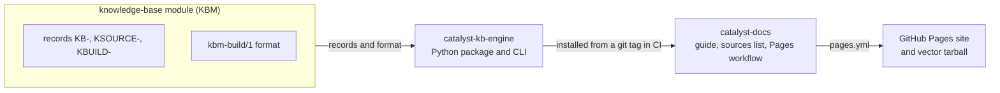

Neither the engine nor catalyst-users is on PyPI (both return 404). Install either one **from its git tag**, for
example `git+https://github.com/cantica-tech/catalyst-kb-engine@0.16.0`. The engine's tags are bare (`0.16.0`). Its
GitHub releases are titled `v0.16.0`.

---

## 2. Architecture and data flow

### 2.1 The whole pipeline

The pipeline, from the sources to the published site and the search services:

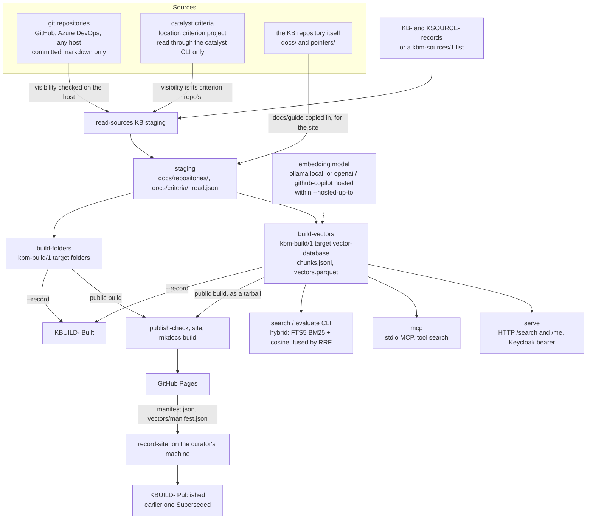

### 2.2 The rules the flow enforces

- **The engine keeps no state of its own.** A knowledge base's state is the criterion's records (`KB-`, `KSOURCE-`,
  `KBUILD-`, `WORKFLOW-`), and every write goes through the `catalyst` CLI, so it is journaled and signed. See
  `cantica-tech/catalyst-kb-engine:src/catalyst_kb_engine/catalyst.py`. Two inputs bypass the criterion: a
  `kbm-sources/1` list (`--sources`) and the build directories.
- **Visibility is a floor.** Every document read from a private source is at least `Internal`. A recorded visibility
  that disagrees with the host stops the **whole** read. A recorded `Public` the host cannot confirm also stops it. A
  source with no recorded or known visibility counts as `Private`. See `sources/visibility.py` `resolve()`.
- **Two builds, never one build filtered afterwards.** The *public* build reads public sources only
  (`--public-only`), with ceiling `Public`, and goes to the site. The *realm* build reads every source, private
  criteria included, and stays in private storage. It is searched by the realm only, through `search`, `mcp` and
  `serve`. See design 01 §5.1 and §6.
- **One embedding model per build.** The engine uses the hosted model only when *every* chunk is at or below
  `--hosted-up-to`. Otherwise it uses the local model. When neither is allowed, nothing is built
  (`build/vectors.py` `EmbeddingPolicy.choose`).
- **A build is written once.** The output directory must be new or empty (`refuse_written`). An unmarked document,
  meaning one whose front matter has no `classification`, refuses the whole build.
- **What `.catalystignore` opts out is never part of a knowledge base.** Builds skip it in the KB repository, and
  `read-sources` skips it in each repository source (`ignore.py`, catalyst `FORMAT.md` §11).
- **The site keeps no history.** It is deployed as a Pages artifact by Actions, never from a `gh-pages` branch, so a
  withdrawn page leaves no public copy.

How a source's visibility is decided before anything is read (`resolve()`):

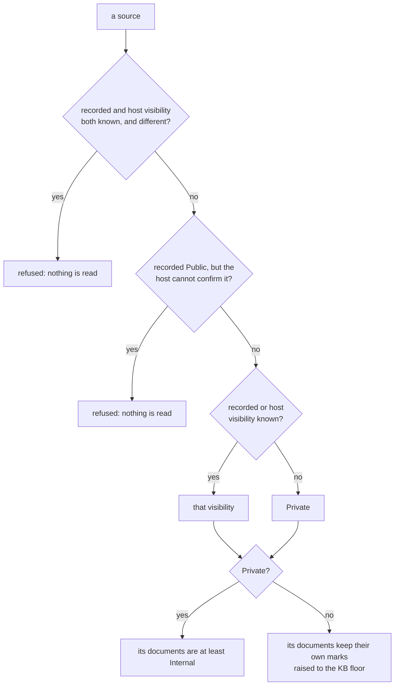

The two builds, side by side:

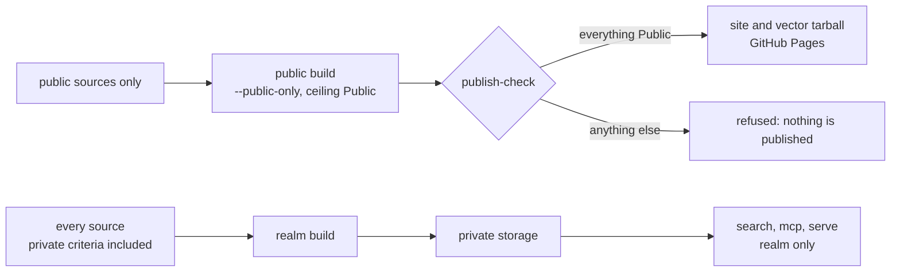

How `EmbeddingPolicy.choose` picks the one model of a build:

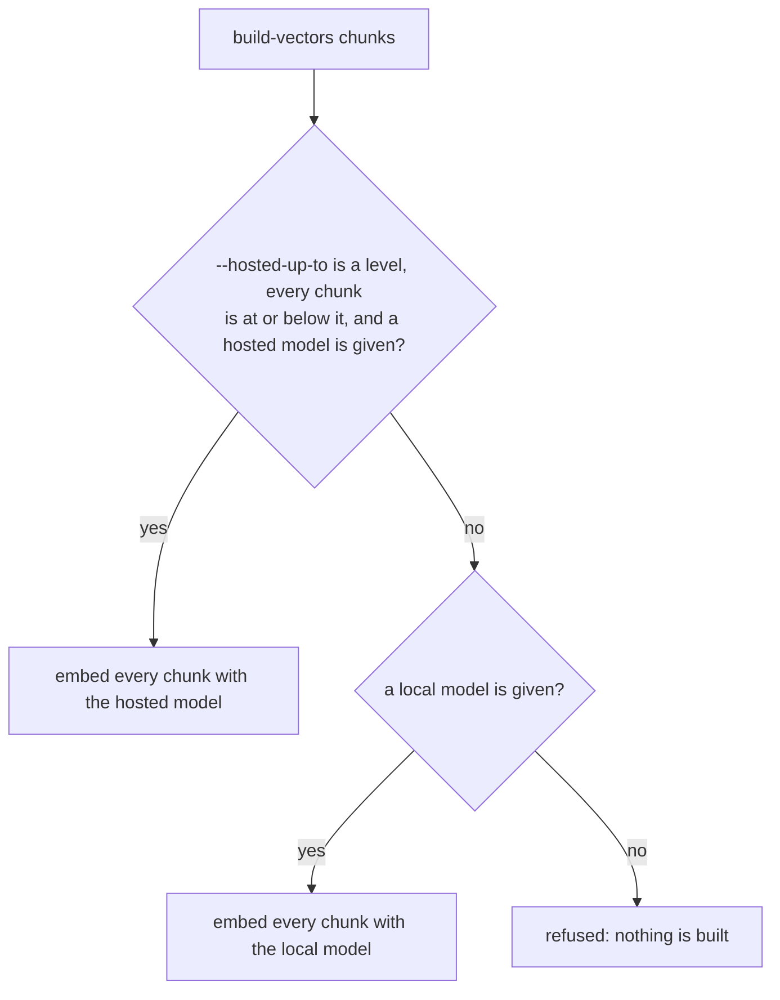

### 2.3 Who runs what, where

| Step | Runs on | Needs |
| --- | --- | --- |
| onboarding, `--record` on builds, `evaluate --record`, `record-site`, `export-sources`, `plan`, criterion reads | the curator's machine, in the KB's catalyst project (`--project-root`) | `catalyst` CLI (`CATALYST_CLI`), the criterion opened (`catalyst open`), a verified signer (catalyst-users and the identity provider running), `gh` signed in |
| public build + site | GitHub Actions in `cantica-tech/catalyst-docs` | `site/sources.json`, `GH_TOKEN` (the workflow token), Ollama installed in the runner |
| realm build | the curator's machine | checkouts of all sources and of the criteria's projects under one `--projects-dir`, Ollama with `nomic-embed-text` |
| `search` / `mcp` | any machine holding a vector build | the build's own embedding model reachable (except `--mode keyword`) |
| `serve` | a machine of the realm | catalyst-users' settings, the provider's API client secret, the embedding model |

---

## 3. catalyst-kb-engine: package, configuration, formats

### 3.1 Package map (`cantica-tech/catalyst-kb-engine:src/catalyst_kb_engine/`)

| Module | Lines | Role |
| --- | --- | --- |
| `cli.py` | 418 | argparse parser, one handler per subcommand. Exit codes: `0` done, `1` refused or failed (`BuildError`, `CatalystError`, `SourceError`, `ValidationError`, `ValueError`), `2` usage. Sets `PYDANTIC_AI_NO_BANNER=1`. Logging at WARNING, prefixed `catalyst-kb-engine:` |
| `catalyst.py` | 74 | `CatalystCLI`: runs `catalyst` in the project root (`new`, `view`, `list`, `where`, `status set`, `journal append`) with `--intent --command --tier [--as]`. `write_section()` rewrites one `## Heading` of an entity file in the criterion, then journals it |
| `models.py` | 139 | Pydantic models and enums: `Basis` (Criterion/Documents), `DocumentBase` (Static/Dynamic), `Target` (Folders/Vector database), `Classification` (Public < Internal < Confidential < Restricted), `SourceKind` (Repository/Folder/Site/Criterion), `Visibility`, `Source`, `Folder`, `Layout`, `OnboardingPlan`. `PRIVATE_FLOOR = Internal`. A `criterion:` location means a Criterion source |
| `onboarding.py` | 249 | The onboarding workflow as a `pydantic-graph` graph with four steps: basis and sources, location and storage, target, document base. Each is proposed by `DefaultProposer` (rules) or `AgentProposer` (a Pydantic AI agent, any model, 3 retries, **silent fallback to rules** on model failure) and decided by a `Decider` (the console) |
| `record.py` | 188 | `record_onboarding()` (`catalyst new KB` plus one `KSOURCE` per source, and a `Structure` section). `read_knowledge_base()` (skips `Retired` sources). `read_plan()`. `record_build()` (`catalyst new KBUILD`, `Contents`, status `Built`) |
| `build/folders.py` | 251 | The folders build, the `kbm-build/1` manifest writer, selection by ceiling, and refusal of unmarked documents |
| `build/chunks.py` | 87 | Chunking by heading, about 4 characters per token, windows cut at paragraph or word boundaries with overlap |
| `build/vectors.py` | 261 | The vector build: model choice, batched embedding (64 per call), unit-normalized vectors, Parquet writer, incremental reuse keyed by the SHA-256 of the exact embedding input, `OLLAMA_URL` default |
| `search.py` | 224 | `BuildIndex`: in-memory SQLite FTS5 (`porter unicode61`; BM25 weights title 5, heading 3, text 1), numpy cosine, reciprocal-rank fusion (k=60, 50 candidates per ranking), per-document cap (default 1) |
| `evaluate.py` | 73 | Recall@k and MRR per mode (keyword, vector, hybrid), misses reported by question ID only, and a `Verification` table for a `KBUILD-` |
| `mcp_server.py` | 32 | stdio MCP server `catalyst-kb-engine` with one tool, `search(question, k=8, mode="hybrid")`. `k` is clamped to 1..50 |
| `serve.py` | 57 | FastAPI app: `GET /me`, `GET /search?q=&k=&mode=`, auth via catalyst-users' `KeycloakAuth`. No OpenAPI or docs routes. Run by uvicorn, access log off |
| `publish.py` | 101 | The `kbm-sources/1` list (`export_sources`, `load_sources`) and `publish_check` |
| `published.py` | 148 | `record_site`: fetches `<site>/manifest.json` and `<site>/vectors/manifest.json` over **https only** and records them as `KBUILD-`s |
| `site.py` | 86 | A public folders build turned into MkDocs pages: `index.md`, `guide/…`, `reference/<repo>.md`, `reference/<repo>/<path>.md` |
| `sources/stage.py` | 282 | `read-sources`: stages criterion and repository documents, `--history`, incremental `--previous`, `read.json` |
| `sources/criterion.py` | 146 | Reads a criterion through `catalyst list all --json` and `catalyst view <ID> --json` (parallel `--workers`), one document per entity or rule, with its own journal history. Leaves out `rules/Rules-of-Rules.md` (composed) |
| `sources/visibility.py` | 263 | Parses repository URLs (https, http, ssh, git, `user@host:path`, Azure DevOps forms). Visibility comes from `gh repo view --json visibility`, Azure DevOps REST (`api-version=7.1`, optional `AZURE_DEVOPS_EXT_PAT`), or an anonymous `git ls-remote` with all credential sources stripped. Also holds `Projects.find` (checkout lookup) |
| `ignore.py` | 30 | `.catalystignore` semantics |

Tests are in `tests/` (offline unit tests, plus `tests/integration/test_record_catalyst.py`). CI is
`cantica-tech/catalyst-kb-engine:.github/workflows/ci.yml`. It runs on pushes to `development` and on PRs, with a
Python 3.11 and 3.13 matrix and `uv==0.11.26`. The steps are `uv sync --locked`, `ruff check`, `ruff format --check`,
`uvx pyright`, `pytest -q`. The local `.python-version` is `3.11`.

### 3.2 Dependencies and extras (`pyproject.toml`, version 0.16.0, `requires-python >=3.11`, build backend `uv_build`)

| Install | Pulls | Needed for |
| --- | --- | --- |
| base | `pydantic>=2.11`, `pydantic-ai-slim>=2.61`, `pydantic-graph>=2.61`, `pyyaml>=6` | onboarding, `read-sources`, `build-folders`, `publish-check`, `site`, `record-site`, `repository`, `plan`, `export-sources` |
| `[vectors]` | `pyarrow>=17` | `build-vectors` (writes Parquet) |
| `[openai]` | `pydantic-ai-slim[openai]` | `ollama:`, `openai:` **and `github-copilot:`** model strings. All three use the OpenAI client, so `build-vectors` with Ollama needs this extra too |
| `[search]` | `numpy>=1.26`, `pyarrow>=17` | `search`, `evaluate` |
| `[mcp]` | `mcp>=2.3`, numpy, pyarrow | `mcp`. It imports `mcp.server.mcpserver.MCPServer`, the mcp 2.x name for the former `FastMCP` |
| `[serve]` | `catalyst-users[fastapi] @ git+https://github.com/cantica-tech/catalyst-users@0.7.0`, numpy, pyarrow, `uvicorn>=0.30` | `serve` |

`sentence-transformers:` models appear in the help text as an example, but no extra installs `sentence-transformers`.
Install it yourself if you want to use one (not verified).

### 3.3 Configuration: models, providers, environment, secrets

The engine reads no config file. Everything is a flag or an environment variable.

| Variable | Read by | Meaning |
| --- | --- | --- |
| `CATALYST_CLI` | every command that writes or reads records | How to run catalyst, split shell-style. Example: `python3 ~/.catalyst/bin/catalyst`. Default `catalyst` on `PATH` |
| `OLLAMA_BASE_URL` | `build-vectors`, `search`, `mcp`, `serve`, `evaluate` (for an `ollama:` build) | Ollama's OpenAI-compatible endpoint. Since 0.14.1 the engine sets it to `http://localhost:11434/v1` when it is unset, for **embedding** only |
| `OLLAMA_API_KEY` | pydantic-ai's Ollama provider | Optional. Defaults to a dummy value |
| `OPENAI_API_KEY` | `openai:` embedding models | Required for a hosted OpenAI model |
| `GITHUB_COPILOT_API_KEY`, `GITHUB_COPILOT_API_TOKEN`, `COPILOT_GITHUB_TOKEN` | `github-copilot:` models (pydantic-ai 2.61 `providers/github_copilot.py`) | The GitHub token Copilot accepts |
| `GITHUB_COPILOT_BASE_URL` / `COPILOT_API_URL` / `GITHUB_COPILOT_API_BASE` | same | Copilot API base. Default `https://api.githubcopilot.com` |
| `AZURE_DEVOPS_EXT_PAT` | visibility checks (`repository`, `read-sources`, `export-sources`) | Azure DevOps PAT with read scope, needed for a private project's visibility. Anonymous otherwise |
| `GH_TOKEN` / `gh auth` | `gh repo view` in visibility checks | `gh` must be signed in, or given `GH_TOKEN` (as in CI) |
| `CATALYST_USERS_SERVER`, `CATALYST_USERS_REALM`, `CATALYST_USERS_CLIENT_ID`, `CATALYST_USERS_API_CLIENT_ID`, `CATALYST_USERS_API_CLIENT_SECRET`, `CATALYST_USERS_TIMEOUT`, `CATALYST_USERS_CATALYST_CLIENT`, `CATALYST_USERS_HOME`, `CATALYST_USERS_POINTER` | `serve` (through `catalyst_users.config.load`) | Defaults: server `http://localhost:8080`, realm `catalyst`, client `catalyst-cli`, API client `catalyst-api`, timeout 10 s. Precedence, lowest first: defaults, `config.toml` in catalyst-users' home (`$CATALYST_USERS_HOME`, else `$CATALYST_HOME/users`, else `~/.catalyst/users`), `CATALYST_USERS_*`, explicit overrides |
| `PYDANTIC_AI_NO_BANNER` | set to `1` by the CLI | — |

**Where secrets live (never their values):**

- The API client secret for `serve` comes from `CATALYST_USERS_API_CLIENT_SECRET` or from catalyst-users' home
  `config.toml` and credentials. The identity-provider chapter covers how catalyst-users stores them.
- Hosted-model keys (`OPENAI_API_KEY`, Copilot tokens) come only from the environment.
- Azure DevOps PAT: `AZURE_DEVOPS_EXT_PAT`, environment only.
- The engine never logs or returns a token or secret (`serve.py` docstring). `read-sources` summaries contain counts
  only, never content.

**Default models and settings in practice:**

| Use | Model string | Dimensions | Prefixes |
| --- | --- | --- | --- |
| catalyst-docs public and realm builds (owner decision, design 01 §10.3) | `ollama:nomic-embed-text` | 768 | `--document-prefix "search_document: " --query-prefix "search_query: "`, `--embed-input context` |
| Hosted example | `openai:text-embedding-3-small` | 1,536 | none |
| Onboarding proposals (optional) | for example `ollama:llama3.2:3b` or `anthropic:…` via `--model` | — | — |

### 3.4 The staging layout (`read-sources` output)

```text
<staging>/
├── read.json                         {"knowledge_base", "read_at", "sources": {KSOURCE-…: {kind, location,
│                                       visibility, classification, floor, read_at}}}  ← input to --previous
└── docs/
    ├── repositories/<repo-name>/<path>.md   each committed *.md (git ls-files), front matter:
    │                                         title, classification, source, repository (owner/name), path
    │   ├── …/readme.md                       README.md renamed (a build skips README.md as a folder description)
    │   └── git-history.md                    with --history N: the last N commits (date, short hash, author name,
    │                                         subject, files), never an e-mail
    └── criteria/<project>/<type>/<ID>.md     one per entity/rule: title "<ID> <title>", classification, source,
                                              entity, type, status, criterion, updated; body = fields, sections,
                                              links and its own journal history
```

The staging directory **is** a KB repository in the shape the builds read (`docs/`, optional `pointers/`), so
`build-folders <staging> …` builds the sources. It holds private data whenever a private source was read. Keep it out
of every public repository.

**Incremental reads (`--previous <earlier staging>`).** A criterion source whose recorded kind, location,
visibility, classification and floor are all unchanged is re-viewed only for entities the journal names or touched
since the previous `read_at`, plus new ones and what they cite. Every other document is carried over. Repositories
are always re-read. The previous `read.json` must belong to the same `KB-` or the read is refused.

What an incremental read re-reads:

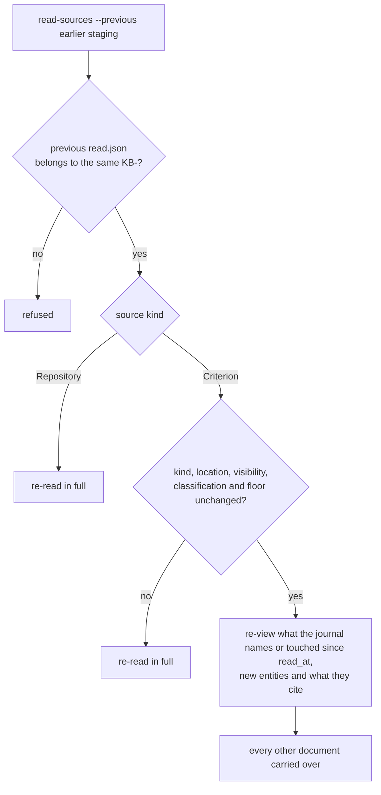

### 3.5 The `kbm-build/1` format (what every build is)

Defined by the module (`cantica-tech/catalyst-knowledge-base:GUIDE.md`, "A build") and written by
`build/folders.py` and `build/vectors.py`. A build needs no tool, account, network or model to read: it is UTF-8
markdown, JSON, JSON Lines and Apache Parquet.

```text
<version>/                      folders target                  vector-database target
├── manifest.json               ✓                               ✓ (+ embedding, chunking, incremental)
├── README.md                   ✓ how to read it                ✓ how to load it
├── index.md                    ✓ every document: [title](docs/…) (classification) — one-line summary
├── docs/<topic>/<doc>.md       ✓ front matter + "hash: sha256:…" (of the body); effective classification
├── chunks.jsonl                —                               ✓ {id, path, title, heading, text, classification, source, url}
└── vectors.parquet             —                               ✓ id (string), vector (fixed-size list<float32>), chunks.jsonl order
```

`manifest.json` keys, in the order written: `format` (`"kbm-build/1"`), `target` (`"folders"` or
`"vector-database"`), `knowledge_base`, `build` (the `KBUILD-` ID or `null`), `version`, `classification` (the
highest effective level in the build), `ceiling`, `content_commit`, then for vectors `embedding`, `chunking` and
optionally `incremental`, then `counts` (documents, pointers, `chunks` for vectors, `left_out`), `files`
(`{relative path: "sha256:<hex>"}` for every file except the manifest), and `built` (UTC ISO, `Z`).

`embedding` = `{model, dimensions, where ("local" or the hosted service's name), normalized: true, distance:
"cosine", input ("context"|"text"), document_prefix, query_prefix}`. `chunking` = `{max_tokens, overlap, by:
"heading"}`. `incremental` = `{previous: <version>, reused, embedded}`, or `not_reused` with a reason when the
previous build used another model, input or prefix.

Rules a consumer can rely on:

- A chunk id is `<path>#<n>`. Chunks follow headings: the heading trail is joined with `" > "`, then text longer than
  `max_tokens*4` characters is windowed with `overlap*4` characters of overlap.
- With `input: context`, the embedded text is `document_prefix + title + "\n" + heading + "\n\n" + text` (the
  heading only when present). With `input: text`, it is `document_prefix + text`.
- Vectors are unit length, so cosine equals dot product. Query with the same model and prefix the question with
  `query_prefix`.
- A pointer (from `pointers/`, `status` not `broken`) becomes a document carrying its `url`. A broken pointer is
  counted in `left_out`.
- A document whose effective classification is above the ceiling is left out and counted. Effective classification
  is the higher of the document's own mark and the KB floor.

### 3.6 The `kbm-sources/1` list (public sources, for runners that cannot reach the criterion)

```json
{
  "format": "kbm-sources/1",
  "knowledge_base": "<KB-id>",
  "classification": "Public",
  "default_classification": "Internal",
  "sources": [
    {"id": "<KSOURCE-id>", "title": "catalyst (repository)",
     "location": "https://github.com/cantica-tech/catalyst", "kind": "Repository",
     "visibility": "Public", "classification": "Public"}
  ]
}
```

`export-sources` writes the list from the criterion, re-checking each source on its host and **never writing a
private one**. `read-sources --sources <list>` reads from it. With `--public-only` (the default for a public list in
`load_sources`) every entry must be `Public`. Without it, a list may name private sources or leave `visibility` out
for the host to decide. `publish-check` always loads the list as public. The `KB-` argument to `read-sources` must
equal the list's `knowledge_base`.

### 3.7 Search internals

- **Keyword:** the question's words (`[\w-]{2,}`, lowercased, de-duplicated) are quoted and joined with `OR`, so
  FTS5 never sees raw punctuation. Ranked by `bm25(chunks, 5, 3, 1)`, top 50.
- **Vector:** `query_prefix + question` is embedded with the build's own model (from the manifest), normalized, and
  ranked by dot product, top 50. A dimension mismatch is a `BuildError`.
- **Hybrid** (the default): reciprocal-rank fusion, `Σ 1/(60+rank)`.
- **Per-document cap** (default 1, `0` means no cap), applied before taking `k`.
- **Output:** each passage has `rank, score, text, path, title, heading, classification, source, entity, criterion`.
  `entity` and `criterion` come from the document's front matter, so a criterion document cites its entity ID.
- **Measured** on catalyst-docs' realm (52 questions, k=10): hybrid recall 0.865, MRR 0.569 since 0.15.0. Query
  expansion with `llama3.2:3b` gained nothing reliable (abandoned).

The hybrid search, step by step:

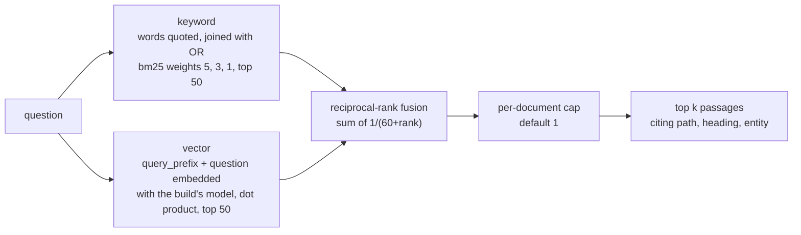

---

## 4. catalyst-kb-engine: full CLI reference

```text
catalyst-kb-engine {onboard,read-sources,export-sources,repository,publish-check,site,record-site,
                    build-folders,build-vectors,search,mcp,serve,evaluate,plan} …
```

Exit codes: `0` done, `1` refused or failed (the message is on stderr, prefixed `catalyst-kb-engine:`), `2` usage.
`--project-root` (default `.`, the catalyst project where `catalyst.toml` is) exists on `onboard`, `read-sources`,
`export-sources`, `build-folders`, `build-vectors`, `evaluate`, `plan` and `record-site`. Classification levels are
`Public`, `Internal`, `Confidential` and `Restricted`.

### 4.1 `onboard` — the four onboarding decisions, proposed and decided at the terminal

```text
catalyst-kb-engine onboard TITLE [--purpose P] [--project PROJECT] [--other-module M]… [--model MODEL]
    [--record --serves RULE,RULE --classification LEVEL] [--default-classification LEVEL]
    [--kind Project|Reflective] [--hosted-up-to "Local only"|LEVEL] [--freshness F] [--curator USER]
    [--project-root DIR]
```

| Flag | Default | Meaning |
| --- | --- | --- |
| `title` | (required) | the knowledge base's title |
| `--purpose` | `""` | what it must make known, and for whom |
| `--project` | none | the catalyst project it belongs to. Together with `--other-module`, the rules propose a criterion-based KB whose first source is `criterion:<project>` |
| `--other-module` | none, repeatable | a module governing the project beside KBM |
| `--model` | rules only | a Pydantic AI model to propose with (for example `ollama:llama3.2`). If the model fails, the rules propose instead, with a logged warning |
| `--record` | off | record the decided plan: `catalyst new KB` plus a `KSOURCE` per source, plus the `Structure` section. Needs `--serves` and `--classification` |
| `--serves` | — | with `--record`: the rule IDs it exists for, comma-separated |
| `--kind` | `Project` | `Project` or `Reflective` |
| `--classification` | — | with `--record`: its classification, which is its floor |
| `--default-classification` | `--classification` | the mark given to unmarked imports |
| `--hosted-up-to` | `Local only` | the KB's "Hosted embedding up to" |
| `--freshness` | `30 days` | — |
| `--curator` | none | — |

Interaction: each of the four steps prints the proposal as JSON. **Enter** accepts it. Pasting a JSON document of
the same shape replaces it, and an invalid one is asked again. The decided plan is printed, then the recorded IDs as
`{"kb": …, "sources": […]}`. Records are journaled for the command `/kb-setup`, tier `kb`.

### 4.2 `plan` — read a recorded KB back into its onboarding plan

`catalyst-kb-engine plan KB-… [--project-root DIR]` prints the `OnboardingPlan` JSON. It fails if `Basis`,
`Document base` or `Target` is unset.

### 4.3 `read-sources` — stage a KB's sources (private data)

```text
catalyst-kb-engine read-sources KB OUT [--projects-dir DIR] [--project NAME=DIR]… [--public-only]
    [--workers 8] [--previous STAGING] [--sources LIST.json] [--history N] [--project-root DIR]
```

| Flag | Default | Meaning |
| --- | --- | --- |
| `kb` | — | the `KB-` ID. With `--sources`, it must equal the list's `knowledge_base` |
| `out` | — | the staging directory, new or empty |
| `--projects-dir` | none | the directory holding each source's checkout as `<dir>/<name>`, where `<name>` is the repository name or the criterion's project name. A criterion's project dir must contain `catalyst.toml` |
| `--project` | none, repeatable | `<name>=<dir>`, a checkout somewhere else |
| `--public-only` | off | never open a non-public source (it is reported as skipped) |
| `--workers` | 8 | parallel `catalyst view` calls per criterion |
| `--previous` | none | an earlier staging dir: re-view only what the journal says moved |
| `--sources` | the KB's records | read the sources a `kbm-sources/1` list names instead of the `KB-`'s |
| `--history N` | 0 | also read each repository's last N commits, per document and as `git-history.md`. Needs full clones, and a shallow clone is refused |

Prints a summary with counts only: per source, visibility, documents, per-classification counts, `skipped`,
`unviewable`, `carried`. Unsupported kinds (`Folder`, `Site`) are skipped with a reason.

### 4.4 `export-sources` — the public sources list

`catalyst-kb-engine export-sources KB OUT.json [--projects-dir DIR] [--project NAME=DIR]… [--project-root DIR]`
writes `kbm-sources/1` with public sources only, each confirmed on its host, and prints `{"out",
"public_sources"}`. A criterion source is resolved through its project's `catalyst.toml` `catalyst_repo_url`, so its
checkout must be findable.

### 4.5 `repository` — what a URL is

`catalyst-kb-engine repository URL` prints JSON `{host: github|azure-devops|git, repository, name, clone_url,
web_url, visibility: Public|Private|null}`. URL forms accepted: `https://`, `http://`, `ssh://` (with user and port),
`git://`, `git+ssh://`, `user@host:path`. Azure DevOps forms: `dev.azure.com`, `<org>.visualstudio.com` and
`ssh.dev.azure.com:v3/…`. `AZURE_DEVOPS_EXT_PAT` is read for a private Azure DevOps project. Example output:
`git@github.com:cantica-tech/catalyst-docs.git` gives
`{"host":"github","repository":"cantica-tech/catalyst-docs","name":"catalyst-docs","clone_url":"https://github.com/cantica-tech/catalyst-docs.git",…,"visibility":"Public"}`.

### 4.6 `build-folders` — a folders build

```text
catalyst-kb-engine build-folders REPOSITORY OUT --kb KB --version V --floor LEVEL [--ceiling LEVEL]
    [--build KBUILD-…] [--content-commit SHA] [--record [--location WHERE]] [--project-root DIR]
```

| Flag | Default | Meaning |
| --- | --- | --- |
| `repository` | — | the KB repository (or a staging dir): `docs/`, `pointers/` |
| `out` | — | new or empty |
| `--kb` | required | `KB-` ID (free text when not recorded, for example `KB-my-repos`) |
| `--version` | required | — |
| `--floor` | required | the KB's classification |
| `--ceiling` | `--floor` | the highest level the build may contain |
| `--build` | none | the `KBUILD-` ID, once recorded (goes into the manifest) |
| `--content-commit` | none | the commit it is built from |
| `--record` | off | `catalyst new KBUILD` with fields `Knowledge base`, `Version`, `Target`, `Ceiling`, `Classification`, `Location`, `Content commit`; `Contents` section; status `Built` (journaled as `/kb-build`, tier `build`) |
| `--location` | the resolved `out` | with `--record`: where the build is kept |

Prints `{out, classification, documents, pointers, left_out[, build]}`.

### 4.7 `build-vectors` — a vector database build

```text
catalyst-kb-engine build-vectors REPOSITORY OUT --kb KB --version V --floor LEVEL [--ceiling LEVEL]
    [--hosted-up-to "Local only"|LEVEL] [--local-model M] [--hosted-model M]
    [--embed-input context|text] [--document-prefix P] [--query-prefix P] [--previous BUILD]
    [--max-tokens 512] [--overlap 64] [--build KBUILD-…] [--content-commit SHA]
    [--record [--location WHERE]] [--project-root DIR]
```

The flags shared with `build-folders` mean the same. The additional ones:

| Flag | Default | Meaning |
| --- | --- | --- |
| `--hosted-up-to` | `Local only` | the KB's "Hosted embedding up to". The hosted model is used only if every chunk is at or below it |
| `--local-model` | none | for example `ollama:nomic-embed-text`. Its `where` is recorded as `local` |
| `--hosted-model` | none | for example `openai:text-embedding-3-small` or `github-copilot:text-embedding-3-small`. Its `where` is the provider prefix |
| `--embed-input` | `context` | `context` (title and heading before the text) or `text` |
| `--document-prefix` | `""` | prepended to each chunk (`"search_document: "` for nomic) |
| `--query-prefix` | `""` | recorded in the manifest for searches (`"search_query: "` for nomic) |
| `--previous` | none | a previous vector build: reuse every vector whose exact input, model, input mode and prefix are unchanged |
| `--max-tokens` | 512 | chunk size in tokens (×4 characters) |
| `--overlap` | 64 | overlap in tokens |

Prints `{out, classification, documents, pointers, chunks, left_out, embedding[, incremental][, build]}`. A full
build of catalyst-docs' realm (931 documents, 6,925 chunks) takes about 46 minutes on the curator's machine (engine
`docs/catalyst-docs-progress.md`). An
incremental one takes seconds.

### 4.8 `search` — query a vector build

```text
catalyst-kb-engine search QUESTION --build DIR [-k 8] [--per-document 1] [--mode hybrid|keyword|vector] [--json]
```

Plain output shows each passage as `[rank] title (classification; entity, criterion X, source)`, then
`path > heading` and the text. `--json` prints the passage records. Searching a folders build fails with "is a
folders build; search needs a vector database". `--mode keyword` needs no embedding model.

### 4.9 `mcp` — the search as an MCP server (stdio)

`catalyst-kb-engine mcp --build DIR` runs MCP server `catalyst-kb-engine` with instructions
`Search <KB> <version>: passages citing their sources.` and a single tool:

```text
search(question: str, k: int = 8, mode: str = "hybrid") -> str   # rendered text, k clamped to 1..50
```

`per_document` is not exposed, so the tool uses the default of 1. The server is meant for the machine that keeps the
build and is never exposed beyond it.

### 4.10 `serve` — the search over HTTP, realm only

`catalyst-kb-engine serve --build DIR [--host 127.0.0.1] [--port 8765]`

- `GET /me` returns `{"signer": …}`, the caller's verified identity.
- `GET /search?q=<1..2000 chars>&k=<1..50, default 8>&mode=hybrid|keyword|vector` returns `{knowledge_base, build,
  passages:[…]}`.
- Auth: `Authorization: Bearer <token>`. The token must pass active introspection at the realm's issuer
  (`<server>/realms/<realm>`) with audience `catalyst-api`. Refused tokens get 401, and a provider out of reach gets
  503. There are no `/docs`, `/redoc` or `/openapi.json` routes.
- Settings come from catalyst-users (Section 3.3). It listens on localhost unless `--host` says otherwise.

A realm search over HTTP:

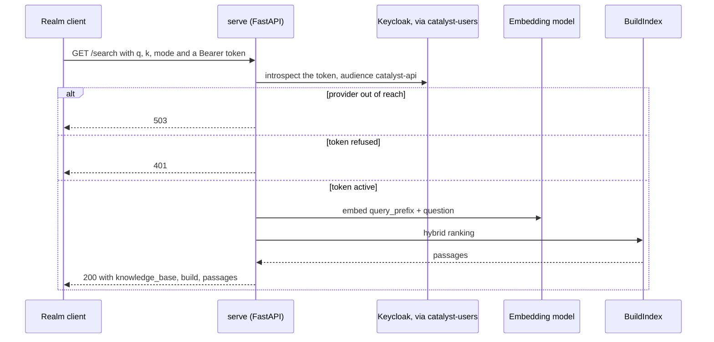

### 4.11 `evaluate` — score a vector build

```text
catalyst-kb-engine evaluate QUESTIONS.yaml --build DIR [-k 10] [--record KBUILD-…] [--project-root DIR]
```

```yaml
questions:
  - id: q01
    question: "Who may run /kb-build?"
    expect: ["rr-KB-005-…", "docs/repositories/catalyst-knowledge-base/code-of-conduct.module.md"]
```

`expect` holds entity IDs or document paths (with or without `docs/`). The output is `{k, questions, modes:
{keyword|vector|hybrid: {recall_at_k, mrr, misses:[ids]}}}`. `--record` writes a Markdown table into the
`KBUILD-`'s `Verification` section and journals it. An evaluation set drawn from private sources is private: keep it
in the KB's criterion. catalyst-docs keeps its set in its criterion.

### 4.12 `publish-check` — refuse anything not public

`catalyst-kb-engine publish-check BUILD --sources LIST.json` passes only if the manifest's `ceiling` and
`classification` are `Public`, every `docs/**/*.md` is `classification: Public`, every document's `source` is named
by the list, and no document under `docs/repositories/` or `docs/criteria/` lacks a `source`. One failure refuses
everything, with every problem listed. On success it prints `{build, documents, publishable: true}`.

### 4.13 `site` — a public folders build as MkDocs pages

`catalyst-kb-engine site BUILD OUT [--title Documentation] [--intro ""]` writes:

```text
OUT/index.md                          title + intro + numbered guide list + link to the reference
OUT/guide/…                           docs/guide/** copied as written
OUT/reference/index.md                every repository with its page count
OUT/reference/<repo>.md               its pages, by title
OUT/reference/<repo>/<path>.md        each document, prefixed "> From [`owner/repo`: `path`](<file URL>)."
```

Any document outside `docs/guide/` or `docs/repositories/` (with `repository` and `path` front matter) is refused.
A criterion document is never accepted here, which is by design.

### 4.14 `record-site` — record what a site serves

`catalyst-kb-engine record-site https://<owner>.github.io/<repo>/ [--project-root DIR]`, run from the KB's project:

1. `catalyst list KBUILD --json`.
2. GET `<site>/manifest.json` (required: it must be a folders build) and `<site>/vectors/manifest.json` (optional).
   HTTPS only.
3. Each manifest must be `kbm-build/1`, of the right target, with classification and ceiling `Public`.
4. The version recorded is `<manifest version>+<first 8 hex of the manifest's SHA-256>`. If a `KBUILD-` with that
   version and KB exists, it is listed as `known` and skipped.
5. Otherwise `catalyst new KBUILD` titled `<KB title> public site|vectors <version>`, with fields `Knowledge base`,
   `Version`, `Target`, `Ceiling` and `Classification` = Public, `Location` (the site URL, or
   `<site>/vectors/catalyst-vectors.tar.gz`), `Content commit`, and `Embedding model`. Then: `Contents` written,
   status `Built`, `Verification` written, status `Published`. Any earlier `Published` build of the same KB, target
   and location becomes `Superseded`. `Related` is written last.

The command prints `{recorded, known, superseded}`. The vectors location is hard-coded to
`vectors/catalyst-vectors.tar.gz` (`published.py` `SERVED`).

What `record-site` does, call by call:

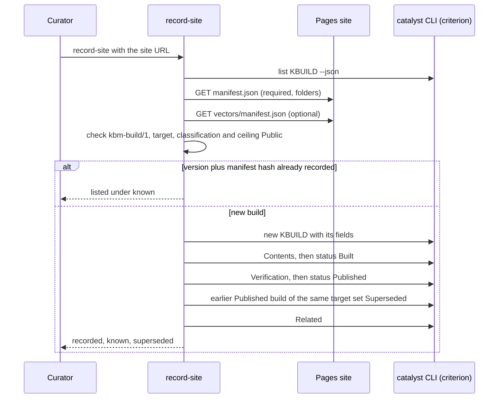

---

## 5. catalyst-docs: the documentation project and its pipeline

### 5.1 Repository layout (`cantica-tech/catalyst-docs`, branches `development` and `main`)

| Path | What |
| --- | --- |
| `catalyst.toml` | `project_name = "catalyst-docs"`, `module = "knowledge-base"`, `kernel_version = "0.114.0"`, `catalyst_repo_url` (its private `<project>-criterion` repository), `criterion_branch = "criterion"` |
| `KB.md` | the knowledge base card: classification Public, default Internal, hosted embedding Local only (`nomic-embed-text`), basis Documents, document base Dynamic, target Vector database (realm), Folders and Vector database (public), curator `<owner>`, the rule it serves, plus the source table |
| `GUIDE-OUTLINE.md` | the guide's approved outline (owner, 2026-10-26): audience, voice, twelve pages, what each rests on |
| `docs/guide/01…12-*.md` | the twelve guide pages (what catalyst is, getting started, the ten laws, rules/domains/criterion, day-to-day, people/roles/signing, working together, keeping up to date, modules, knowledge bases, analysing existing code, the Studio and the editor), each approved by the owner |
| `docs/user-generated/` | opted out by `.catalystignore` ("not part of the project"). Holds a `project-map.md` |
| `pointers/README.md`, `builds/README.md`, `docs/README.md` | placeholders. Builds are not kept in the repo: the site serves their manifests |
| `site/sources.json` | the public sources list (`kbm-sources/1`) for the seven public sources: `catalyst`, `catalyst-software-engineering`, `catalyst-knowledge-base`, `catalyst-kb-engine`, `catalyst-users`, `catalyst-ui`, `standards` |
| `mkdocs.yml` | MkDocs Material: `docs_dir: _pages`, `site_dir: _site`, `site_url: https://cantica-tech.github.io/catalyst-docs/`, nav (Home, Guide 01–12, Reference), plugins `search`, link validation set to `info` |
| `.github/workflows/pages.yml` | the build and deploy pipeline (Section 5.3) |
| `.gitignore` | `_pages/`, `_site/`, `_build/` (generated, never committed) |

### 5.2 The knowledge base's sources and builds

- **Seven public repositories** (kind Repository, Public), read by both builds.
- **Five private criteria of the fleet** (kind Criterion, location `criterion:<project>`), read by the realm build
  only and never published (`KB.md`).
- **The public build**: built in Actions from `site/sources.json` and served by the site.
- **The realm build**: built on the curator's machine, kept at `$HOME/.catalyst/projects/catalyst-docs/realm/`
  (`sources/<version>` staging, `builds/<version>`), beside the criterion, never in it. Its 0.2.1 build held 931 documents
  and 6,925 chunks (engine `docs/catalyst-docs-progress.md`).

### 5.3 The Pages workflow, step by step (`cantica-tech/catalyst-docs:.github/workflows/pages.yml`)

Triggers: push to `main`, a daily cron `17 5 * * *` (UTC), and `workflow_dispatch`. Permissions: `contents: read`,
`pages: write`, `id-token: write`. Concurrency group `pages`, not cancelled in progress.
`ENGINE="catalyst-kb-engine[vectors,openai] @ git+https://github.com/cantica-tech/catalyst-kb-engine@0.12.0"`.

**Job `build` (ubuntu-latest):**

| # | Step | Command (summary) | Produces |
| --- | --- | --- | --- |
| 1 | checkout | `actions/checkout@v4` | the repo at `$GITHUB_SHA` |
| 2 | Python | `actions/setup-python@v5`, 3.12 | — |
| 3 | Install | `pip install uv`, `uv tool install "$ENGINE"`, `uv tool install mkdocs --with mkdocs-material` | `catalyst-kb-engine`, `mkdocs` on PATH |
| 4 | Clone public sources | Python loop over `site/sources.json`: `git clone --depth 1 <location>.git _build/src/<name>` | shallow clones of GitHub's default branches, so unpushed work never reaches the site |
| 5 | Read and build folders | `GH_TOKEN=${{ github.token }}`. `read-sources "$KB" _build/staging --sources site/sources.json --projects-dir _build/src --public-only`. `cp -R docs/guide _build/staging/docs/guide`. `build-folders _build/staging _build/public --kb "$KB" --version "${GITHUB_SHA::12}" --floor Public --ceiling Public --content-commit "$GITHUB_SHA"` | `_build/public` (folders build) |
| 6 | Publication check | `publish-check _build/public --sources site/sources.json` | fails the job on any non-public content |
| 7 | Ollama | `curl -fsSL https://ollama.com/install.sh \| sh`. Start `ollama serve` if `/api/version` does not answer. `ollama pull nomic-embed-text` | the local embedding model in the runner |
| 8 | Vector DB | `OLLAMA_BASE_URL=http://localhost:11434/v1`. Download the live `vectors/catalyst-vectors.tar.gz` into `_build/previous`. If that works, add `--previous _build/previous/catalyst-vectors`. Then `build-vectors _build/staging _build/vectors/catalyst-vectors … --floor Public --ceiling Public --hosted-up-to "Local only" --local-model ollama:nomic-embed-text --document-prefix "search_document: " --query-prefix "search_query: " --content-commit "$GITHUB_SHA"`, then `publish-check` on it | `_build/vectors/catalyst-vectors` |
| 9 | Make the site | `site _build/public _pages --title "catalyst" --intro "…"`. Copy `manifest.json` to `_pages/`. `tar -czf _pages/vectors/catalyst-vectors.tar.gz -C _build/vectors catalyst-vectors`. Copy the vectors manifest. `mkdocs build` | `_site/` |
| 10 | Pages | `actions/configure-pages@v5`, `actions/upload-pages-artifact@v3` (path `_site`) | the Pages artifact |

**Job `deploy`:** `needs: build`, environment `github-pages`, `actions/deploy-pages@v4`.

The workflow as a sequence:

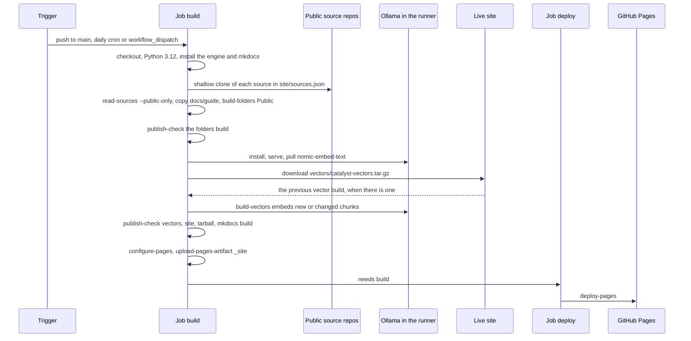

The live site (checked 2026-10-31) serves:

- `manifest.json`: folders target, version `a1785ae342dd`, 296 documents, Public/Public.
- `vectors/manifest.json`: 296 documents, 2,579 chunks, `ollama:nomic-embed-text`, 768 dimensions, incremental with
  2,528 reused and 51 embedded.
- `vectors/catalyst-vectors.tar.gz`: about 9.6 MB.

Recent runs take about 40 s to 2.5 min. One full re-embed took 22 min 40 s.

### 5.4 Recording what the site serves (`record-site`, `KBUILD-` records)

Actions cannot reach the private criterion. After each deployment that changed the content, the curator runs this
from a checkout of `cantica-tech/catalyst-docs`, with its criterion available:

```sh
catalyst-kb-engine record-site https://cantica-tech.github.io/catalyst-docs/
```

- **What it does:** Section 4.14. It records up to two `KBUILD-`s (site and vectors), each `Published`, and
  supersedes the previous ones.
- **What it creates:** `KBUILD-NNNNNN-<suffix>` files in the catalyst-docs criterion and journal entries for the
  command `/kb-build`, tier `build`.
- **Verify:** the JSON output lists `recorded` IDs. A second run returns them under `known`. `catalyst view
  <KBUILD-…>` shows `Status: Published`.

The statuses a `KBUILD-` passes through in this flow:

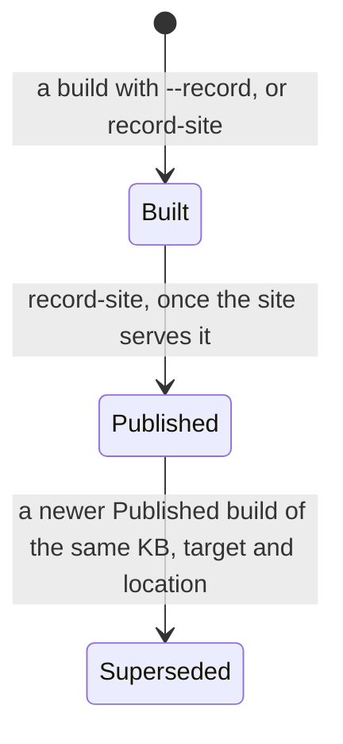

Because the build version is the catalyst-docs commit, a daily scheduled rebuild of an unchanged commit produces the
same `version` with possibly different contents. `record-site` tells them apart by the manifest SHA suffix
(`a1785ae342dd+1a2b3c4d`).

### 5.5 Who reads `KB.md`, `GUIDE-OUTLINE.md`, `builds/`, `pointers/`

- `KB.md` is the human card. The authoritative record is the `KB-` in the criterion.
- `GUIDE-OUTLINE.md` drives the guide pages. New guide pages are drafted with the realm search, reviewed by a person,
  and may cite public reference pages only (design 01 §5.3).
- `builds/` and `pointers/` are empty placeholders. The builds read `pointers/` if pointers are ever added there.

---

## 7. Deployment from scratch

Ordered steps. "Depends on" names other chapters' components.

### 7.0 Order and dependencies

| # | Step | Depends on | Optional? |
| --- | --- | --- | --- |
| 1 | Base tools: git, `gh` (signed in), Python 3.11+, `uv` | — | no |
| 2 | Ollama and `nomic-embed-text` | — | no for catalyst-docs. Not needed with a hosted model |
| 3 | catalyst CLI and runtime, `catalyst agent install` | kernel chapter | needed for anything that records (`--record`, onboarding, `record-site`, criterion sources) |
| 4 | catalyst-users with the identity provider (Keycloak) running, signer set up | catalyst-users chapter | needed for signed records and for `serve` |
| 5 | The knowledge-base module (KBM 0.6.1) available to `catalyst init` | KBM chapter | needed for a governed KB project |
| 6 | Install catalyst-kb-engine | 1 | no |
| 7 | First KB build (standalone list, or governed) | 2 or a hosted model, 6 (+3, 4, 5 if governed) | — |
| 8 | catalyst-docs: open its criterion, enable Pages, publish, `record-site` | 3–6, GitHub admin on the repo | — |
| 9 | Realm build and `evaluate` | 3–6, checkouts of all sources and criteria | optional |
| 10 | `serve` the realm search | 4, 9 | optional |
| 11 | Wire MCP search into an agent | 6, a vector build | optional |

The same order as a dependency graph (dotted: needed only for a governed KB):

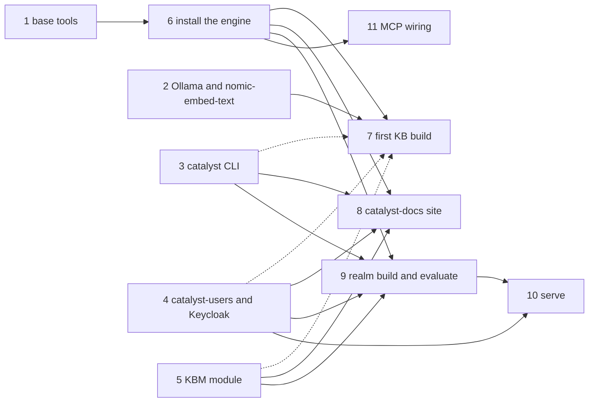

### 7.1 Base tools

```sh
git --version; gh --version; gh auth login; gh auth status
python3 --version                    # 3.11+ for the engine
curl -LsSf https://astral.sh/uv/install.sh | sh   # uv; CI pins 0.11.26
```

- **Achieves:** `gh` answers visibility queries (`gh repo view --json visibility`).
- **Verify:** `gh repo view cantica-tech/catalyst-docs --json visibility -q .visibility` prints `PUBLIC`.

### 7.2 Ollama and the embedding model

```sh
# Linux:  curl -fsSL https://ollama.com/install.sh | sh        macOS: the Ollama app or `brew install ollama`
ollama serve &                        # if not already running as a service
ollama pull nomic-embed-text
curl -fsS http://localhost:11434/api/tags | python3 -c 'import json,sys;print([m["name"] for m in json.load(sys.stdin)["models"]])'
```

- **Creates:** the model in Ollama's store (about 270 MB, not measured here).
- **Verify:** the list contains `nomic-embed-text:latest`. For a non-default address, export
  `OLLAMA_BASE_URL=http://<host>:11434/v1`. Note the `/v1`.

### 7.3 Install catalyst-kb-engine

As a tool, at a tag, with every extra:

```sh
uv tool install "catalyst-kb-engine[vectors,openai,search,mcp,serve] @ git+https://github.com/cantica-tech/catalyst-kb-engine@0.16.0"
catalyst-kb-engine --help
```

Or for development from a clone:

```sh
gh repo clone cantica-tech/catalyst-kb-engine && cd catalyst-kb-engine
uv sync                                  # dev group includes catalyst-users[fastapi], mcp, numpy, pyarrow, pytest, ruff
uv run ruff check && uv run ruff format --check && uv run pytest -q
uv run catalyst-kb-engine --help
```

- **Creates:** the tool in uv's tool dir with `catalyst-kb-engine` on `PATH`, or `.venv/` in the clone.
- **Verify:** `--help` lists the 14 subcommands. The README's bare `uv tool install "catalyst-kb-engine[…]"` fails,
  because the package is not on PyPI. Use the git URL.
- If a `VIRTUAL_ENV` from another project is active, `uv run` warns and ignores it. Unset it or use `.venv/bin/…`.

### 7.4 First KB build, path A: public repositories, no catalyst project

```sh
mkdir -p kbwork/repos && cd kbwork
git clone https://github.com/cantica-tech/catalyst-knowledge-base repos/catalyst-knowledge-base   # full clone for --history
cat > sources.json <<'EOF'
{"format":"kbm-sources/1","knowledge_base":"KB-demo","classification":"Public","default_classification":"Public",
 "sources":[{"id":"kbm","title":"catalyst-knowledge-base","location":"https://github.com/cantica-tech/catalyst-knowledge-base",
             "kind":"Repository","visibility":"Public","classification":"Public"}]}
EOF
catalyst-kb-engine read-sources KB-demo staging/1.0.0 --sources sources.json --projects-dir repos --public-only --history 20
catalyst-kb-engine build-folders staging/1.0.0 builds/folders/1.0.0 --kb KB-demo --version 1.0.0 --floor Public
catalyst-kb-engine build-vectors staging/1.0.0 builds/vectors/1.0.0 --kb KB-demo --version 1.0.0 --floor Public \
    --local-model ollama:nomic-embed-text --document-prefix "search_document: " --query-prefix "search_query: "
catalyst-kb-engine search "who may run /kb-build?" --build builds/vectors/1.0.0
```

- **Achieves:** stages committed markdown, then writes both `kbm-build/1` targets.
- **Creates:** `staging/1.0.0/{docs/repositories/catalyst-knowledge-base/…, read.json}`, `builds/folders/1.0.0`,
  `builds/vectors/1.0.0`.
- **Verify:**
  - Each command prints JSON with non-zero `documents` and `chunks`.
  - `jq .embedding builds/vectors/1.0.0/manifest.json` shows 768 dimensions.
  - `search` returns passages citing `docs/repositories/…`.
  - The manifest's `files` hashes match `shasum -a 256`.

### 7.5 First KB build, path B: a governed KB project (records `KB-`, `KSOURCE-`, `KBUILD-`)

Prerequisites: steps 3 to 5. A project initialised with the knowledge-base module (KBM chapter):
`catalyst init … --module knowledge-base --rule-doc knowledge-rules:kn …`. `catalyst where` and `catalyst open` must
work, and the identity provider must be up so records are signed.

```sh
cd <kb project root>
catalyst-kb-engine onboard "Support KB" --purpose "…" --project app --other-module software-engineering   # dry run
catalyst-kb-engine onboard "Support KB" --purpose "…" --project app --other-module software-engineering \
    --record --serves <rule IDs> --classification Internal --hosted-up-to "Local only" --curator <user>
catalyst-kb-engine plan KB-000001-…                          # read back
catalyst-kb-engine read-sources KB-000001-… ~/kb-private/staging/1.0.0 --projects-dir ~/src [--history 20]
catalyst-kb-engine build-vectors ~/kb-private/staging/1.0.0 ~/kb-private/builds/1.0.0 --kb KB-000001-… \
    --version 1.0.0 --floor Internal --ceiling Internal --local-model ollama:nomic-embed-text \
    --document-prefix "search_document: " --query-prefix "search_query: " --record
```

Alternatively, run the module's slash commands through the agent: `/kb-setup project <title>`,
`/create knowledge-source …` and `/kb-build <KB-id> [<ceiling>]`. See the KBM chapter.

- **Creates:** `KB-`, `KSOURCE-`s and `KBUILD-` (status `Built`) in the criterion, with journal entries
  (`/kb-setup`, tier `kb`; `/kb-build`, tier `build`). The build itself lives at `--location`, which defaults to the
  output dir. Keep it outside any repository, since it may be private.
- **Verify:** `catalyst view <KBUILD-…>` shows `Contents` and `Status: Built`, and `catalyst check` passes.

### 7.6 catalyst-docs: publish the site

On a fresh machine, as the curator:

```sh
gh repo clone cantica-tech/catalyst-docs && cd catalyst-docs
catalyst where && catalyst open           # the project's private criterion repository (access needed)
```

One-time repository settings. These are standard GitHub settings, not scripted in the repo:

```sh
gh api -X POST repos/cantica-tech/catalyst-docs/pages -f build_type=workflow   # Pages source = GitHub Actions
# or: Settings → Pages → Build and deployment → Source: GitHub Actions
```

Refresh the public sources list when a source changes (needs the criterion):

```sh
catalyst-kb-engine export-sources <KB-id> site/sources.json --projects-dir <dir with the checkouts>
```

Publish: merge `development` into `main` through a PR (the fleet's branch model), or run
`gh workflow run pages.yml -R cantica-tech/catalyst-docs`. The daily cron also rebuilds.

Publishing and recording, end to end:

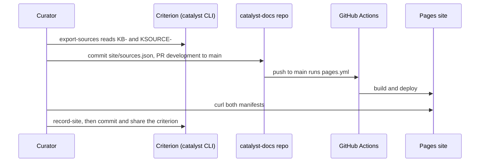

```sh
gh run list -R cantica-tech/catalyst-docs -L 3                 # watch
gh run watch -R cantica-tech/catalyst-docs <run id>
curl -fsS https://cantica-tech.github.io/catalyst-docs/manifest.json | jq '{version,counts}'
curl -fsS https://cantica-tech.github.io/catalyst-docs/vectors/manifest.json | jq '{version,embedding,incremental,counts}'
catalyst-kb-engine record-site https://cantica-tech.github.io/catalyst-docs/    # then commit and share the criterion as usual
```

- **Achieves:** a public site and a public vector DB, each recorded as `KBUILD-` `Published`.
- **Verify:**
  - The run is `success`.
  - Both manifests show `classification`/`ceiling` `Public` and `version` equal to the first 12 characters of the
    `main` commit.
  - `record-site` lists IDs under `recorded`, or under `known` on a re-run.

To stand up **another** documentation site the same way, copy `pages.yml`, `mkdocs.yml`, `site/sources.json`
(generated by `export-sources` for your `KB-`) and `docs/guide/`. Change `site_url`, the `curl` URL of the previous
tarball in step 8, `--title`/`--intro`, and the `nav`. The tarball name `catalyst-vectors.tar.gz` is hard-coded in
`record-site`, so keep it or record by hand.

### 7.7 Realm build (private, every source) and its evaluation

```sh
R=$HOME/.catalyst/projects/catalyst-docs/realm
# every public repo checked out, plus every criterion's project checkout (with catalyst.toml), under one dir
cd <catalyst-docs checkout>
catalyst-kb-engine read-sources <KB-id> $R/sources/0.3.0 --projects-dir ~/src --previous $R/sources/0.2.1
catalyst-kb-engine build-vectors $R/sources/0.3.0 $R/builds/0.3.0 --kb <KB-id> --version 0.3.0 \
    --floor Public --ceiling Restricted --local-model ollama:nomic-embed-text --embed-input context \
    --document-prefix "search_document: " --query-prefix "search_query: " --previous $R/builds/0.2.1 --record
catalyst-kb-engine evaluate <criterion>/knowledge-bases/evaluations/<KB-id>.yaml --build $R/builds/0.3.0 \
    --record KBUILD-…
```

- **Timing:** a full read is about 2.5 min, CPU-bound on `catalyst view`. An incremental read is about 18 s. A full
  embed is about 46 min, and an incremental one takes seconds.
- **Ceiling:** the ceiling shown, `Restricted`, means "the highest" (design 01 §5.1).
- **Verify:** the evaluate output shows hybrid `recall_at_k` around 0.86 at k 10, and `KBUILD-` `Verification`
  holds the table.

### 7.8 Serve the realm search (behind catalyst-users)

```sh
export CATALYST_USERS_SERVER=http://localhost:8080          # the same host string as the token's issuer
export CATALYST_USERS_API_CLIENT_SECRET=…                   # from the provider; never print it
catalyst-kb-engine serve --build $HOME/.catalyst/projects/catalyst-docs/realm/builds/0.2.1 &
curl -s -H "Authorization: Bearer $(catalyst-users token --system)" localhost:8765/me      # 200 {"signer":…}
curl -s -H "Authorization: Bearer $(catalyst-users token --system)" "localhost:8765/search?q=ten+laws&k=3"
curl -s -o /dev/null -w '%{http_code}\n' localhost:8765/search?q=x                          # 401
```

Gotchas (from `docs/catalyst-docs-progress.md`):

- Give `CATALYST_USERS_SERVER` to `serve` only. Set in the shell that runs `catalyst-users token --system`, it
  overrides `IAM/settings.json` and drops the system account's password command.
- Use the same host string (`localhost` or `127.0.0.1`) for the token and the service, because Keycloak builds the
  issuer from it.

### 7.9 Wire the MCP search into an agent

**Claude Code.** This uses the generic `claude mcp add` syntax and is not scripted in these repos:

```sh
claude mcp add --scope user catalyst-docs-search --env OLLAMA_BASE_URL=http://localhost:11434/v1 \
    -- catalyst-kb-engine mcp --build /abs/path/to/builds/vectors/1.0.0
```

**Any MCP client:** the command is `catalyst-kb-engine mcp --build <abs dir>` over stdio, and the tool is `search`.

A search call through MCP:

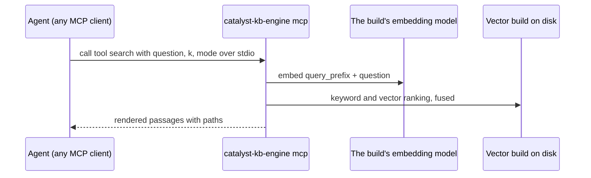

- **Verify:** the client lists the server (`/mcp` in Copilot CLI or Claude Code) and a `search` call returns ranked
  passages with paths.

---

## 8. How-tos

### 8.1 Build a KB from GitHub repositories (fastest)

Use path A (Section 7.4) with Ollama: you control the model and nothing leaves the machine. For private repos, use
path B (Section 7.5) with `--local-model` and records.

### 8.2 Add a source

- **Governed KB:** create a `KSOURCE-` with `Knowledge base`, `Location` (repo URL or `criterion:<project>`), `Kind`,
  `Visibility` (as the host shows it) and optionally `Classification`. Use the module's `/create knowledge-source`
  (KBM chapter), then re-run `export-sources` if the KB publishes.
- **catalyst-docs:** additionally regenerate `site/sources.json` with `export-sources` and commit it (PR to `main`).
  The next Pages run clones it.
- **Sources list only:** add an entry to `sources.json`. With `--public-only`, it must be confirmable as public.

### 8.3 Rebuild incrementally

```sh
catalyst-kb-engine read-sources KB-… staging/1.0.1 [--sources …] --projects-dir repos --previous staging/1.0.0
catalyst-kb-engine build-vectors staging/1.0.1 builds/vectors/1.0.1 --kb KB-… --version 1.0.1 --floor … \
    --local-model ollama:nomic-embed-text --document-prefix "search_document: " --query-prefix "search_query: " \
    --previous builds/vectors/1.0.0
```

The model, `--embed-input` and `--document-prefix` must match the previous build or nothing is reused (the manifest
records `not_reused`). Pull the clones first (`git -C repos/<r> pull --ff-only`).

### 8.4 Query the vectors

From the CLI: `catalyst-kb-engine search "…" --build <dir> [-k 8] [--mode keyword|vector|hybrid] [--per-document N]
[--json]`.

Query catalyst's public vector DB:

```sh
mkdir pub && curl -fsSL https://cantica-tech.github.io/catalyst-docs/vectors/catalyst-vectors.tar.gz | tar -xz -C pub
catalyst-kb-engine search "what is a criterion?" --build pub/catalyst-vectors          # needs Ollama + nomic-embed-text
catalyst-kb-engine search "REQ-" --build pub/catalyst-vectors --mode keyword --json    # offline, no model
```

Without the engine, with pyarrow, numpy and Ollama's OpenAI-compatible API:

```python
import json, numpy as np, pyarrow.parquet as pq, urllib.request
b = "pub/catalyst-vectors"
m = json.load(open(f"{b}/manifest.json"))["embedding"]
chunks = [json.loads(l) for l in open(f"{b}/chunks.jsonl")]
V = np.stack(pq.read_table(f"{b}/vectors.parquet").column("vector").to_pylist()).astype("float32")
req = urllib.request.Request("http://localhost:11434/v1/embeddings", method="POST",
      headers={"Content-Type": "application/json"},
      data=json.dumps({"model": "nomic-embed-text", "input": m["query_prefix"] + "what is a criterion?"}).encode())
q = np.array(json.load(urllib.request.urlopen(req))["data"][0]["embedding"], dtype="float32"); q /= np.linalg.norm(q)
for i in np.argsort(-(V @ q))[:5]: print(chunks[i]["path"], "|", chunks[i]["heading"])
```

Any vector store (FAISS, LanceDB, pgvector, Chroma) can load `vectors.parquet` with `chunks.jsonl` by `id`.

### 8.5 Score a change to the search

Write a YAML evaluation set (Section 4.11), then run `evaluate` before and after the change on the same build.
Compare `recall_at_k` and `mrr` per mode. Report only question IDs if the set is private.

### 8.6 Publish a KB of your own as a site

1. `export-sources` to produce `site/sources.json`.
2. Put the guide pages in `docs/guide/`.
3. In CI: `read-sources --sources … --public-only`, copy the guide into staging, `build-folders --floor Public
   --ceiling Public`, `publish-check`, `site`, `mkdocs build`, then the Pages actions (copy catalyst-docs'
   `pages.yml`).
4. After the deploy: `record-site <url>`.

---

## 9. Verification and common failures

### 9.1 Checked while writing this chapter (sandbox, engine 0.16.0 from a clone's `.venv`, local Ollama)

| Check | Result |
| --- | --- |
| `--help` for all 14 subcommands | matches Section 4 |
| `build-folders` with an unmarked document | exit 1: `unmarked, so nothing is built: docs/howto/unmarked.md` |
| `build-folders --floor Public` over a Public and an Internal doc | 1 document, `left_out: 1` |
| `build-folders` into a non-empty dir | exit 1: `… is not empty: a build is written once, into its own version` |
| `build-vectors` with no `--local-model` and `Local only` | exit 1: `no embedding model allowed: nothing may go to a hosted service, and no local model is configured` |
| `build-vectors --ceiling Internal` with `ollama:nomic-embed-text` | 2 chunks, 768 dims, `classification: Internal` |
| `build-vectors --previous` with nothing changed | `incremental: {reused: 2, embedded: 0}` |
| `search` (hybrid, `--json`) | correct passage, rank 1, cites path and heading |
| `search` on a folders build | exit 1: `… is a folders build; search needs a vector database` |
| `publish-check` on the Internal vector build | exit 1, lists the ceiling, classification and document problems |
| `publish-check` on the Public folders build | `publishable: true` |
| `repository git@github.com:cantica-tech/catalyst-docs.git` | `github`, `Public` |
| Live site manifests and tarball | served (Section 5.3), with Pages runs succeeding |

Not run: `onboard --record`, `read-sources` against criteria, `record-site`, `evaluate --record`, `serve`, `mcp`
through a client, the Copilot embedding path.

### 9.2 Common failures

| Symptom | Cause | Fix |
| --- | --- | --- |
| `uv tool install "catalyst-kb-engine[…]"` cannot find the package | not on PyPI | install `… @ git+https://github.com/cantica-tech/catalyst-kb-engine@<tag>` |
| `embedding with ollama:… failed, so nothing is built` | Ollama down, model not pulled, or a wrong `OLLAMA_BASE_URL` (missing `/v1`) | `ollama serve`, `ollama pull nomic-embed-text`, `OLLAMA_BASE_URL=http://localhost:11434/v1` |
| `the vector build needs pyarrow` / `search needs numpy and pyarrow` / `the MCP server needs the mcp package` / `the realm's search needs catalyst-users and FastAPI` | missing extra | reinstall with `[vectors,openai,search,mcp,serve]` |
| `… recorded Public, but …'s visibility cannot be confirmed; nothing is read` | `gh` not signed in or no `GH_TOKEN`, or the Azure DevOps project needs a PAT | `gh auth login` or export `AZURE_DEVOPS_EXT_PAT` |
| `… recorded X, but <repo> is Y; nothing is read until they agree` | a repo's visibility changed | update the `KSOURCE-` `Visibility` (and `site/sources.json`). The next build follows |
| `no checkout of 'name': give --projects-dir or --project name=<dir>` | the checkout dir name differs from the repo or project name | rename, or pass `--project name=dir` |
| `… has no catalyst.toml, so it is not the catalyst project` | a criterion source's project dir is wrong | point at the project root, not at the criterion |
| `… is a shallow clone …` | `--history` on a `--depth 1` clone | `git -C <dir> fetch --unshallow`, or drop `--history` |
| `… was read for KB-x, not KB-y` | `--previous` staging from another KB | use the same KB's previous staging |
| `… is the public sources list of KB-x, not KB-y` | the `KB` arg differs from the list's `knowledge_base` | match them |
| `a pointer and a document share a path` | the same relative path under `docs/` and `pointers/` | rename one |
| `the previous build's vectors and this build's differ in dimensions` | `--previous` from a build made under the same model **name** that now returns other dimensions (for example a re-pulled or changed `nomic-embed-text` tag) | build without `--previous` |
| `the question's vector has N dimensions, the build's M` | searching with a different model, e.g. the Copilot token missing for a Copilot build | provide the build's own model and credentials |
| `catalyst-kb-engine: <catalyst message>` (CatalystError) on `--record` / `record-site` | the criterion is not opened, `catalyst` is not on PATH, or the signer is not verified (Keycloak down) | `catalyst open`, set `CATALYST_CLI`, start the identity provider |
| `record-site`: `… is not there: … serves no build` | wrong URL, or Pages not deployed | check `curl <site>/manifest.json` |
| `serve` returns 503 | the identity provider is unreachable | start Keycloak and check `CATALYST_USERS_SERVER` |
| `serve` returns 401 with a valid-looking token | issuer host mismatch (`localhost` vs `127.0.0.1`) or wrong audience | use one host string everywhere. The audience must be `catalyst-api` |
| `serve` `/search` returned 500 before 0.14.1 | `OLLAMA_BASE_URL` unset for queries | upgrade to 0.14.1 or later, or set the variable |
| `onboard --model ollama:…` proposes rule-based plans anyway | the model failed (for example pydantic-ai's Ollama provider needs `OLLAMA_BASE_URL`, which the engine does not default for onboarding). It silently falls back with a warning | export `OLLAMA_BASE_URL=http://localhost:11434/v1` |
| `site`: `docs/… is neither the knowledge base's own page nor a repository's` | a document outside `docs/guide/` or `docs/repositories/` | a site is built only from a public repositories read plus the guide |

---

## 10. Oddities, version skew, open items

**Version skew (2026-10-31):**

| Where | Engine | Kernel | KBM |
| --- | --- | --- | --- |
| `cantica-tech/catalyst-kb-engine` (latest tag) | 0.16.0 | 0.119.2 (its deployment) | — |
| catalyst-docs `pages.yml` | **0.12.0** | 0.114.0 (`catalyst.toml`) | 0.6.x |
| catalyst-users pinned by engine `[serve]` | — | — | — (catalyst-users 0.7.0) |

Pages builds therefore skip 0.13–0.16 changes, such as the per-document default and the Ollama URL default. Those
changes do not affect the build steps, because the workflow sets `OLLAMA_BASE_URL` itself.

**Oddities and gotchas:**

- **Public build version:** it is the **catalyst-docs** commit (`${GITHUB_SHA::12}`), not the sources' commits.
  `content_commit` is also the catalyst-docs commit. A daily cron rebuild of the same commit has the same version
  (Section 5.4).
- **Action pins:** `pages.yml` pins actions by tag (`@v4`, `@v5`, `@v3`). The engine's CI pins them by SHA.
- **Ollama in CI:** `pages.yml` installs Ollama in CI with `curl … | sh` on every run.
- **Stale placeholders:** `KB.md`'s "Contents" block and `docs/README.md` still say "none yet" for `docs/`, but twelve
  guide pages exist.
- **Superseded open item:** the progress log's "Open for the owner: the public build is not recorded as a `KBUILD-`"
  is resolved by `record-site` (README), but the log still lists it.
- **Tarball name:** `record-site` hard-codes the vectors tarball name `catalyst-vectors.tar.gz`.
- **README install line:** the engine README's install line (`uv tool install "catalyst-kb-engine[…]"`) assumes
  PyPI. Use the git URL.
- **`sentence-transformers:`** is offered as an example model, but no extra installs it.
- **`onboard --model ollama:…`** may silently fall back to rules (Section 9.2).
- **Search over the realm:** every person of the realm sees every criterion's results for now. Per-criterion
  membership waits on catalyst designs `30` (visibility) and `32` (project membership) (design 01 §10.1).

**Next steps seen in the docs and roadmaps:**

- Design 01 is complete. The "exact next step" in `docs/catalyst-docs-progress.md` is operational: run `serve` again
  as needed.
- Search-quality misses are mostly vocabulary (7 of 52 in hybrid). Any further change is to be measured the same way.
  Query expansion was abandoned.
- Entity-level classification inside criteria (catalyst design `30`) would replace the "source visibility is the
  floor" rule with the higher of the two (design 01 §6).
- Folder, Site and pointer sources are modelled (`SourceKind`) but `read-sources` reads only Repository and
  Criterion. Others are skipped with "not supported yet". Code, PDFs and non-markdown files are not read (HOWTO "Good
  to know").
- catalyst-docs' CI trails the engine (0.12.0) and its deployment trails the kernel (0.114.0). A
  `/sync-framework`-style upgrade and an engine pin bump are due (inferred, not stated in a roadmap).

**Unverified in this chapter:** the timings quoted from the progress log, the Ollama model size, the
`claude mcp add` wiring and every command that writes to a criterion. These were read from code, not executed.
