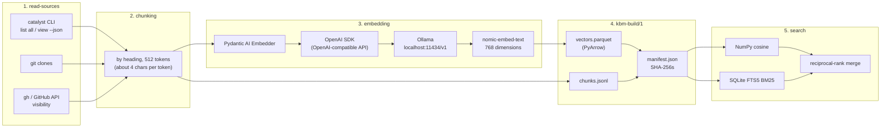

Everything involved when catalyst-kb-engine turns a knowledge base's sources into a vector database, in the order the
work flows, as of catalyst-kb-engine 0.16.1. It covers a build run on a curator's machine (for example over private
criteria, classification `Internal`) and the public build that GitHub Actions publishes with catalyst's documentation
site. Chapter [60](60-knowledge-base-stack.md) explains the commands; this page lists what they stand on.

## 1. Reading the sources (`read-sources`)

| What | Role |
|---|---|
| **catalyst CLI** (`$HOME/.catalyst/bin/catalyst`, the launcher) | Reads a criterion source: `catalyst list all --json`, then `catalyst view <ID> --json` per entity, each entity with its history from the journal. Each call runs in the criterion's own runtime. |
| **uv** | Builds each criterion's runtime (`<criterion>/.venv`). |
| **git** | Repository sources are clones (`--history N` needs full clones); criteria are git repositories whose journal blobs are pinned in git. |
| **GitHub** (`gh` signed in, or `GH_TOKEN`) | Confirms a repository's visibility before anything is read; a public build reads GitHub's default-branch commit only. |
| **Azure DevOps** (anonymous, or `AZURE_DEVOPS_EXT_PAT`) | The same, for Azure DevOps repositories. |
| **catalyst-users and its identity provider (Keycloak)** | Only for what the read records in a criterion (signed entries); reading itself needs no login. |
| **Python standard library** | `subprocess`, `concurrent.futures` (parallel `view` calls, `--workers`), `urllib`, `hashlib`, `tomllib`, `json`. |
| **Pydantic**, **PyYAML** | The engine's data models; front matter and module files. |

## 2. Chunking

Done by the engine itself, no tokenizer library: each document is split **by Markdown heading** into chunks of at most
**512 tokens**, estimated at about four characters per token, with an overlap (`--max-tokens`, `--overlap`). By default
each chunk is embedded as its **title and heading, then its text** (`--embed-input context`), with nomic's prefixes:
`search_document: ` before each chunk, `search_query: ` before a question.

## 3. Embedding

| What | Role |
|---|---|
| **Pydantic AI** (`pydantic-ai-slim`) | Its `Embedder` is the one interface to any embedding model, named `<provider>:<model>`. |
| **OpenAI Python SDK** (`openai`, the engine's `[openai]` extra) | Pydantic AI reaches Ollama through Ollama's **OpenAI-compatible API**; hence `OLLAMA_BASE_URL` ends in `/v1` (default `http://localhost:11434/v1` since engine 0.14.1). |
| **Ollama** | The local model server (`ollama serve`, port 11434). In CI the workflow installs it on every run. |
| **`nomic-embed-text`** | The embedding model: 768 dimensions, local. catalyst's knowledge base allows local models only ("Hosted embedding up to: Local only"). |
| **Incremental reuse** (`--previous <build>`) | Every vector whose exact input is unchanged is copied from the previous build, so only changed chunks are embedded. |

Other models the engine accepts: `openai:text-embedding-3-small` (hosted, only within `--hosted-up-to`) and
`sentence-transformers:…` (local; no extra installs it yet).

## 4. Writing the build (format `kbm-build/1`)

| File | Made with |
|---|---|
| `vectors.parquet` | **Apache Parquet** through **PyArrow** (the `[vectors]` extra): each chunk's id and its float32 vector. |
| `chunks.jsonl` | **JSON Lines**: each chunk's text, title, heading, classification, source and URL. |
| `manifest.json` | The model, its dimensions, the chunking, the classification and every file's SHA-256. |
| `index.md`, `docs/`, `README.md` | The documents themselves (as the folders build), and how to load the build. |

Any vector store can load the Parquet file (FAISS, LanceDB, pgvector, …); no account, network or model is needed to
read the build.

## 5. Searching it (`search`, `mcp`, `serve`)

| What | Role |
|---|---|
| **NumPy** (the `[search]` extra) | Cosine similarity of the question's vector against every chunk's. |
| **SQLite FTS5** (standard library `sqlite3`) | An in-memory full-text index (`porter unicode61` tokenizer), ranked by **BM25** weighted on title, heading and text. |
| **Reciprocal-rank fusion** | `--mode hybrid` (the default) merges the keyword and vector rankings. |
| **MCP Python SDK** (`mcp`, the `[mcp]` extra) | `catalyst-kb-engine mcp --build <dir>` serves the search as an MCP tool over stdio. |
| **FastAPI**, **Starlette**, **Uvicorn** (the `[serve]` extra) | `serve` exposes the search over HTTP, behind **catalyst-users** and **Keycloak** (OIDC token introspection). |

## 6. Publishing (the public build only)

| What | Role |
|---|---|
| **GitHub Actions** (`ubuntu-latest`) | catalyst-docs' `.github/workflows/pages.yml`, on each push to `main` and daily. |
| `actions/checkout`, `actions/setup-python` (Python 3.12), `actions/configure-pages`, `actions/upload-pages-artifact`, `actions/deploy-pages` | The workflow's steps. |
| **uv** | Installs the engine from its git tag (`uv tool install "catalyst-kb-engine[vectors,openai] @ git+https://github.com/cantica-tech/catalyst-kb-engine@<tag>"`; it is not on PyPI) and MkDocs. |
| **curl**, **tar**, **gzip** | Fetch the vectors the site last served (for `--previous`), pack the new ones as `vectors/catalyst-vectors.tar.gz`. |
| `catalyst-kb-engine publish-check` | Refuses any document or build that is not `Public`, or that comes from a source the public list does not name. |
| **MkDocs** with **Material** | Builds the pages; Mermaid diagrams render in the browser. |
| **GitHub Pages** | Serves the site and the vector tarball. |
| `catalyst-kb-engine record-site` | Run by the curator afterwards: records each served build in the criterion as a `KBUILD-`. |

## Runtime underneath

Python 3.11 to 3.13 (3.12 in CI) and uv; the engine installed from its git tag. Optional extras: `vectors`
(PyArrow), `openai` (the OpenAI SDK), `search` (NumPy, PyArrow), `mcp`, `serve` (catalyst-users with FastAPI,
Uvicorn).
