# 70 — catalyst-ui: Catalyst Studio (VS Code extension, desktop app, Studio SPA)

Hand-off chapter for `cantica-tech/catalyst-ui`. It describes what the repository contains and how it works, how to
build, test, package and release each deliverable, and what tends to break. Everything here was read from the
repository at product version **0.69.0** (branch `development`, HEAD `1ec35eb`, 2026-10-31) unless marked
**(unverified)**.

Citations use the form `cantica-tech/catalyst-ui:path`. Other repositories are named by their GitHub names:
`cantica-tech/catalyst` (the kernel and CLI), `cantica-tech/catalyst-users` (the identity facade),
`cantica-tech/cantica-tech` (the public distribution repository), `cantica-tech/standards` (shared lint config),
`cantica-tech/catalyst-software-engineering` (the SE process module), and catalyst-ui's own criterion, kept in the
project's private criterion repository (`<project>-criterion`).

---

## Table of contents

1. [Identity and scope](#1-identity-and-scope)
2. [Repository layout](#2-repository-layout)
3. [Architecture](#3-architecture)
   1. [Package graph](#31-package-graph)
   2. [catalyst-core](#32-catalyst-core--the-headless-runtime)
   3. [catalyst-app-model](#33-catalyst-app-model)
   4. [catalyst-ui](#34-catalyst-ui--the-vs-code-detail-webviews)
   5. [catalyst-studio](#35-catalyst-studio--the-studio-spa)
   6. [catalyst-host-vscode](#36-catalyst-host-vscode--the-vs-code-extension)
   7. [catalyst-host-electron](#37-catalyst-host-electron--the-desktop-app)
   8. [How the UI finds and runs the catalyst CLI](#38-how-the-ui-finds-and-runs-the-catalyst-cli)
   9. [How a project and its criterion are found and read](#39-how-a-project-and-its-criterion-are-found-and-read)
   10. [Kernel-version compatibility](#310-kernel-version-compatibility)
   11. [The vendored `spec/` and generated types](#311-the-vendored-spec-and-generated-types)
   12. [Process-module UI bundles and modules' `ui/` directories](#312-process-module-ui-bundles-and-modules-ui-directories)
   13. [Messaging: webviews, the Studio frame, Electron IPC, and the write allow-list](#313-messaging-webviews-the-studio-frame-electron-ipc-and-the-write-allow-list)
   14. [Identity: catalyst-users, the Users panel and password login](#314-identity-catalyst-users-the-users-panel-and-password-login)
4. [VS Code reference: views, commands, settings, activation](#4-vs-code-reference-views-commands-settings-activation)
5. [Task and script reference](#5-task-and-script-reference)
6. [Build from scratch](#6-build-from-scratch)
7. [Release process](#7-release-process)
8. [How-tos](#8-how-tos)
9. [Common failures and fixes](#9-common-failures-and-fixes)
10. [Next steps (roadmap, decisions, design notes)](#10-next-steps-roadmap-decisions-design-notes)
11. [Known oddities and what was not verified](#11-known-oddities-and-what-was-not-verified)

---

## 1. Identity and scope

| Item                   | Value                                                                                                                                                                                                                                                      |
| ---------------------- | ---------------------------------------------------------------------------------------------------------------------------------------------------------------------------------------------------------------------------------------------------------- |
| Repository             | `cantica-tech/catalyst-ui` (public), npm workspaces monorepo named `catalyst-ui-monorepo` (`cantica-tech/catalyst-ui:package.json`)                                                                                                                       |
| Product name           | **Catalyst Studio** (decision C3); the repository keeps the name `catalyst-ui`                                                                                                                                                                             |
| Version                | `0.69.0`, kept identical in `cantica-tech/catalyst-ui:version.txt`, every `packages/*/package.json` and `catalyst-core/src/index.ts` `VERSION` (a test checks them)                                                                                       |
| Licence                | Apache-2.0 from 0.47.0 (`LICENSE`, `NOTICE`: copyright CanticaTech); earlier releases were proprietary (decision C4)                                                                                                                                       |
| Deliverables           | (1) the VS Code extension `CanticaTech.catalyst-host-vscode` ("Catalyst Studio — rules, journal and traceability for AI-assisted development"); (2) the desktop app "Catalyst Studio" (Electron) for macOS/Windows/Linux; (3) the Studio web bundle served by `catalyst serve --local --static` |
| Kernel compatibility   | Works with catalyst kernel `>=0.54.0` (`packages/catalyst-host-vscode/package.json` → `catalyst.kernelVersion`). Individual Studio features need newer kernels (each noted where used, e.g. Studio page serving needs 0.64.0, actions need 0.77.0+, share panel 0.90.0) |
| Desktop app's own CLI  | `catalyst.pyz` of the kernel in `packages/catalyst-host-electron/catalyst-version.txt` (0.119.2 at HEAD; the published 0.69.0 desktop build shipped 0.119.1)                                                                                            |
| Governance             | catalyst-governed: `cantica-tech/catalyst-ui:catalyst.toml` (`project_name = "catalyst-ui"`, `module = "software-engineering"`, `kernel_version = "0.119.2"`, `repoed = true`, `catalyst_repo_url` (its private `<project>-criterion` repository), `criterion_branch = "criterion"`, `format = "1.0-rc"`). The criterion lives outside the repo in `$HOME/.catalyst/projects/catalyst-ui/criterion`; rule ID prefixes seen in code: `core`, `vscode`, `electron`, `env`, `studio` |
| Requirement IDs        | `REQ-0000NN-<userid>`, `BUG-0000NN-<userid>`; every commit cites one or is `chore:` (enforced by the CI `catalyst-trace` job)                                                                                                                              |

What catalyst-ui does: it makes catalyst's chain (rules → work items/artifacts → domains, with journal and checks)
navigable, shows drift (`catalyst check` findings) as editor diagnostics, and lets a person act on the criterion only
by having the **host** (VS Code or Electron) run catalyst's own verbs after an explicit confirmation (decision W1). It
never writes criterion files itself.

The three deliverables and what they drive:

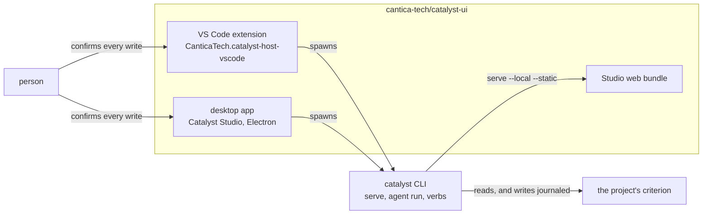

---

## 2. Repository layout

```
catalyst-ui/
├── package.json              # workspaces: packages/*; root scripts lint/format:check/typecheck/test; engines node >=20
├── package-lock.json         # npm ci source of truth
├── version.txt               # 0.69.0 — product version
├── .nvmrc                    # 20 (CI uses Node 24 — see §9)
├── Taskfile.yml              # the repo's own tasks (§5); includes ../standards/Taskfile.standards.yml optionally
├── catalyst.toml             # catalyst project file (the only catalyst file in the repo)
├── .catalystignore           # excludes packages/catalyst-core/src/test/fixtures (a sample criterion used as test data)
├── tsconfig.json             # solution file: project references to all six packages
├── tsconfig.base.json        # extends .standards/tsconfig.strict.json; ES2022, NodeNext, composite, declaration
├── eslint.config.mjs         # = .standards/eslint-standard.mjs
├── eslint-suppressions.json  # ESLint bulk suppressions (ratchet)
├── .prettierrc.json, .prettierignore, .markdownlint-cli2.jsonc, .yamllint.yaml, .taplo.toml, .editorconfig
├── .standards/               # vendored copy of cantica-tech/standards (VERSION v0.1.1): eslint, tsconfig, markdownlint, yamllint, zizmor
├── .github/workflows/        # ci.yml, standards.yml, desktop.yml (§7.4)
├── scripts/release-vsix.mjs  # copies a built .vsix + manifest.json into a cantica-tech/cantica-tech checkout (§7.5)
├── brand/                    # README.md (icon licence record), placeholder-mark.svg, placeholder-app-icon.svg
├── catalyst-modules.md       # how process-module UI bundles work + a long release log (partly stale, see §11)
├── docs/
│   ├── roadmap.md            # Studio roadmap (catalyst roadmap phase R6)
│   ├── decisions.md          # owner decisions C1–C7, S1–S7, W
│   ├── desktop.md            # desktop build and signing setup
│   ├── design/               # 09, 23, 24, 25, 26 + ui-potential-roadmap/ (design notes)
│   └── results/              # round results write-ups
└── packages/
    ├── catalyst-core/          # headless TS runtime (Node), spec/ schemas, generated types
    ├── catalyst-app-model/     # pure view-model selectors (tree sections, rows, detail)
    ├── catalyst-ui/            # React detail webviews for VS Code (bundled to webview.js)
    ├── catalyst-studio/        # the Studio SPA (React, elkjs) → dist/web/{index.html,studio.css,studio.js,embed.js}
    ├── catalyst-host-vscode/   # the VS Code extension (published)
    └── catalyst-host-electron/ # the desktop app (Electron 30, electron-builder)
```

Ignored build outputs (`cantica-tech/catalyst-ui:.gitignore`): `node_modules/`, `dist/`, `out/`, `*.tsbuildinfo`,
`*.vsix`, `packages/catalyst-host-electron/app/`, `packages/catalyst-host-electron/release/`,
`packages/catalyst-host-electron/build/catalyst/` (the downloaded `catalyst.pyz`).

---

## 3. Architecture

### 3.1 Package graph

An arrow points from a package to the package that uses it:

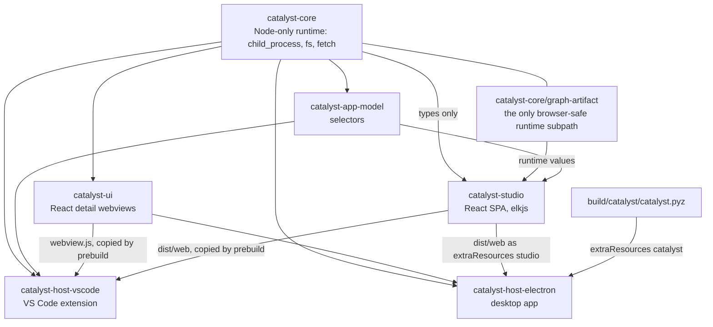

Declared npm dependencies (all internal ones are `"*"` workspace links):

| Package                  | Internal deps                               | Notable external deps                                                       | Module type |
| ------------------------ | ------------------------------------------- | --------------------------------------------------------------------------- | ----------- |
| `catalyst-core`          | none                                        | none at runtime; `vitest` (dev)                                             | ESM         |
| `catalyst-app-model`     | core                                        | `vitest`                                                                    | ESM         |
| `catalyst-ui`            | core                                        | `react@18`, `react-dom@18`, `marked@18`; `esbuild`, `jsdom`, `vitest`       | ESM         |
| `catalyst-studio`        | core, app-model                             | `react@18`, `react-dom@18`, `elkjs@0.12`; `axe-core`, `jsdom`, `esbuild`    | ESM         |
| `catalyst-host-vscode`   | core, app-model (+ copies built ui, studio) | `@types/vscode@^1.85`, `@vscode/vsce@^2.27`, `esbuild`, `mocha`             | CJS output  |
| `catalyst-host-electron` | core, studio, ui                            | `electron@^30` (`electronVersion: 30.5.1`), `electron-builder@^25`, `esbuild` | CJS output  |

TypeScript: every package is `composite` (project references, `tsc --build` from the root builds all six in
dependency order and **emits** `dist/` + `tsconfig.tsbuildinfo` per package). `noUncheckedIndexedAccess` is ratcheted
off in `tsconfig.base.json` (126 pre-existing violations).

**Browser-safe rule.** `catalyst-core`'s root entry (`dist/index.js`) re-exports modules that import `node:fs`,
`node:child_process` etc. The Studio (a browser bundle) therefore imports **runtime values** only from the subpath
export `catalyst-core/graph-artifact` (`isRow`, `isEntity`, `fieldsOf`, `titleOf`); from the root it imports **types
only** (`import type`, erased at build). Breaking this makes esbuild pull Node modules into `studio.js`; it surfaced on
2026-10-20 when a stale local bundle hid it and CI failed (§9). The VS Code host has a similar boundary test:
`packages/catalyst-host-vscode/src/test/host-boundary.test.ts` asserts that only `src/vscode/**` and `src/extension.ts`
import `vscode` (roadmap R6.1).

### 3.2 catalyst-core — the headless runtime

`cantica-tech/catalyst-ui:packages/catalyst-core/src/`. No DOM, no `vscode`. Exports (from `index.ts`):

| File                         | Role                                                                                                                                                                                                                         |
| ---------------------------- | ---------------------------------------------------------------------------------------------------------------------------------------------------------------------------------------------------------------------------- |
| `catalyst-source.ts`         | **The bridge to catalyst.** `catalystCommand()` (CLI resolution, §3.8), `startLocalServe()` (spawns `catalyst serve --local --project <root> [--static <dir>]`, reads the first stdout line `{"url","token","page?"}`, 15 s timeout), `readThroughCatalyst()` (GET `/v1/graph`, `/v1/check`, `/v1/journal`, `/v1/list?type=users`, `/v1/list?type=role`, `/v1/definitions`), `watchCatalyst()` (follows `/v1/events` SSE, re-reads on each `data:` line, coalescing), `watchProject()` (the hosts' watcher; on failure calls `onUnavailable` with "needs catalyst 0.54.0 or later: run `catalyst open`"), `modelFromGraph()` (graph JSON → `ChainModel` of domains, rules, artifacts, table rows; edges from links and mentions), `reportFromCheck()` (check JSON → `ValidationReport`, mapping `dangling-ref`/`ungrounded`/`duplicate-id`), `startAgentRun()` (spawns `catalyst agent run --json <command> <args>` in the project dir; streams JSON-line events; synthesises an `end` event on crash). `CATALYST_SERVE_FLOOR = "0.54.0"`. |
| `actions.ts`                 | The **write allow-list** (`StudioAction`) and `runAction(projectRoot, args)`: spawns `catalyst <args>` with no shell. See §3.13.                                                                                             |
| `studio-host.ts`             | `StudioRuns`: the host side of the Studio protocol (`hello`, `run`, `cancel`, `action`, `batch` ≤ 50, `try`), confirming every run/action through the host's dialog before spawning.                                         |
| `discover.ts`                | `resolveCorpusRoot()` (where a project's criterion is, §3.9), `readDeployedKernelVersion()` (criterion `version.txt`), `REQUIRED_KERNEL_VERSION` (`>=0.54.0`), `workingCopyState()` (`reachable`/`dangling`/`missing`).      |
| `project-file.ts`            | `catalyst.toml` reader (flat TOML subset) with legacy `<name>.catalyst` JSON fallback; `catalystHome()` (`$CATALYST_HOME` or `~/.catalyst`); `homeCriterion(name)`.                                                         |
| `workspace.ts`               | Deployment discovery inside a workspace folder: `findDeployments()` (BFS to depth 4, skipping `.git`, `.criterion`, `node_modules`, `dist`, `out`, `build`, `.venv`, `venv`, `__pycache__`, `target`), `.catalystignore` semantics (empty file = opt the whole directory out; lines = relative paths), `governs()`/`owningDeployment()` (nested deployments own their subtree). Mirrors the kernel's scope rule. |
| `kernel-version.ts`          | `KERNEL_VERSION_FLOOR = "0.54.0"`, `VERIFIED_KERNEL_VERSION = "0.54.0"`, `kernelSyncTarget()`, `restoreKernelVersion()`.                                                                                                    |
| `spec.ts`                    | **Generated** — types for every `--json` output (`GraphJson`, `CheckJson`, `RunEventJson`, …) from `spec/*.schema.json`. Never edit by hand (§3.11).                                                                       |
| `graph-artifact.ts`          | Browser-safe helpers (`isRow`, `isEntity`, `fieldsOf`, `titleOf`) — exported as subpath `catalyst-core/graph-artifact`.                                                                                                     |
| `ui-module-manager.ts`       | In-memory zip reader/writer (own PKZip + CRC32 + `zlib` deflate), `UiModuleManager` (activate a module zip if its `kernelVersion` specifier matches), `packageUiModule()`.                                                   |
| `remote-module-store.ts`     | Finds process-module bundles at a source URL (default `git@github.com:cantica-tech/cantica-tech.git/catalyst/`): local scan, shallow git clone cached in `<os tmp>/catalyst-git-remotes/<sha12>`, or GitHub REST tree + raw fetch. |
| `versioning.ts`              | Version compare and uv-style specifiers (`>=`, `<=`, `>`, `<`, `==`, `!=`, `~=`, `*`, comma = AND).                                                                                                                         |
| `agent-bridge.ts`, `agent-launch.ts`, `commands-discovery.ts`, `slash-command.ts` | Agent presets (`copilot` → `GitHub.copilot-chat`/`@workspace`; `claude`/`claude-code` → `anthropic.claude-code`/`@claude`), resolving which agent a project uses from the project file's `agent`/`chatAgents`, discovering the deployment's slash commands (from catalyst's command catalog), composing `/command args`. |
| `join-criterion.ts`, `criterion.ts` | Legacy "connect an existing criterion repo" flow (clone into agent-owned storage, write pointer/`.criterion` gitignore); branch-name helpers (`<name>.criterion`). Predates the `$HOME/.catalyst` criterion home (see §11). |
| `iam.ts`, `journal.ts`, `ids.ts`, `markdown.ts`, `host-port.ts`, `types.ts` | Coercers for users/roles/journal, ID regexes and short-form resolution, markdown sectioning, the `HostPort` abstraction (`ScriptedHost` for tests). |

How a host reads and follows a project through `catalyst-core`:

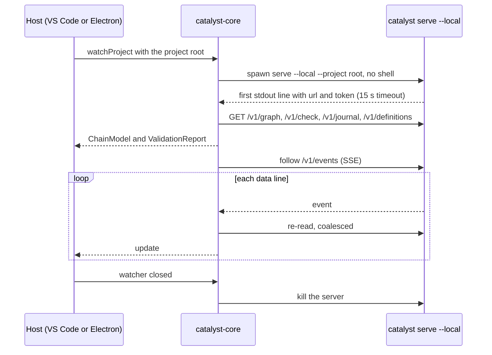

Tests: `vitest run` over `src/test/*.test.ts` (Node environment). `src/test/fixtures` holds a sample criterion (test
data, excluded from catalyst via `.catalystignore`).

### 3.3 catalyst-app-model

`cantica-tech/catalyst-ui:packages/catalyst-app-model/src/` — pure functions the views share, no host imports:
`tree.ts` (`buildTreeSections`, `formatNodeLabel`: one section per module type under its plural name, rules grouped by
document, every entity **once** in the tree), `rows.ts` (`buildRowSections` for table-row types such as
roadmap items), `tree-ids.ts` (`breadthFirst`, `childId`, `itemKey` — stable tree IDs for `TreeView.reveal`),
`detail.ts` (detail payloads). Tests: vitest.

### 3.4 catalyst-ui — the VS Code detail webviews

`cantica-tech/catalyst-ui:packages/catalyst-ui/src/`. React components rendered in VS Code webview panels:
`NodeDetail` (an entity/rule document with links), `Journal`, `Backlog`, `DirectoryDetail` (user/role/group documents
for the Users panel), `KernelVersionHeader`, `VersionControlIcon`, plus `markdown.ts` (sanitised `marked` rendering) and
`references.ts`. `webview-entry.tsx` is bundled by `npm run build:webview` into `dist/webview.js` (IIFE, minified,
`NODE_PATH=node_modules:../../node_modules` so esbuild resolves hoisted React). The VS Code host copies that file into
its own `dist/`. Note: despite the name, this package is **not** the Studio; the Studio is `catalyst-studio`.

### 3.5 catalyst-studio — the Studio SPA

`cantica-tech/catalyst-ui:packages/catalyst-studio/`. One accessible React bundle (design tokens, light/dark/system
theme, keyboard and screen-reader support; axe-core checked in tests — decision S6). Built by `npm run build`
(`tsc --build && node scripts/bundle.mjs`) into `dist/web/`:

| File          | What                                                                                                                     |
| ------------- | ------------------------------------------------------------------------------------------------------------------------ |
| `index.html`  | copied from `static/index.html` (`<div id="studio">`, loads `studio.css`, `studio.js`)                                     |
| `studio.css`  | copied from `static/studio.css` (~760 lines of tokens and layout)                                                         |
| `studio.js`   | `src/main.tsx` bundled (IIFE, browser)                                                                                   |
| `embed.js`    | `src/embed.ts`: the `<catalyst-entity server=… token=… entity=…>` web component for other sites (decision B8), no React |

**Connection.** `client.ts` `connectionFromPage()` takes `{url, token}` from `window.catalystStudio` if a host injected
it, else from the URL fragment `#token=…` (then strips it from history); the URL is the page's own origin. Every call
is `GET <origin>/v1/<route>` with `Authorization: Bearer <token>`. Routes used: `graph`, `check`, `inbox`, `backlog`,
`head` (kernel, change counter), `history/<id>`, `approvals/<id>`, `view/<id>`, `analyses[/<id>]`, `modules`,
`modules/<id>/available`, `modules/<id>/plan?to=<tag>`, `share`, `audit`, `impact/<id>`, `commands`,
`spec/<command>[/<part>]`, `list?type=users|role`, `runs`, `events` (SSE, `event: batch`). Each route documents the
minimum kernel in a comment; older kernels degrade (optional fields via the `Since<>` helper type).

**Views** (navigation in `src/main.tsx`/`Shell.tsx`): Overview (dashboard: health, waiting items with settle commands,
open work, versions, activity, rule coverage), Inbox (with unread count), Artifacts (+ entity page: fields, sections,
allowed moves and guards, citers, journal, gates, history with side-by-side and two-version diffs), Board (columns
from a type's states; moves = `status set`; batch moves), Map (type map, elkjs layout, tinted by state), Roadmap
(timeline/Gantt from roadmap rows), Rules (rule browser with strength filter), Journal (timeline, grouping), Approvals,
Analyses (findings triage), Modules (installed/available/upgrade plan), Audit (audit pack), Team (people, work in
progress; from kernel 0.106.0 user/role administration is catalyst-users', not the Studio's), Share (unpublished
changes, pull, push), Search, Commands (palette, Ctrl/⌘+K, each command's procedure from `catalyst spec`). Plus Trace
(tree + elkjs graph) and Impact on entity pages, RunConsole/RunHistory (agent runs and their cost), Trial ("Try it":
`catalyst try` result before a write).

**Host detection** (`src/host.ts`): `transportOf(window)` uses `window.catalystHost` (the Electron preload bridge) if
present, else `window.parent` when framed (VS Code), else **none** — in a plain browser the Studio is read-only: no
runs, no actions.

How the Studio decides which transport it has (`transportOf`):

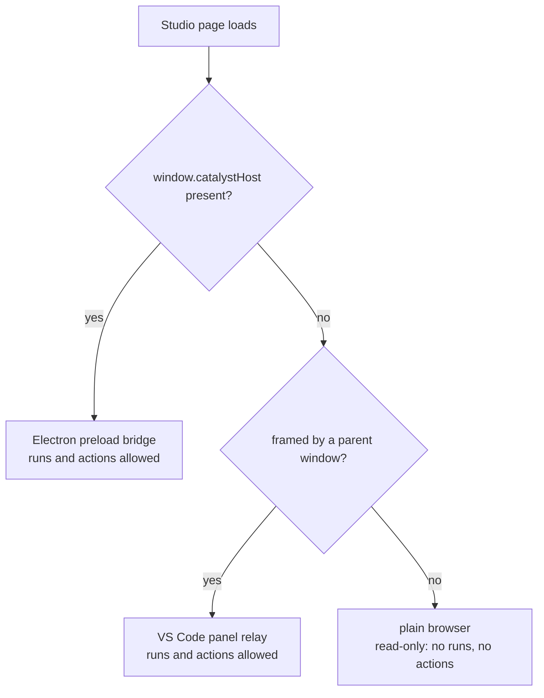

### 3.6 catalyst-host-vscode — the VS Code extension

`cantica-tech/catalyst-ui:packages/catalyst-host-vscode/`. Entry `dist/extension.js` (esbuild bundle, CJS, `vscode`
and `fsevents` external). `engines.vscode ^1.85.0`, `extensionKind: ["workspace"]` (runs where the files are: SSH,
WSL, containers, codespaces), virtual workspaces unsupported, untrusted workspaces "limited" (read-only: no install or
sync offers, no agent commands until trusted).

Source map:

| Path                                    | Role                                                                                                                                                         |
| --------------------------------------- | ------------------------------------------------------------------------------------------------------------------------------------------------------------ |
| `src/extension.ts` (~1000 lines)        | `activate()`: creates the Instances and Users tree views, diagnostics, CodeLens, status bar, output channel "Catalyst"; resolves workspace folders; registers all commands. |
| `src/vscode/inspector.ts`               | `ChainInspectorProvider` (Instances tree): one top-level entry per deployment, sections from module types (via `catalyst-app-model`), unset-folder entries offering "Set Up Catalyst in a Folder…". |
| `src/vscode/deployments.ts`             | `setupDeployment()`: starts `watchProject()` for each deployment, pushes diagnostics and CodeLens on each update.                                            |
| `src/vscode/studio-panel.ts`            | `openStudio()`: `catalyst serve --local --static <ext>/dist/studio`, a webview panel framing the served page, `StudioRuns` with a modal "Run" confirmation.   |
| `src/studio-html.ts`                    | The panel HTML: strict CSP (`default-src 'none'; frame-src <server origin>`; nonce'd style/script), an iframe, and a relay script (only `catalyst:"studio"` messages from the frame on the server origin go to the extension; only `catalyst:"host"` messages go to the frame). |
| `src/vscode/webview-html.ts`, `src/webview-protocol.ts` | Detail panels (the `catalyst-ui` webview.js) with CSP; inbound messages validated: only `openReference` with an entity-shaped ID (≤200 chars) and `openDirectory` (user/role/group, printable name ≤256). |
| `src/vscode/users-view.ts`, `src/directory.ts`, `src/iam.ts` | The Users panel and catalyst-users integration (§3.14).                                                                                            |
| `src/vscode/onboarding.ts`              | Install offer for folders without catalyst (agent-driven, follows catalyst's `BOOTSTRAP.md`), "connect existing criterion repo", kernel sync offers.          |
| `src/vscode/agent-bridge.ts`, `src/command-picker.ts` | "Send to Agent (Chat)…": pick a discovered slash command + arguments, send it to the configured chat participant (`@claude`, `@workspace`).       |
| `src/remote.ts`                         | Advice when a deployment's working copy is unreachable in a remote environment (copy a devcontainer mount, or share the criterion).                          |
| `src/codelens.ts`, `src/diagnostics.ts`, `src/vscode/deployment-diagnostics.ts` | `catalyst check` findings → Problems panel + CodeLens on governed files.                                                    |
| `src/panel-groups.ts`                   | `catalyst.detailPanelGroups`: one editor group per project or one shared.                                                                                    |
| `scripts/enable-unsigned-install.js`    | Sets `extensions.verifySignature: false` in the real user `settings.json` (surgical text edit) for local unsigned installs.                                  |
| `.vscodeignore`                         | Packs only `dist/extension.js`, `dist/webview.js`, `dist/studio/**` (+ resources, README, LICENSE, NOTICE, package.json).                                   |

How "Open Studio" brings the Studio into a VS Code panel:

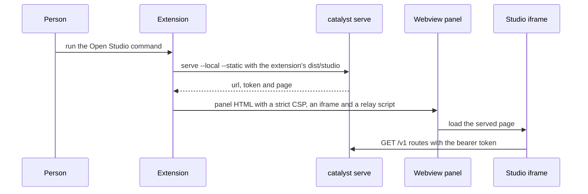

Tests: `mocha "dist/test/**/*.test.js"` after `pretest` → `npm run build`. Pure modules are tested without a VS Code
host; there is no `@vscode/test-electron` integration run wired into a script (it is only a devDependency).

### 3.7 catalyst-host-electron — the desktop app

`cantica-tech/catalyst-ui:packages/catalyst-host-electron/`. Two kinds of windows:

1. **Main window** (`src/main.ts`, `src/renderer-entry.tsx`, `src/preload.ts`): tracks projects the user adds (folder
   picker → `resolveCorpusRoot()`; saved to `<userData>/projects.json` by `state.ts`), keeps one persistent
   `watchProject()` per project, and draws node count, error count and a graph layout (`graph.ts`, `GraphView.tsx`).
   The renderer is inlined into a `data:` URL page with a nonce CSP (`security.ts`); `contextIsolation: true`,
   `nodeIntegration: false`, `sandbox: true`, navigation and `window.open` denied. IPC channels (all checked to come
   from the app's own window): `catalyst:listProjects`, `catalyst:addProject`, `catalyst:removeProject`,
   `catalyst:getNodeDetail`, `catalyst:openStudio`; push channel `catalyst:project-update`. Exposed to the page as
   `window.catalyst`.
2. **Studio window** (`src/studio.ts`, `src/studio-preload.ts`): `catalyst serve --local --static <studio bundle>`
   as a sidecar, a sandboxed `BrowserWindow` on `server.page`; navigation allowed only to the same origin
   (`studio-policy.ts` `staysOn`). The preload exposes `window.catalystHost` (`post` → IPC `catalyst:studio`,
   `subscribe` ← IPC `catalyst:host`); the main process runs `StudioRuns` with a **native** dialog (`Run`/`Cancel`,
   default Cancel). Closing the window kills the server.

The desktop app's processes, windows and channels:

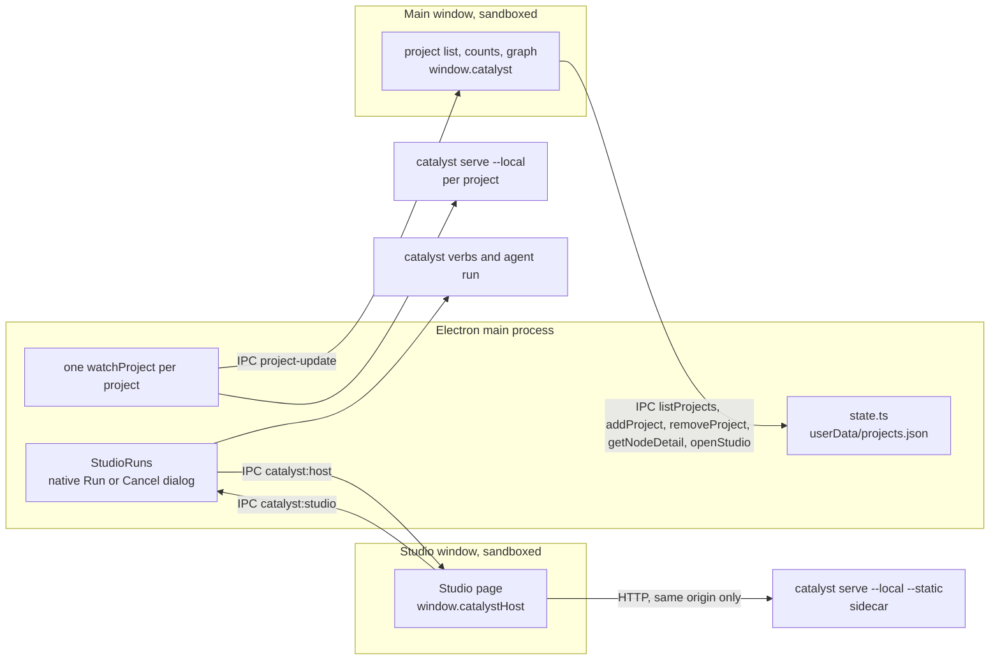

`studioBundle()` resolves the Studio bundle from `process.resourcesPath/studio` in a packaged app, else from the
`catalyst-studio` package's `dist/web`. `bundledCatalyst()` finds `resourcesPath/catalyst/catalyst.pyz`; `main.ts` sets
`CATALYST_BUNDLED_PYZ` to it so `catalystCommand()` can fall back to it (§3.8).

Packaging (`electron-builder.yml`): `appId com.cantica-tech.catalyst-studio`, productName "Catalyst Studio",
`directories.app: app` (built by `scripts/bundle.mjs`: `main.js`, `preload.js`, `studio-preload.js`, `renderer.js`
and a dependency-free `package.json`), `extraResources`: `../catalyst-studio/dist/web` → `studio`, `build/catalyst/catalyst.pyz`
→ `catalyst`. Targets: mac `dmg`+`zip` (arm64, x64; hardened runtime; entitlements `build/entitlements.mac.plist`),
win `nsis` (x64, arm64; per-user, choosable directory), linux `AppImage`+`deb` (x64, arm64). `artifactName:
catalyst-studio-${version}-${os}-${arch}.${ext}`. `publish: null` (no auto-update feed).

The repo README still calls the Electron host "experimental, not released or packaged"; that is out of date — it has
been packaged and attached to GitHub releases since 0.53.0 (see §11).

### 3.8 How the UI finds and runs the catalyst CLI

`catalystCommand()` in `packages/catalyst-core/src/catalyst-source.ts` is the single resolver used by both hosts:

1. `$CATALYST_BIN` — split on spaces into argv (e.g. `CATALYST_BIN="python3.12 /path/catalyst.pyz"`).
2. `$CATALYST_HOME/bin/catalyst` (default `~/.catalyst/bin/catalyst`; `catalyst.cmd` on Windows) — catalyst's
   **launcher**, installed by `catalyst runtime install`. The launcher reads the `catalyst.toml` of the project it is
   run in and execs that project's criterion runtime (its `.venv`, or a legacy `.criterion/bin/catalyst.pyz`). So in
   practice **the kernel the UI talks to is the project's own pinned criterion runtime**, not a global one. This
   fallback exists because an editor launched from the Dock lacks the shell's `PATH`.
3. Only if no `catalyst` is on `PATH` and `$CATALYST_BUNDLED_PYZ` points to an existing file (the desktop app sets it):
   run that `.pyz` with the first Python ≥ 3.11 found among `python3.13`, `python3.12`, `python3.11`, `python3`,
   `python` (and `py -3` on Windows), probed with a 5 s `sys.version_info` check. macOS's system `python3` (3.9) is
   rejected.
4. Otherwise plain `catalyst` from `PATH`.

The same order as a decision procedure (`catalystCommand()`):

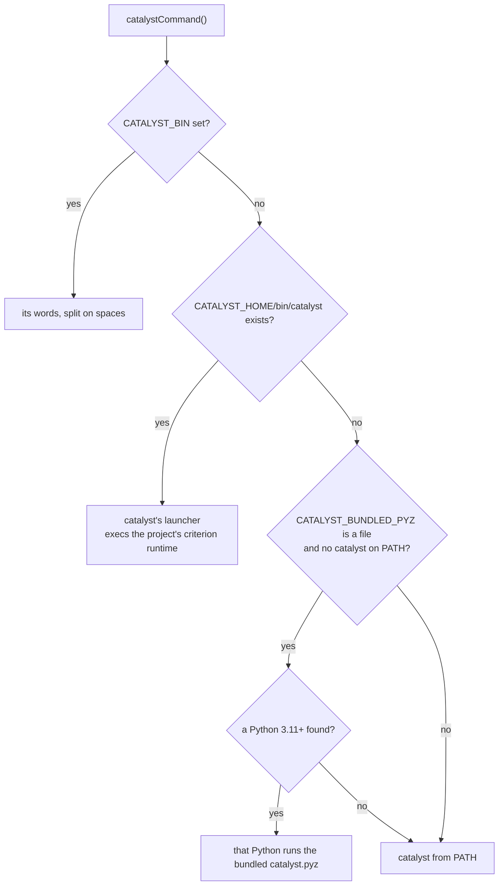

Processes spawned (never through a shell):

| Purpose                     | Command                                                                     | Where                                   |
| --------------------------- | --------------------------------------------------------------------------- | --------------------------------------- |
| Read/watch a project        | `catalyst serve --local --project <projectRoot>`                            | `watchCatalyst`, both hosts             |
| Serve the Studio            | `catalyst serve --local --project <projectRoot> --static <studio dir>`      | `openStudio` (kernel ≥ 0.64.0 for `--static`/`page`) |
| Run a slash command         | `catalyst agent run --json <command> <arg words>` (cwd = project root)      | `startAgentRun` (kernel ≥ 0.76.0)       |
| Studio actions              | `catalyst <verb …>` built by `actionArgs()` (cwd = project root)           | `runAction`                             |
| Try an action               | `catalyst try --json …`                                                     | `tryArgs` (kernel ≥ 0.82.0)             |

`serve --local` prints one JSON line `{"url": "...", "token": "...", "page": "..."}`; the token is a bearer token for
that server only; `page` carries the token in its fragment. The server is killed when the watcher or panel closes.

**Choosing the kernel the UI uses.** There is no extension setting for the CLI path. To control it:

- Normal case: install catalyst's launcher once per machine (`catalyst runtime install`, see the catalyst chapter) and
  pin each project's kernel in its criterion; the UI follows the project.
- Override: start VS Code (or the desktop app) with `CATALYST_BIN` set, e.g. `CATALYST_BIN="python3.12
  /path/to/catalyst.pyz" code .`. `CATALYST_HOME` relocates the home store and launcher.
- Desktop app with no catalyst installed: it uses its bundled `catalyst.pyz` (version in `catalyst-version.txt`),
  needs Python ≥ 3.11 on `PATH`.
- "Catalyst: Load Specific Kernel Version in Memory…" does **not** change the CLI; it only sets the version used to
  check UI module compatibility (§3.12).

### 3.9 How a project and its criterion are found and read

**Activation** (VS Code): `workspaceContains:catalyst.toml`, `workspaceContains:*.catalyst`,
`workspaceContains:*/catalyst.toml`.

**Deployment discovery** per workspace folder (`findDeployments`): every directory with a project file
(`catalyst.toml`, else legacy `<name>.catalyst` JSON) to depth 4, minus skipped dirs, `.catalystignore` opt-outs and
the `catalyst.ignoredFolders` setting. Nested deployments are separate entries and own their subtree.

**Criterion resolution** (`resolveCorpusRoot(projectRoot)`), first hit wins:

0. `$CATALYST_HOME/projects/<project_name>/criterion` (`project_name`, else `name`, from the project file) — the
   current model (kernel ADR-010).
1. Legacy `<projectRoot>/.criterion` (symlink followed, or a real directory).
2. Legacy pointer field `agent-source` (pre-0.37.0).
3. Claude Code storage `~/.claude/projects/<slug>/.criterion` (slug = absolute path with non-alphanumerics → `-`).

If none resolves, `workingCopyState()` distinguishes `dangling` (a `.criterion` symlink to a path not present here —
typical in dev containers/WSL/SSH) from `missing`, and the extension shows `unreachableAdvice()` once.

Criterion resolution, first hit wins:

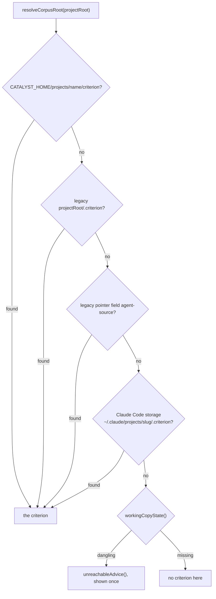

**What is read**: only through `catalyst serve` (decision S2 / R5.3: the UI does not parse criterion files for the
chain, users, roles, commands or definitions). `modelFromGraph` does read rule/artifact markdown files from the
criterion for their text (`readText(join(criterionRoot, file))`) to show descriptions. The criterion's `version.txt`
is read directly for the status bar tooltip and kernel compatibility checks.

### 3.10 Kernel-version compatibility

- `KERNEL_VERSION_FLOOR = VERIFIED_KERNEL_VERSION = "0.54.0"` (`catalyst-core/src/kernel-version.ts`).
  `REQUIRED_KERNEL_VERSION = ">=0.54.0"` must equal `catalyst-host-vscode/package.json` `catalyst.kernelVersion`
  (a test checks). Bump them together when a build is verified against a newer kernel.
- **Sync offer**: for each resolved deployment whose `version.txt` < `VERIFIED_KERNEL_VERSION`, one shared
  notification offers a sync (once per session). Because the verified version is still 0.54.0, current deployments
  (0.119.x) never get an offer.
- Missing/unreadable `version.txt` counts as compatible ("can't compare" is never a failure).
- The `release:vsix` manifest's `kernelVersion` comes from the same `catalyst.kernelVersion` field.

### 3.11 The vendored `spec/` and generated types

`packages/catalyst-core/spec/` holds catalyst's JSON Schemas for every `--json` output and `serve` route (53 schema files +
`KERNEL`, the tag they were copied from: `0.119.1` at HEAD). `scripts/spec.mjs`:

| Command                                                                   | Effect                                                                                                                         |
| ------------------------------------------------------------------------- | ------------------------------------------------------------------------------------------------------------------------------ |
| `npm run spec:sync -w catalyst-core -- <catalyst checkout> <tag>`         | `git ls-tree`/`git show` the `spec/*.schema.json` of `cantica-tech/catalyst` at `<tag>` into `spec/`, write `spec/KERNEL`, regenerate `src/spec.ts` (formatted with the repo's Prettier). Writes tracked files. |
| `npm run spec:generate -w catalyst-core`                                  | Regenerate `src/spec.ts` from `spec/`.                                                                                         |
| `npm run spec:check -w catalyst-core`                                     | Exit 1 if `src/spec.ts` differs from what `generate` would write. Read-only.                                                  |

The generator supports only `type, properties, required, additionalProperties, items, enum, const, anyOf, oneOf,
$ref (#/$defs), $defs` (+ ignorable `$schema, $id, title, description, minimum, minProperties, maxProperties`); any
other keyword aborts so nothing is silently dropped. Tests in `src/test/spec.test.ts` (run by `npm test`) assert:
generated = check passes; `KERNEL` is `X.Y.Z` and named in `spec.ts`; `oneOf` becomes a union; and **`spec/KERNEL`
equals `packages/catalyst-host-electron/catalyst-version.txt`** ("syncing one means syncing the other"). CI therefore
covers `spec:check` through `npm test` (decision S7), not as a separate step.

Where the types come from, and what the tests tie together:

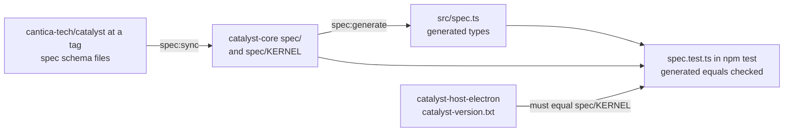

### 3.12 Process-module UI bundles and modules' `ui/` directories

Two mechanisms exist; only one is live:

**(a) What actually draws module content (live).** The Studio and the Instances tree are generated from the
module's **types as catalyst serves them** (`graph.types`: names, plural names, states, initial and closed states,
fields; `definitions`; `view/<id>` sections and next states). No UI package names a module type (since UI 0.43.0).
Decision **C6** (2026-10-19): a module is **data only**; the Studio draws it from `module.yaml`; module-shipped UI code
(R6.29, sandboxed module UI) is **disabled**. The knowledge-base module, for instance, renders with no UI change.

**(b) UI-module bundles (shipped but not rendered).** `cantica-tech/catalyst-software-engineering` has a `ui/`
directory (npm package `@catalyst-modules/software-engineering-ui`: `Backlog.tsx`, `RoadmapDetails.tsx`,
`index.ts`; its `tsconfig.json` resolves `catalyst-core` types from a sibling `../../catalyst-ui/` checkout). catalyst's
release tooling zips a module with a `manifest.json` into `cantica-tech/cantica-tech:catalyst/modules/<id>/v<version>/`.
The extension can discover, download, validate and hold one such bundle in memory:

| Step      | Code                                                                                                                                                                                                                  |
| --------- | --------------------------------------------------------------------------------------------------------------------------------------------------------------------------------------------------------------------- |
| Discover  | `fetchRemoteUiModules(catalyst.moduleSourceUrl)` — accepts `git@host:owner/repo.git/path/`, `https://github.com/owner/repo/tree/branch/path`, `git+https://…#branch:path`, `raw.githubusercontent.com` URLs, or a local path; derives `…/modules` and `…/kernel` subpaths; strategies: local scan → shallow `git clone --depth=1` cached in `<tmp>/catalyst-git-remotes/<sha256(url)[:12]>` (works over SSH for private repos) → GitHub REST tree API + raw manifest fetches. Expects `<modules>/<id>/v<version>/manifest.json` beside a zip (prefers `<id>-v<version>.zip`). |
| Validate  | `manifest.json` (else `ui-module.json`, else `module.json`, at zip root or a subfolder): required `id`, `name`, `version`, `kernelVersion` (legacy `frameworkVersion` accepted); `entry` (e.g. `ui/index.js`) declared but **not executed**. |
| Activate  | `UiModuleManager.loadAndActivateZipModule(zip, kernelVersion)`; kernel version checked = the one set by "Load Specific Kernel Version in Memory…", else the first deployment's `version.txt`, else the floor.               |
| Persist   | `<globalStorageUri>/active-module.zip` (one slot), restored at activation (logged to the "Catalyst" output channel, never a notification).                                                                              |

Commands: "Catalyst: Switch Process UI Module…" (discover + pick + download + activate), "Catalyst: Load Zipped UI
Module…" (local zip), "Catalyst: Load Specific Kernel Version in Memory…" (sets the in-memory version and activates a
placeholder `software-engineering-ui` manifest). Remote fetching is only ever started by the user (B-06).
`Backlog`/`RoadmapDetails` therefore exist twice: live in `catalyst-ui/src`, shipped-but-inert in the module's `ui/`.

The live path and the inert one side by side:

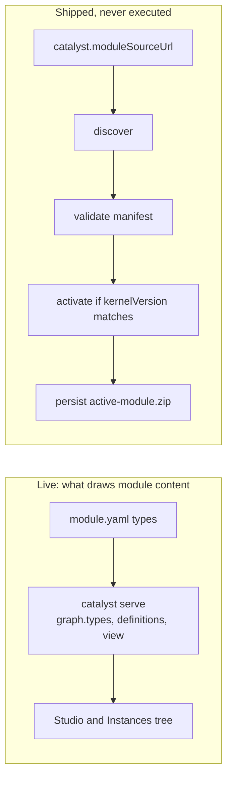

### 3.13 Messaging: webviews, the Studio frame, Electron IPC, and the write allow-list

**Protocol** (`catalyst-core/src/studio-host.ts`):

- Studio → host (`catalyst: "studio"`): `hello`; `run {id, command, arguments}`; `cancel {id}`;
  `action {id, action}`; `batch {id, actions}` (≤ 50); `try {id, action}`.
- Host → Studio (`catalyst: "host"`): `hello {runs, actions, tries?, agent?}`; `run-event {id, event}`;
  `run-declined {id}`; `action-result {id, ok, output, error, declined?}`; `batch-result {…}`; `try-result {…}`.

Transports: VS Code — iframe ↔ panel relay script ↔ `webview.postMessage`/`onDidReceiveMessage`; Electron —
`window.catalystHost` preload ↔ IPC `catalyst:studio`/`catalyst:host`; browser — none (read-only).

**Write allow-list** (`catalyst-core/src/actions.ts`, decision W1): the host validates
each field by regex and builds argv itself. Verbs: `status-set`, `journal-adopt`, `journal-append`, `reconcile`
(`accept | accept-with-edits | reject | propose | close`), `restore` (to `#N` or ISO time), `approve` (gate),
`analysis-decide`, `user-add`, `user-remove`, `user-assign-role`, `share-pull`, `share-push`. `forewarned: true` adds
`--forewarned` for admin writes previewed with `try` (kernel ≥ 0.112.0, UI 0.65.0). There is **no HTTP write route**:
a browser page can never write or start an agent. Every run/action/batch is confirmed in the host's own modal dialog
first; the change is journaled by catalyst like any CLI command.

An action from the Studio, through the host, to catalyst:

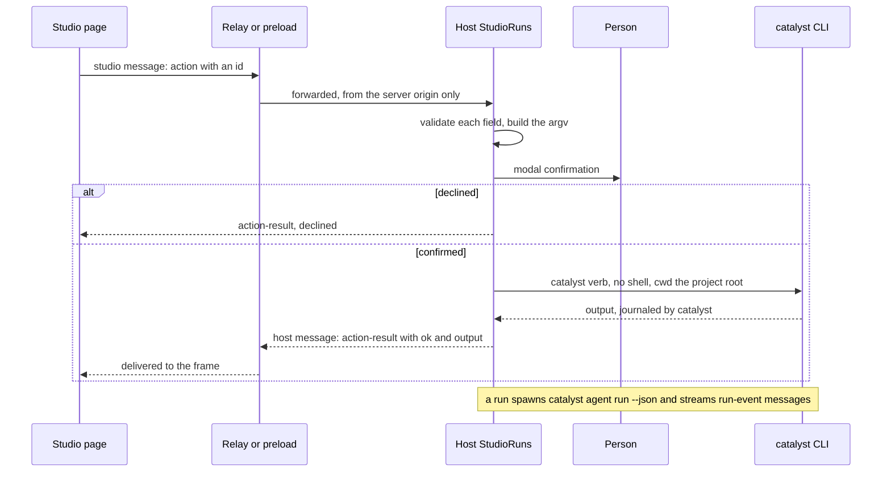

### 3.14 Identity: catalyst-users, the Users panel and password login

The extension holds **no credential**. It runs the catalyst-users CLI named by the setting `catalyst.iam.command`
(default `catalyst-users`; e.g. `uv run --project <catalyst-users checkout> catalyst-users`). The command line is split
on blanks without a shell (quotes group, leading `~/` expands). Every call is `<command> --json <args>`, 60 s timeout.

| Feature                                   | catalyst-users calls                                                                                     | Minimum catalyst-users |
| ----------------------------------------- | -------------------------------------------------------------------------------------------------------- | ---------------------- |
| "Catalyst: Check IAM Account"             | `whoami --system` → shows username, issuer, roles, grants of the **system account**                       | 0.3.0                  |
| (internal) system token                   | `token --system` → `access_token`, `expires_at` (never displayed)                                         | 0.3.0                  |
| Users panel (`catalystUsers` view)        | `users list`, `roles list`, `groups list`; read when shown or on Refresh, never in the background         | (unverified)           |
| User / role / group documents             | `users roles <u>`, `users groups <u>`; `roles holders <r>`; `groups members <path>` → `DirectoryDetail` webview, links between them | (unverified) |
| "Log In to catalyst-users" (right-click a user, or the panel's "Log in…" item) | `login --password --username <u>`, password written to **stdin**, never argv; error text has the password redacted; on success the panel refreshes | 0.9.0 |

Logging in from the Users panel:

```mermaid
sequenceDiagram
  participant P as Person
  participant X as VS Code extension
  participant U as catalyst-users CLI
  participant K as Identity provider (Keycloak)
  P->>X: Log In on a user
  X->>P: ask for the password
  X->>U: --json login --password --username name
  X->>U: password on stdin, never in argv
  U->>K: sign in
  alt refused
    U-->>X: error, password redacted
    X-->>P: the problem and a Log in item
  else signed in
    U-->>X: JSON result
    X->>X: refresh the Users panel
  end
```

If catalyst-users fails, the panel shows the problem plus a "Log in to catalyst-users…" item. Versions 0.60/0.61
stored a password in VS Code secret storage under `catalyst.iam.password`; activation deletes it. The identity
provider (Keycloak in the CanticaTech fleet) and its configuration live in catalyst-users' home `~/.catalyst/users`
(see the catalyst-users chapter). The Studio's Team view, from kernel 0.106.0, does not offer user/role forms: people
are catalyst-users'.

---

## 4. VS Code reference: views, commands, settings, activation

**View container** `catalyst` (activity bar, flask icon `resources/catalyst.svg`) with two views:

| View ID                  | Name      | Content                                                                                                                            |
| ------------------------ | --------- | ---------------------------------------------------------------------------------------------------------------------------------- |
| `catalystChainInspector` | Instances | Every deployment as a top-level entry (renamed from "Instance(s)" in 0.69.0); type sections; each entity once; Journal and Backlog entries; unset folders offering setup. Title bar: Switch UI module, Refresh, Send to Agent, Configure Criterion Repo, Open Settings. |
| `catalystUsers`          | Users     | Users, Roles, Groups sections from catalyst-users; context menu on a user: Log In. Title bar: Refresh.                             |

**Commands** (all titled "Catalyst: …"): `catalyst.showNodeDetail`, `catalyst.openJournal`, `catalyst.openBacklog`,
`catalyst.openStudio`, `catalyst.sendToAgentChat`, `catalyst.configureCriterion`, `catalyst.refreshChainInspector`,
`catalyst.loadUiModule`, `catalyst.selectKernelVersion`, `catalyst.switchUiModule`, `catalyst.openSettings`,
`catalyst.setUpFolder`, `catalyst.checkIamAccount`, `catalyst.iam.login`, `catalyst.users.refresh`,
`catalyst.users.open` (hidden from the palette).

**Settings**:

| Setting                       | Default                                                     | Meaning                                                                                       |
| ----------------------------- | ----------------------------------------------------------- | --------------------------------------------------------------------------------------------- |
| `catalyst.frameworkPath`      | `""`                                                        | Local `cantica-tech/catalyst` checkout (with `BOOTSTRAP.md`) for the install offer, if not a sibling of the project |
| `catalyst.moduleSourceUrl`    | `git@github.com:cantica-tech/cantica-tech.git/catalyst/`    | Where UI-module bundles are listed                                                            |
| `catalyst.kernelSourceUrl`    | `git@github.com:cantica-tech/cantica-tech.git/catalyst/kernel/` | Where kernel releases are listed                                                          |
| `catalyst.detailPanelGroups`  | `perProject`                                                | `perProject` or `single` editor group for detail panels                                       |
| `catalyst.ignoredFolders`     | `[]` (resource scope)                                       | Folders left out of catalyst (absolute or relative to the workspace folder)                   |
| `catalyst.trackEntityInTree`  | `true`                                                      | Reveal the entity a detail panel shows in the tree (only while visible, no focus change)       |
| `catalyst.iam.command`        | `catalyst-users`                                            | The catalyst-users command line                                                               |

**Other surfaces**: language `catalyst` for `*.catalyst` files; a status-bar item `$(beaker) <deployment>` for the
deployment owning the active file (tooltip: kernel version, remote environment; click = backlog); Problems panel
diagnostics (collection `catalyst`) and CodeLens from `catalyst check`; output channel **Catalyst** (logs serve URLs,
watcher failures, module restore, Studio run errors). Since 0.66.0 the extension starts quietly: at most one
notification; install offers are tree entries, not pop-ups.

---

## 5. Task and script reference

Run tasks from the repository root with [Task](https://taskfile.dev) v3. The Taskfile
optionally includes `${STANDARDS_DIR:-../standards}/Taskfile.standards.yml` (flattened, excluding its
`lint`/`format`/`typecheck`), and defines `CODE_BIN` = `code` on `PATH` or the macOS app bundle's `code`.
catalyst's own commands are **not** here: `catalyst task` lists them from the criterion's `Taskfile.common.yml`
(`catalyst task check-rules`, …); never add catalyst tasks to this Taskfile.

### 5.1 `Taskfile.yml` tasks

| Task                                   | Runs                                                                                                   | Writes                                              | Verify                                       |
| -------------------------------------- | ------------------------------------------------------------------------------------------------------ | --------------------------------------------------- | -------------------------------------------- |
| `install`                              | `npm ci`                                                                                               | `node_modules/` (root + hoisted)                    | `npm ls --workspaces --depth=0` exits 0      |
| `lint`                                 | `npm run lint` (= `tsc --build && eslint .`) then `standards:lint`                                     | `dist/`, `*.tsbuildinfo` (tsc emits)                | exit 0                                       |
| `format:check`                         | `npm run format:check` (`prettier --check .`)                                                          | nothing                                             | "All matched files use Prettier code style!" |
| `typecheck`                            | `npm run typecheck` (`tsc --build --pretty`)                                                           | `packages/*/dist`, `*.tsbuildinfo`                  | exit 0                                       |
| `build`                                | alias of `typecheck` (project references emit on build)                                                | same                                                | `packages/*/dist/index.js` exist             |
| `test`                                 | `npm test` → `npm run test --workspaces --if-present`                                                  | host-vscode rebuilds (its `pretest`)                | all suites pass                              |
| `ci`                                   | `lint`, `format:check`, `typecheck`, `test` (what `ci.yml`'s first job runs, plus `standards:lint`)    | as above                                            | exit 0                                       |
| `build:vscode-extension`               | in `packages/catalyst-host-vscode`: `npm run package`                                                  | `packages/catalyst-host-vscode/catalyst-host-vscode.vsix` (gitignored) | `unzip -l …vsix` lists `extension/dist/extension.js`, `webview.js`, `studio/index.html` |
| `install:vscode-extension`             | `build:vscode-extension` then `"$CODE_BIN" --install-extension catalyst-host-vscode.vsix`             | installs into the local VS Code                     | `code --list-extensions --show-versions \| grep catalyst-host-vscode` |
| `install:vscode-extension:unsigned`    | build, `node scripts/enable-unsigned-install.js` (sets `extensions.verifySignature: false` in your **real** VS Code user settings), install | user `settings.json` edited | as above |
| `publish:vscode-extension`             | in host-vscode: `npm run publish` = build + bundle + `npx vsce publish --no-dependencies`              | **public Marketplace release** — owner request only | Marketplace page version                    |
| `publish:vscode-extension:release`     | refuses unless `git describe --tags --exact-match HEAD` is a tag equal to `package.json` version (with or without `v`); then `publish:vscode-extension`; then `release:vsix:publish` with `PUBLISH_DIR` default `../cantica-tech`, `KERNEL_VERSION` default `catalyst.kernelVersion` | Marketplace + commit/push in the distribution repo | — **do not run unless the owner asks** |
| `release:vsix`                         | `build:vscode-extension`, then `node scripts/release-vsix.mjs --publish-dir "$PUBLISH_DIR"` (required var) | copies `.vsix` + `manifest.json` + regenerates `README.md` under `PUBLISH_DIR/catalyst/vsix/v<version>/`; **no commit** | `git -C $PUBLISH_DIR status` |
| `release:vsix:publish`                 | `release-vsix.mjs --publish-dir … --push [--kernel-version …] [CLI_ARGS e.g. -- --tag <tag>]`: builds from the release tag in a temp worktree (`npm ci`, `npm run typecheck`, `npm run package`), copies, **commits "Deploy release: catalyst-host-vscode v<version>" and pushes `origin main`** of `PUBLISH_DIR` | distribution repo commit + push | `git -C $PUBLISH_DIR log -1` |
| `standards:lint` (included)            | markdownlint `**/*.md`, `yamllint --strict .`, `actionlint`, `zizmor --config .standards/zizmor.yml --min-severity medium .github/workflows` (+ ruff/shellcheck when Python/shell files exist) | nothing | exit 0 |
| `standards:check` / `standards:sync`   | drift check / copy of `cantica-tech/standards` into `.standards/`, `.editorconfig`, …                  | `sync` writes tracked files                         | —                                            |
| `standards:format`, `standards:typecheck` | Prettier (and Ruff) in place / Pyright for Python (none here)                                       | `format` writes                                     | —                                            |

The `standards:*` tasks exist only when a `cantica-tech/standards` checkout is at `../standards` (or `STANDARDS_DIR`).
Without it, `task lint` fails at the `standards:lint` step; `npm run lint` alone still works.

### 5.2 Root `package.json` scripts

| Script         | Command                                         |
| -------------- | ----------------------------------------------- |
| `lint`         | `tsc --build && eslint .`                       |
| `format:check` | `prettier --check .`                            |
| `typecheck`    | `tsc --build --pretty`                          |
| `test`         | `npm run test --workspaces --if-present`        |

### 5.3 Package scripts

| Package                  | Script            | Command / effect                                                                                                                                                                                                       |
| ------------------------ | ----------------- | ---------------------------------------------------------------------------------------------------------------------------------------------------------------------------------------------------------------------- |
| `catalyst-core`          | `build`           | `tsc --build`                                                                                                                                                                                                          |
|                          | `test`            | `vitest run` (includes the spec tests)                                                                                                                                                                                 |
|                          | `spec:sync`       | `node scripts/spec.mjs sync <checkout> <tag>` (writes `spec/`, `src/spec.ts`)                                                                                                                                         |
|                          | `spec:generate`   | regenerate `src/spec.ts`                                                                                                                                                                                               |
|                          | `spec:check`      | fail if `src/spec.ts` is stale                                                                                                                                                                                         |
| `catalyst-app-model`     | `build`, `test`   | `tsc --build`; `vitest run`                                                                                                                                                                                            |
| `catalyst-ui`            | `build`           | `tsc --build`                                                                                                                                                                                                          |
|                          | `build:webview`   | `esbuild src/webview-entry.tsx --bundle --minify --format=iife --platform=browser --jsx=automatic --outfile=dist/webview.js` with `NODE_PATH=node_modules:../../node_modules`                                          |
|                          | `test`            | `vitest run`                                                                                                                                                                                                           |
| `catalyst-studio`        | `build`           | `tsc --build && node scripts/bundle.mjs` → `dist/web/{index.html, studio.css, studio.js, embed.js}`                                                                                                                   |
|                          | `test`            | `vitest run` (jsdom + axe-core)                                                                                                                                                                                        |
| `catalyst-host-vscode`   | `prebuild`        | `npm run build:webview -w catalyst-ui && npm run build -w catalyst-studio && mkdir -p dist && cp ../catalyst-ui/dist/webview.js dist/webview.js && rm -rf dist/studio && cp -R ../catalyst-studio/dist/web dist/studio` |
|                          | `build`           | `tsc --build --force` (forced on purpose — see §9 "No test files found")                                                                                                                                               |
|                          | `pretest`/`test`  | `npm run build`; `mocha "dist/test/**/*.test.js"`                                                                                                                                                                      |
|                          | `bundle`          | `esbuild src/extension.ts --bundle --platform=node --format=cjs --external:vscode --external:fsevents --outfile=dist/extension.js` (overwrites tsc's `dist/extension.js` with the self-contained bundle)              |
|                          | `package`         | `npm run build && npm run bundle && npx vsce package --no-dependencies -o catalyst-host-vscode.vsix`                                                                                                                    |
|                          | `publish`         | `npm run build && npm run bundle && npx vsce publish --no-dependencies` (Marketplace; needs a `vsce` login for publisher `CanticaTech`)                                                         |
| `catalyst-host-electron` | `prebuild`        | `npm run build:renderer`                                                                                                                                                                                               |
|                          | `build:renderer`  | `esbuild src/renderer-entry.tsx … --outfile=dist/renderer.js --format=iife --platform=browser`                                                                                                                         |
|                          | `build`           | `tsc --build --force`                                                                                                                                                                                                  |
|                          | `test`            | `vitest run`                                                                                                                                                                                                           |
|                          | `bundle`          | `node scripts/bundle.mjs` → `app/{main,preload,studio-preload,renderer}.js` + `app/package.json`                                                                                                                       |
|                          | `dist`            | `npm run bundle && electron-builder --publish never` → `release/`                                                                                                                                                       |

---

## 6. Build from scratch

### 6.1 Prerequisites

| Tool                 | Version / note                                                                                                                                                            | Check                                   |
| -------------------- | ------------------------------------------------------------------------------------------------------------------------------------------------------------------------- | --------------------------------------- |
| Node.js + npm        | `.nvmrc` pins **20**; `engines.node >=20`; CI and the Desktop workflow use **24**. Either works; use 24 to match CI.                                                       | `node --version`                        |
| git                  | for `release-vsix.mjs` worktrees, spec sync, module discovery                                                                                                              | `git --version`                         |
| Task v3              | optional but used throughout                                                                                                                                               | `task --version`                        |
| VS Code ≥ 1.85       | with the `code` CLI on `PATH` (Command Palette → "Shell Command: Install 'code' command in PATH"), else the Taskfile falls back to the macOS app bundle path               | `code --version`                        |
| catalyst CLI         | to actually *use* the UI: catalyst's launcher at `~/.catalyst/bin/catalyst` (or `catalyst` on `PATH`), kernel ≥ 0.54.0; ≥ 0.64.0 for the Studio; build depends on nothing from catalyst | `~/.catalyst/bin/catalyst --version` (unverified flag) |
| Python ≥ 3.11        | needed by catalyst itself, and by the desktop app's bundled `catalyst.pyz`                                                                                                 | `python3.12 --version`                  |
| catalyst-users       | for the Users panel / login / IAM check; configured with its own identity provider                                                                                         | `catalyst-users --json whoami --system` |
| `cantica-tech/standards` checkout at `../standards` | only for `task lint` / `task standards:*`                                                                                                   | `ls ../standards/Taskfile.standards.yml`|
| actionlint, zizmor, yamllint, markdownlint-cli2 | used by `standards:lint` (how they are provisioned is in the standards repo — unverified here)                                                         | —                                       |

### 6.2 Clone and install

```sh
git clone git@github.com:cantica-tech/catalyst-ui.git
cd catalyst-ui
git checkout development              # day-to-day branch; main/release trail it (§7)
nvm use                               # or: nvm install 24 && nvm use 24
npm ci                                # = task install
```

Creates `node_modules/` with workspace symlinks `node_modules/catalyst-core -> ../packages/catalyst-core`, etc.
Verify: `ls -l node_modules/ | grep catalyst-` shows six links.

### 6.3 Build every package

```sh
npm run typecheck                     # = task build; tsc --build over the solution
npm run build -w catalyst-studio      # Studio web bundle (tsc does NOT produce it)
npm run build:webview -w catalyst-ui  # VS Code detail webview bundle
```

Creates `packages/*/dist/**`, `packages/*/tsconfig.tsbuildinfo`, `packages/catalyst-studio/dist/web/{index.html,
studio.css,studio.js,embed.js}`, `packages/catalyst-ui/dist/webview.js`. Verify: `ls packages/catalyst-studio/dist/web`.

### 6.4 Run the full CI suite locally — from a clean tree

Local incremental builds can pass on stale `*.tsbuildinfo` and stale `dist/` while CI (fresh clone) fails. Before a
release, clean first. In zsh a non-matching glob aborts the whole `rm`, so remove the two kinds separately:

```sh
rm -rf packages/*/dist
rm -f  packages/*/tsconfig.tsbuildinfo
npm run lint
npm run format:check
npm run typecheck
npm test
npm run build -w catalyst-studio      # catches a browser bundle reaching Node modules
```

(`task ci` = lint (+ standards:lint), format:check, typecheck, test.) Expected: all exit 0. At HEAD `1ec35eb` on
2026-10-31, **`npm test` fails** in `catalyst-core/src/test/spec.test.ts` because `spec/KERNEL` (0.119.1) ≠
`catalyst-version.txt` (0.119.2); CI on `development` is red for the same reason (fix in §8.3).

### 6.5 Build the VS Code extension (`.vsix`)

```sh
task build:vscode-extension
# or: cd packages/catalyst-host-vscode && npm run package
```

What happens: `prebuild` builds the `catalyst-ui` webview and the Studio and copies them into the extension's `dist/`
(`dist/webview.js`, `dist/studio/`); `tsc --build --force`; esbuild bundles `src/extension.ts` with `catalyst-core`
inlined into `dist/extension.js`; `vsce package --no-dependencies` writes
`packages/catalyst-host-vscode/catalyst-host-vscode.vsix` (≈ 650 KB for 0.69.0). Verify:

```sh
unzip -l packages/catalyst-host-vscode/catalyst-host-vscode.vsix | grep -E 'extension.js|webview.js|studio/index.html'
```

What `npm run package` chains together:

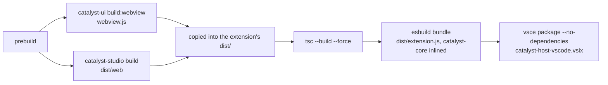

### 6.6 Install it in VS Code

```sh
task install:vscode-extension
# or: code --install-extension packages/catalyst-host-vscode/catalyst-host-vscode.vsix
```

If VS Code refuses an unsigned local build ("signature verification"), either use
`task install:vscode-extension:unsigned` (permanently sets `extensions.verifySignature: false` in your user settings —
revert it by hand later) or install the Marketplace build. A released `.vsix` is also available from
`cantica-tech/cantica-tech:catalyst/vsix/v<version>/catalyst-host-vscode-v<version>.vsix` (with `manifest.json`
naming the kernel range).

Verify: `code --list-extensions --show-versions | grep -i catalyst-host-vscode` → `canticatech.catalyst-host-vscode@0.69.0`;
reload the window in a folder containing `catalyst.toml`; the **Catalyst** activity-bar icon shows Instances and Users;
the "Catalyst" output channel logs `reading <criterion> through catalyst serve`.

Then set `catalyst.iam.command` if catalyst-users is not on `PATH` (e.g. `uv run --project <catalyst-users checkout>
catalyst-users`) and run "Catalyst: Check IAM Account".

### 6.7 Run the extension from source (development host)

There is no checked-in `.vscode/launch.json` in this repo (the repo's `.vscode` folder is absent). To debug: build
(§6.5 up to `npm run bundle`), then start VS Code with `code --extensionDevelopmentPath=$PWD/packages/catalyst-host-vscode
<a catalyst project>` **(unverified as a documented workflow; standard VS Code mechanism)**.

### 6.8 Build and run the desktop app

Local (from `cantica-tech/catalyst-ui:docs/desktop.md`):

```sh
npm ci
npx tsc --build
npm run build --workspace catalyst-studio
cd packages/catalyst-host-electron
npm run bundle                                   # app/ (main.js, preload.js, studio-preload.js, renderer.js, package.json)
# optional: ship a catalyst.pyz like the release build does
v=$(tr -d '[:space:]' < catalyst-version.txt); mkdir -p build/catalyst
curl -fsSL -o build/catalyst/catalyst.pyz \
  "https://raw.githubusercontent.com/cantica-tech/cantica-tech/main/catalyst/kernel/v${v}/catalyst.pyz"
CSC_IDENTITY_AUTO_DISCOVERY=false npx electron-builder --mac dir   # or --win / --linux; drop "dir" for installers
```

Creates `packages/catalyst-host-electron/release/` (e.g. `release/mac-arm64/Catalyst Studio.app`, or
`catalyst-studio-<v>-<os>-<arch>.<ext>` installers). All outputs are gitignored. Run the `.app`/AppImage directly. In a
VS Code integrated terminal, `unset ELECTRON_RUN_AS_NODE` first or Electron starts as plain Node.

Running unpackaged for development: `npm run build -w catalyst-host-electron` (builds `dist/main.js`,
`dist/renderer.js`), then `npx electron packages/catalyst-host-electron` **(unverified: `main` is `dist/main.js`,
which expects `renderer.js` beside it; `npm run build:renderer` writes it to `dist/`)**.

Use: "Add project" → pick a folder with `catalyst.toml` whose criterion resolves (§3.9); the project gets a live count
and graph; "Open Studio" opens a Studio window via `catalyst serve --local --static`.

Which catalyst the desktop app uses: §3.8. Released builds ship `catalyst.pyz` of `catalyst-version.txt` (downloaded by
the Desktop workflow); it is used only when no catalyst is installed and needs Python ≥ 3.11.

### 6.9 Serve the Studio in a plain browser (read-only)

```sh
npm run build -w catalyst-studio
cd <a catalyst project>
catalyst serve --local --project . --static /abs/path/to/catalyst-ui/packages/catalyst-studio/dist/web
```

The first stdout line is JSON with `page` (URL with `#token=…`); open it. No runs or writes are possible in a browser.

---

## 7. Release process

### 7.1 Branch model

Three long-lived branches, mirroring catalyst's own: **`development`** (all work; CI on push), **`main`** (GitHub
default branch; receives `development` by PR), **`release`** (receives `main` by PR; GitHub releases target it).
None of the three is protected on GitHub (checked 2026-10-31); the discipline is procedural.

How a release moves through the three branches:

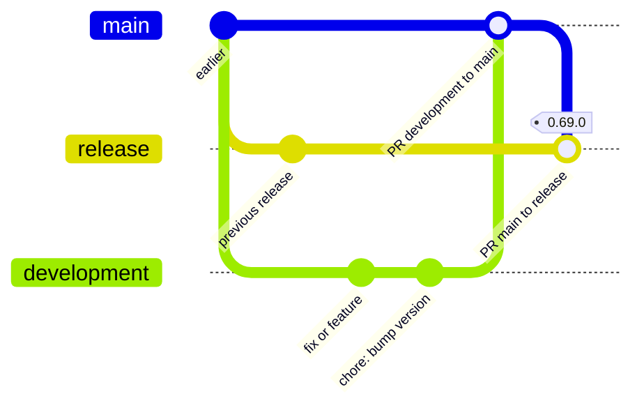

### 7.2 Version and kernel bookkeeping per release

A release commit on `development` is a `chore:` titled like `chore: bump version to 0.69.0; <summary>; works with kernel
>=0.54.0` and updates, together:

- `version.txt`, every `packages/*/package.json` `version`, root `package-lock.json`, `catalyst-core/src/index.ts`
  `VERSION` (tests compare them).
- `catalyst-modules.md` release log row (convention; the file's header is stale).
- If the verified kernel changes: `KERNEL_VERSION_FLOOR`/`VERIFIED_KERNEL_VERSION` and
  `catalyst-host-vscode/package.json` `catalyst.kernelVersion` together.
- If the desktop app's kernel changes: `packages/catalyst-host-electron/catalyst-version.txt` **and**
  `spec:sync` to the same tag (the test enforces equality; the kernel's `catalyst.pyz` must already be published in
  `cantica-tech/cantica-tech:catalyst/kernel/v<version>/`).
- Separately, catalyst-ui's own deployment is bumped with `chore: catalyst at kernel <x>` (`catalyst.toml`
  `kernel_version`), done through catalyst's sync commands, never by hand.

### 7.3 Cutting a release (as practised; there is no script)

1. On `development`, from a **clean build** (§6.4) everything passes; push; wait for **CI** and **Standards** green.
2. Open PR `development → main` titled `catalyst UI <version>` (e.g. #191); wait for CI + Standards on the PR; merge.
3. Open PR `main → release` titled `catalyst UI <version>` (e.g. #192); wait; merge.
4. Create the GitHub release on `release`: **tag `<version>` without `v`** (e.g. `0.69.0`), release name
   `v<version>`: `gh release create 0.69.0 --target release --title v0.69.0 --notes …`.
   Older tags (≤ 0.30.0) used `v<version>`; tooling accepts both.
5. Publishing the release triggers the **Desktop** workflow, which builds macOS/Windows/Linux and attaches 11 files
   (`.dmg`/`.zip` ×2 mac, `.exe` ×3 win, `.AppImage`/`.deb` ×2 linux each) to the release. Verify:
   `gh release view <version> -R cantica-tech/catalyst-ui --json assets`.
6. Copy the `.vsix` to the distribution repo: `git fetch --tags` (local clones may lack recent tags), then
   `task release:vsix:publish PUBLISH_DIR=<cantica-tech/cantica-tech checkout>` — builds from the tag in a temp
   worktree, writes `catalyst/vsix/v<version>/{catalyst-host-vscode-v<version>.vsix, manifest.json}` and the
   `catalyst/vsix/README.md` table, commits and **pushes** the distribution repo's `main`.
7. **Marketplace only on explicit owner request**: `task publish:vscode-extension` (or
   `publish:vscode-extension:release` from a checkout of the exact tag, which also does step 6). `vsce` needs a
   publisher login for `CanticaTech`. Never part of the routine cycle.

Verify the distribution copy: `cat <cantica-tech>/catalyst/vsix/v<version>/manifest.json` (`id`, `version`,
`kernelVersion`, `vscode`, `file`).

The release cycle end to end:

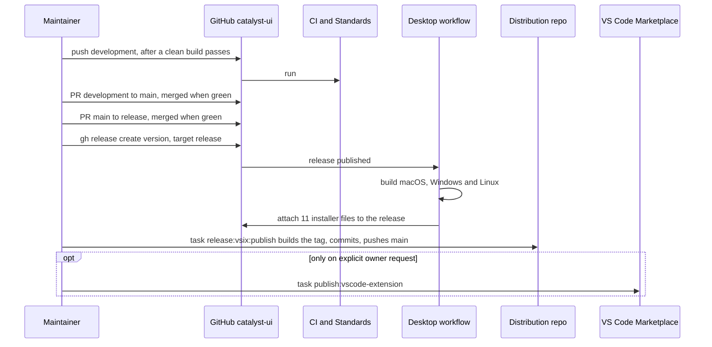

### 7.4 CI workflows (`cantica-tech/catalyst-ui:.github/workflows/`)

| Workflow        | Trigger                                    | Jobs                                                                                                                                                                                                                                                                                                                                         |
| --------------- | ------------------------------------------ | -------------------------------------------------------------------------------------------------------------------------------------------------------------------------------------------------------------------------------------------------------------------------------------------------------------------------------------------- |
| `ci.yml` (CI)   | every `pull_request`; push to `development` | **lint-typecheck-test** (ubuntu, Node 24): `npm ci`, `npm run lint`, `npm run format:check`, `npm run typecheck`, `npm test`. **catalyst-trace** (ubuntu, Python 3.11): clones the project's private criterion repository (branch from `catalyst.toml`) with secret `CRITERION_DEPLOY_KEY` into `$RUNNER_TEMP/catalyst/projects/<name>/criterion`, then `python3 <criterion>/bin/catalyst.pyz trace <range>` (PR base..head, push before..sha, or sha~1..sha): every commit must cite an artifact/rule ID or be `chore:`. |
| `standards.yml` | every `pull_request`; push to `development` | Reuses `cantica-tech/standards/.github/workflows/lint.yml@v0.1.2` (`ref: v0.1.2`, `typecheck: false`): standards drift check + linters.                                                                                                                                                                                                     |
| `desktop.yml`   | `release: published`; `workflow_dispatch`  | Matrix macOS/Windows/Ubuntu, environment `release`, Node 24, no npm cache: `npm ci`, `npx tsc --build`, `npm run build -w catalyst-studio`, `npm run bundle -w catalyst-host-electron`; downloads `catalyst.pyz` for `catalyst-version.txt` from `raw.githubusercontent.com/cantica-tech/cantica-tech/main/catalyst/kernel/v<ver>/catalyst.pyz` (checks the `#!` shebang); signing setup; `npx electron-builder --publish never`; Windows Azure Artifact Signing when `vars.AZURE_CLIENT_ID` is set; uploads to the release (`gh release upload --clobber`) or, for manual runs, as run artifacts `catalyst-studio-<os>`. |

Secrets/variables (names only): `CRITERION_DEPLOY_KEY` (repo secret, read-only deploy key on the criterion repo);
environment `release`: secrets `MAC_CERTIFICATE_P12`, `MAC_CERTIFICATE_PASSWORD`, `APPLE_API_KEY_P8`; variables
`APPLE_API_KEY_ID`, `APPLE_API_ISSUER`, `AZURE_TENANT_ID`, `AZURE_CLIENT_ID`, `AZURE_SUBSCRIPTION_ID`,
`ARTIFACT_SIGNING_ENDPOINT`, `ARTIFACT_SIGNING_ACCOUNT`, `ARTIFACT_SIGNING_PROFILE`. Without them builds are
**unsigned** and the run emits a `::notice::`. The setup procedure for each is in `docs/desktop.md`. All actions are
pinned by SHA (zizmor-clean).

What triggers which workflow:

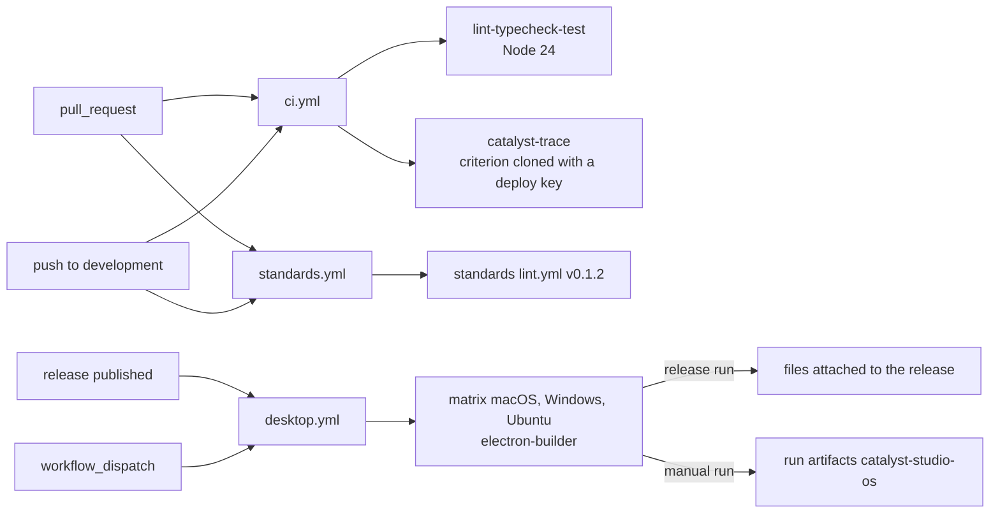

### 7.5 `scripts/release-vsix.mjs` in detail

`node scripts/release-vsix.mjs --publish-dir <dir> [--push [--tag <tag>]] [--kernel-version <range>]`

- Without `--push`: copies the already-built working-tree `.vsix`; no git operations on `<dir>`.
- With `--push`: finds tag `v<version>` or `<version>` (or `--tag`), `git worktree add --detach` into a temp dir,
  `npm ci --no-audit --no-fund`, `npm run typecheck`, `npm run package` there; removes the worktree afterwards.
- `kernelVersion`: `--kernel-version` or `package.json` `catalyst.kernelVersion` (refuses if neither).
- Destination `<dir>/catalyst/vsix/v<version>/`: removes other files there, writes `catalyst-host-vscode-v<version>.vsix`
  and `manifest.json` (`id, name, version, description, kernelVersion, vscode, file`), regenerates
  `<dir>/catalyst/vsix/README.md` (one row per release, newest first).
- With `--push`: `git add catalyst/vsix`, commit `Deploy release: catalyst-host-vscode v<version>`, `git push origin main`.

### 7.6 Governance of releases

Every non-chore commit cites a `REQ-`/`BUG-` of the criterion (SE module law: a feature is a requirement with steps;
a fix is a bug). Changes are journaled by catalyst as they happen. Pushes, PRs and publication need the owner's
explicit assent (catalyst law L3).

---

## 8. How-tos

### 8.1 Point the extension at a specific catalyst

Launch VS Code from a shell with `CATALYST_BIN` set, e.g.
`CATALYST_BIN="$HOME/.catalyst/projects/myproj/criterion/.venv/bin/catalyst" code <project root>`
(the variable is split on spaces, so no spaces inside paths). Check the "Catalyst" output channel for the serve URL.

### 8.2 Use the desktop app without installing catalyst

Install Python ≥ 3.11 so `python3.11`/`python3.12`/`python3.13` (or `python3` if new enough) is on `PATH`; do not have
`catalyst` on `PATH` or `~/.catalyst/bin/catalyst` present (they take precedence). The app runs its bundled
`catalyst.pyz`.

### 8.3 Move the Studio's types and the desktop kernel to a new catalyst release

Prerequisite: the kernel tag exists in a `cantica-tech/catalyst` checkout and its `catalyst.pyz` is published in
`cantica-tech/cantica-tech:catalyst/kernel/v<ver>/`.

```sh
npm run spec:sync -w catalyst-core -- ../catalyst <tag>     # e.g. 0.119.2 — tag exactly as spec/KERNEL should read
echo <ver> > packages/catalyst-host-electron/catalyst-version.txt
npm test -w catalyst-core                                   # spec tests pass
npm run typecheck && npm test                               # catch consumers of changed types
```

Commit as `chore: spec/ and the desktop app at catalyst <ver>` (or a `fix(BUG-…)` if behaviour changes). This is the
pending fix for the red CI at HEAD (`spec/KERNEL` 0.119.1 vs `catalyst-version.txt` 0.119.2).

### 8.4 Raise the verified kernel

Edit `packages/catalyst-core/src/kernel-version.ts` (`VERIFIED_KERNEL_VERSION`, and `KERNEL_VERSION_FLOOR` if the
floor moves) and `packages/catalyst-host-vscode/package.json` `catalyst.kernelVersion` to `>=<floor>`; run tests. This
changes the sync offer and the release manifest's `kernelVersion`.

### 8.5 Leave a folder out of catalyst

Commit an empty `.catalystignore` in it (for everyone), or add it to `catalyst.ignoredFolders` (this workspace only).

### 8.6 Work in a dev container / WSL / SSH

The extension runs remotely. Ensure the project's criterion is reachable there: with the home store, mount or clone
`$HOME/.catalyst/projects/<name>/criterion` in the remote (e.g. via `catalyst open`, which readies a criterion from its
repo), and have catalyst's launcher installed remotely. For legacy `.criterion` symlinks the extension offers a
devcontainer `mounts` entry or `/share create`.

### 8.7 Test the desktop build without a release

Run the **Desktop** workflow manually (`gh workflow run desktop.yml -R cantica-tech/catalyst-ui --ref <branch>`); the
files are kept as run artifacts `catalyst-studio-<os>` (nothing is attached to a release).

### 8.8 Inspect what the UI sees

Start the server yourself in the project: `catalyst serve --local --project .` → copy `url`/`token` from the first
line → `curl -H "Authorization: Bearer <token>" <url>/v1/graph | jq '.types | keys'`.

---

## 9. Common failures and fixes

| Symptom                                                                                                 | Cause                                                                                                                                                         | Fix                                                                                                                                                         |
| ------------------------------------------------------------------------------------------------------- | ------------------------------------------------------------------------------------------------------------------------------------------------------------- | ----------------------------------------------------------------------------------------------------------------------------------------------------------- |
| `catalyst cannot serve <project>: … It needs catalyst 0.54.0 or later: run catalyst open` (output channel / tree) | catalyst not found (`ENOENT`), project's criterion not ready, or kernel < 0.54.0                                                                    | Install catalyst's launcher; run `catalyst open` in the project; check `catalyst where`; set `CATALYST_BIN`                                                 |
| `catalyst serve --local: no answer` after 15 s                                                          | slow first start (runtime creation), or server printing non-JSON                                                                                              | Run `catalyst serve --local --project .` in a terminal to see the error; warm the criterion runtime with `catalyst open`                                   |
| "This catalyst cannot serve a page (catalyst 0.64.0 or later serves one)"                               | kernel too old for `--static`                                                                                                                                 | Sync the project to a newer kernel                                                                                                                          |
| "The Studio bundle is missing from this extension"                                                     | `.vsix` built without `prebuild` (e.g. `vsce package` run by hand)                                                                                            | Build with `task build:vscode-extension`                                                                                                                    |
| Desktop: "this app carries its own catalyst, which needs Python 3.11 or later on the PATH"             | Only macOS's Python 3.9 found                                                                                                                                 | Install Python ≥ 3.11 (e.g. Homebrew/uv) so `python3.11+` is on the app's `PATH`, or install catalyst                                                      |
| Desktop app launched from VS Code terminal behaves like Node                                            | `ELECTRON_RUN_AS_NODE` set by VS Code                                                                                                                         | `unset ELECTRON_RUN_AS_NODE`                                                                                                                                 |
| Users panel: `catalyst-users (…) failed: catalyst-users was not found — check catalyst.iam.command`     | catalyst-users not on the editor's `PATH`                                                                                                                     | Set `catalyst.iam.command` to an absolute command (e.g. `uv run --project <catalyst-users checkout> catalyst-users`)                                         |
| "did not answer JSON: is it catalyst-users 0.9.0 or later?" on login                                    | old catalyst-users                                                                                                                                            | Upgrade catalyst-users                                                                                                                                      |
| Users panel empty / provider errors                                                                     | identity provider (Keycloak) not running or not configured in `~/.catalyst/users`                                                                             | Start the provider; `catalyst-users --json whoami --system`                                                                                                 |
| CI `npm test` fails: `expected '0.119.1' to be '0.119.2'` in `spec.test.ts`                             | `catalyst-version.txt` bumped without `spec:sync` (current state of `development`)                                                                            | §8.3                                                                                                                                                         |
| CI fails although local checks pass                                                                     | stale `*.tsbuildinfo`/`dist` locally; or the Studio importing a runtime value from `catalyst-core`'s root (pulls `node:*` into the browser bundle)             | Clean build (§6.4); import runtime helpers only from `catalyst-core/graph-artifact`, types via `import type`                                                |
| host-vscode mocha: "No test files found" on CI                                                          | historical: incremental `tsc --build` on the Linux runner emitted no `dist/test` (root cause unconfirmed, suspected mtime/incremental cache)                  | Fixed by `tsc --build --force` in that package's `build`; don't remove `--force`                                                                            |
| `src/spec.ts is not what spec/ generates`                                                               | hand edit, or Prettier config changed                                                                                                                         | `npm run spec:generate -w catalyst-core`                                                                                                                    |
| `spec.mjs`: `the keyword X is not supported`                                                            | a new kernel schema uses an unsupported JSON-Schema keyword                                                                                                   | Extend `scripts/spec.mjs` (as was done for `oneOf`)                                                                                                   |
| `task lint` fails at `standards:lint` / task not found                                                 | no `../standards` checkout                                                                                                                                    | Clone `cantica-tech/standards` next to the repo or set `STANDARDS_DIR`; or run `npm run lint` only                                                          |
| `release:vsix:publish`: "No release tag for 0.69.0"                                                     | local clone lacks the tag (tags are created on GitHub)                                                                                                        | `git fetch --tags`                                                                                                                                          |
| `publish:vscode-extension:release`: "HEAD is not an exact release tag"                                  | not checked out at the tag                                                                                                                                    | `git checkout <version>`                                                                                                                                    |
| `code --install-extension` signature error                                                              | unsigned local build                                                                                                                                          | `task install:vscode-extension:unsigned` (and revert the setting later)                                                                                     |
| `task install:vscode-extension` cannot find `code`                                                      | `code` shim not installed (non-macOS fallback path absent)                                                                                                    | Install the shell command from VS Code's palette                                                                                                            |
| A deployment shows a warning "working copy … is not reachable from a dev container"                     | legacy `.criterion` symlink into another machine's storage                                                                                                    | Copy the suggested mount or share the criterion (§8.6)                                                                                                      |
| Saved UI module "not restored: …" in the output channel                                                 | module's `kernelVersion` specifier doesn't match the first deployment's kernel                                                                                | Harmless (module UI is not rendered); switch module or ignore                                                                                               |

---

## 10. Next steps (roadmap, decisions, design notes)

Sources: `cantica-tech/catalyst-ui:docs/roadmap.md` (phase R6 of catalyst's roadmap; catalyst keeps the engine side
in `cantica-tech/catalyst:docs/roadmap.md`), `docs/decisions.md`, `docs/design/09, 23, 24, 25, 26,
ui-potential-roadmap/`.

**Done (as of 0.69.0):** R6.A foundations (host split, `HostPort`, `catalyst-app-model`, the Studio SPA, generated
`spec/` types R6.50); R6.B first views (trace, inbox, dashboard, drift, generated entity pages, palette and agent
console); R6.C richer views (map, journal timeline, board, roadmap, rules, history/diffs, approvals, team, search);
gap phases G1–G4 from design `24` (writes through the host W1, inbox settling, board moves, rollback, batch moves,
read-side completion, approval gates, proposals, Try it, rule strength, analysis workspace, module administration,
team WIP, Gantt, unread count, audit pack, embeds); R6.20 desktop packaging and the bundled CLI; R6.25 IAM
administration and share panel (IAM forms later handed to catalyst-users); 0.65.0 admin forewarning (`try` then
`--forewarned`); 0.67–0.69 catalyst-users login, Users panel, single-occurrence tree, "Instances" naming.

**Open / next:**

1. **Fix CI on `development`**: `spec:sync` to 0.119.2 (§8.3) — CI is red since `1ec35eb`.
2. **Studio editing (design `26`, decided 2026-10-25)**: a form editor generated from each type's definition;
   "New…" limited to types the person may create (from `catalyst identity whoami` and the modules' definitions);
   "Retire" instead of delete; non-admins edit/retire only unlinked entities they own, linked ones go through
   "Request change"/"Request retirement" proposals moved by the governing workflow; admins get the "What this would
   change" preview on every write; batch edits admins only; fields/sections edited in the form only. Depends on
   catalyst designs `30` (visibility) and `31` (contributor grants, workflows, tags), and on the action allow-list
   gaining `new`, `propose`, field edits and `try` — none of which are in `actions.ts` yet.
3. **R6.20 remainder**: signing credentials (Apple Developer ID + notarization; Azure Artifact Signing) — builds are
   unsigned until the owner provides them; the app inside the Windows installer is not separately signed; **auto-update**
   waits on the feed choice (Azure Blob Storage vs GitHub Releases; `publish: null` today); `.deb` maintainer has no
   address yet.
4. **Brand roadmap** (decision C5, its own roadmap): spike (design `25`), legal clearance (USPTO/EUIPO checks still to do per C3), name decision, asset
   licence audit, colour/type system, mark and app icon (the flask icon is back since 0.64.0, licence in
   `brand/README.md`), voice, name sweep, brand in the CLI, store/web presence, guide, vocabulary; every brand change
   follows the "Brand change" workflow (decision C5).
5. **R6.E (after 1.0 unless a pilot needs it)**: R6.22 cost meter beyond per-run cost; R6.26 notifications beyond the
   unread count; R6.29 sandboxed module UI stays **disabled** (C6) — revisit only if a module needs what `module.yaml`
   cannot express.
6. **Exit criteria for R6.A–D** still to demonstrate formally: same bundle at localhost, in VS Code and on desktop
   (done in practice); a second module rendering with no UI change (knowledge-base does); "a newcomer finds why an
   artifact exists in under three minutes"; Problems panel equals `catalyst check`. Budgets from
   `ui-potential-roadmap` (15k tokens first session, 500 graph nodes at 16 ms, P95 < 200 ms) are targets to measure.
7. **Housekeeping implied by this review** (not on any roadmap): refresh the root `README.md` (still lists four
   packages, calls the desktop host unreleased) and the Marketplace `packages/catalyst-host-vscode/README.md` (still
   advertises the removed "propose a fix" and authoring composer); refresh `catalyst-modules.md`'s header (as of
   catalyst 0.36.0); `VERIFIED_KERNEL_VERSION` has stayed at 0.54.0 while the fleet runs 0.119.x; the legacy
   `.criterion`/agent-storage code paths (`join-criterion.ts`, `configureCriterion`, onboarding's
   "connect existing criterion repo") predate the `$HOME/.catalyst` criterion home; `.standards/VERSION` is v0.1.1
   while CI runs standards v0.1.2.

---

## 11. Known oddities and what was not verified

**Oddities / gotchas**

- `development` HEAD (`1ec35eb`, "the desktop app ships kernel 0.119.2") is pushed and **CI fails** on the
  `spec/KERNEL` = `catalyst-version.txt` test; the published 0.69.0 desktop build shipped kernel 0.119.1.
- Release tags are bare versions (`0.69.0`) with release names `v0.69.0`; tags up to 0.30.0 were `v`-prefixed. A
  local clone may hold only old tags → `git fetch --tags` before `release:vsix:publish`.
- `.nvmrc` says 20; CI/Desktop use 24.
- The package named `catalyst-ui` is the VS Code detail-webview package, not the Studio; the repo is also called
  catalyst-ui.
- `npm run lint` runs `tsc --build` first, so "lint" also emits build output.
- `catalyst-host-vscode`'s `bundle` overwrites tsc's `dist/extension.js` with the esbuild bundle; `test` (via
  `pretest` → `build`) then rewrites the tsc version. Always package with `npm run package`, which runs build then bundle.
- `install:vscode-extension:unsigned` changes your global VS Code setting `extensions.verifySignature` permanently.
- The VS Code sync offer never fires for current kernels because `VERIFIED_KERNEL_VERSION` is 0.54.0.
- Module UI bundles are downloaded/held but never executed; modules render from their types only (C6).
- The Electron main window is a separate, simpler UI (project list, counts, graph) than the Studio window.

**Not verified in this review**

- Running the VS Code extension or desktop app interactively; the extension-development-host and unpackaged
  `npx electron` invocations in §6.7/§6.8 are standard mechanisms, not documented in the repo.
- Exact minimum catalyst-users versions for `users/roles/groups list|members|holders` (only 0.3.0 for whoami/token and
  0.9.0 for password login are stated in code).
- Whether catalyst's launcher honours `--project` (the UI passes `--project` but spawns `serve` without setting cwd;
  it works in practice in the fleet, per the release log).
- How `standards:lint`'s external tools (actionlint, zizmor, yamllint, markdownlint) are installed — see the
  standards chapter.
- Whether the 0.69.0 Marketplace listing matches the GitHub release (Marketplace publication is on owner request only
  and was not checked).
- The only test run in this review was `vitest run src/test/spec.test.ts` in `catalyst-core` (3 passed, 1 failed as
  described) and `node scripts/spec.mjs check` (passes); no full build or packaging was run.
