This chapter lists what surprises a newcomer to the catalyst fleet: known bugs and their fixes, CI quirks, environmental requirements, historical traps, and design choices that look wrong but are deliberate (with their rationale). It reflects the state on **2026-10-31**: kernel **0.119.2**, SE module 3.4.1, KBM 0.6.1, catalyst-ui 0.69.0, catalyst-users 0.10.0, catalyst-mcp 0.4.0, catalyst-kb-engine 0.16.0.

Each entry gives:

- **Symptom** — what you see.
- **Cause** — why it happens.
- **Fix / workaround** — what to do about it.
- **Source** — where it is recorded.

Every source is a public repository. `cantica-tech/<repo>:<path>` is a file in one; a bare path is a file in the repository the section is about; "CHANGELOG x.y.z" is that release's entry in the repository's `CHANGELOG.md`.

## Contents

- [0. Fleet-wide conventions that bite](#0-fleet-wide-conventions-that-bite)
- [1. Kernel — cantica-tech/catalyst](#1-kernel--cantica-techcatalyst)
  - [1.1 Release and CI](#11-release-and-ci)
  - [1.2 Tests](#12-tests)
  - [1.3 Identity, signing, journal](#13-identity-signing-journal)
  - [1.4 Migrations, sync, modules](#14-migrations-sync-modules)
  - [1.5 Documentation drift](#15-documentation-drift-in-the-kernel-repo)
  - [1.6 Historical traps](#16-historical-traps-kernel)
  - [1.7 Deliberate design choices](#17-deliberate-design-choices-that-look-odd)
- [2. SE module — cantica-tech/catalyst-software-engineering](#2-se-module--cantica-techcatalyst-software-engineering)
- [3. KBM — cantica-tech/catalyst-knowledge-base](#3-kbm--cantica-techcatalyst-knowledge-base)
- [4. catalyst-ui (Studio, VS Code, desktop)](#4-catalyst-ui--cantica-techcatalyst-ui)
- [5. catalyst-users (IAM facade, local Keycloak)](#5-catalyst-users--cantica-techcatalyst-users)
- [6. catalyst-mcp](#6-catalyst-mcp--cantica-techcatalyst-mcp)
- [7. catalyst-kb-engine](#7-catalyst-kb-engine--cantica-techcatalyst-kb-engine)
- [8. catalyst-docs (public site)](#8-catalyst-docs--cantica-techcatalyst-docs)
- [9. Distribution repo — cantica-tech/cantica-tech](#9-distribution-repo--cantica-techcantica-tech)
- [10. Cross-cutting summary tables](#10-cross-cutting-summary-tables) (with [10.3 Triage](#103-triage-of-the-most-common-failures))

---

## 0. Fleet-wide conventions that bite

| # | Oddity | Symptom | Cause / rationale | Fix / workaround | Source |
|---|---|---|---|---|---|
| 0.1 | **Branch models differ per repository** | You push to the wrong branch, or look for a `release` branch that does not exist. | Kernel, UI and catalyst-users use **development → main → release**, each step a PR, then a tag. The SE module, catalyst-mcp and catalyst-kb-engine work on development and tag **on main**, with no release branch; catalyst-docs has development and main but no tags. KBM has **no development branch at all**; the distribution repo is main-only. | Check `git branch -a` before releasing. | each repository's branches |
| 0.2 | **Two tag-naming eras** | <code>git tag \&#124; sort -V \&#124; tail</code> shows `v0.34.0` (kernel) or `v0.30.0` (UI) as "latest". | Early tags carry a `v` prefix; later ones do not (kernel `0.119.2`, UI `0.69.0`). | Use <code>git tag \&#124; grep -v '^v' \&#124; sort -V</code>. | tags of cantica-tech/catalyst and cantica-tech/catalyst-ui |
| 0.3 | **The criterion lives outside the project** (law L5) | A project holds only `catalyst.toml`; there is no `.criterion/` folder, no Taskfile and no `.claude/commands`. | Decision A1 (revised 2026-10-08, design 13). The criterion lives at `$HOME/.catalyst/projects/<name>/criterion`, with its own `uv` runtime. | Find it with `catalyst where`; ready it with `catalyst open`. Never add catalyst files to a host project. | cantica-tech/catalyst:docs/design/13-criterion-home-requirement.md; docs/decisions.md A1 |
| 0.4 | **IDs are permanent, and citing one early burns it** (law L7) | Gaps in a deployment's numbering. | Citing an ID (in a journal intent, a commit, prose) before `catalyst new` allocates it can reserve that number, and IDs are never reused. Each ID is suffixed with the creator's userid hash. | Name an ID only after `catalyst new` prints it. Never "fix" gaps. | kernel `INVARIANTS.md` L7 |
| 0.5 | **`Fixed` is not closed** | Backlogs list as "open" bugs that were fixed and released long ago. | In the SE module's `module.yaml`, BUG's closed states are only `Closed` and `WontFix`. `Fixed` means "fix landed, not yet verified". | Verify each fix, then `catalyst status set <BUG> Closed`, then regenerate the backlog. Never hand-edit `BACKLOG.md` (L6). | cantica-tech/catalyst-software-engineering:module.yaml |
| 0.6 | **Every signed command needs the identity provider** | Commands fail with `IamNotLoggedInError`, or sign as the **system account**. | Since kernel 0.106.1 deployments sign via catalyst-users → a Keycloak (OIDC). With nobody logged in, the system account signs. | Run `docker compose up -d` in catalyst-users, then `catalyst identity login` (catalyst keeps its own login, separate from `catalyst-users login`). | cantica-tech/catalyst:docs/results/2026-10-24-deployments-on-keycloak.md |
| 0.7 | **Law L3: nothing leaves the machine without a yes** | A catalyst command exits `3` and prints a preview. | Publishing verbs (`share push`, PRs, sync) preview their effect and refuse without `--yes` (INV-4). | Show the preview to the person; re-run with `--yes` only after explicit assent. | kernel `INVARIANTS.md` L3; docs/roadmap.md R3.6 |
| 0.8 | **Never hand-edit generated files** (L6) | `check` fails after editing `BACKLOG.md`, indexes, composed `CODE-OF-CONDUCT.md`, back-references or the criterion's `Taskfile.common.yml`. | They are regenerated by their commands; deployed definitions change only by migration. | Use the generating verb (`/show-backlog`, `catalyst sync apply`, `catalyst link/unlink`). | kernel L6 |
| 0.9 | **Hand-made git changes are detected** | `check` and the commit-msg hook warn "unrecorded change". At format 1.0 this becomes an error. | Built in 0.42.0. `unrecorded.level` warns while `catalyst.toml` says `format = "1.0-rc"` and errors at `1.0` or with `strict_journal`. `check` reads the declared format since 0.95.0. | Adopt the change (`catalyst journal adopt` / `/adopt`) or revert it. Declaring format 1.0 happens at the 1.0 release. | cantica-tech/catalyst:docs/roadmap.md R7 |
| 0.10 | **Ruff version skew** | CI's lint fails on something local ruff accepted, or format differs. | The cantica-tech/standards reusable `lint.yml@v0.1.2` runs `uvx ruff@0.16.10`. catalyst-mcp pins `ruff==0.16.10`; catalyst-users and catalyst-kb-engine declare `ruff>=0.7`, which their `uv.lock` resolves to **0.17.2**, and their own `ci.yml` runs that locked version. | Before pushing a Python change, run `uvx ruff@0.16.10 check --no-cache .` **and** `uvx ruff@0.16.10 format --check --no-cache .` repo-wide (or `task standards:lint`). | cantica-tech/standards:Taskfile.standards.yml; each repo's pyproject.toml and uv.lock |
| 0.11 | **`task lint` silently skips the standards checks without a sibling checkout** | Local lint passes while CI's Standards job fails. | The Taskfile include of `../standards/Taskfile.standards.yml` is `optional: true` (`STANDARDS_DIR` defaults to `../standards`). | Clone cantica-tech/standards beside the repo. | cantica-tech/catalyst:Taskfile.yml; cantica-tech/catalyst-ui:Taskfile.yml |
| 0.12 | **Synced `.standards/` copy older than CI's** | catalyst's `.standards/VERSION` says `v0.1.1`, while CI calls `lint.yml@v0.1.2`. | The standards sync was not re-run after 0.1.2. The Standards job checks that the copy is "in sync", so expect a failure or a no-op depending on what changed. | Re-sync `.standards/` from cantica-tech/standards v0.1.2. | cantica-tech/catalyst:.standards/VERSION; .github/workflows/standards.yml |
| 0.13 | **Uneven CI across the fleet** | Some repos have no CI at all. | Reusable standards workflow plus tests: kernel, UI. Own `ci.yml` with ruff, pyright and pytest: catalyst-mcp, catalyst-kb-engine. Partial: catalyst-users (ruff and pytest, plus integration tests; no standards workflow, no pyright), SE module (standards lint only, no tests). None: KBM, catalyst-docs (Pages only). | See next steps ([90](90-next-steps.md)). | each repo's `.github/workflows` |
| 0.14 | **The kernel names no module** (law L9, INV-30) | The Deployment Rules CI job fails on a word in a changelog, a comment or a script. | `scripts/check_kernel_purity.py` derives a denylist from every catalogued module's manifest (ids, entity prefixes such as `BUG`/`REQ`, folders, command names) and scans `framework/kernel`, `scripts` and **root `*.md`/`*.txt` — including `CHANGELOG.md`**. | Run `python3 scripts/check_kernel_purity.py` after editing CHANGELOG or anything kernel-side, **before** pushing a release bump. | cantica-tech/catalyst:scripts/check_kernel_purity.py; commits `c594f9d` (0.55.0), `293cfc6`/`0aa71d1` (0.52.x) |

The branch models of 0.1, side by side:

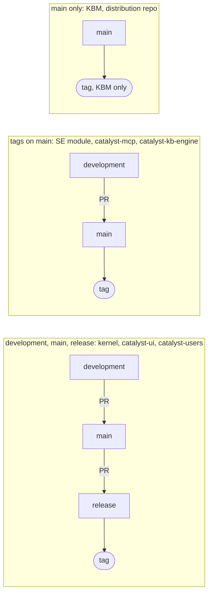

The bug lifecycle behind 0.5. The SE module declares no transitions, so these are the usual walks, not enforced ones; only `Closed` and `WontFix` count as closed:

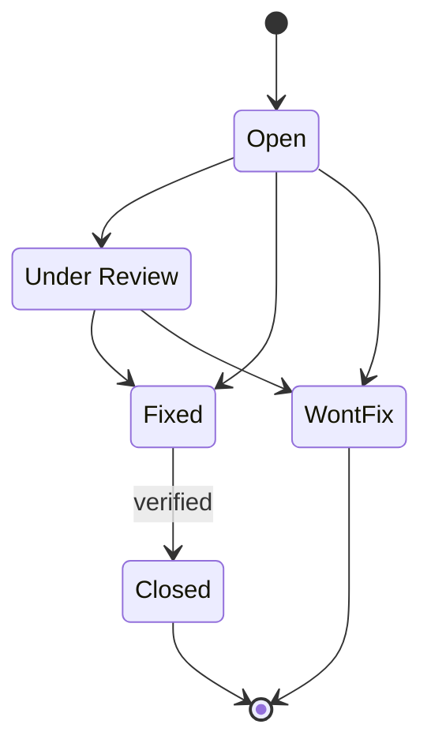

Signing (0.6): every signed verb asks catalyst-users who is logged in, and catalyst-users asks the Keycloak.

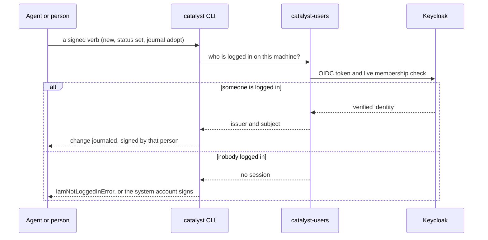

The assent rule of 0.7 (law L3) as a decision:

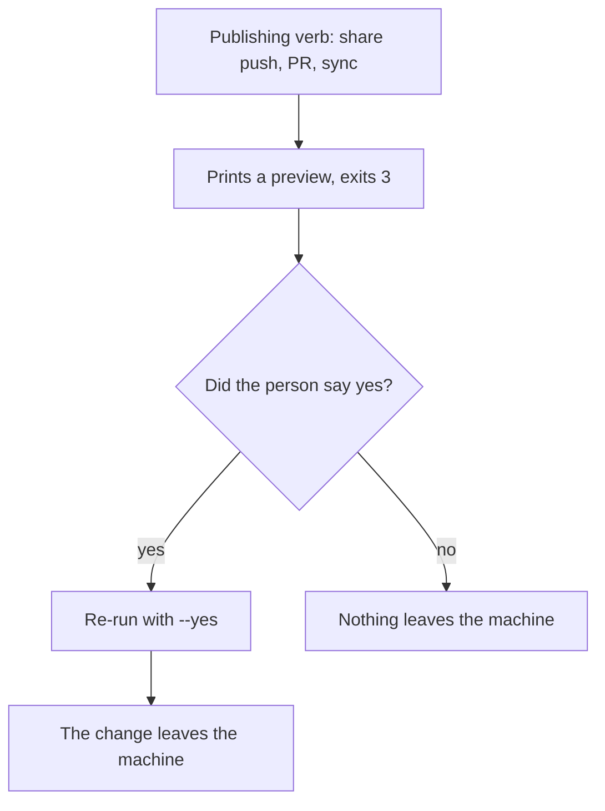

How a hand-made change is treated (0.9):

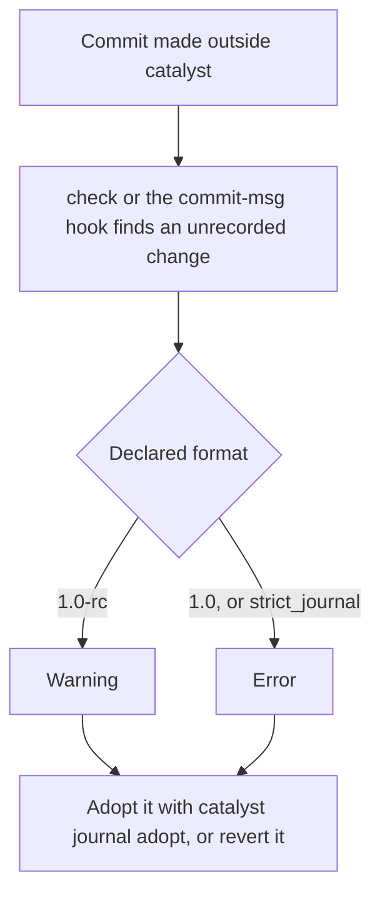

What the purity scan of 0.14 reads and where it looks:

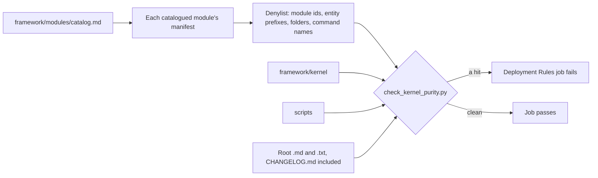

---

## 1. Kernel — cantica-tech/catalyst

### 1.1 Release and CI

| # | Oddity | Symptom | Cause | Fix / workaround | Source |
|---|---|---|---|---|---|
| 1.1.1 | **Purity scan broke two release PRs** | The 0.52.x and 0.55.0 release PRs failed Deployment Rules. | Their CHANGELOG entries named the SE module or its entity types. The check now denies a plain-word module command only as `/<name>`. | See 0.14. Release notes in the module repo may name the pairing; the kernel CHANGELOG may not. | commits `c594f9d`, `293cfc6`, `17a0e98` |
| 1.1.2 | **Deployment Rules CI builds scratch deployments from the module catalog** | CI fails when a catalogued module's `main` is broken. | `framework/modules/catalog.md` lists `software-engineering` and `knowledge-base` on branch `main`. CI clones each at `--depth=1`, runs `catalyst init` with `CATALYST_ALLOW_STATIC_IDENTITY=1` (the static identity backend verifies nobody; tests only), then runs `check_deployment.py --require`, `check_command_parity.py --require` and `catalyst check`. | A module's `main` must always pass against the kernel's development branch. Release the kernel first when a module needs a newer kernel. | .github/workflows/deployment-rules.yml |
| 1.1.3 | **Trace gate and force pushes** | After a force push, the previous tip is gone and the commit range cannot be computed. | Handled: when `before` is unknown, CI checks `origin/main..sha`. | Avoid force pushes on development anyway. | deployment-rules.yml; commit `35e4900` |
| 1.1.4 | **Every commit must cite an artifact or rule ID, or be `chore:`** | The trace job fails on a commit message such as `fix: typo`. | Law L2. `catalyst trace <range>` runs in CI; a commit-msg hook does the same locally. | Use `fix(<bug ID>):`, `feat(<requirement ID>):` or `chore:`. `chore:` must change no rule's behaviour. | deployment-rules.yml |
| 1.1.5 | **Old commit-msg hooks don't update themselves** | A machine keeps an old hook script. | A hook installed before 0.117.1 keeps its old script; no migration rewrites it. | Re-run `catalyst hook install`. | docs/results/2026-10-26-quickstart.md |
| 1.1.6 | **The commit-msg hook could fail open** | Commits passed untraced on a fresh machine. | Fixed in 0.117.1: the hook now runs the criterion's own CLI, found through `catalyst.toml`, when no `catalyst` launcher is installed. | Confirm `which catalyst` works; run `catalyst open`. | CHANGELOG 0.117.1 |
| 1.1.7 | **`package_release --publish-dir` could publish an unreleased kernel** | The distribution repo received a kernel that was never tagged. | Fixed in 0.116.1: it publishes only a tagged release. | Publish only from a tag; check the distribution repo's newest kernel after `task release:publish`. | CHANGELOG 0.116.1; docs/results/2026-10-26-catalyst-docs-phase-3.md |
| 1.1.8 | **Second-module CI fixture pinned old** | `tests.yml` checks out cantica-tech/catalyst-knowledge-base at ref **0.4.1**, while KBM is 0.6.1. | Pinned when the fixture was added and never bumped. `CATALYST_REQUIRE_FIXTURES=1` makes the test fail instead of skipping when the fixture is absent. | Bump the ref when a kernel change needs newer KBM behaviour. Locally, set `CATALYST_KB_MODULE` or keep a sibling checkout, else the test skips. | .github/workflows/tests.yml; tests/test_second_module.py |
| 1.1.9 | **Test matrix is 3 OS × Python 3.11/3.13** | Windows-only failures. | Windows has been a 1.0 target since decision A4 (no symlinks, colons or absolute paths). Many fixes followed: git objects are read-only on Windows, delete-pending state, CRLF on git stdin, backslashes in JSON, the `serve` refused-request body. | Expect Windows-specific bugs. Use Python helpers, not `cat`, in tests (commit `35ef25a`). | commits `ea14027`, `8623403`, `3b38141`, `1894be6`, `f78012c`, `680a9f3`, `acb92b6` |
| 1.1.10 | **The criterion's Taskfile is composed, not the project's** | `task <cmd>` in the project does nothing catalyst-related. | `catalyst init` composes `Taskfile.common.yml` **inside the criterion** from the kernel template plus the module's `Taskfile.module.yml`. `scripts/check_command_parity.py` keeps it 1:1 with `CODE-OF-CONDUCT.md` §4. | `catalyst task <name> -- <args>`; `catalyst task` lists them. | CLAUDE.md; scripts/check_command_parity.py |
| 1.1.11 | **The criterion repository's name is not derived from the project's** | Guessing `<project>-criterion` as the remote can be wrong; the kernel's own uses a generic name. | Historical. | Read `catalyst_repo_url` in `catalyst.toml` rather than guessing. | catalyst.toml |

The Deployment Rules job of 1.1.2 and 1.1.4, step by step:

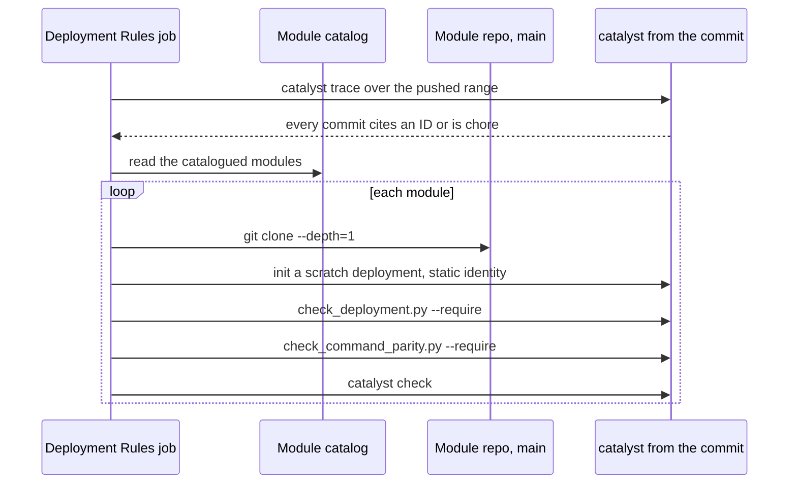

### 1.2 Tests

| # | Oddity | Symptom | Cause | Fix / workaround | Source |
|---|---|---|---|---|---|
| 1.2.1 | **Concurrency tests are timing-sensitive** | `test_concurrent_appends_are_serialised` launches 8 processes that journal at once and asserts a whole, chained journal. | It exercises the journal lock, which on Windows must wait through the delete-pending state (commit `8623403`). Two other CI races were fixed by relaxing tests: helpers saw git repack files mid-walk, and a local event-stream test expected exactly the next batch. | Fixed: helpers don't walk `.git`, and the test expects "a later batch" (commits `51b8047`, `a258f8c`). If a concurrency test fails once, rerun it and look at the lock's retry window on Windows. | tests/test_catalyst_journal_shards.py; git log |
| 1.2.2 | **Conditional skips** | Tests skip silently on a dev machine. | Skip conditions: Python < 3.11 (`tomllib`); no sibling module checkout (token budgets, kernel schemas); no `uv` (runtime builds); `pycryptodome` missing (membership, via `importorskip`); Windows (module-install permission test); **golden corpus not captured** (always skipped in CI, because corpora are gitignored). | Install `requirements-dev.txt`; keep sibling checkouts `../catalyst-<module>`; install `uv`. | tests/test_*.py |
| 1.2.3 | **The golden-corpus checks never run in CI** | Regressions against real deployments are only caught locally. | The corpora are copies of real criteria, so they are gitignored. | Run `scripts/capture_golden_corpus.py` locally before risky format changes. It refuses `.git` and `.ledger`. | tests/test_golden_corpus.py; scripts/capture_golden_corpus.py |

### 1.3 Identity, signing, journal

| # | Oddity | Symptom | Cause | Fix / workaround | Source |
|---|---|---|---|---|---|
| 1.3.1 | **`journal adopt` used to sign as the git author** | Adopted changes were recorded under whoever git said committed them. | Fixed in 0.119.1. Adopt now signs as the verified identity; the git author is kept only as `commit_author`. Earlier adopt entries stay as written (append-only). | Upgrade to ≥ 0.119.1; never use `--as` to impersonate. | CHANGELOG 0.119.1 |
| 1.3.2 | **`share push` could say "nothing to publish" while the criterion held changes** | Work was left unshared while the command exited 0. | Fixed in 0.119.2. Git read errors and uncommitted leftovers now fail loudly. | Upgrade to ≥ 0.119.2; on older kernels, check `git status` in the criterion after a push. | CHANGELOG 0.119.2 |
| 1.3.3 | **Adopt could chain an already-consumed commit** | Duplicate history in the journal. | Fixed in 0.118.1: such a commit is now recorded as `superseded` history only. | — | CHANGELOG 0.118.1 |
| 1.3.4 | **`init` refused when git `user.name` differed from the provider's name** | `catalyst init` failed on a machine with a nickname in git config. | Fixed in 0.117.1. The kernel's `init` takes `--git-username`. | — | CHANGELOG 0.117.1 |
| 1.3.5 | **Unknown `--command` names are kept forever** | Journal entries name commands the deployment does not define. | `journal append` only **warns** on an unknown command (0.88.0), and the journal is append-only. | Use the deployment's §4 names (`fix`, not `/fix-bug`). | docs/roadmap.md R4.8 |
| 1.3.6 | **Roles are enforced** | A writing verb refuses: "role does not grant command". | Decision D5 (0.93.0). A role grants commands named with a leading `/` in `actions`, or everything with `*`; tier names (`chore`/`fix`/`feature`) are not checked. A deactivated user signs nothing. | `role_check = "warn"` in `catalyst.toml` downgrades this to a warning. Fix the role in catalyst-users. | docs/decisions.md D5 |
| 1.3.7 | **Redaction weakens immutability on purpose** | A journal entry's content is a tombstone. | Decision A5: `catalyst journal redact` replaces a mistakenly journaled secret with an auditable tombstone, keeping the entry and its hash. Purging git history stays a separate, manual job. | — | docs/decisions.md A5 |
| 1.3.8 | **The Stop hook is session-scoped** | The Stop hook does not block on failures that existed before the session. | ADR-002: `hook start --quiet` records what the check already fails on; Stop blocks only on what the session broke. Every failure exits 2 (exit 1 is non-blocking in Claude Code — the "fail open" bug of R0.16). | Don't add catalyst hooks to a project's `.claude/settings.json`; `catalyst agent install claude-code` wires them at user level. | docs/adr/ADR-002-session-scoped-stop-hook.md; docs/roadmap.md R0.16 |

The session-scoped Stop hook of 1.3.8:

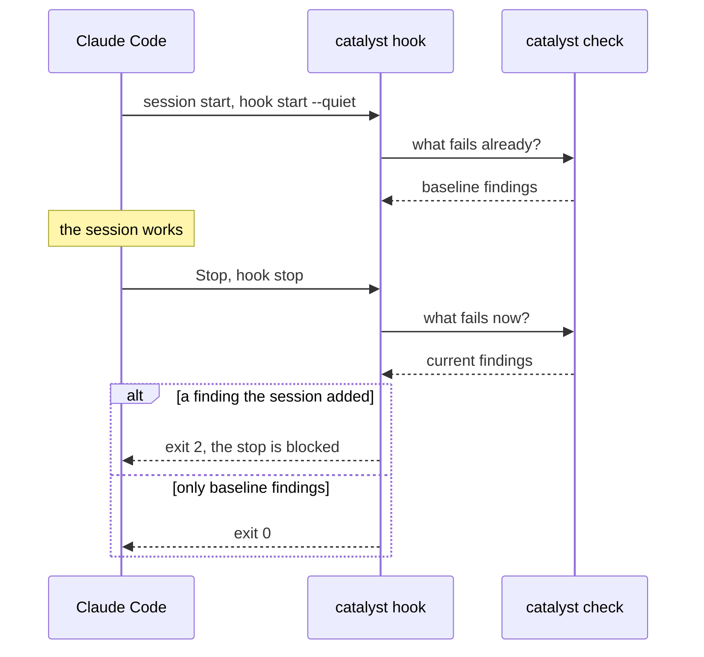

### 1.4 Migrations, sync, modules

| # | Oddity | Symptom | Cause | Fix / workaround | Source |
|---|---|---|---|---|---|
| 1.4.1 | **Module migrations are keyed by kernel version** | A module release's migration never fires on sync. | A module migration runs only when the kernel version moves across it. Fixed in 0.117.2: the sync plan includes module migrations outside the kernel range, and `migrate --since` finds those keyed to older kernels. | Every module release pins a **minimum kernel** (SE 3.4.x needs ≥ 0.83.0; KBM needs ≥ 0.107.0). When in doubt, `catalyst migrate` lists what a deployment is behind on. | CHANGELOG 0.117.2 |
| 1.4.2 | **Format changes come as many small releases** | Nearly every minor kernel version may change the layout. | Decision B6: each format change ships with its own migration in `framework/kernel/migrations/`. | `/sync-framework` (`catalyst sync plan` → `apply`) per deployment. Read CHANGELOG "No layout change" lines. | docs/decisions.md B6; CHANGELOG preamble |
| 1.4.3 | **Migration 0.106.0 kept roles under slugged IDs** | Roles did not match the provider's role IDs. | Fixed in 0.106.1. | — | CHANGELOG 0.106.1 |
| 1.4.4 | **A module's own `catalyst.toml` must never ship** | A governed module repository could pass its project file to installing criteria. | Fixed in the kernel; KBM relies on "a module's own catalyst.toml never ships". | — | cantica-tech/catalyst-knowledge-base:README.md |
| 1.4.5 | **`module upgrade` from a deployment's own CLI crashed building from a checkout** | — | Fixed in 0.110.1. There is still no dry run of `module upgrade` (R6, open). | Run `catalyst try` around it. | CHANGELOG 0.110.1; docs/roadmap.md R6 |
| 1.4.6 | **Enum values `none`, `n/a`, `-` read as empty** | A required enum field failed `check`. | Fixed in 0.110.0 (YAML read `None` as a null). KBM had the same problem with a `None` classification value and renamed it `Local only`. | Avoid those literals as enum values. | CHANGELOG 0.110.0; cantica-tech/catalyst-knowledge-base:module.yaml |
| 1.4.7 | **`new` could create a file INV-7 rejects** | A title ending in a number gave an invalid file name. | Fixed in 0.68.0. | — | CHANGELOG 0.68.0 |
| 1.4.8 | **Table-row entities are second-class** | A row's `Linked` column is not read as links. `edit` and `history` don't handle rows. | Rows (roadmap items, features, reconciliation cases, analyses) live inside index or roadmap tables, not in their own files. Earlier gaps (`view` and `graph` leaving rows out, `new` and `link` refusing them) are fixed. | Edit rows through their module verbs (`/roadmap`). | docs/results/2026-10-26-view-table-rows.md; CHANGELOG 0.91.0 |
| 1.4.9 | **Legacy pointer / in-project criterion** | `check` warns about a `<name>.catalyst` pointer or a `.criterion/` folder. | Deprecation window (0.94.0): read-only legacy support, writes refused at format 1.0. | `catalyst migrate --apply`, or `move --to-home`. | docs/roadmap.md R3.4, R7 |
| 1.4.10 | **`init` and `catalyst-mcp` need a catalyst checkout or release `.pyz`** | `catalyst init` cannot run from the `~/.catalyst/bin` launcher in a new repo. | A new repository has no criterion runtime yet. | Run `python3 <catalyst>/dist/catalyst.pyz init …` (`task build:cli` builds it), or download it from the distribution repo. | CLAUDE.md; cantica-tech/catalyst-mcp:README.md |

Why a module migration could be skipped (1.4.1): sync walks kernel versions, and a module migration fires only when that walk crosses the kernel version it is keyed to.

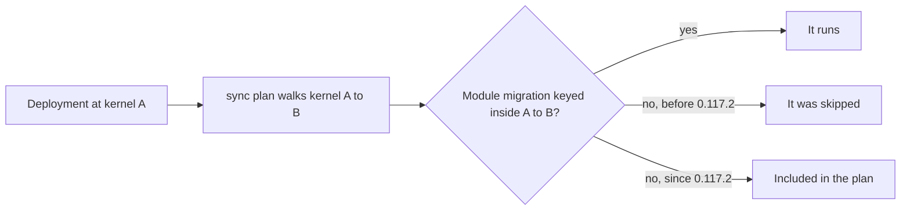

### 1.5 Documentation drift in the kernel repo

| # | Oddity | Symptom | Cause | Fix / workaround | Source |
|---|---|---|---|---|---|
| 1.5.1 | **`docs/adr/` statuses are not authoritative** | ADR-003…007, 009, 011…016 say "Pending (awaiting owner decision)". | Decision E (0.83.0) moved catalyst's decisions into its record as entities; the `docs/adr` files were not updated. | Treat the deployment's record as authoritative (`catalyst view <ADR>`), and the files as history. | docs/adr/; docs/decisions.md E; docs/roadmap.md R6 |
| 1.5.2 | **`docs/adr/PARKING.md` reuses taken numbers** | It "anticipates" ADR-015…032 with topics unrelated to the real ADR-015…022, and still talks about plugins and `.criterion` symlinks. | Written at R0 and never revised. | Ignore it as history. | docs/adr/PARKING.md |
| 1.5.3 | **The R6 table contradicts itself** | "A proposal path for rules and changes; a rule typing field" is `open`, while rows above mark proposals (0.81.0) and rule strength (0.83.0) done. | Stale row. | Treat it as done. The genuinely open R6 rows are `check --json` entity, coverage counts, the run log, and `analysis`/`module --json` plus the `module upgrade` dry run. | docs/roadmap.md R6 |
| 1.5.4 | **The feature register was last refreshed 2026-10-16** | It cites an audit file that is no longer in the repository. It shows 7 "R7 open", 4 "R6 open", and several "partly" rows. | Not refreshed since kernel 0.71.0. | Re-derive the open set from docs/roadmap.md. | docs/feature-register.md |
| 1.5.5 | **`beta/TRIAL.md` may use old verbs** | It mentions `catalyst criterion sync` and `criterion create/join/protect`, and a "submodule". | R3.6 moved these to `share create/join` and the criterion to `$HOME`. They may be aliases; not verified. | Check against `catalyst --help` before running the trial. | beta/TRIAL.md |
| 1.5.6 | **The quickstart is heavy** | A newcomer needs Python 3.11+, uv, git, **Docker + a throwaway Keycloak 26.4.0**, and three checkouts on `development`, about 25 min. | Identity is mandatory since 0.106. One step stays manual: approving `catalyst-users login` in a browser. | A sandboxed `CATALYST_HOME` keeps the machine clean. | beta/QUICKSTART.md; docs/results/2026-10-26-quickstart.md |

### 1.6 Historical traps (kernel)

| # | Trap | What happened | Lesson / guard | Source |
|---|---|---|---|---|
| 1.6.1 | **The Stop hook failed open** | Any exception exited 1, which Claude Code treats as non-blocking; one corrupt journal byte disabled enforcement. | All failures now map to exit 2 (R0.16). | docs/roadmap.md R0.16 |
| 1.6.2 | **Self-governance suspended, then restored** | Journalling of catalyst's own refactor was off from 2026-10-07 to 2026-10-10 (decision D1). | Journal entries from that window are absent; every catalyst change is journaled since. | docs/decisions.md D1 |
| 1.6.3 | **The plugins era** | The `plugins/` submodule tree and the `catalyst-git` submodule are gone (0.72.0, ADR-022). catalyst-git is an optional extension. | Old notes mentioning catalyzers or plugins are history. | docs/adr/ADR-022-remove-the-plugin-system.md; docs/decisions.md B3 |
| 1.6.4 | **Risk-management module dropped** | It was the second module from 2026-10-17 to 10-22, then replaced by KBM. Its repository and 0.1.0 release are kept but not catalogued or tested. | Don't add it back to the catalog without a new decision. | docs/decisions.md B1 |
| 1.6.5 | **`~/.catalyst-users` legacy home** | Kernels ≤ 0.110.1 read `~/.catalyst-users`. catalyst-users 0.6.0 moved its home to `~/.catalyst/users` and left a symlink. | Remove the link only once no machine runs a kernel ≤ 0.110.1. | docs/results/2026-10-26-deployments-0117-ui-0651.md, 2026-10-27-kb-azure-devops-local-checkouts.md |

### 1.7 Deliberate design choices that look odd

| Choice | Rationale | Source |
|---|---|---|
| The criterion is in `$HOME`, not in the repo | Keeps host repositories clean (only `catalyst.toml`); one runtime per criterion; shared via git (`share`), or via `catalyst serve`. | design 13; decisions A1 |
| Agents never read `module.yaml` whole; prose-size targets retired | The kernel reads it and agents see generated `catalyst spec` output. Cutting it to 15 KB would have forced migrations for 8 types in every deployment. | decisions D6 |
| Reference docs generated from code, between markers | Arguments, schemas, keys, migrations and enforcement come from code and are checked in CI; the "why" stays prose. | decisions D7; roadmap R4.4 |
| Rules may be headings **or** their own files | Both shapes are allowed; ADR-001 is superseded. | decisions B7 |
| Four-eyes analysis is configurable | Two blind passes plus a person's decision by default; `analysis_passes = 1` allowed, and recorded as single-pass. | decisions B5 |
| Approval gates are opt-in, in `IAM/gates.json` | No gate unless declared; the author's approval doesn't count; `--force` doesn't pass a gate. | decisions G; design 25 |
| Proposals are reconciliation cases of kind `proposal` | They reuse the reconciliation verbs; `accept` is refused when the base moved, and for the proposer. | decisions P; design 26 |
| `catalyst try` never applies | It runs the real verb on a scratch worktree and reports the findings it adds and clears; there is no `--apply`. | decisions T; design 27 |
| Rules have a strength (`must` by default) | No existing rule loosens; a breach is reported as a violation, warning or note. | decisions S |
| People live outside catalyst (catalyst-users) | catalyst is a facade over any IAM; `IAM/identity.json` points at it; an append-only signers ledger is keyed by issuer and subject. | decisions I; designs 28/29 |
| No `serve` route writes or starts an agent run | Writes and runs go through a UI's host after the person confirms; `serve` only reads, from origins a deployment allows. | docs/roadmap.md R6; decisions B8 |
| The plugin system was removed | It was unused complexity; extensions act on deployments, never on catalyst. | ADR-022; decisions B3 |
| Meta-tags were removed for a `tags:` field (not built yet) | No uses. | decisions B4 |
| Windows is a 1.0 target | Decision A4. | decisions A4 |

---

## 2. SE module — cantica-tech/catalyst-software-engineering

| # | Oddity | Symptom | Cause | Fix / workaround | Source |
|---|---|---|---|---|---|
| 2.1 | **No criterion of its own** | You can't find SE's requirements anywhere in its own repo. | Its changes are tracked as work items in catalyst's own record. | Commit messages cite them. | git log |
| 2.2 | **Release zips committed in the module repo** | `catalyst/modules/software-engineering/v1.0.0`, `v2.0.0`, and a duplicate `catalyst/module/…/v1.0.0`. | An old release flow wrote distribution-layout output into the repo. | The distribution repo is the real home; these can be deleted or gitignored. | repo tree |
| 2.3 | **`ROADMAP.md` is a stale "Draft/Proposed" plan** | It describes the module extraction (done since module format v3, 3.0.0) and names `.claude/commands/`, `*.catalyst` pointers and `schemas/`. | Never retired. | Read it as history. | ROADMAP.md |
| 2.4 | **Aliases are load-bearing** | The 3.1.0 regression broke `/create-*` and <code>/roadmap-add\&#124;update\&#124;merge\&#124;remove</code>; fixed in 3.1.1. 3.1.0 is not in the distribution repo. | ADR-020/021 keep old names as aliases. | Test aliases on every release. | commit `23cea3c`; cantica-tech/catalyst:docs/adr/ADR-020, ADR-021 |
| 2.5 | **Minimum-kernel pins** | 3.0.0 needs ≥ 0.57.0; 3.3.0 and 3.4.x need ≥ 0.83.0. | See 1.4.1. | — | module.yaml |
| 2.6 | **CI is lint only** | No tests run on the module itself. | It is exercised by the kernel's Deployment Rules job instead (1.1.2). | — | .github/workflows/standards.yml |
| 2.7 | **Closed states are narrow** | BUG: `Closed`/`WontFix`; REQ: `Completed`/`Abandoned`; STEP: `done`/`abandoned`; TEST: `Passing`. A BUG reaches Fixed or Closed only with its steps closed; a REQ completes only with ≥ 1 step, all closed (law SE-L1). | — | — | module.yaml |

## 3. KBM — cantica-tech/catalyst-knowledge-base

| # | Oddity | Symptom | Cause | Fix / workaround | Source |
|---|---|---|---|---|---|
| 3.1 | **main only** | No development branch, unlike every other code repo. | — | Tag on main. | branches |
| 3.2 | **Needs kernel ≥ 0.107.0** | Older kernels refuse the module. | It relies on guards with field conditions, sources falling due, gated builds, and a module's own `catalyst.toml` never shipping. It is the CI proof that the kernel names no module type. | — | README.md |
| 3.3 | **Old module id `cantica-knowledge-base`** | 0.1.0 was published under another id (renamed in 0.2.0); legacy zips are under `catalyst/modules/`. | Rename in B1's revision. | — | cantica-tech/catalyst:docs/decisions.md B1; repo tree |
| 3.4 | **`None` as an enum value** | A `None` hosted-embedding classification failed check. | See 1.4.6; the value is now `Local only`. | — | module.yaml |
| 3.5 | **Stale design text** | `docs/engine-and-onboarding.md` §6 still lists "open questions" that have all been answered: the engine is its own repo; <code>Document base: Static\&#124;Dynamic</code> exists since 0.5.0; the default embedding is `nomic-embed-text`, local; Pydantic AI with the criterion as durable state. | Not refreshed. | — | docs/engine-and-onboarding.md |
| 3.6 | **No CI, no `.standards/`** | — | — | — | repo |
| 3.7 | **Designed to run alone or beside any module** | A KB can be built off any project, including an SE-governed one. | Law L9 plus the second-module decision. | — | cantica-tech/catalyst:docs/decisions.md B1 |

## 4. catalyst-ui — cantica-tech/catalyst-ui

| # | Oddity | Symptom | Cause | Fix / workaround | Source |
|---|---|---|---|---|---|
| 4.1 | **Studio must import catalyst-core only via browser-safe subpaths** | The browser bundle pulls in Node modules. | catalyst-core's root export `"."` is not browser-safe; `./graph-artifact` is the only safe runtime subpath today. Type-only imports from the root are fine. | — | packages/catalyst-core/package.json `exports` |
| 4.2 | **CI quirk: "No test files found" in catalyst-host-vscode** | `mocha "dist/test/**/*.test.js"` once found nothing on GitHub Actions, though it passed locally. | Suspected incremental `tsc --build` cache or mtime differences between macOS and Linux; never confirmed. | The `build` script is `tsc --build --force` (host-vscode and host-electron), and `pretest` runs `build`. Investigate if it recurs. | packages/catalyst-host-vscode/package.json |
| 4.3 | **`npm run lint` builds first** | Lint is slow and writes `dist/`. | Type-aware ESLint needs each package's declarations; every package is composite, so `typecheck` equals `build`. | — | package.json; commit `a016f17` |
| 4.4 | **ESLint bulk suppressions** | 39 suppressions across 16 files in `eslint-suppressions.json`. | Existing violations were frozen when standards v0.1.2 arrived. | Remove entries as code is fixed. | eslint-suppressions.json |
| 4.5 | **The Taskfile says it mirrors `ci.yml` "exactly", but `task lint` also runs `standards:lint`** | — | The standards checks are a separate `standards.yml` (reusable `lint.yml@v0.1.2`, `typecheck: false`). | See 0.11. | .github/workflows/standards.yml; Taskfile.yml |
| 4.6 | **Node version mismatch** | `.nvmrc` says Node 20 and `engines` says `>=20`; CI and the Desktop workflow run **Node 24**. | Drift. | Use 24 locally to match CI, or align the files. | .nvmrc; package.json; .github/workflows/ci.yml, desktop.yml |
| 4.7 | **`catalyst-trace` job needs a deploy key** | Every PR fails if the `CRITERION_DEPLOY_KEY` secret is missing or revoked. | The job clones the private criterion (URL and branch from `catalyst.toml`) and runs its `bin/catalyst.pyz trace`. | Keep the deploy key valid. | .github/workflows/ci.yml |
| 4.8 | **CI on push only to development** | Other branches run CI only through PRs. | — | — | .github/workflows/ci.yml |
| 4.9 | **Marketplace publishing is separate from the release cycle** | — | `task publish:vscode-extension` (→ `vsce publish`) is its own task. `…:release` refuses unless HEAD is exactly the release tag, then copies the `.vsix` into the distribution repo's `catalyst/vsix/v<ver>/` with a `manifest.json` (`kernelVersion >= 0.54.0`). | Run `task release:vsix:publish` for every UI release tag; it builds in a temporary worktree, then commits and pushes the distribution repo. | Taskfile.yml |
| 4.10 | **The unsigned install task persists a global setting** | VS Code stops verifying extension signatures. | `install:vscode-extension:unsigned` sets `extensions.verifySignature: false` in the real user settings. | Revert the setting after testing. | Taskfile.yml |
| 4.11 | **Desktop app gotchas** | Unsigned on every OS (needs an Apple Developer ID plus notarization, and Azure Artifact Signing). No auto-update (`publish: null`; Azure Blob vs GitHub Releases undecided). The bundled `catalyst.pyz` comes from `catalyst-version.txt` and needs Python ≥ 3.11 on PATH (macOS ships 3.9). The `.deb` maintainer has no address. | Signing keys and the update feed are not chosen yet. | Bump `catalyst-version.txt` only **after** that kernel is in the distribution repo. In a VS Code terminal, `unset ELECTRON_RUN_AS_NODE`, or the app runs as plain Node. | docs/desktop.md; .github/workflows/desktop.yml |
| 4.12 | **Stale docs** | The README calls the Electron host "experimental, not released" (it ships) and mentions a ".criterion working copy". desktop.md says "0.106.0 since UI 0.63.0". | — | — | README.md; docs/desktop.md |
| 4.13 | **One IAM test can fail on a long-lived dev realm** | `test_provisioned_grants_reach_the_token` fails locally. | The realm's `developer` role holds old extra grants; CI uses a fresh realm. | In catalyst-users: `rm -rf .keycloack/data` (sic), then `catalyst-users setup --force`. | docs/results/2026-10-23-iam-settings.md |
| 4.14 | **Test fixtures are excluded from catalyst** | — | `packages/catalyst-core/src/test/fixtures` is a sample criterion; `.catalystignore` excludes it so neither catalyst nor a KB built off the repo reads it. | — | .catalystignore |
| 4.15 | **Deliberate UI design choices** | — | **W1:** no HTTP write route; only the host runs verbs, after confirmation. **C2:** agent runs are spawned by the VS Code host. **C6/D3:** a module is data only; R6.29 (sandboxed module UI) is disabled, not dropped. **S7:** payload types are generated from catalyst `spec/`, vendored at one kernel release (`npm run spec:sync -w catalyst-core`); a field an older kernel lacks is optional. **S6:** axe-clean on every Studio page. **S4:** `elkjs` does layout only. **C4:** Apache-2.0 from 0.47.0 (proprietary before). **R6.1:** the proposal loop, composer and run monitor were removed because they wrote files outside the journal. | — | docs/decisions.md; docs/design/09-ui-brand-portability.md |
| 4.16 | **Naming risk** | "Catalyst UI" is Tailwind's; npm `catalyst-ui` is taken; another "Catalyst Studio" is on the Marketplace. | No USPTO or EUIPO search done yet. | — | docs/decisions.md C3; docs/design/25-brand-spike.md |

## 5. catalyst-users — cantica-tech/catalyst-users

| # | Oddity | Symptom | Cause | Fix / workaround | Source |
|---|---|---|---|---|---|
| 5.1 | **`.keycloack` is misspelled, and load-bearing** | — | The data dir is `.keycloack/data` in `compose.yaml` and CI. | Never "fix" one side only. | compose.yaml; .github/workflows/ci.yml |
| 5.2 | **Keycloak's H2 database could not be written in CI** | Fixed. | Docker created the mounted dir owned by root. | CI runs `mkdir -p .keycloack/data && chmod 777` before `docker compose up`. | .github/workflows/ci.yml |
| 5.3 | **Integration tests skip by default** | — | They need `CATALYST_USERS_IT=1` plus `docker compose up -d`. Onboarding also needs Docker plus a catalyst checkout (`CATALYST_CHECKOUT`, else `../catalyst`). After the bootstrap admin is replaced: `CATALYST_USERS_IT_ADMIN` and `CATALYST_USERS_IT_ADMIN_PASSWORD_COMMAND`. | — | tests/integration/conftest.py |
| 5.4 | **Trace skipped on fork PRs** | — | The deploy key is absent on forks, so only a notice is printed. | — | .github/workflows/ci.yml |
| 5.5 | **The realm is always imported** | The compose Keycloak is never greenfield (`--import-realm`). The dev realm `keycloak/realm-catalyst.json` holds no person and no secret. | — | Greenfield trials use a separate Keycloak on **port 8081**. | README.md; docs/onboarding.md |
| 5.6 | **System account uses the `catalyst-admin-cli` client** | — | Keycloak's own `admin-cli` checks the password but carries no groups, roles or grants. The `static` provider is test-only and refused unless `CATALYST_ALLOW_STATIC_IDENTITY=1`. | — | README.md |
| 5.7 | **Home moved to `~/.catalyst/users` (0.6.0)** | — | A legacy `~/.catalyst-users` is moved once, with a symlink left behind. `CATALYST_USERS_HOME` or `CATALYST_HOME` override it. | See 1.6.5. | CHANGELOG |
| 5.8 | **Identity rules** | — | Users are disabled, never deleted. Usernames are immutable (0.8.0). A changed email becomes unverified. `is_member` asks the provider live, never token claims. A role reached only through a composite role appears in neither `users roles` nor `roles holders` (0.10.0). | — | CHANGELOG |
| 5.9 | **Private criteria cannot be branch-protected on the free plan** | A direct push to a `criterion` branch is caught only after the fact (`catalyst check`, `criterion integrity`). | GitHub's free plan refuses branch protection and rulesets on private repositories (HTTP 403). | Revisit on a paid plan or when a second writer joins. | cantica-tech/catalyst:docs/results/2026-10-23-catalyst-users.md, 2026-10-26-landing-phase-2.md |
| 5.10 | **Only repo besides kernel and UI with a `release` branch** | — | — | — | branches |
| 5.11 | **Stale design doc** | `docs/development/python-identity-libraries.md` §10 says "Proposed, not yet decided"; §11 predates the decisions of 2026-10-23. | — | — | that file |
| 5.12 | **The stdlib core is vendored into the kernel** | Kernel identity code mirrors catalyst-users' standard-library core. | Decision I and `scripts/vendor_identity.py`. | Change it in catalyst-users first, then re-vendor. | cantica-tech/catalyst:scripts/vendor_identity.py; docs/decisions.md I |

## 6. catalyst-mcp — cantica-tech/catalyst-mcp

| # | Oddity | Symptom | Cause | Fix / workaround | Source |
|---|---|---|---|---|---|
| 6.1 | **Read-only over HTTP** | Writes and people-reads are refused over streamable HTTP. | catalyst would sign as the server, not the caller. | Use stdio. | docs/design.md |
| 6.2 | **Deny by default** | — | `catalyst-admin` creates criteria and manages people. A criterion's admins, asked of the IdP at decision time, update and watch it. A watch acts as its starter; if that identity is unresolvable at trigger time, the action is denied. The git author never authorizes anything. | — | docs/design.md |
| 6.3 | **Watches** | — | They adopt only unpushed local commits; saved files write nothing. Watches die with the server and never push. | — | docs/design.md |
| 6.4 | **Needs a catalyst checkout** | `catalyst init` fails through the launcher. | See 1.4.10. `CATALYST_MCP_CATALYST_ROOT` is required, with the module beside it as `catalyst-<module>`. | — | README.md |
| 6.5 | **Repeated create said "group made"** | Fixed in 0.2.0. | catalyst-users never deletes a group; the group step is last and idempotent. | — | CHANGELOG |
| 6.6 | **Members refused for criteria not served by `catalyst serve`** | — | catalyst records members only there (design 32). | — | docs/design.md §Implementation 4 |
| 6.7 | **Tests** | — | The Keycloak testcontainer needs Docker (marker `integration`); live catalyst tests need `CATALYST_MCP_IT_CATALYST`; one watch test is skipped on Windows. `ruff==0.16.10` pinned (see 0.10). | — | pyproject.toml; tests |
| 6.8 | **Stale lines in `docs/design.md`** | Step 5 waits for a kernel fix to `journal adopt`'s signer that shipped in 0.119.1; step 2 says catalyst-users can't change email or name (it can since 0.8.0, used by 0.4.0). | — | — | docs/design.md |

## 7. catalyst-kb-engine — cantica-tech/catalyst-kb-engine

| # | Oddity | Symptom | Cause | Fix / workaround | Source |
|---|---|---|---|---|---|
| 7.1 | **Ollama had no default address** | Search, MCP, `serve` and `build-vectors` failed with an `ollama:` model. | Pydantic AI's Ollama provider has no default base URL. | Since 0.14.1 `OLLAMA_BASE_URL` defaults to `http://localhost:11434/v1`. | README.md; src/catalyst_kb_engine/build/vectors.py |
| 7.2 | **Token host must match** | Token rejected. | Keycloak builds its issuer from the host; `serve` and `catalyst-users token --system` must both use `localhost` (or both `127.0.0.1`). Give `CATALYST_USERS_SERVER` to `serve` only: set for `token --system` it overrides the settings and drops the system account's password command. `serve` needs the API client's secret. | — | docs/catalyst-docs-progress.md |
| 7.3 | **Slow reads** | A full criterion read takes about 2.5 min; a full vector build about 46 min; incremental (`--previous`) seconds to about 18 s. | Each `catalyst view` is a new Python process (about 0.8 s). | Use `--previous`. A batch `view` in the kernel would fix this. | docs/catalyst-docs-progress.md |
| 7.4 | **Read requirements** | — | `--history N` needs full clones; GitHub visibility via `gh` (signed in); Azure DevOps anonymously or `AZURE_DEVOPS_EXT_PAT`; other hosts are public only if anonymously readable; only committed markdown is read; `.catalystignore` is honoured. Never publish from a private source: public builds read GitHub's default-branch commit. | — | README.md |
| 7.5 | **mcp 2.x renamed `FastMCP` to `MCPServer`** | — | Upstream API change. | — | docs/catalyst-docs-progress.md |
| 7.6 | **Integration tests need `KB_ENGINE_IT=1`** | CI runs offline tests only. | — | — | tests |
| 7.7 | **Search quality ceiling** | Hybrid recall 0.865@10, MRR 0.569, 7 of 52 questions missed. | Mostly vocabulary mismatch between questions and rule text. Query expansion with `llama3.2:3b` gave nothing reliable at about 10 s per question, and was abandoned. | Better rule wording or a synonym glossary. | cantica-tech/catalyst:docs/results/2026-10-30-search-query-expansion.md |
| 7.8 | **Placeholder source** | `onboarding.py` writes "TODO: where the documents live" when no source is known. | Intended. | — | src/catalyst_kb_engine/onboarding.py |

The token-host rule of 7.2 as a flow:

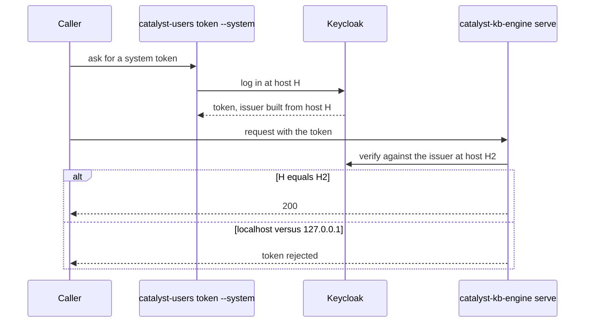

## 8. catalyst-docs — cantica-tech/catalyst-docs

| # | Oddity | Symptom | Cause | Fix / workaround | Source |
|---|---|---|---|---|---|
| 8.1 | **Public builds are recorded by hand** | A Pages build has no build record in the knowledge base. | Pages builds daily (cron 05:17) and on push to main, but Actions cannot reach the private criterion. | The curator runs `catalyst-kb-engine record-site <site url>` after each deployment. | README.md; .github/workflows/pages.yml; cantica-tech/catalyst:docs/results/2026-10-30-catalyst-docs-public-build-recorded.md |
| 8.2 | **`pages.yml` pins engine 0.12.0** (engine is 0.16.0) | — | It still sets `OLLAMA_BASE_URL` explicitly (pre-0.14.1), uses tag pins (`@v4`, not SHA), and installs Ollama via its script on every run. | Bump with a local check first; the site must stay identical. | .github/workflows/pages.yml |
| 8.3 | **Vector reuse depends on the live site** | Builds sometimes take about 46 min. | Each run downloads the previously served `catalyst-vectors.tar.gz`; if that fails, it quietly falls back to a full embed. | — | .github/workflows/pages.yml |
| 8.4 | **`docs/user-generated/` excluded** | — | Opted out via `.catalystignore`. | — | .catalystignore |
| 8.5 | **Guide pages 06–07 may be stale** | They say visibility and tag workflows are "designed, not yet built". | Visibility is partly built (membership); tag workflows are not. | Re-verify. | docs/guide/ |

## 9. Distribution repo — cantica-tech/cantica-tech

| # | Oddity | Symptom | Cause | Fix / workaround | Source |
|---|---|---|---|---|---|
| 9.1 | **Binaries committed per release** | `.git` is about 101 MB and grows with every kernel. | It holds 106 kernel versions (`catalyst.pyz`, zip, manifest each), SE v1.0.0–v3.4.1, KBM v0.2.0–v0.6.1 and `.vsix` up to v0.69.0, all in commits "Deploy release: …". | Consider GitHub release assets. | repo |
| 9.2 | **Holes** | No SE v3.1.0 (only v3.1.1); no KBM v0.4.0. | Releases skipped or withdrawn. | — | repo |
| 9.3 | **Not everything is distributed here** | catalyst-users, catalyst-mcp and catalyst-kb-engine are absent. | Kernel, modules and vsix only. | — | repo |
| 9.4 | **The example project is pre-L5** | `catalyst/example/` (tempconv) builds an in-project `.criterion`, and `build.py` calls `init --user …`. | Not updated since R3. Inferred from code, not run. | — | catalyst/example/build.py |

---

## 10. Cross-cutting summary tables

### 10.1 Environment a new maintainer needs

| Need | Why |
|---|---|
| Python ≥ 3.11 (CI also 3.13), `uv` | Kernel floor (`tomllib`); a runtime per criterion |
| Docker plus catalyst-users' Keycloak (`docker compose up -d`), logged in via `catalyst identity login` and `catalyst-users login` | All signing |
| Node 24 (CI), npm workspaces | catalyst-ui |
| `gh` signed in | kb-engine visibility, PR flow |
| Ollama with `nomic-embed-text` | kb-engine vectors |
| Sibling checkouts: `../standards`, `../catalyst-software-engineering`, `../catalyst-knowledge-base` | `task lint`, purity scan, module tests |
| `uvx ruff@0.16.10` | CI parity |
| A `CRITERION_DEPLOY_KEY` secret in the UI's and catalyst-users' CI | Trace jobs |
| For releases: a Marketplace publisher login, Apple and Azure signing (not set up yet), the API client's secret | Publishing, desktop signing, live checks |

### 10.2 Version-pin lag (as of 2026-10-31)

| Consumer | Pins | Current |
|---|---|---|
| kernel tests.yml → KBM fixture | 0.4.1 | 0.6.1 |
| catalyst-docs pages.yml → engine | 0.12.0 | 0.16.0 |
| catalyst `.standards/` | v0.1.1 | v0.1.2 |
| catalyst-ui `.nvmrc` | Node 20 | CI Node 24 |
| catalyst-users, kb-engine → ruff (locked) | 0.17.2 | standard 0.16.10 |
| development ahead of main (chores only) | catalyst-mcp (1), kb-engine (4), catalyst-docs (1) | — |

The same lag as a graph: each consumer, the version it pins, and the version that exists now.

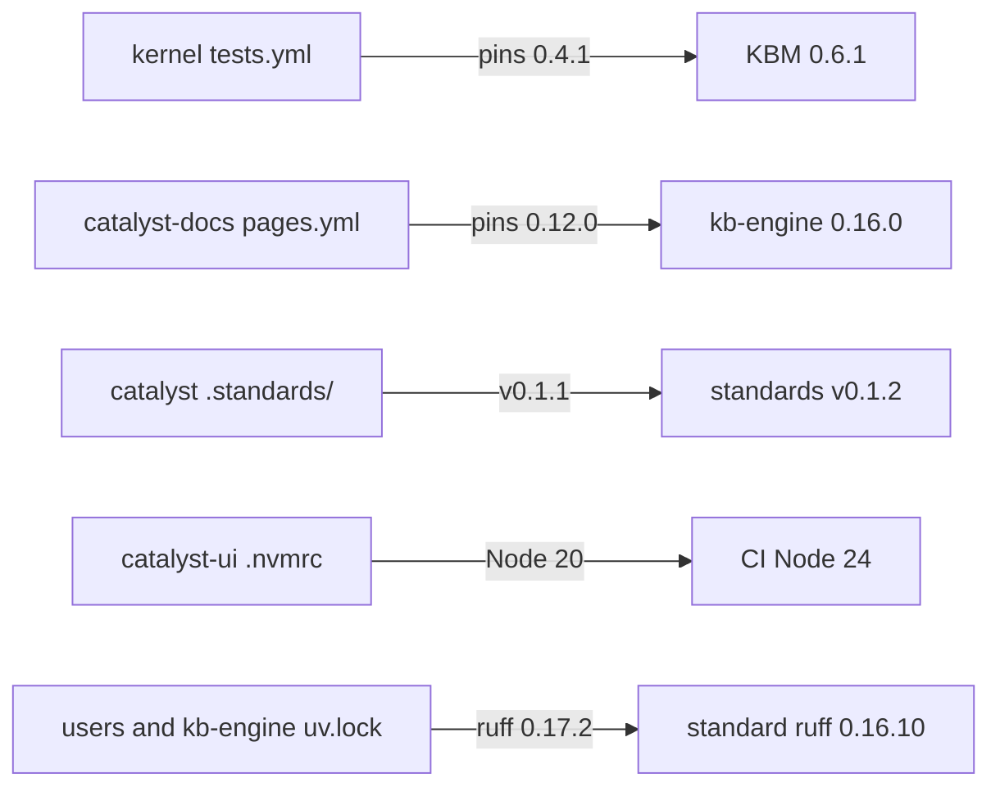

### 10.3 Triage of the most common failures

A first look at what fails most often, pointing to the entry that explains it:

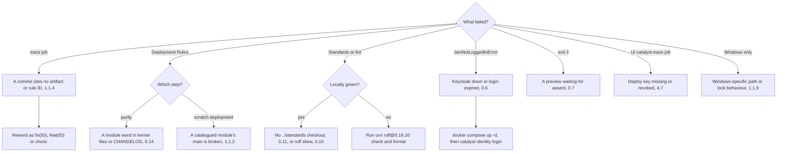
