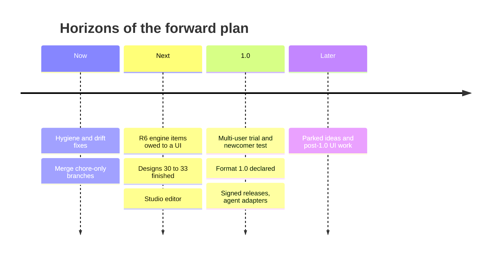
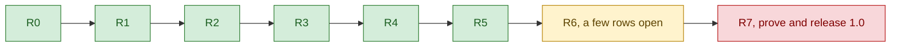
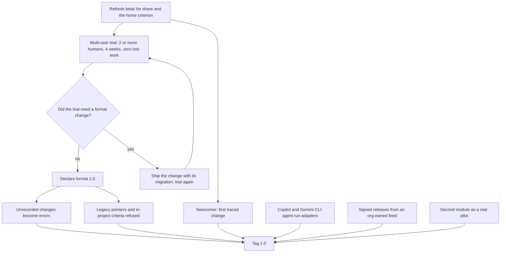
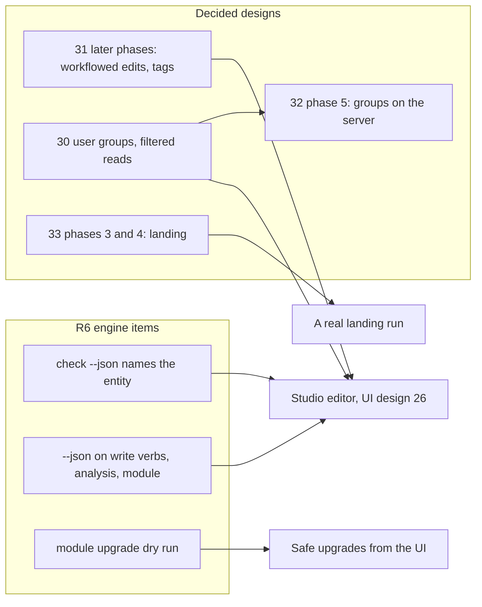
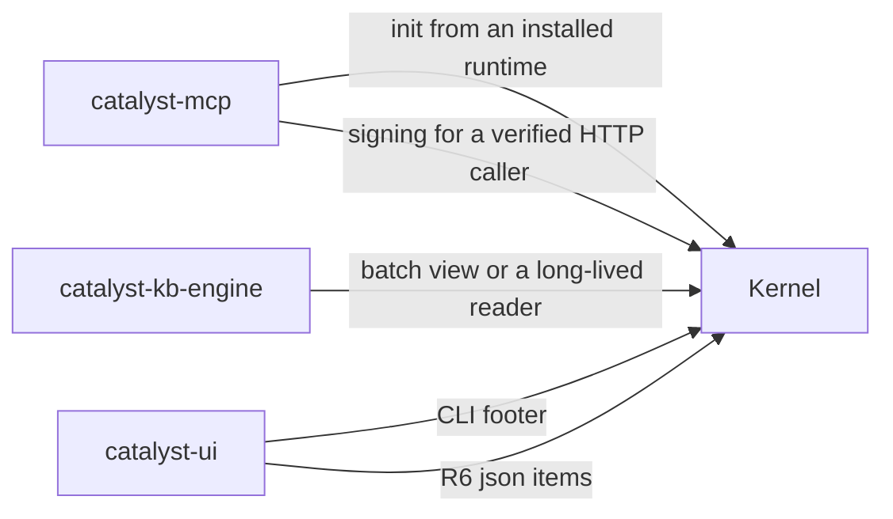
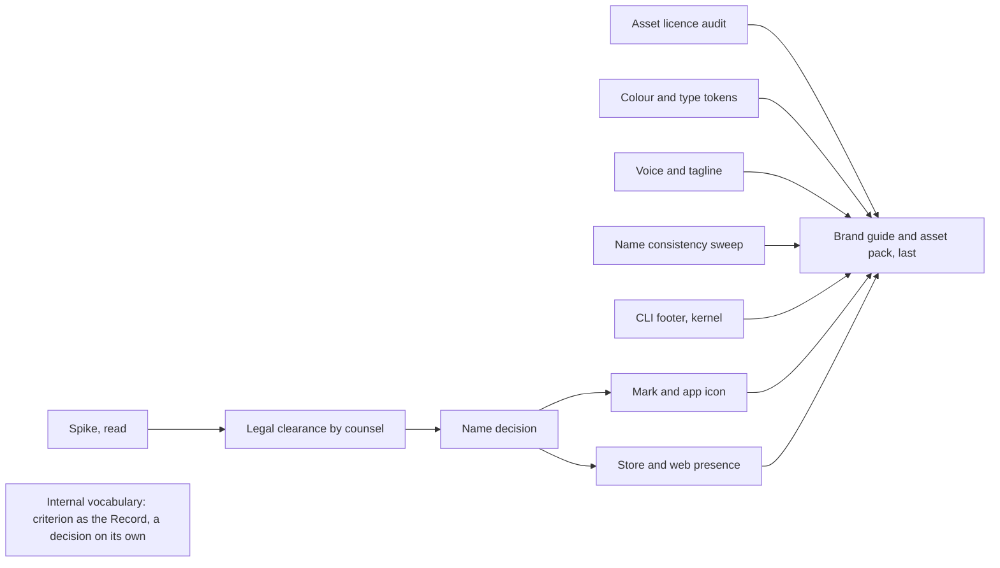
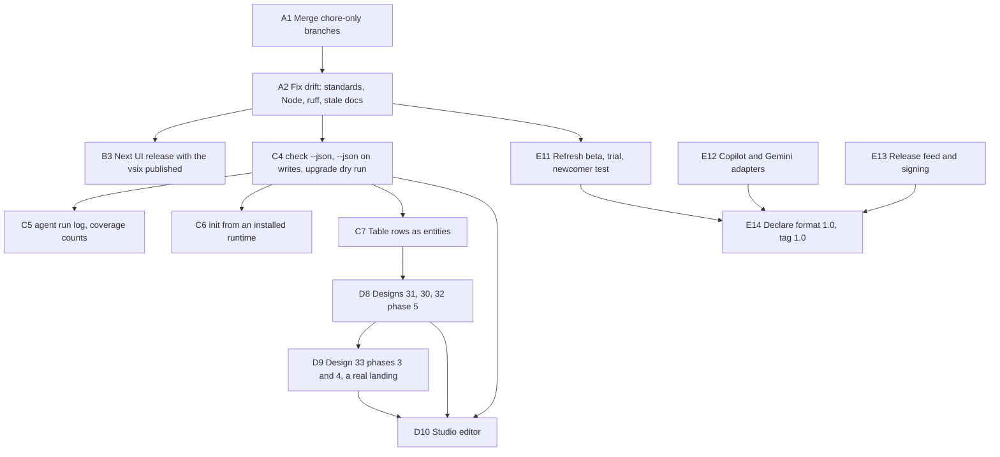

This chapter is the consolidated forward plan for the catalyst fleet, as of **2026-10-31** (kernel 0.119.2). It draws only on public sources:

- the open items in each repository's roadmap (`docs/roadmap.md`);
- the decision records (`docs/decisions.md`) and design notes (`docs/design/`) that are decided but not fully built;
- the "What's left" sections of the published results notes (`cantica-tech/catalyst:docs/results/`);
- what each repository's code, workflows, READMEs and CHANGELOGs show as stale or missing.

The plan is grouped first by **component** and then by **horizon**:

- **Now** — hygiene that needs no design work.
- **Next** — before the 1.0 work starts.
- **1.0** — the R7 release gate.
- **Later** — after 1.0, or parked.

The four horizons, with what dominates each:

Each item gives its status, its horizon and a source. Sources use the same citation forms as [chapter 80](80-oddities.md). The last section is a prioritised sequence.

## Contents

- [1. Where the fleet stands](#1-where-the-fleet-stands)
- [2. Kernel — cantica-tech/catalyst](#2-kernel--cantica-techcatalyst)
  - [2.1 Release 1.0 (R7)](#21-release-10-r7)
  - [2.2 Engine items owed to a UI (R6)](#22-engine-items-owed-to-a-ui-r6)
  - [2.3 Designs decided but not fully built](#23-designs-decided-but-not-fully-built)
  - [2.4 Kernel features requested by other repositories](#24-kernel-features-requested-by-other-repositories)
  - [2.5 Documentation hygiene](#25-documentation-hygiene)
- [3. SE module](#3-se-module--cantica-techcatalyst-software-engineering)
- [4. KBM](#4-kbm--cantica-techcatalyst-knowledge-base)
- [5. catalyst-ui](#5-catalyst-ui--cantica-techcatalyst-ui)
- [6. catalyst-users](#6-catalyst-users--cantica-techcatalyst-users)
- [7. catalyst-mcp](#7-catalyst-mcp--cantica-techcatalyst-mcp)
- [8. catalyst-kb-engine](#8-catalyst-kb-engine--cantica-techcatalyst-kb-engine)
- [9. catalyst-docs](#9-catalyst-docs--cantica-techcatalyst-docs)
- [10. Distribution repo and release infrastructure](#10-distribution-repo-and-release-infrastructure)
- [11. Open points in the public decision records](#11-open-points-in-the-public-decision-records)
- [12. Parked or post-1.0](#12-parked-or-post-10)
- [13. Recommended sequence](#13-recommended-sequence)

---

## 1. Where the fleet stands

**Roadmap.** The kernel roadmap (`cantica-tech/catalyst:docs/roadmap.md`) runs from R0 to R7:

- **R0 to R5 are done.**
- **R6** (the engine's side of a UI) is mostly done; a handful of rows are still open.
- **R7** (prove and release 1.0) is the remaining phase.

Where the kernel roadmap stands:

The real work left is therefore:

- **(a)** the human beta trial and the 1.0 declaration;
- **(b)** a short list of engine features;
- **(c)** the visibility and editing designs that were decided on 2026-10-25 but are only partly built;
- **(d)** release infrastructure: signing and feeds;
- **(e)** a fair amount of documentation and CI hygiene.

---

## 2. Kernel — cantica-tech/catalyst

### 2.1 Release 1.0 (R7)

| Item | Status | Gated on | Horizon | Source |
|---|---|---|---|---|
| **Multi-user trial**: at least 2 real humans, at least 4 weeks, zero lost work | Open. The kit is ready (beta/TRIAL.md, FEEDBACK.md, `catalyst report`). The owner is the first tester (D3). | A second human | 1.0 | docs/roadmap.md R7; docs/decisions.md D3 |
| **Declare file format 1.0** | Open. FORMAT.md is `1.0-rc`, and catalyst's own `catalyst.toml` declares `format = "1.0-rc"`. | Declared only if the trial needed no format change | 1.0 | docs/roadmap.md R7; FORMAT.md |
| **A newcomer's first traced change** (QUICKSTART steps 2–6) | Open | An outside human; a filled FEEDBACK.md | 1.0 | beta/QUICKSTART.md |
| **Unrecorded-change detection flips from warning to error** | Built since 0.42.0. It flips when a deployment declares format 1.0. | Format 1.0 | 1.0 | docs/roadmap.md R7 |
| **Legacy pointer and in-project criterion refused at format 1.0** | Built (0.94.0). | Format 1.0 | 1.0 | docs/roadmap.md R7 |
| **First-class agents** (B2): `catalyst agent run` adapters for **Copilot** and **Gemini CLI**. `agent install` already wires all three. | Open | — | 1.0 | docs/decisions.md B2; docs/roadmap.md R5.5 |
| **Signed releases from an org-owned feed**, and module signatures (R4.9 N4) | Open | Choosing the feed; key custody | 1.0 | docs/roadmap.md R7, R4.9 |
| **Second module as a pilot**: KBM is the CI fixture. A real pilot is the R7 goal. | In progress | — | 1.0 | docs/roadmap.md R7 |
| Refresh the beta material for the post-R3 verbs (`share`, the home criterion) | Open (TRIAL.md may be stale) | — | Next | beta/TRIAL.md |

The 1.0 gate: what must happen, and in which order.

### 2.2 Engine items owed to a UI (R6)

All of these are open (`docs/roadmap.md` §R6). They also unblock the Studio editor (§5.2).

| Item | Why it matters | Horizon |
|---|---|---|
| `check --json` names each finding's entity | The UI can then mark drift on the entity it belongs to. It is also a UI exit criterion: "Problems panel = `catalyst check`". | Next |
| Coverage counts in `backlog` or `graph` (rules with targeting work, linked tests) | Studio coverage views | Next |
| A run log kept by `agent run` (who, command, ok, usage, cost) | Run history and the cost meter | Next |
| `analysis` and `module` verbs with `--json` | Host-run writes (decision W1) | Next |
| A dry run of `module upgrade` | Safe upgrades from the UI | Next |
| `--json` on every write verb that lacks it | W1 | Next |
| *Stale row:* "a proposal path; rule typing field" | Already done (0.81.0, 0.83.0). Delete the row. | Now |

How the open R6 items and the decided designs feed the Studio editor (§5.2):

### 2.3 Designs decided but not fully built

| Design | What is left | Status | Horizon | Source |
|---|---|---|---|---|
| **30 Visibility** (decided 2026-10-25) | Classification, clearance, elevations, **user groups** (§4.4), and filtered server reads. Membership (design 32) is its first piece. | Partly built | Next | docs/design/30-visibility.md; docs/results/2026-10-25-project-membership.md |
| **32 Project membership** | Phase 5: user groups kept on the server, waiting on user groups. Retire `serve token issue` (`cst_` tokens are already refused under membership). A **first real run**: membership starts when a criterion is served by `catalyst serve` with a ledger opened; a git-shared criterion has admins only. | Phases 1–4 built | Next | docs/design/32-project-membership.md; docs/results/2026-10-25-project-membership.md |
| **31 Who changes what** | Later phases: a linked entity's edits and retirements go through its workflow (tag, type, criterion), plus **tags and tag workflows**. The `tags:` field was decided in B4 but never built. | Partly built | Next | docs/design/31-who-changes-what.md; docs/results/2026-10-25-who-creates-which-type.md |
| **33 Landing** | **Phase 3:** approving a landing in the inbox, the Stop hook ending an agent's session, a conflict becoming a reconciliation case. **Phase 4:** review on the host's PR, and a GitHub App installation token minted by catalyst. **A real run**: landing has only run on test repositories. | Phases 1–2 built | Next | docs/design/33-landing.md; docs/results/2026-10-26-landing-phase-2.md |
| **19 Server** (decision A2: a multi-user server within about 6 months of 2026-10-07) | S1+S2 released (0.53.0, `catalyst serve`). Postgres is optional; the multi-user production story depends on 30/32/33. | Partly built | 1.0 or later | docs/design/19-server-design.md |
| **Table rows as full entities** | Read a row's `Linked` column as links; `edit` and `history` for rows. | Open | Next | docs/results/2026-10-26-view-table-rows.md |
| **R4.4 generated reference** | Phases after 0.101.0, including the ratchet on schema-less commands. | Mostly done | Later | docs/plans/r4-4-generated-reference.md |
| **15 Agent adapters** | Thin user-level adapters for Copilot, Cursor, Codex and Gemini (MCP config plus hooks where supported). Claude Code is done. | Partly | 1.0 (Copilot, Gemini) | docs/design/15-agent-adapters-mcp.md |

### 2.4 Kernel features requested by other repositories

| Feature | Requested by | Status | Horizon | Source |
|---|---|---|---|---|
| `catalyst init` from an **installed runtime**, so no checkout is needed | catalyst-mcp | Open | Next | cantica-tech/catalyst-mcp:README.md |
| **Signing for a verified HTTP caller**, which lifts catalyst-mcp's read-only-over-HTTP rule | catalyst-mcp | Open | Later | cantica-tech/catalyst-mcp:docs/design.md |
| A batch `view` or a long-lived read process (a full criterion read is about 2.5 min) | kb-engine | Idea | Later | cantica-tech/catalyst-kb-engine:docs/catalyst-docs-progress.md |
| A one-line brand footer in the CLI, product-agnostic | catalyst-ui | Open | Later | cantica-tech/catalyst-ui:docs/design/25-brand-spike.md §5 item 9 |

Who asks the kernel for what:

### 2.5 Documentation hygiene

These are **Now** items.

1. **Re-sync `.standards/`** to v0.1.2 (the copy says v0.1.1 while CI calls `lint.yml@v0.1.2`).
2. Mark the `docs/adr/` statuses as superseded by the decisions recorded in catalyst's own record (decision E), or replace them with pointers. Retire `PARKING.md`.
3. Delete the stale R6 row (§2.2).
4. Refresh `docs/feature-register.md`, or declare it historical (last refreshed 2026-10-16).
5. Bump the KBM fixture in `tests.yml` from 0.4.1 toward 0.6.1 when convenient.

---

## 3. SE module — cantica-tech/catalyst-software-engineering

| Item | Status | Horizon | Source |
|---|---|---|---|
| Retire or rewrite `ROADMAP.md` as historical | Open | Later | ROADMAP.md |
| Delete or gitignore the in-repo release copies under `catalyst/module(s)/` | Open | Next | repo tree |
| Add tests or a scratch-deployment job to its own CI (today: lint only) | Idea | Later | .github/workflows |
| Roadmap rows with dates and an assignee (B9), already in 3.4.0; the Studio's Gantt view consumes them | Done in module | — | cantica-tech/catalyst:docs/decisions.md B9 |

## 4. KBM — cantica-tech/catalyst-knowledge-base

| Item | Status | Horizon | Source |
|---|---|---|---|
| Mark `docs/engine-and-onboarding.md` §6 as resolved | Stale | Later | that file |
| Add CI and `.standards/` | Open | Next | — |
| Be a real pilot (R7) | In progress | 1.0 | cantica-tech/catalyst:docs/roadmap.md R7 |

## 5. catalyst-ui — cantica-tech/catalyst-ui

### 5.1 Now

| Item | Status | Source |
|---|---|---|
| Fix the stale README (Electron host "experimental, not released", ".criterion working copy") and desktop.md (kernel 0.106.0) | Stale docs | README.md; docs/desktop.md |
| Align Node: `.nvmrc` says 20, CI runs 24 | Drift | .nvmrc; .github/workflows/ci.yml |
| Release the desktop kernel bump to 0.119.2 (`1ec35eb`) in the next UI release, with `task release:vsix:publish` as part of it | Committed on development | git log; Taskfile.yml |

### 5.2 Next

| Item | Status | Gated on | Source |
|---|---|---|---|
| **Design 26, the Studio editor**: a form made from each type's definition, **New…**, **Retire**, **Request change** (a proposal routed by workflow, with a banner on the entity); batch editing for admins only. The host allow-list gains `new`, `propose`, field edits and `try`. | Decided 2026-10-25; not built (only the forewarning panel shipped, 0.65.x) | Kernel design 31's later phases, design 30's open points, and the R6 `--json` items (§2.2) | docs/design/26-studio-editing.md |
| **Signed desktop app** | Packaging done, signing not set up | An Apple Developer ID `.p12` plus notarization and an App Store Connect key; Azure Artifact Signing with identity validation and a federated credential on environment `release` | docs/desktop.md |
| **Desktop auto-update**: Azure Blob vs GitHub Releases | Undecided | A choice of feed | docs/desktop.md |
| `.deb` maintainer address | Open | — | docs/desktop.md |
| IAM onboarding UI: an onboarding editor, setup/provision runners, a masked password field, step-by-step outcomes | Open | — | cantica-tech/catalyst-users:docs/onboarding.md |
| Trace view: rows' `Linked` as links, row edit and history | Waits on kernel §2.3 | Kernel | cantica-tech/catalyst:docs/results/2026-10-26-view-table-rows.md |
| **The brand chain** of design 25: spike → **legal clearance** by counsel (classes 9 and 42, USPTO, EUIPO) → name decision → mark and icons, store and web presence; asset licence audit, colour and type tokens, voice, a name sweep and the CLI footer beside the legal track; the brand guide last; renaming "criterion" to "the Record" a decision on its own (recommended *not now*) | Open | Counsel not chosen yet | docs/design/25-brand-spike.md §5 |

The brand chain of the last row, as design 25 orders it:

### 5.3 1.0 and later

| Item | Status | Source |
|---|---|---|
| R6 exit criteria to *prove*: a newcomer finds why an artifact exists in < 3 min; Problems panel = `catalyst check`; the same bundle at localhost, in VS Code and on desktop | Not measured | docs/roadmap.md |
| Performance and token budgets (first session 15k tokens; 500 nodes at 16 ms; P95 < 200 ms) | Targets, never measured | docs/design/24-studio-gaps-roadmap.md |
| Placing P2 at R6.E vs R7 | "A proposal for the owner" | docs/roadmap.md |
| R6.E after 1.0 unless a pilot asks; R6.29 sandboxed module UI disabled, not dropped | Parked | docs/decisions.md C6 |
| Trace time view (needs dates in `impact`) | Later | docs/roadmap.md |
| Drag-to-reschedule (cut "for now"; rows have dates since module 3.4.0) | Later | docs/roadmap.md |
| Out of scope since 2026-10-25: mentions/@-replies, email digests, a real-time multi-user feed, blame on code lines | Dropped | docs/roadmap.md |

## 6. catalyst-users — cantica-tech/catalyst-users

| Item | Status | Horizon | Source |
|---|---|---|---|
| Adopt the standards workflow, `.standards/` checks and pyright in CI | Open (CI runs ruff and pytest; ruff is `>=0.7`, locked at 0.17.2) | Next | .github/workflows/ci.yml; pyproject.toml |
| Stage two: integrate the stdlib core into catalyst's single-file CLI | Partly done (vendored via `scripts/vendor_identity.py`) | Next | README.md |
| Onboarding open points: where the onboarding JSON lives (proposed: nowhere persistent); provider forms beyond Keycloak's schema | Open | Next | docs/onboarding.md |
| Branch protection for private criteria: on a paid plan or when a second writer joins | Waiting on the organisation's plan | Later | cantica-tech/catalyst:docs/results/2026-10-23-catalyst-users.md |
| Identity design §11: cryptographic record signatures (gitsign/Sigstore or SSH, key custody); a `local` provider for offline use; re-check UserHarbor at 1.0 and the fastapi-users successor; a Casbin proof of concept | Open questions | Later | docs/development/python-identity-libraries.md |
| Refresh that doc's §10/§11 headings to the 2026-10-23 decisions | Stale | Later | same |

## 7. catalyst-mcp — cantica-tech/catalyst-mcp

| Item | Status | Horizon | Source |
|---|---|---|---|
| Merge development to main (1 chore commit) | Open | Now | git |
| Fix the stale lines in docs/design.md (steps 2 and 5) | Stale | Now | docs/design.md |
| Remove the need for a catalyst checkout | Waits on kernel §2.4 | Next | README.md |
| Lift read-only over HTTP | Waits on kernel signing for HTTP callers | Later | docs/design.md |
| Knowledge-base server ("to be detailed"): signed change entries carrying iss/sub, one server per realm with spaces and group-based access, a service reading served journals (`GET journal?since=`), optional JWS detached signatures | Design only | Later | docs/design.md |
| Criterion schema beyond v1 (`naming.max_length`, `branches`) | Later | Later | docs/design.md |

## 8. catalyst-kb-engine — cantica-tech/catalyst-kb-engine

| Item | Status | Horizon | Source |
|---|---|---|---|
| Merge development to main (4 chore commits) | Open | Now | git |
| **The 7 search misses** (recall 0.865@10): better rule titles in the words people ask with, or a synonym glossary; a larger expansion model is untried | Open; content work, not engine work | Next | cantica-tech/catalyst:docs/results/2026-10-30-search-query-expansion.md |
| Live check of `serve` with the API client's secret: a realm token is answered and a foreign token refused | Open | Now | cantica-tech/catalyst:docs/results/2026-10-26-catalyst-docs-phase-6.md |
| Speed up full reads (about 2.5 min) | Idea, needs a kernel batch read | Later | docs/catalyst-docs-progress.md |
| Align ruff with the standard (the lock resolves `>=0.7` to 0.17.2) | Open | Next | pyproject.toml; uv.lock |

## 9. catalyst-docs — cantica-tech/catalyst-docs

| Item | Status | Horizon | Source |
|---|---|---|---|
| Merge development to main (README chore) | Open | Now | git |
| **Automate `record-site`**, e.g. a scheduled local job after the daily Pages run | Open | Next | cantica-tech/catalyst:docs/results/2026-10-30-catalyst-docs-public-build-recorded.md |
| Bump `pages.yml` to engine 0.16.0 (check locally that pages are identical); SHA-pin the actions; drop the explicit `OLLAMA_BASE_URL` | Open | Next | .github/workflows/pages.yml |
| Re-verify guide pages 06–07 ("designed, not yet built") | Open | Later | docs/guide/ |
| Reference fixtures: a source's import should name what it draws on, or repos opt fixtures out (the UI did, via `.catalystignore`) | Partly done | Later | cantica-tech/catalyst:docs/results/2026-10-26-catalyst-docs-phase-6.md |

## 10. Distribution repo and release infrastructure

| Item | Status | Horizon | Source |
|---|---|---|---|
| Make `task release:vsix:publish` part of every UI release | Process fix | Now | cantica-tech/catalyst-ui:Taskfile.yml |
| Refresh `catalyst/example/` (tempconv) to the `catalyst.toml`-only model and current `init` flags | Stale | Later | cantica-tech/cantica-tech:catalyst/example |
| Repo growth (`.git` about 101 MB): move binaries to release assets? | Open question | Later | repo |
| Signed releases and an org-owned feed (shared with kernel R7) | Open | 1.0 | cantica-tech/catalyst:docs/roadmap.md R7 |
| Whether catalyst-users, catalyst-mcp and catalyst-kb-engine are distributed here | Open question | Later | repo |

---

## 11. Open points in the public decision records

The kernel's `docs/decisions.md` has no open question: every row is decided. The open points recorded in a public decision file or roadmap are:

| Point | Where it is recorded | Blocks |
|---|---|---|
| A legal trademark search (USPTO, EUIPO) for "Catalyst Studio" before any filing | cantica-tech/catalyst-ui:docs/decisions.md C3; docs/design/25-brand-spike.md | The brand chain (§5.2) |
| Placing P2 at R6.E or R7, recorded as "a proposal for the owner" | cantica-tech/catalyst-ui:docs/roadmap.md | The UI's 1.0 plan |
| Desktop auto-update feed: Azure Blob or GitHub Releases | cantica-tech/catalyst-ui:docs/desktop.md | Desktop updates |

## 12. Parked or post-1.0

- **Risk-management module.** Kept but out of scope (decision B1).
- **Plugin system.** Removed; catalyst-git is an optional extension (ADR-022).
- **The `tags:` field.** Decided in B4, never built, and folded into design 31's tags and tag workflows.
- **ADR parking-lot topics.** These come from `docs/adr/PARKING.md`; that file is stale, so treat them as ideas only:
  - a deployment registry and federation;
  - cross-deployment rule imports;
  - metrics and alerting;
  - a compliance log format;
  - a GraphQL API;
  - mobile and offline use;
  - LLM-assisted rule writing.
- **UI: sandboxed module UI (R6.29), R6.E, and a real-time multi-user feed.**
- **kb-engine:** an LLM query expansion bigger than 3B.

---

## 13. Recommended sequence

The order puts what unblocks the most first and hygiene early: hygiene is cheap and makes every document trustworthy for whoever takes over. The 1.0 gate goes last, because it needs humans.

The phases and what each waits on:

**Phase A — hygiene.** No design work.

1. Merge the chore-only development branches into main (catalyst-mcp, kb-engine, catalyst-docs).
2. Fix the drift:
   - `.standards` v0.1.2, Node 20/24, ruff pins in catalyst-users and kb-engine;
   - stale docs: `docs/adr` statuses, PARKING.md, the R6 stale row, the UI README and desktop.md, the catalyst-mcp design steps, KBM's §6.

**Phase B — the next UI release.**

- **3.** Release the next UI version (desktop kernel 0.119.2) with `release:vsix:publish` as part of the release.

**Phase C — engine items owed to the UI.** One kernel release each.

- **4.** `check --json` with the entity, then `--json` on the write verbs and on `analysis`/`module`, then a `module upgrade` dry run.
- **5.** A run log kept by `agent run`; coverage counts.
- **6.** `init` from an installed runtime, which unblocks catalyst-mcp.
- **7.** Table rows: links from `Linked`, then `edit` and `history` on rows.

**Phase D — finish the decided designs.**

- **8.** Design 31's later phases: workflowed edits and retirements, tags and tag workflows. Then design 30's user groups and filtered reads, and design 32 phase 5.
- **9.** Design 33 phases 3–4 and **one real landing run** on a served criterion.
- **10.** The Studio editor (UI design 26) on top of 4, 8 and 9.

**Phase E — 1.0 readiness.** In parallel; gated on people and keys.

- **11.** Refresh `beta/` for the post-R3 verbs. Start the **multi-user trial**: the owner plus at least one human, 4 weeks. Measure the newcomer's first traced change with an outside newcomer.
- **12.** Copilot and Gemini CLI `agent run` adapters (B2).
- **13.** The release feed plus signing: kernel and modules (R7, R4.9 N4), desktop signing and auto-update.
- **14.** After a clean trial: **declare format 1.0**. That flips the manual-change detection and legacy pointers to errors. Then tag 1.0.

**Ongoing.** These run alongside every phase:

- search-quality content work (the 7 misses);
- automate `record-site`; bump `pages.yml` to engine 0.16.0;
- CI for KBM and catalyst-docs;
- the brand chain, once counsel is chosen;
- the SE repo cleanup.
