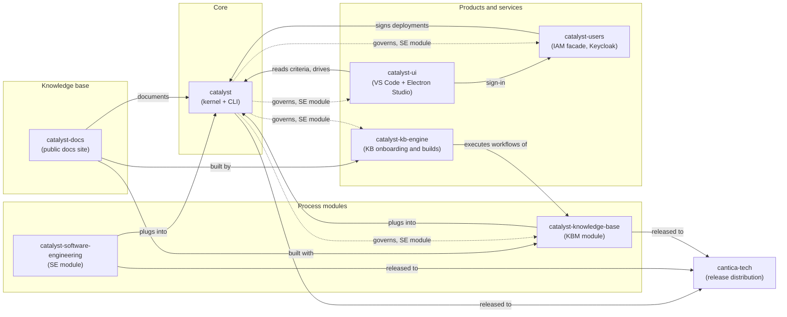

# How the catalyst projects fit together

Solid arrows: runtime or build dependencies. Dotted arrows from `catalyst`:
the project is itself a catalyst deployment (its criterion uses the SE
module); `catalyst-docs` is a deployment using KBM alone.
